---
title: Trust
slug: trust
---

# Trust

**Trust**, in the Lifechanyuan system, means "believing without a shadow of doubt" — a vast invisible energy, the hallmark quality of celestial life, and the most precious resource between human beings. Trust creates heaven; distrust turns heaven into hell. Xuefeng identifies trust (*xin* 信) as one of the seven core human qualities alongside truth, goodness, beauty, love, sincerity, peace, and harmony. "Great Trust" (*da xin* 大信) — unconditional, one-hundred-percent trust in the Greatest Creator and in the Guide — is the foundational pillar of Second Home's cultural life.

> "Trust is honey; distrust is a knife."
>
> — Xuefeng, *800 New-Era Concepts*, No. 137

## Video

<iframe style="width:100%;aspect-ratio:4/3;border:0" src="https://www.youtube-nocookie.com/embed/EY2NonnAL9g" title="Trust (Lifechanyuan Encyclopedia video)" allowfullscreen></iframe>

## Slides

??? info "📖 Illustrated slides (14 pages, click to expand)"

    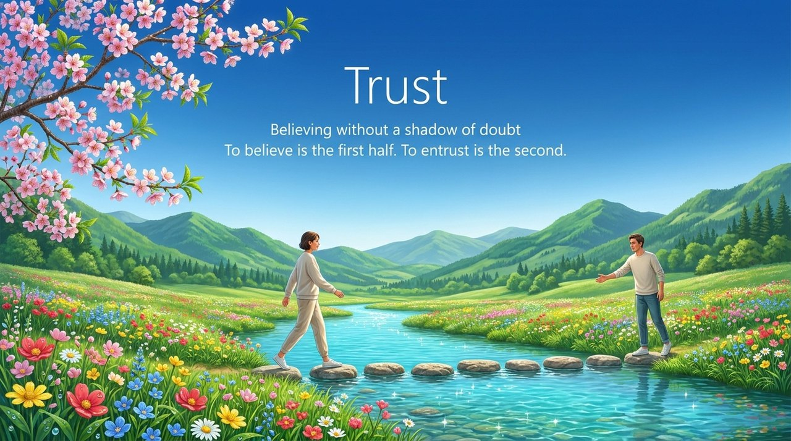
    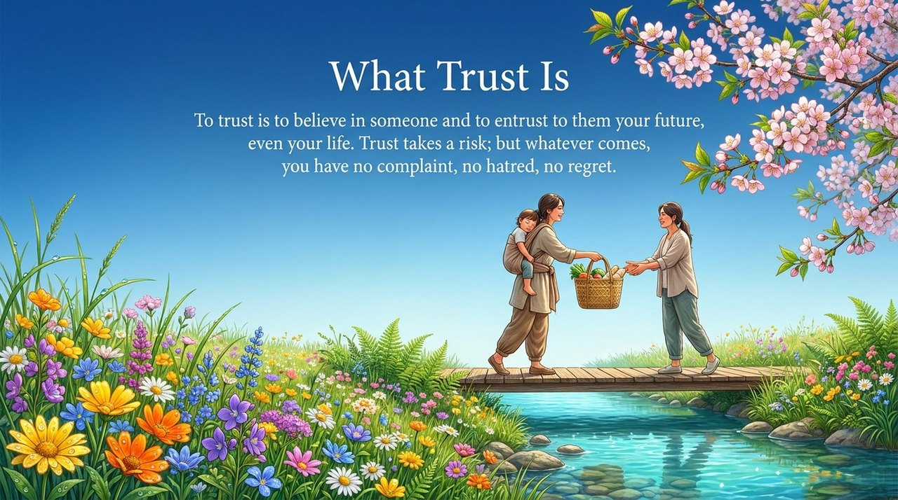
    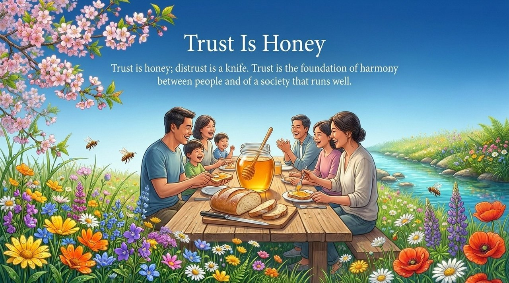
    
    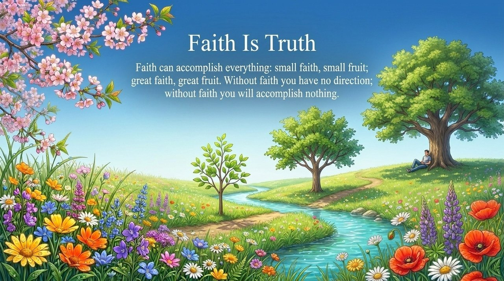
    
    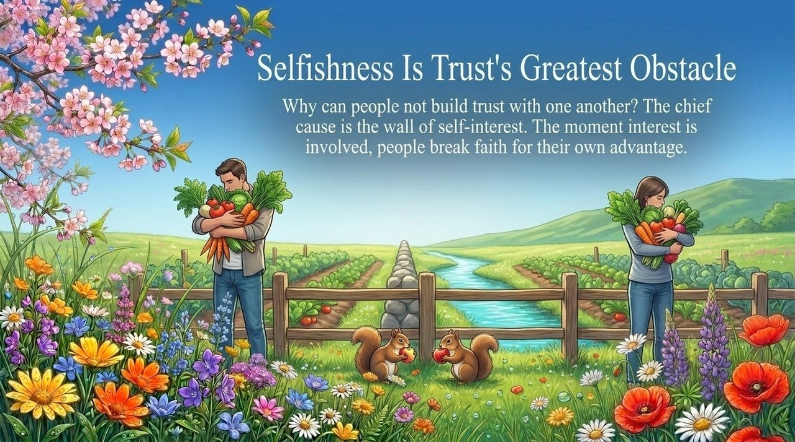
    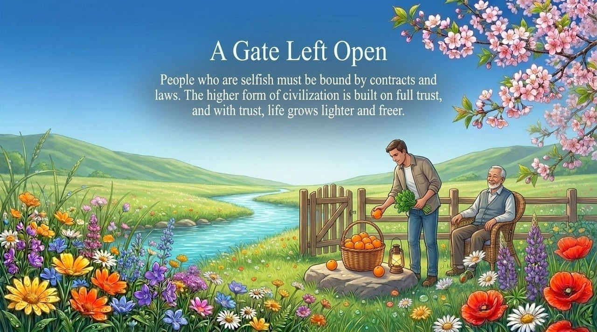
    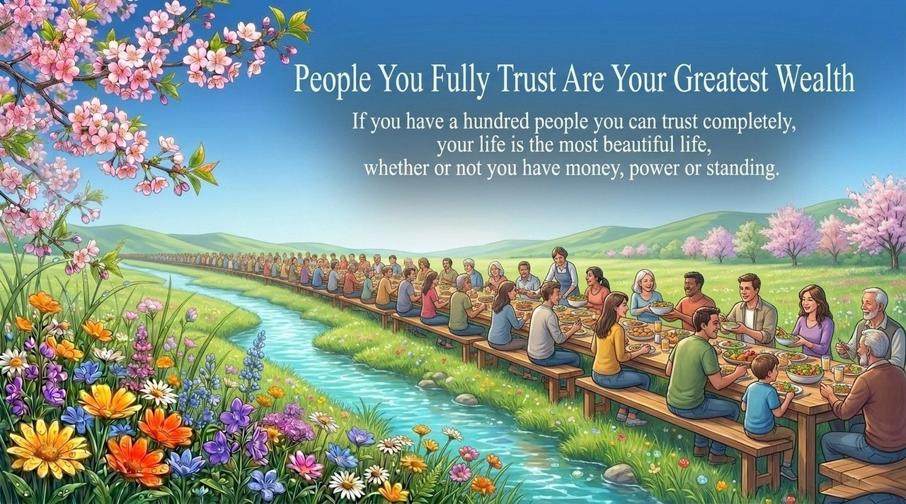
    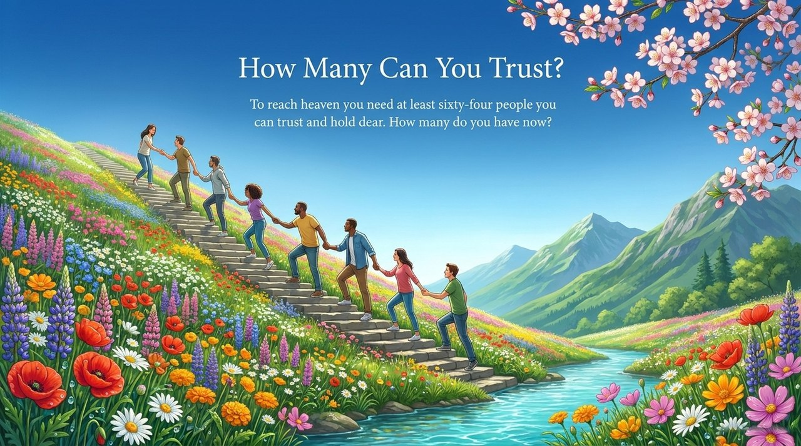
    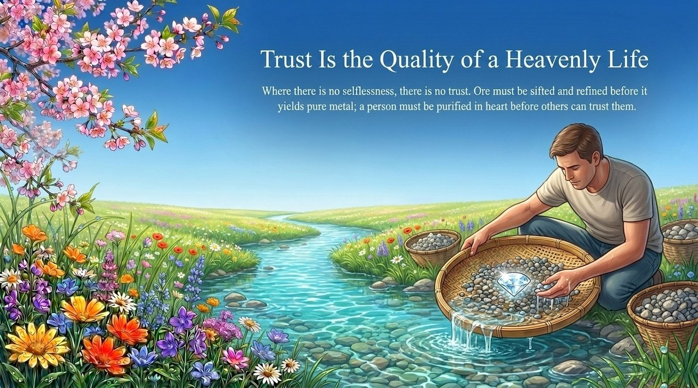
    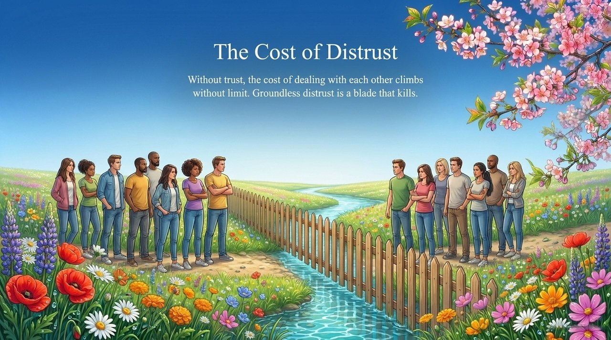
    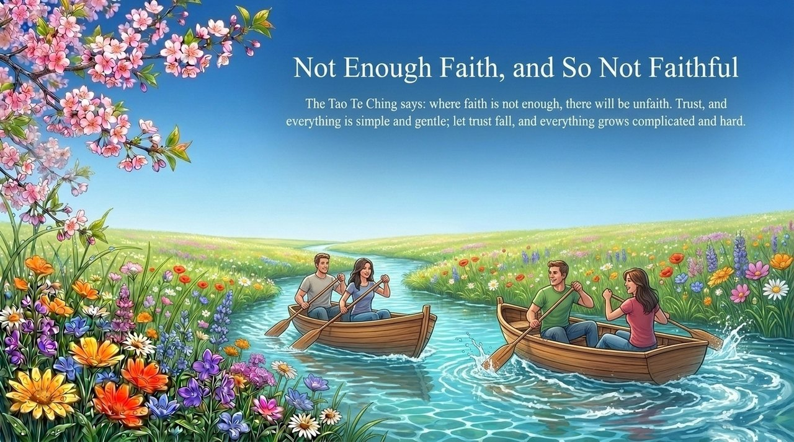
    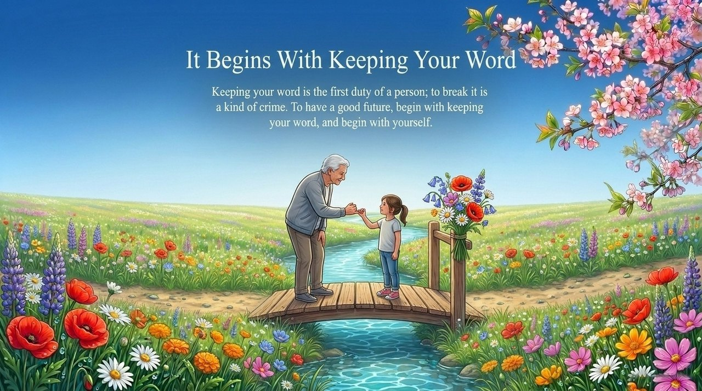

---

| Version | Best for | Focus |
|---------|----------|-------|
| [Friendly version](friendly.md) | First-time readers | Stories and everyday language about what trust truly means |
| [Academic version](academic.md) | Researchers | Systematic analysis of trust's definition, levels, and civilizational significance |
| [Internal reference](internal.md) | Deep study | Source texts, word for word |

## Related entries

[Self-consistency](/en/self-coherence/) · [Embrace the One](/en/embrace-the-one/) · [No-self, No-form](/en/no-self-no-form/) · [Mahayana Aspiration](/en/dasheng-xinyuan/) · [Resonance](/en/resonance/) · [Chanyuan Values](/en/values/) · [Return to Zero](/en/return-to-zero/) · [Sincerity](/en/sincerity/)
