<!-- id: LC-TRU-0001-EN theme: Six LIFE Qualities type: Gateway Page direction: Cultivation Practice lang: en -->

# Truth (真 Zhēn)

[Entry Gateway]

> In Lifechanyuan terminology, **LIFE** (capitalized) refers to the ontological
> essence of existence — the soul/antimatter structure that persists across
> incarnations — while **life** (lowercase) refers to the experiential stage
> of human existence in this world.

**Truth** (真, Zhēn) is the foremost of the six core LIFE qualities — Truth, Goodness, Beauty, Love, Faith, and Sincerity — and the ontological foundation of the universe, the very attribute of the Greatest Creator, and the ultimate direction of all cultivation. There is only one Truth in the universe: the Greatest Creator himself. Everything else is illusion and artistic expression.

> There is only one Truth in the universe. Apart from the Greatest Creator, everything else is an illusion — an artistic expression of the Greatest Creator.
>
> — Guide Xuefeng, *Xuefeng Corpus · Soul Section*

---

## Core Positioning

In the Lifechanyuan system, Truth operates on two levels: cosmologically, it is the nature of the Greatest Creator and the substance of all things; in daily conduct, it means "say yes when it is yes, say no when it is no" — faithfully reflecting reality. Lies and falsehood are tickets to hell; honesty leads to a beautiful LIFE destination.

---

## Video

<iframe style="width:100%;aspect-ratio:4/3;border:0" src="https://www.youtube-nocookie.com/embed/Xxf7TxNTyz8" title="Truth (Lifechanyuan Encyclopedia video)" allowfullscreen></iframe>

## Slides

??? info "📖 Illustrated slides (14 pages, click to expand)"

    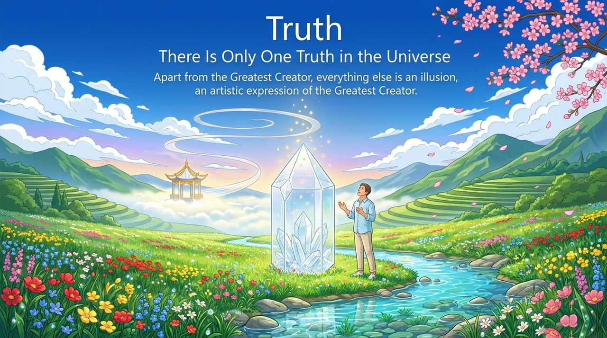
    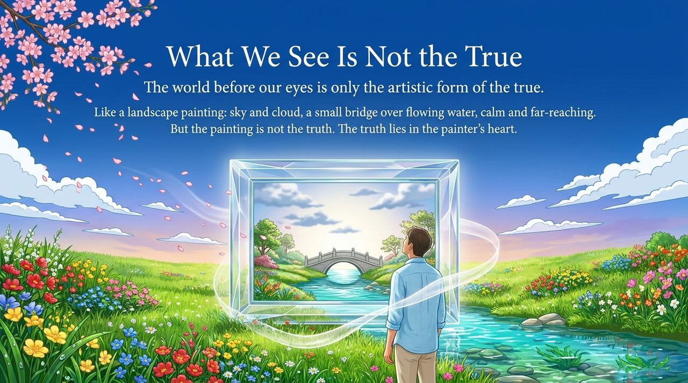
    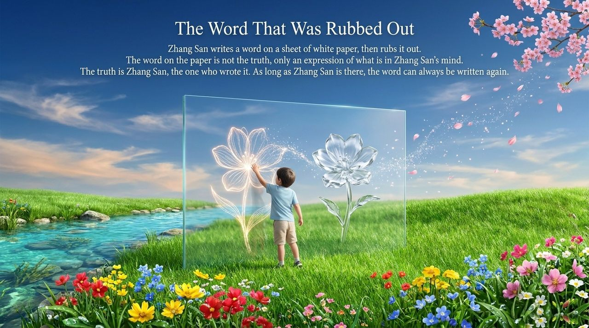
    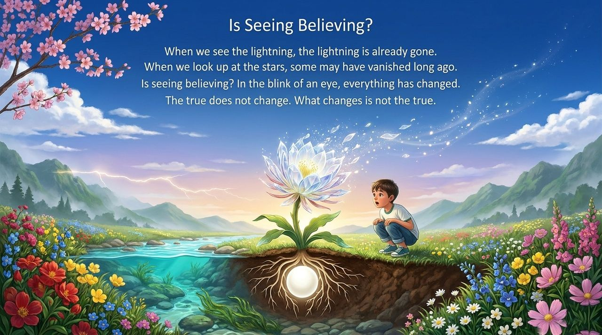
    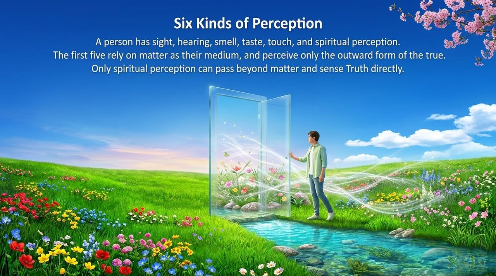
    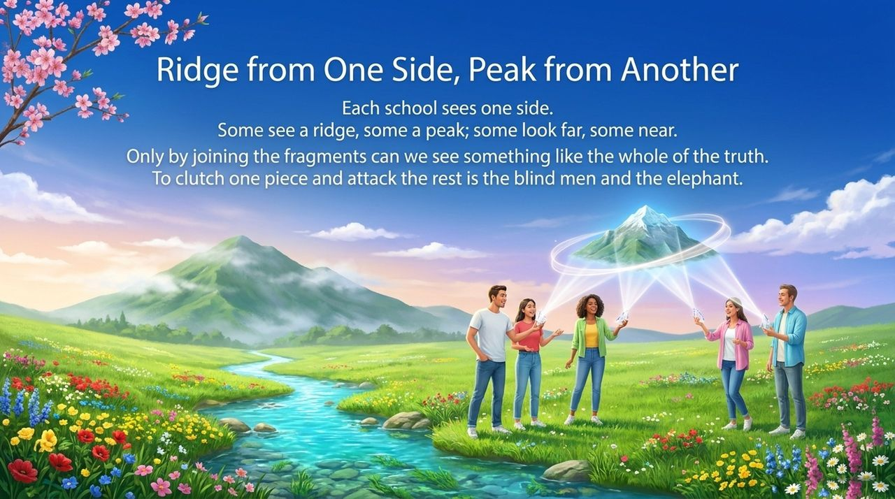
    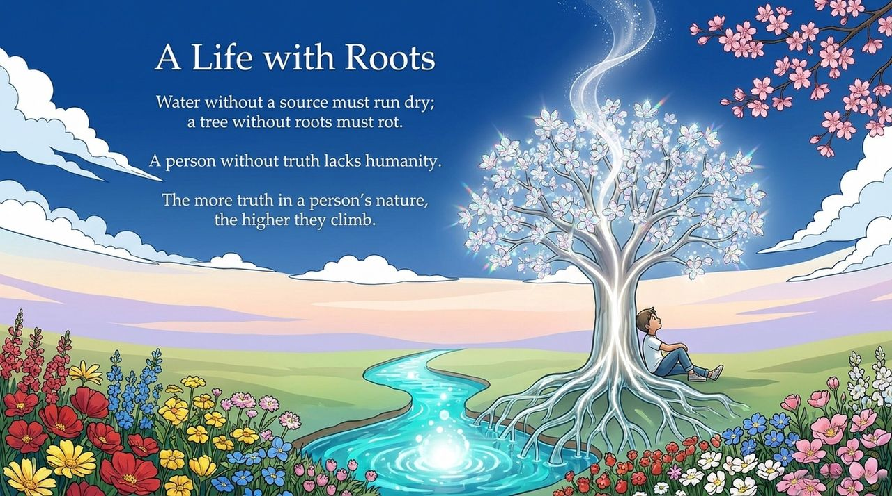
    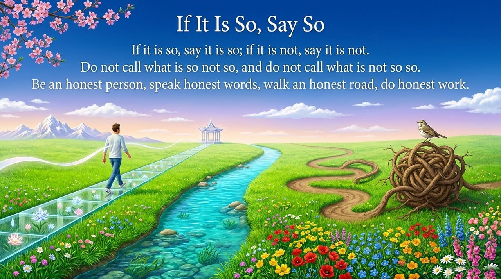
    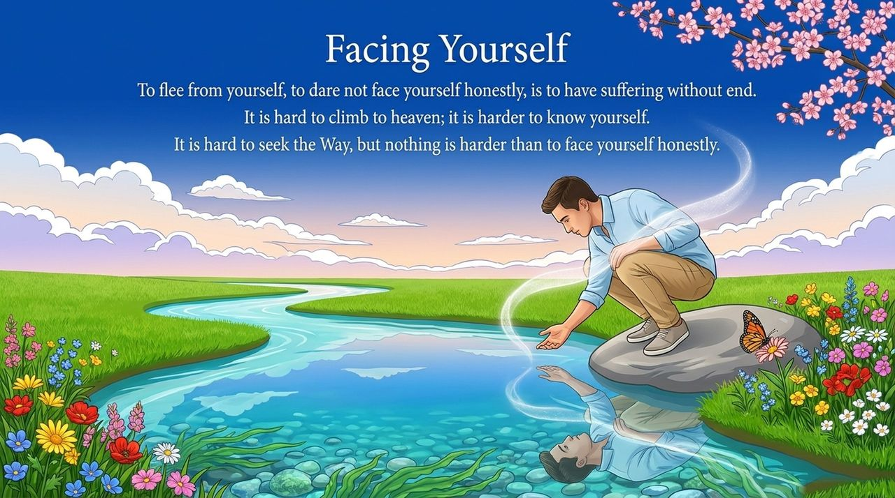
    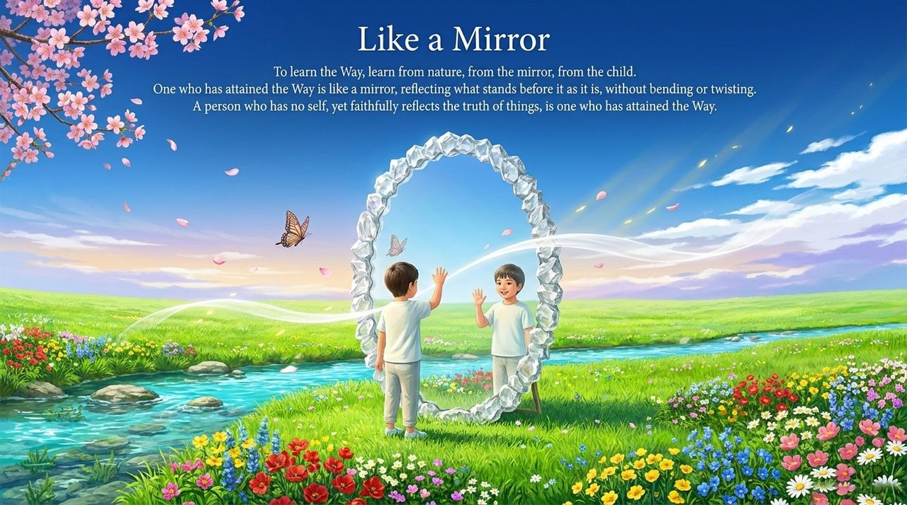
    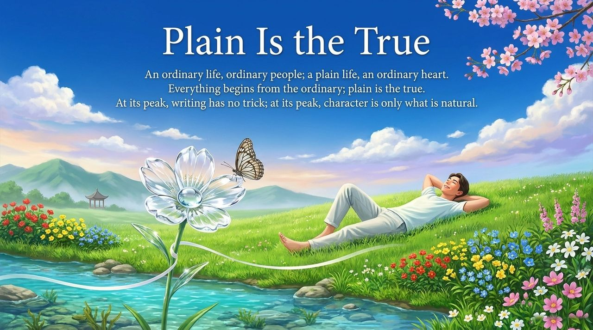
    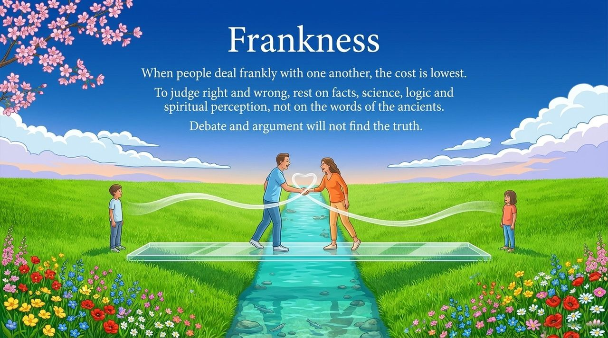
    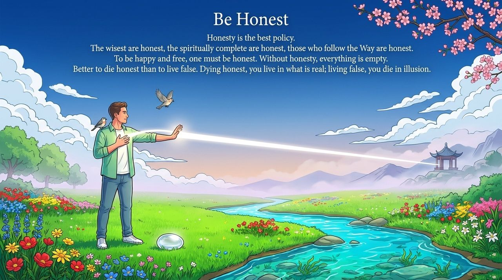
    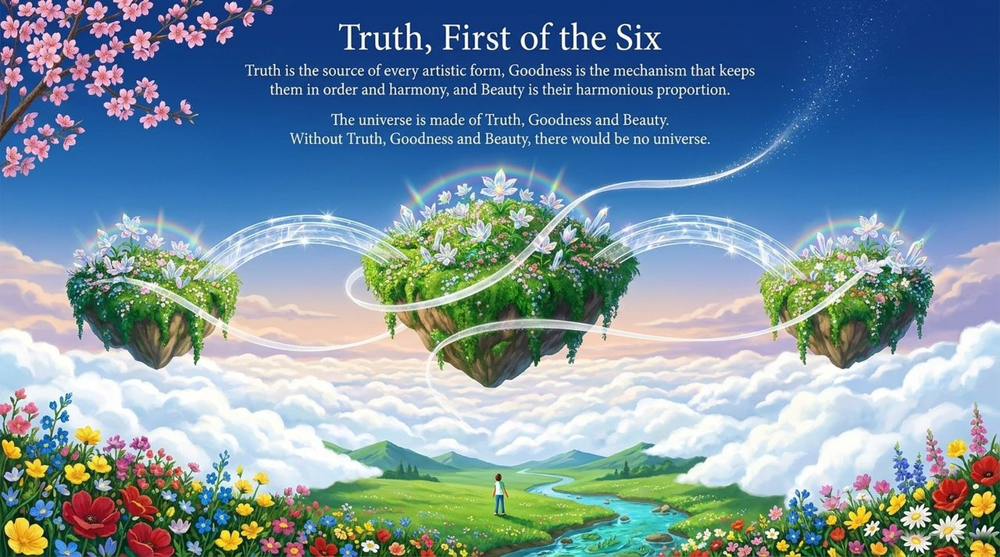

---

## Read by Edition

| Edition | Intended Reader | Link |
|---------|----------------|-------|
| **Friendly Edition** | Readers new to Lifechanyuan concepts | [Read Friendly Edition](./friendly) |
| **Academic Edition** | Researchers with philosophical/religious studies background | [Read Academic Edition](./academic) |
| **Internal Edition** | Chanyuan Celestials and deep practitioners | [Read Internal Edition](./internal) |

---

## Related Entries

- [Six Qualities](/en/six-qualities/) — The integrated system of Truth, Goodness, Beauty, Love, Faith, and Sincerity
- [Goodness](/en/goodness/) · [Beauty](/en/beauty/) · [Love](/en/love/) · [Faith](/en/faith/) · [Sincerity](/en/sincerity/) — The other five core LIFE qualities
- [Soul Garden](/en/soul-garden/) — Truth is the most essential seed in the soul garden
- [The Greatest Creator](/en/greatest-creator/) — The only Truth in the universe
