<!-- id: LC-UO-0001-EN theme: Universe-LIFE System type: Gateway Page direction: Cosmogenesis lang: en -->

# Cosmic Origin

[Entry Gateway]

> In Lifechanyuan terminology, **LIFE** (capitalized) refers to the ontological
> essence of existence — the soul/antimatter structure that persists across
> incarnations — while **life** (lowercase) refers to the experiential stage
> of human existence in this world.

**Cosmic Origin** (宇宙起源) is a foundational entry in the Lifechanyuan cosmology. The universe is not a product of chance — it is the product of the Greatest Creator's consciousness. The cosmological sequence: Wuji (pre-structured potential) → Taiji (the Greatest Creator) → structured energy unfolds into the thirty-six-dimensional universe. The universe is consciousness made manifest.

> Wuji gives rise to Taiji; Taiji is the Greatest Creator. Taiji arises naturally; therefore nature is the Greatest Creator.
>
> — Guide Xuefeng, *New Era Human 800 Concepts*

---

## Core Positioning

In the Lifechanyuan system, cosmic origin is not a Big Bang event but a consciousness-genesis sequence: from unordered energy (Wuji) to ordered structure generating consciousness (Taiji / the Greatest Creator), to the unfolding of the thirty-six-dimensional universe as the Greatest Creator's artistic expression of Truth, Goodness, and Beauty.

---

## Read by Edition

| Edition | Intended Reader | Link |
|---------|----------------|-------|
| **Friendly Edition** | Readers new to Lifechanyuan concepts | [Read Friendly Edition](./friendly) |
| **Academic Edition** | Researchers with philosophical/religious studies background | [Read Academic Edition](./academic) |
| **Internal Edition** | Chanyuan Celestials and deep practitioners | [Read Internal Edition](./internal) |

---

## Video

<iframe style="width:100%;aspect-ratio:4/3;border:0" src="https://www.youtube-nocookie.com/embed/gczmtM7X5KE" title="Cosmic Origin (Lifechanyuan Encyclopedia video)" allowfullscreen></iframe>

## Slides

??? info "📖 Illustrated slides (14 pages, click to expand)"

    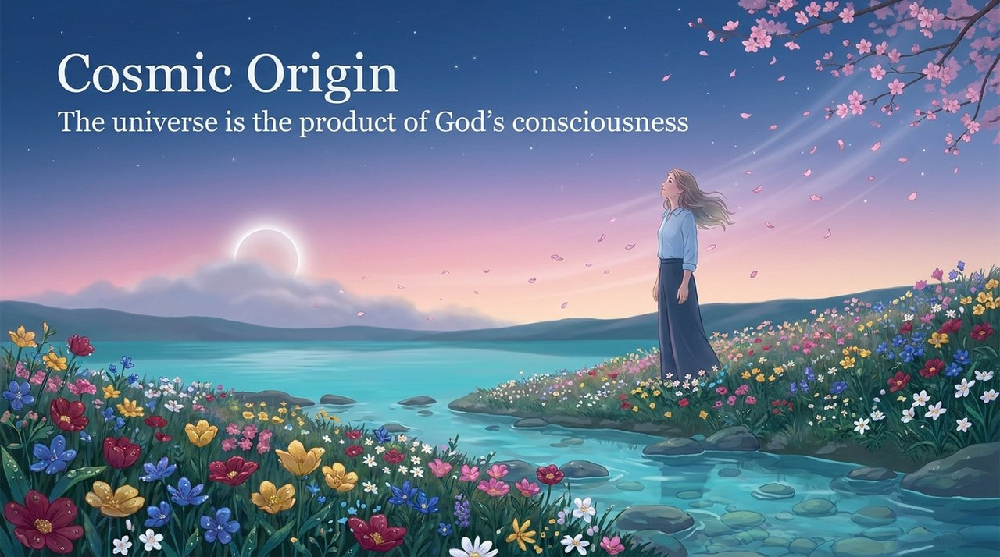
    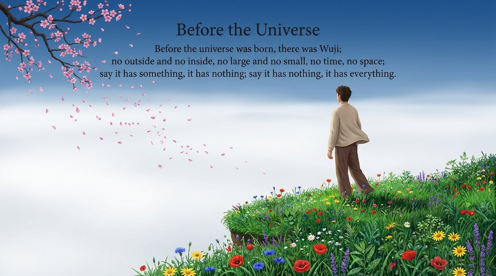
    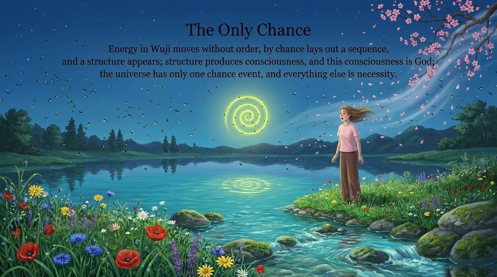
    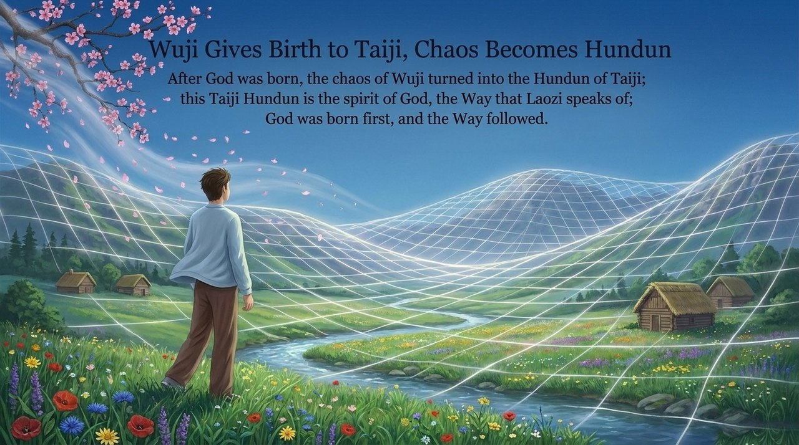
    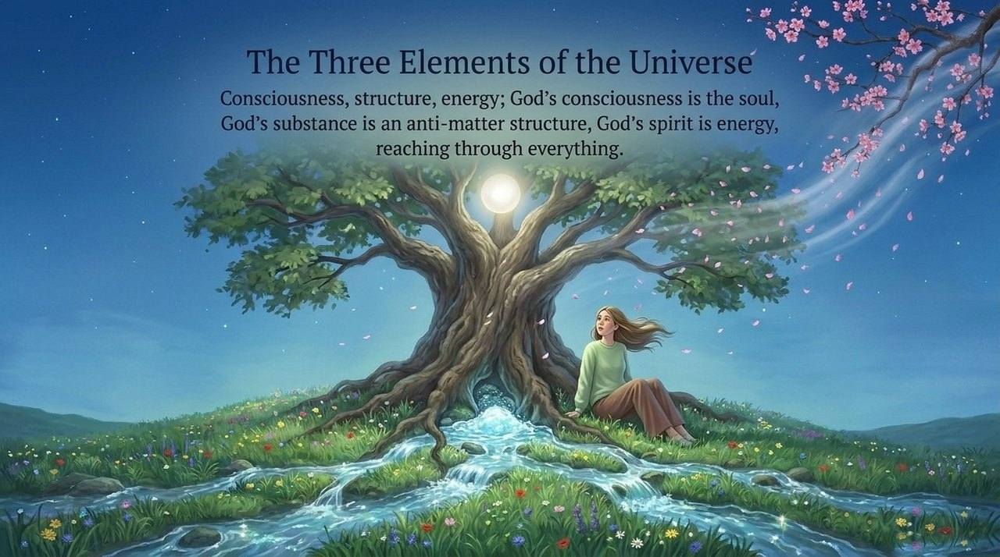
    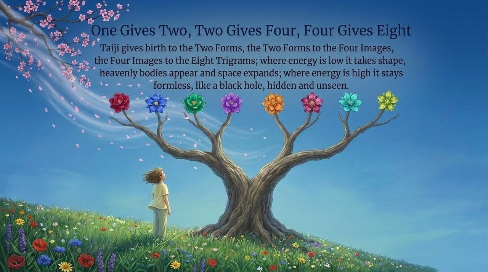
    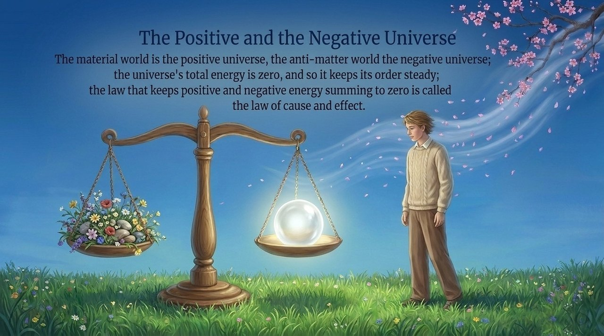
    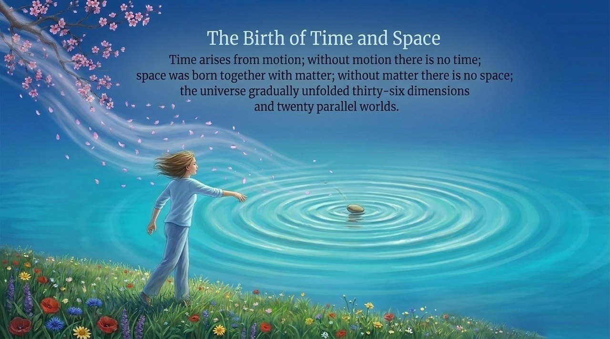
    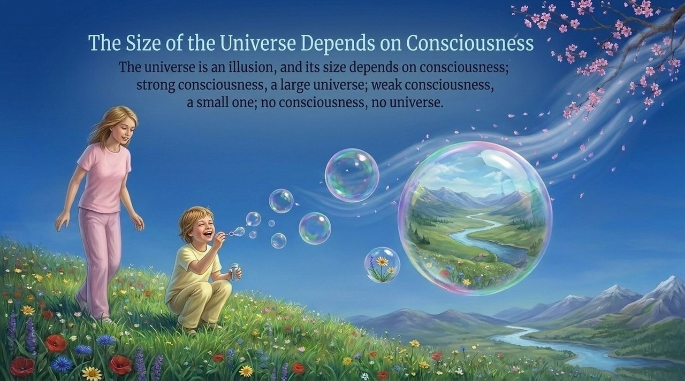
    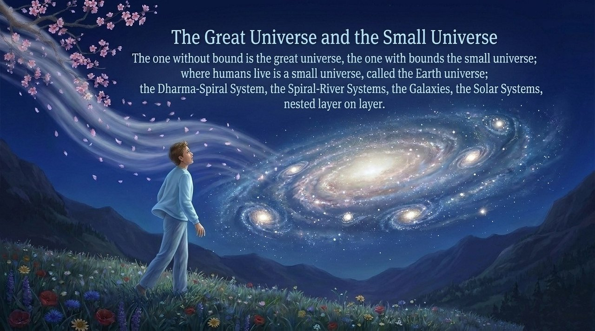
    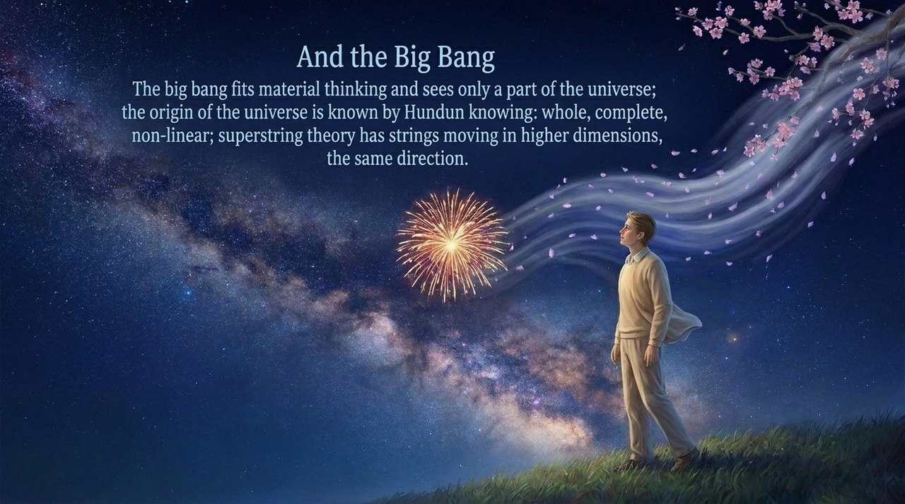
    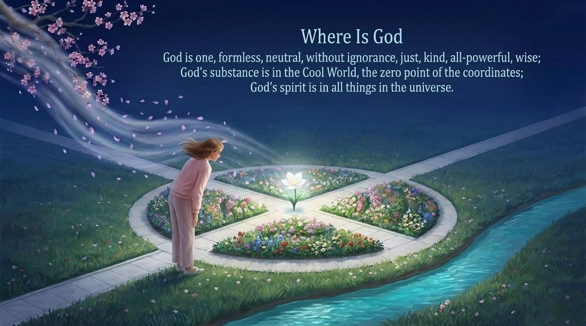
    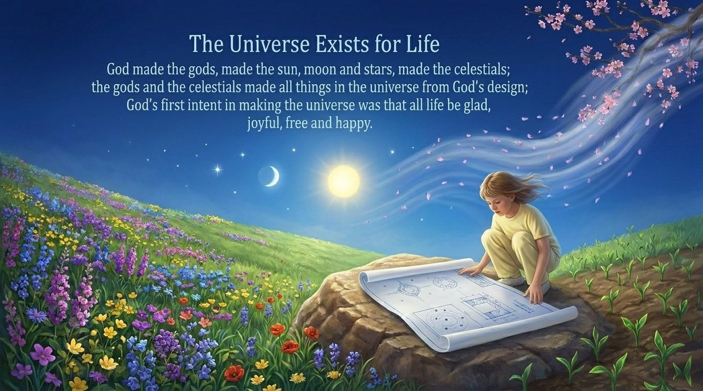
    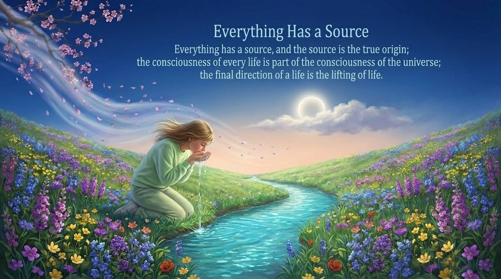

---

## Related Entries

- [Wuji](/en/wuji/) — The pre-universe state; the starting point of the cosmological sequence
- [Taiji](/en/taiji/) — Wuji gives rise to Taiji; the emergence of the Greatest Creator
- [Consciousness](/en/consciousness/) — Consciousness is the first of the Three Cosmic Elements; the mechanism of cosmic creation
- [Thirty-Six-Dimensional Space](/en/thirty-six-dimensional-space/) — The structural model of the universe that emerged
- [The Greatest Creator](/en/greatest-creator/) — The creator of the universe whose consciousness generated all existence
