# Utopia

> **The Thousand-Year World of Heaven is a through-and-through, pure and genuine Utopia that has been running perfectly and in good order for hundreds of thousands of years.**
>
> — Xuefeng, *Hayek's Ignorance of Utopia*

## Video

<iframe style="width:100%;aspect-ratio:4/3;border:0" src="https://www.youtube-nocookie.com/embed/WNIIGHro2Nc" title="Utopia (Lifechanyuan Encyclopedia video)" allowfullscreen></iframe>

## Slides

??? info "📖 Illustrated slides (14 pages, click to expand)"

    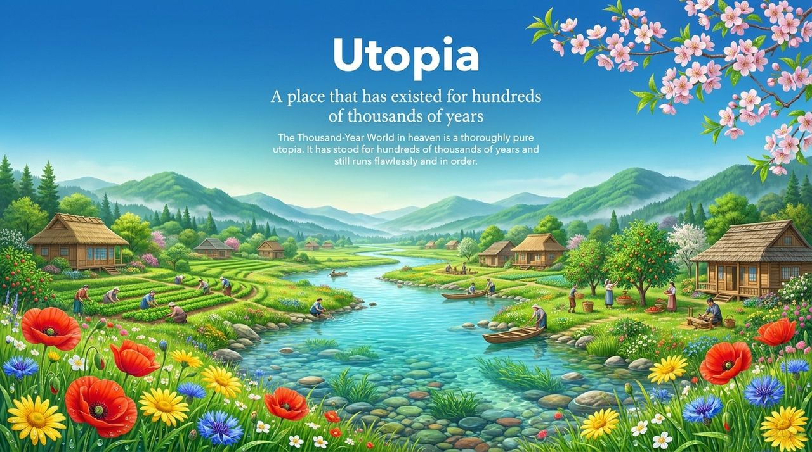
    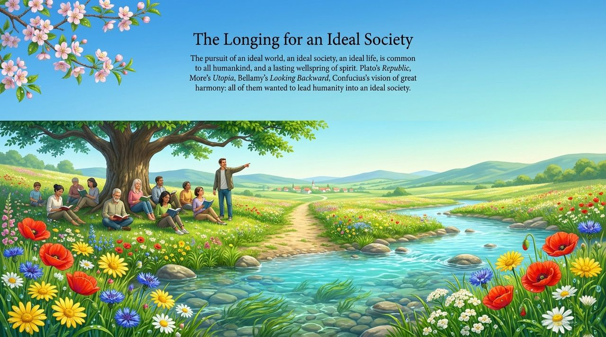
    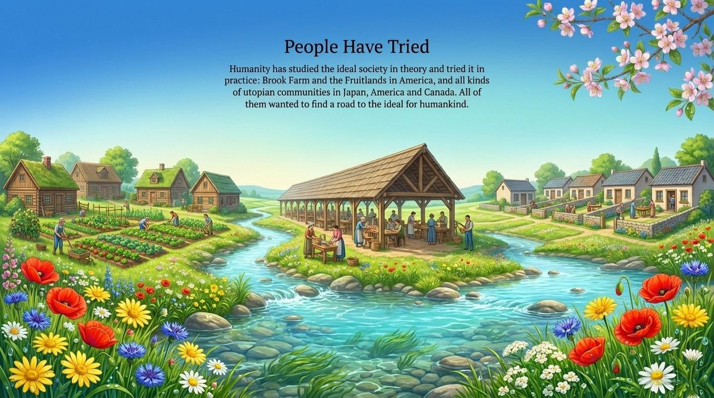
    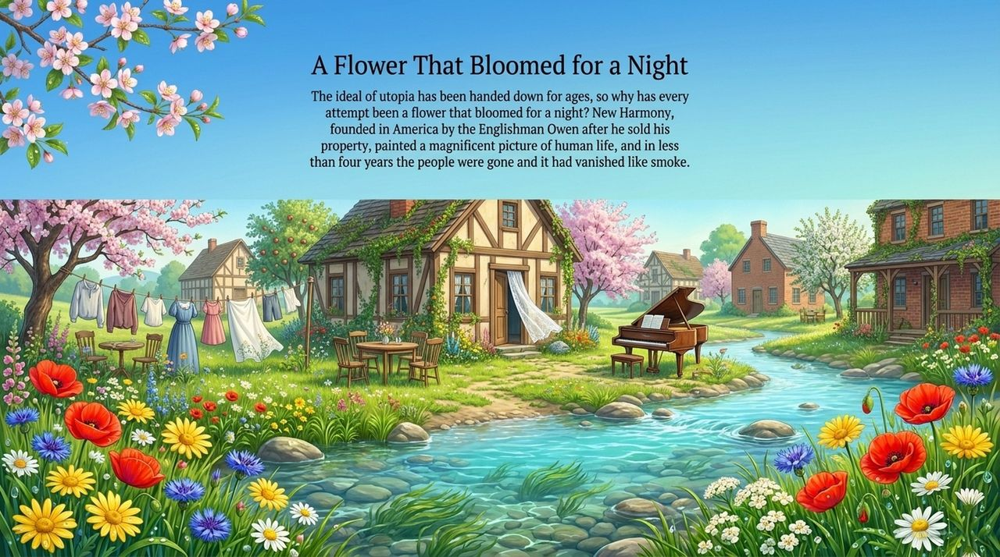
    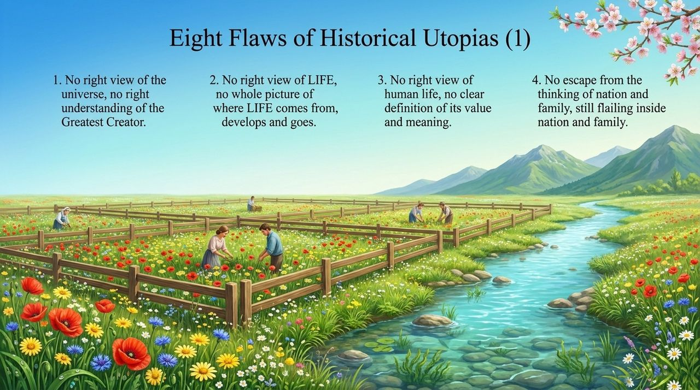
    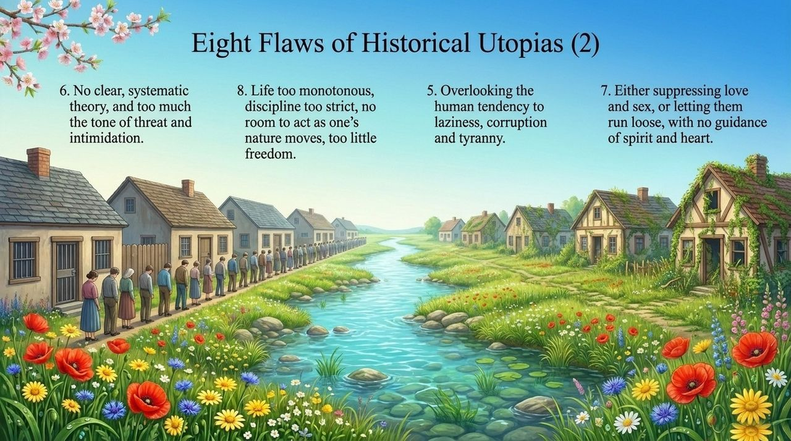
    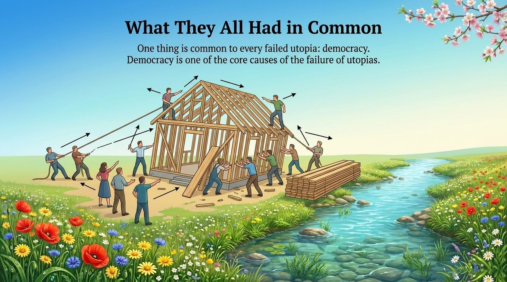
    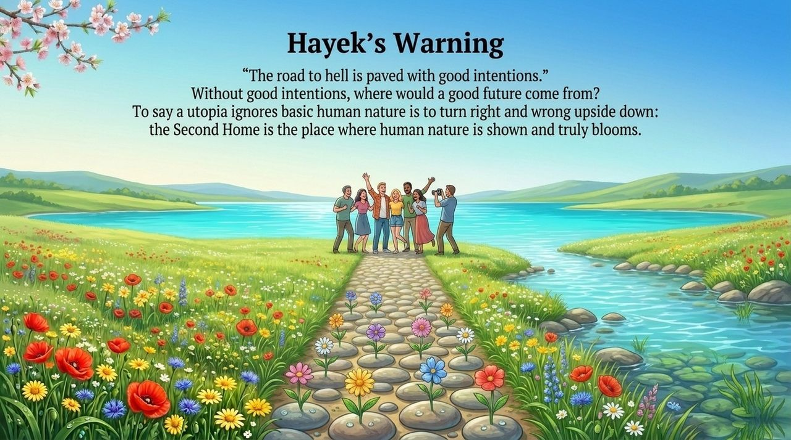
    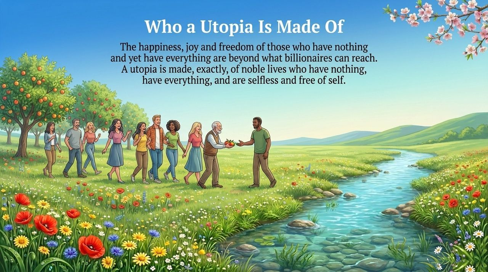
    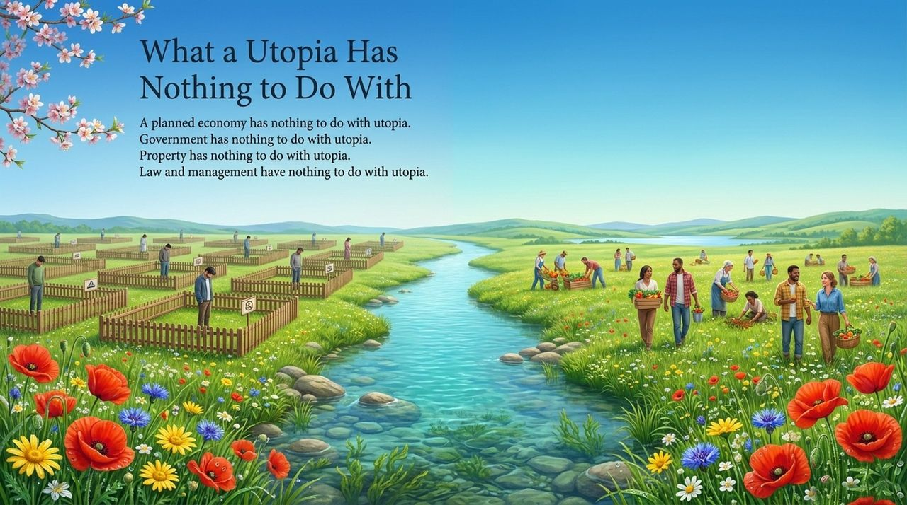
    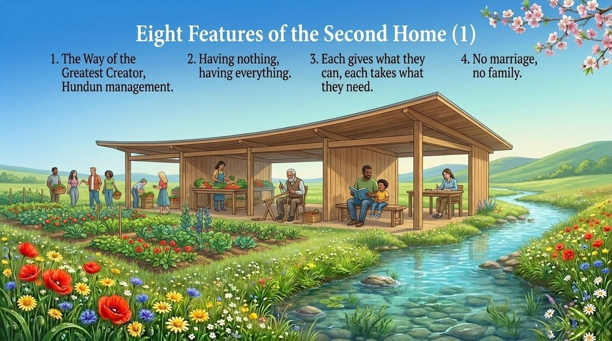
    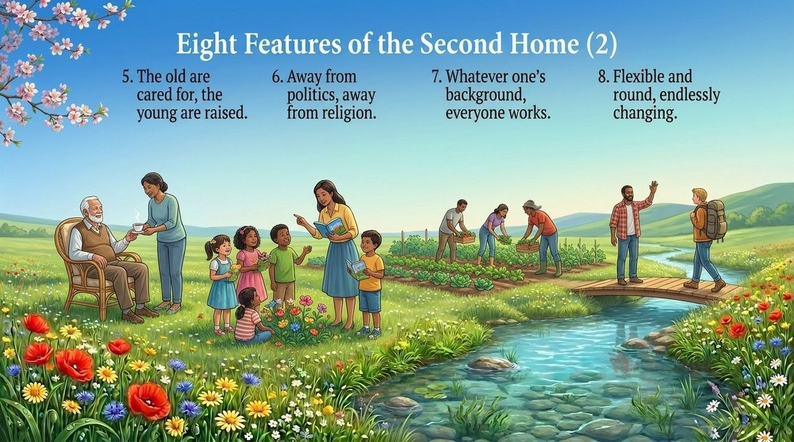
    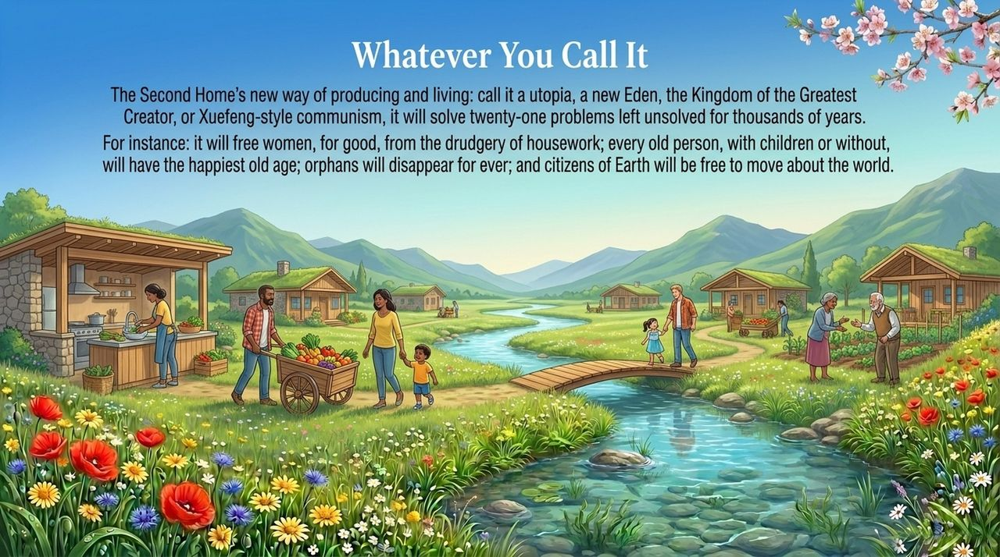
    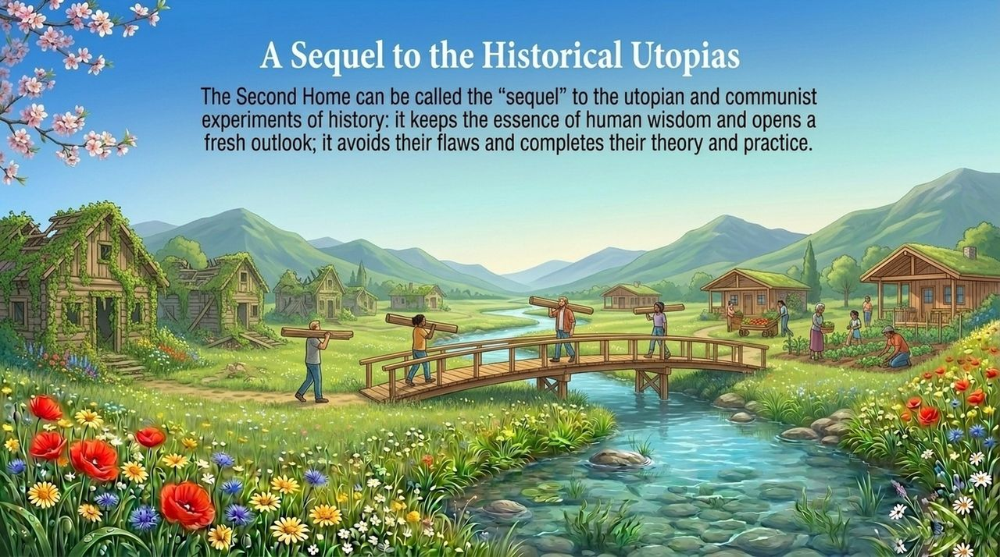

---

| Version | Best for | Focus |
|---------|----------|-------|
| [Friendly version](friendly.md) | First-time readers | What true Utopia means and why the Second Home is not wishful thinking |
| [Academic version](academic.md) | Researchers | Utopia in Lifechanyuan's social theory and its critique of rationalist objections |
| [Internal reference](internal.md) | Deep study | Full original-text compilation with citations |

## Overview

In the Lifechanyuan system, "Utopia" is a positive, substantive concept — not a synonym for impossible dreaming, but the legitimate pursuit of people who possess a consciousness of Heaven. Guide Xuefeng systematically refutes the critiques of thinkers like Hayek, and offers two forms of evidence that Utopia is already real: the Thousand-Year World of Heaven (which has operated perfectly for hundreds of thousands of years) and the Second Home community (which embodies the highest ideal of human life on Earth today).

Historical utopian experiments failed not because Utopia itself is flawed, but because they lacked the correct worldview, life-view, and cosmic consciousness that would allow them to function. The Second Home represents the "sequel" to all previous utopian practice.

## Related Entries

- [Second Home](/en/second-home/) · [Xuefeng-Style Communism](/en/xuefeng-communism/) · [Civilization 3.0](/en/civilization-3-0/)
- [Contribute by Ability, Take by Need](/en/contribute-by-ability-take-by-need/) · [Hundun Management](/en/hundun-management/) · [Steadfast Principles, Trust the Home](/en/steadfast-principles-trust-home/)
- [Thousand-Year World](/en/thousand-year-world/) · [Lifechanyuan New Era](/en/lifechanyuan-new-era/) · [Lifechanyuan Values](/en/values/)
