<!-- id: LC-VMP-0001-EN theme: Cultivation Practice type: Index direction: Cultivation Practice lang: en -->

# The Value, Meaning & Purpose of Life

**The three terms point to distinct realities** — the value of life lies in whether LIFE can extend to higher life spaces; its meaning is to create wealth and joy, to please the Greatest Creator, and to seek the Tao and become a Celestial Being; its purpose is to dissolve karma and transform, while living a present life of joy, happiness, freedom, and bliss. Human life is a brief journey in the long river of LIFE — fully using the value of this journey makes it possible to "transform decay into wonder, and death into eternity."

---

## Version Navigator

## Video

<iframe style="width:100%;aspect-ratio:4/3;border:0" src="https://www.youtube-nocookie.com/embed/Fl2y5hXJusk" title="The Value, Meaning and Purpose of Life (Lifechanyuan Encyclopedia video)" allowfullscreen></iframe>

## Slides

??? info "📖 Illustrated slides (14 pages, click to expand)"

    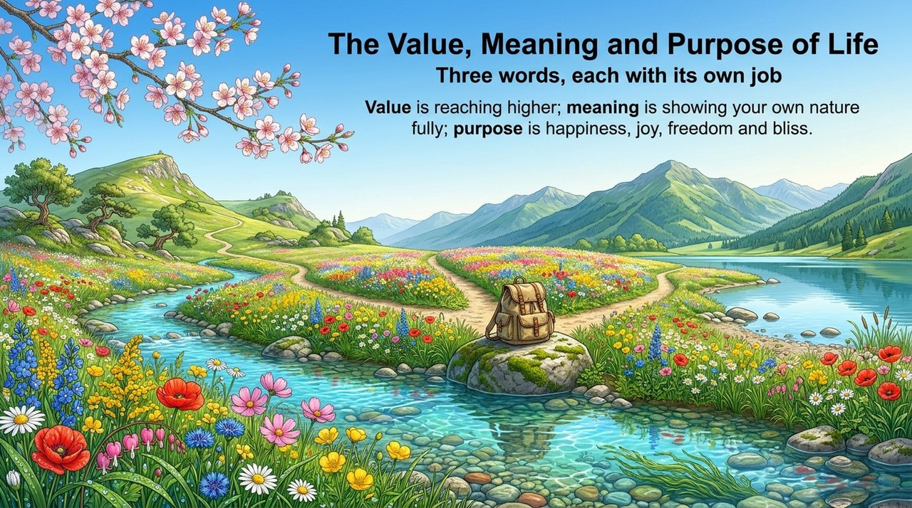
    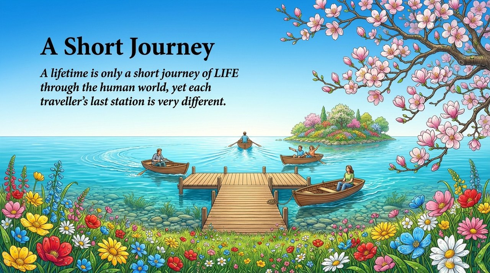
    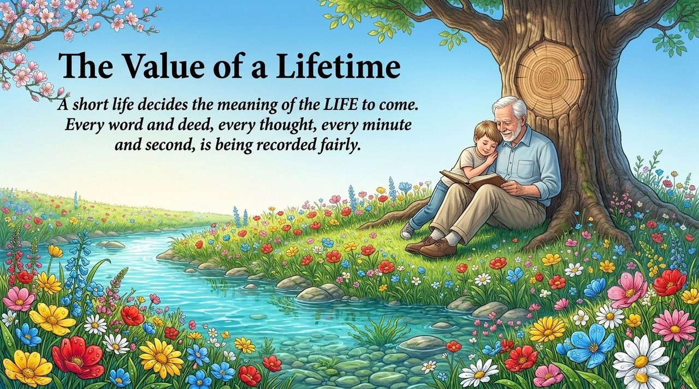
    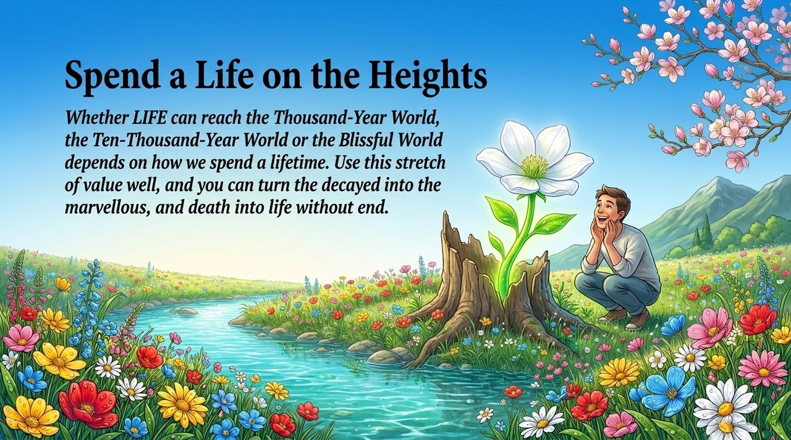
    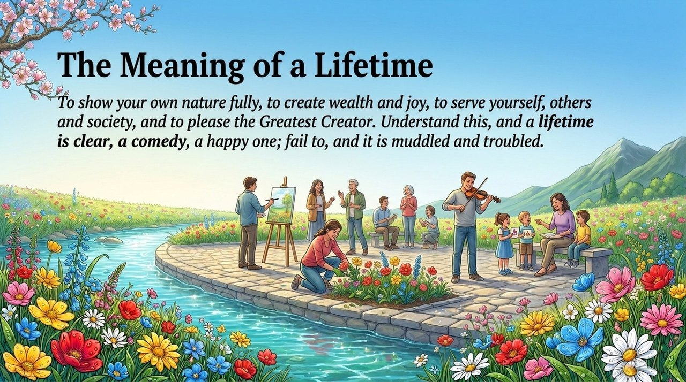
    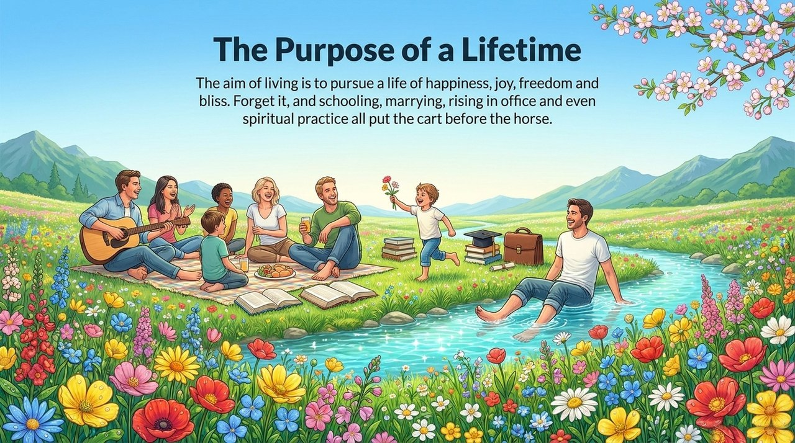
    
    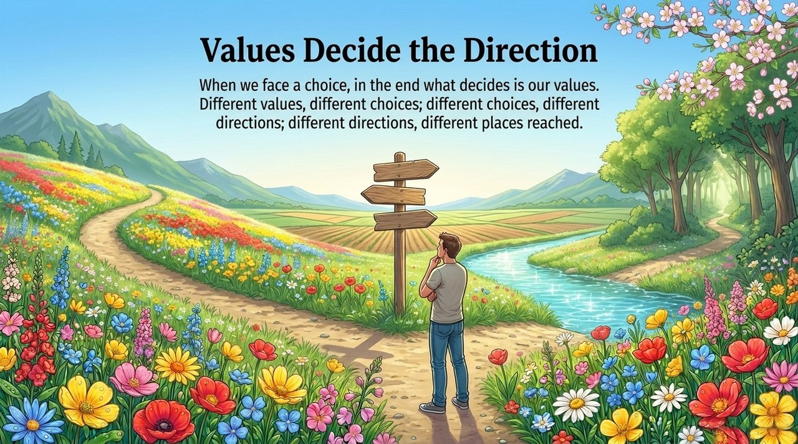
    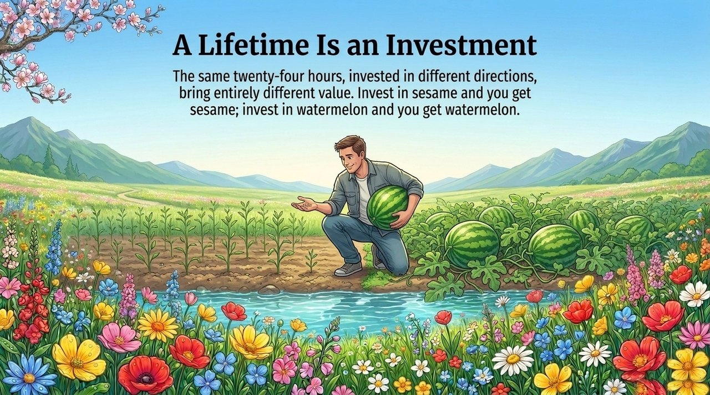
    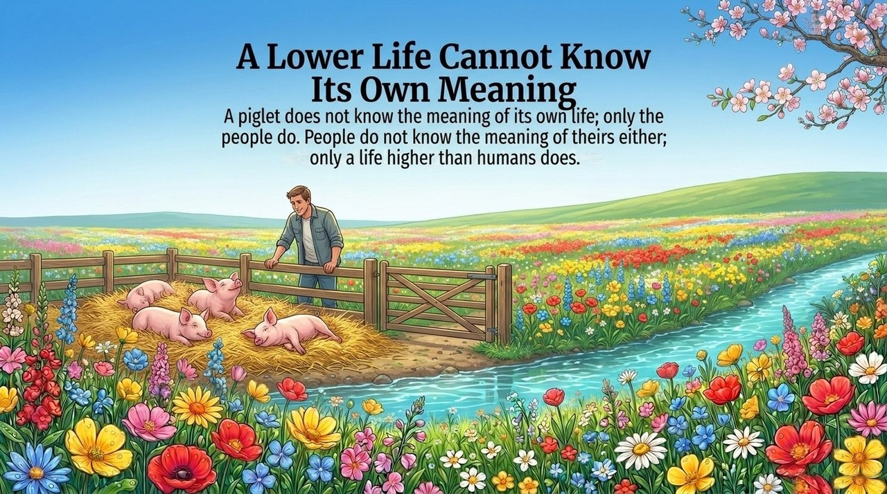
    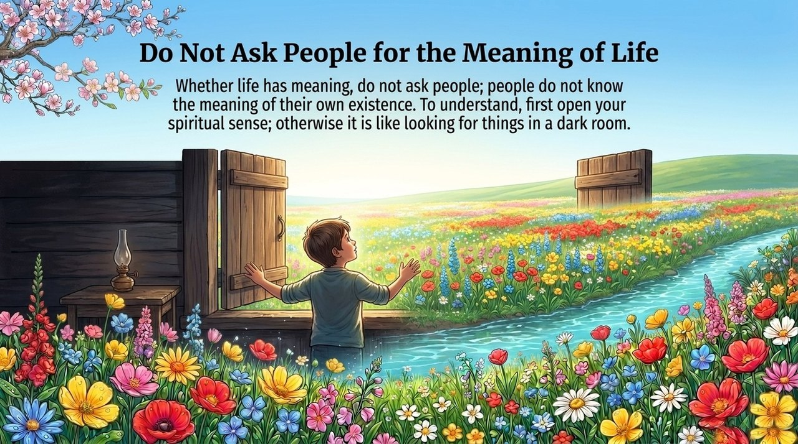
    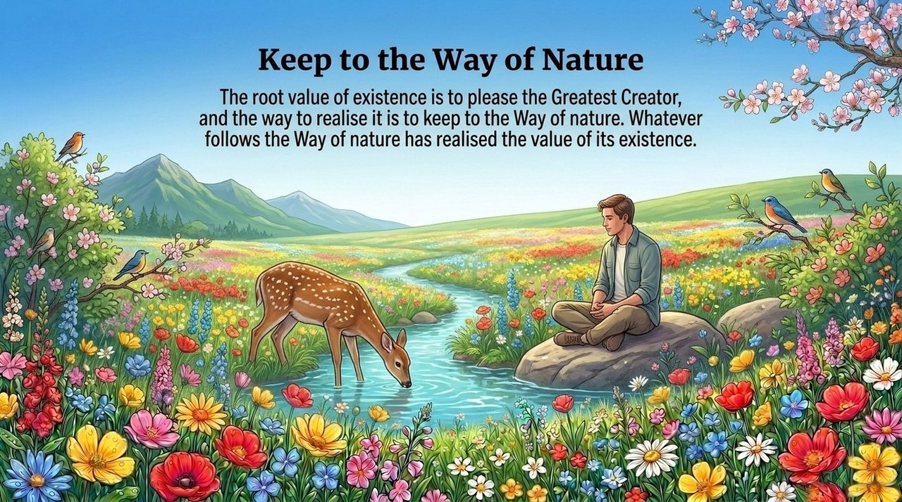
    
    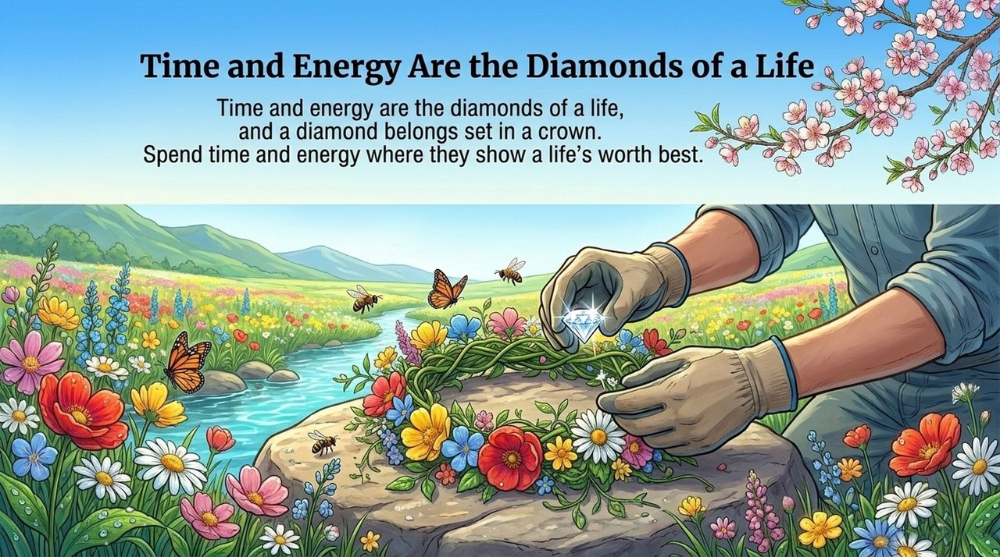

---

| Version | Intended Reader | Core Focus |
|---------|----------------|-----------|
| [Accessible Introduction](friendly.md) | First-time readers | The journey analogy, the two purposes explained plainly, why effort without purpose is wasted effort |
| [Academic Analysis](academic.md) | Researchers | Conceptual structure, value system, comparison with Western existentialism |
| [Internal Edition](internal.md) | In-depth study | Full source quotations across all seven sections |

---

## Related Entries

[LIFE](/en/life/) · [Spirituality](/en/spirituality/) · [Karma, Retribution & Reincarnation](/en/karma-retribution-reincarnation/) · [Awakening](/en/awakening/) · [Becoming a Celestial Being and a Buddha](/en/becoming-celestial-buddha/) · [Kingdom of Heaven](/en/kingdom-of-heaven/) · [Zero-State](/en/zero-state/) · [Self-Coherence](/en/self-coherence/) · [Knowledge, Wisdom & Zhi](/en/knowledge-wisdom-zhi/)
