<!-- id: LC-WD-0001-EN theme: Cultivation Practice type: Entry Index lang: en -->

# Will and Determination (意志)

In Lifechanyuan's framework, *will* (意志, *yìzhì*) is a form of psychic potential energy: the mental and psychological state that arises from a heartfelt wish (*yì*) and sustains itself in pursuit of that wish (*zhì*). Will is latent until action releases it as kinetic energy. A key distinction: will is energy, not structure — no matter how strong one's will, it cannot change LIFE's antimatter structure. Only consciousness can do that. Yet without will as fuel, even the most capable LIFE cannot set sail.

---

## Video

<iframe style="width:100%;aspect-ratio:4/3;border:0" src="https://www.youtube-nocookie.com/embed/Mxl22k_u9xw" title="Will and Determination (Lifechanyuan Encyclopedia video)" allowfullscreen></iframe>

## Slides

??? info "📖 Illustrated slides (14 pages, click to expand)"

    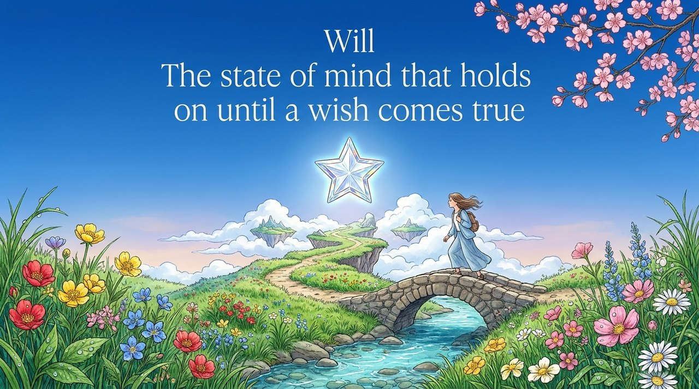
    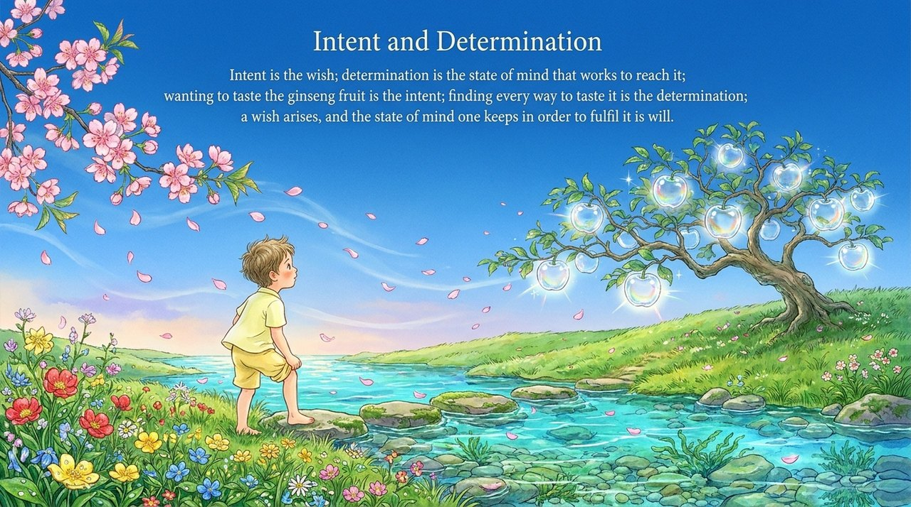
    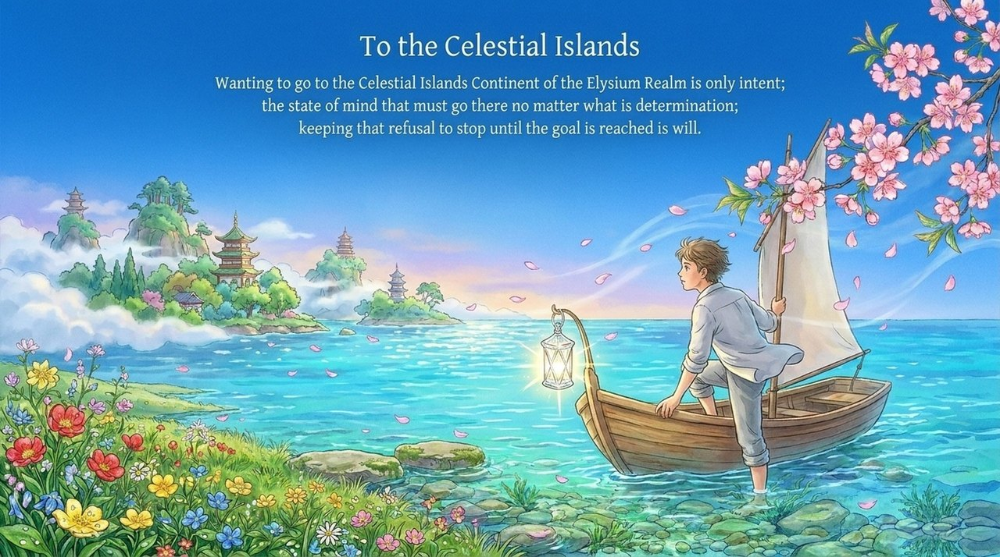
    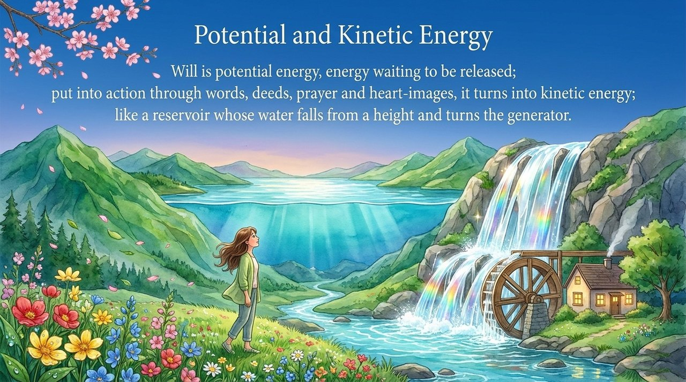
    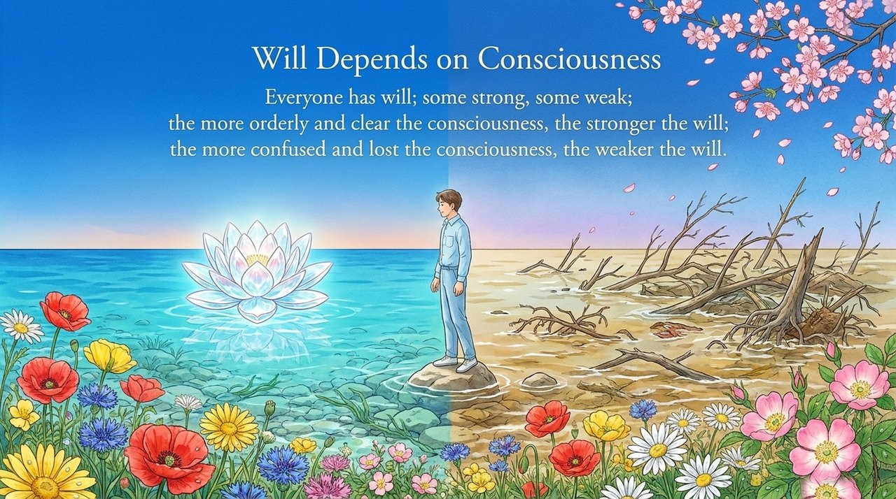
    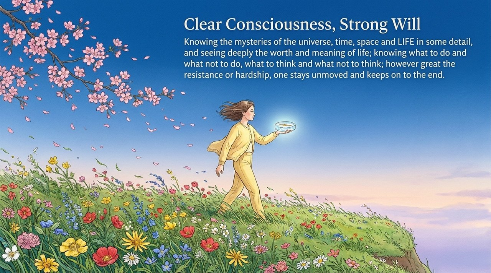
    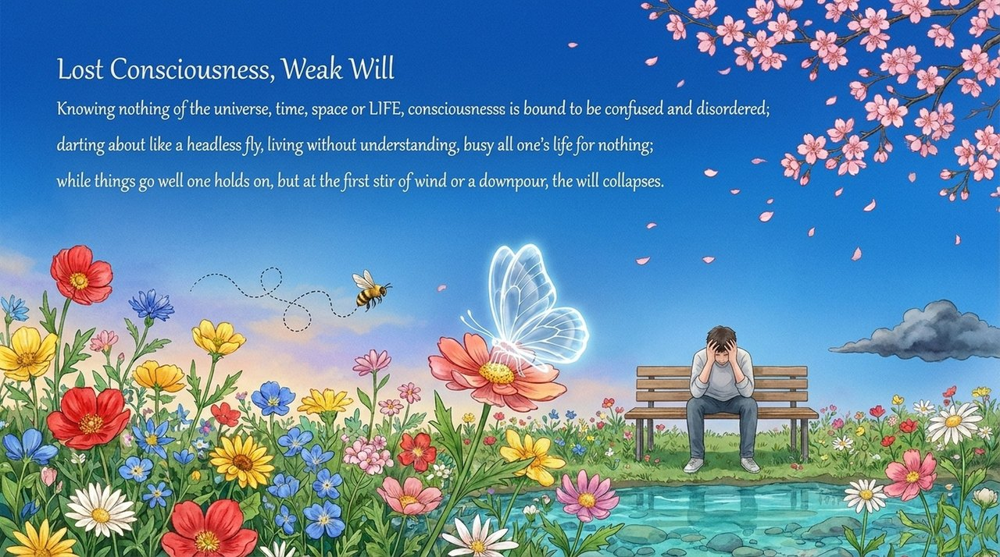
    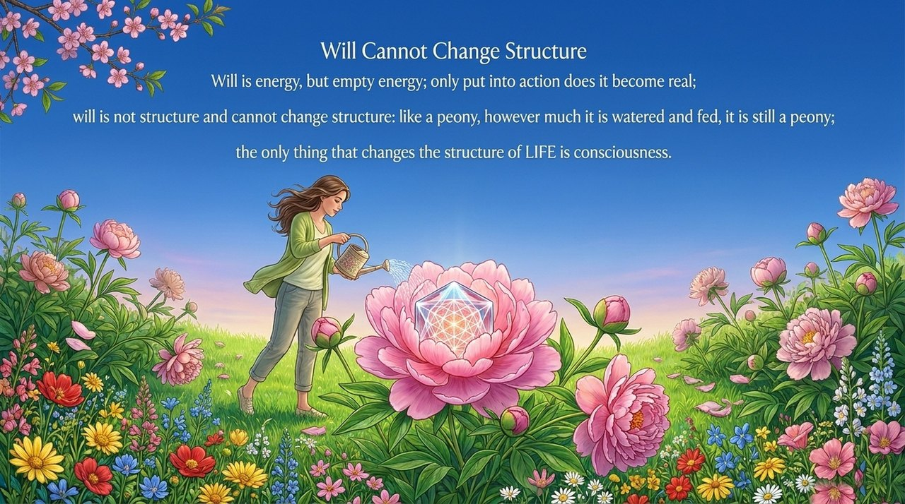
    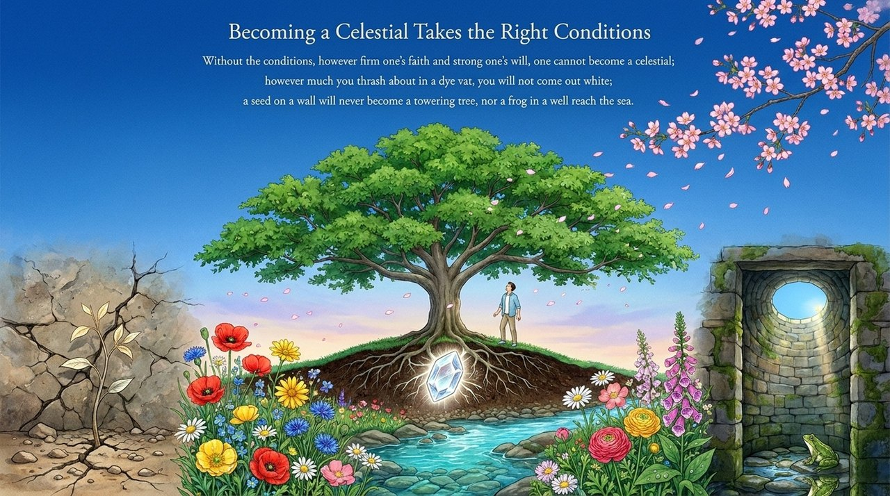
    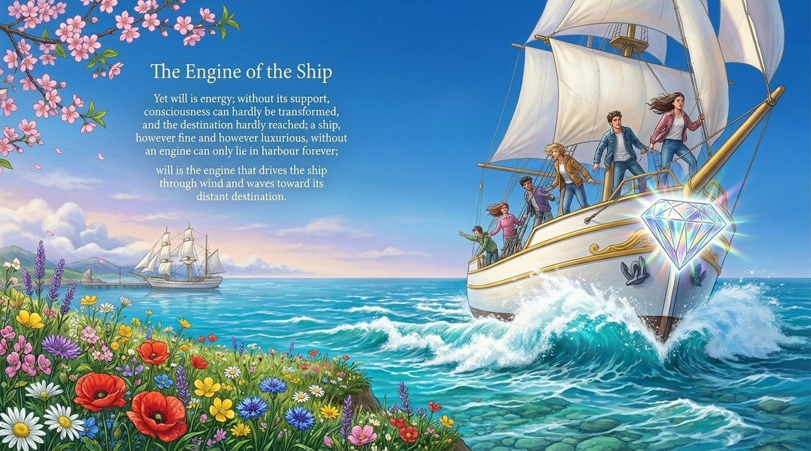
    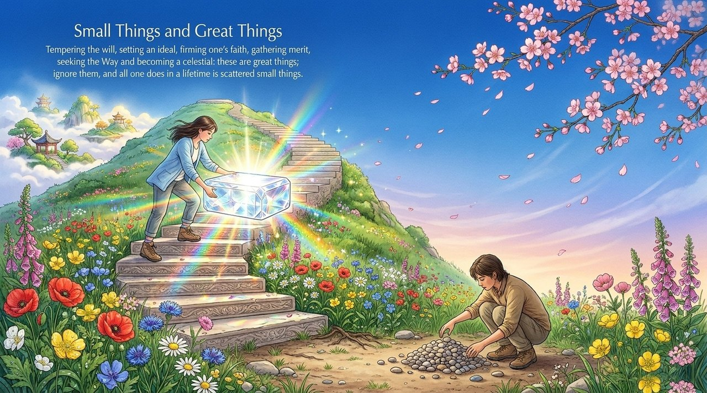
    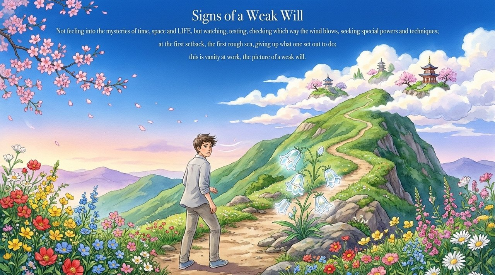
    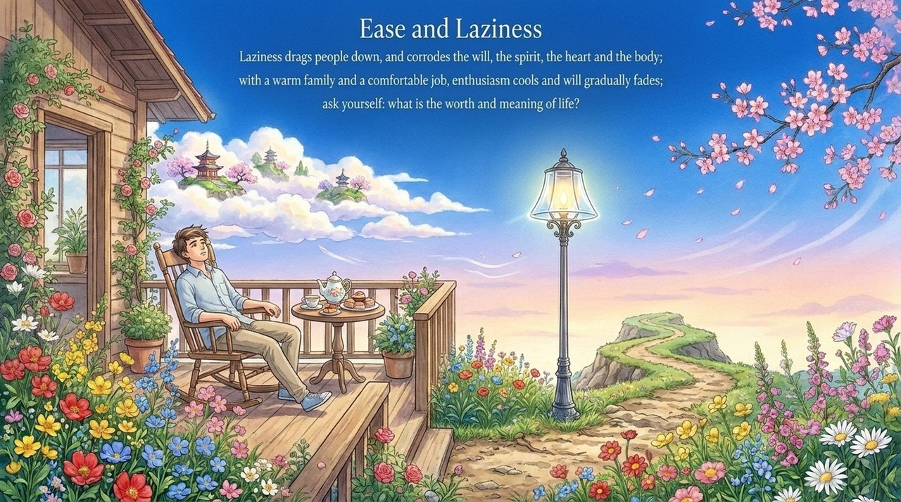
    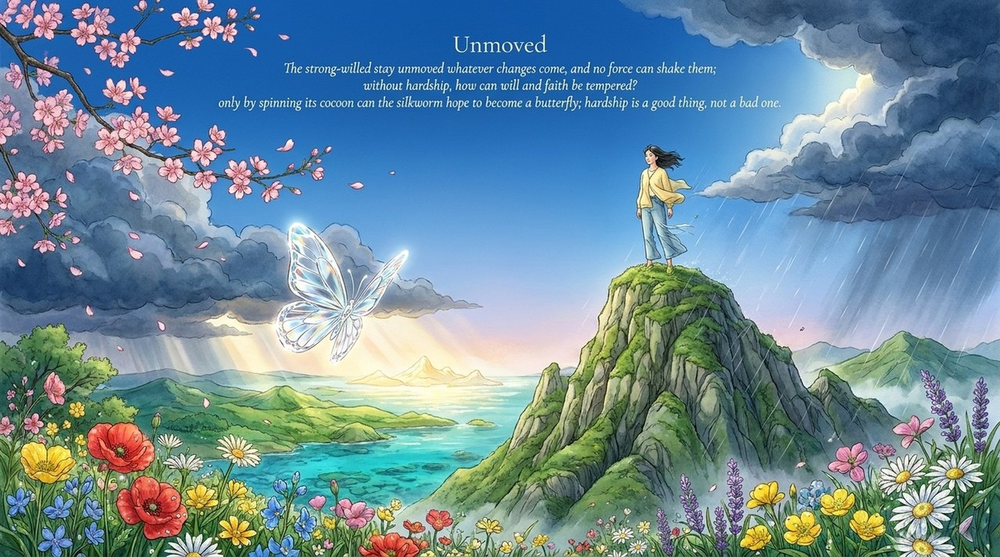

---

## Versions

| Edition | Best for | Link |
|---------|----------|------|
| Friendly | First-time readers, everyday language | [Read Friendly Edition](/en/will-determination/friendly/) |
| Academic | Researchers, source analysis, systematic study | [Read Academic Edition](/en/will-determination/academic/) |
| Internal | Chanyuan Celestials, full primary-source citations | [Read Internal Edition](/en/will-determination/internal/) |

---

## Related Entries

[Consciousness](/en/consciousness/) · [Antimatter Structure](/en/antimatter-structure/) · [Awakening](/en/awakening/) · [Free Will](/en/free-will/) · [Raise Vibrational Frequency](/en/raise-vibration-frequency/) · [Elysium World](/en/elysium-world/)
