<!-- id: LC-WFL-0001-EN theme: Cultivation Practice type: index lang: en -->

# A Worry-Free Life

**A Worry-Free Life is a state of existence in the Lifechanyuan system achieved through Three Treasures: firm faith in the Greatest Creator, belief in the law of cause and effect, and wholeheartedly doing one's best in everything.** The one who holds these treasures lives without anxiety about food, clothing, shelter, aging, illness, or death — and without fear for the future. As Guide Xuefeng puts it: "No matter how fierce the wind and waves, I stroll at ease through my own courtyard." This is not passive resignation but a serene confidence grounded in understanding the cosmic order — the Greatest Creator's care, karma's perfect justice, and one's own responsibility to act with full effort. Sustained throughout a lifetime, this practice leads directly to the Celestial Realm.

---

## Video

<iframe style="width:100%;aspect-ratio:4/3;border:0" src="https://www.youtube-nocookie.com/embed/GSMkB_k14cI" title="Worry-Free Life (Lifechanyuan Encyclopedia video)" allowfullscreen></iframe>

## Slides

??? info "📖 Illustrated slides (14 pages, click to expand)"

    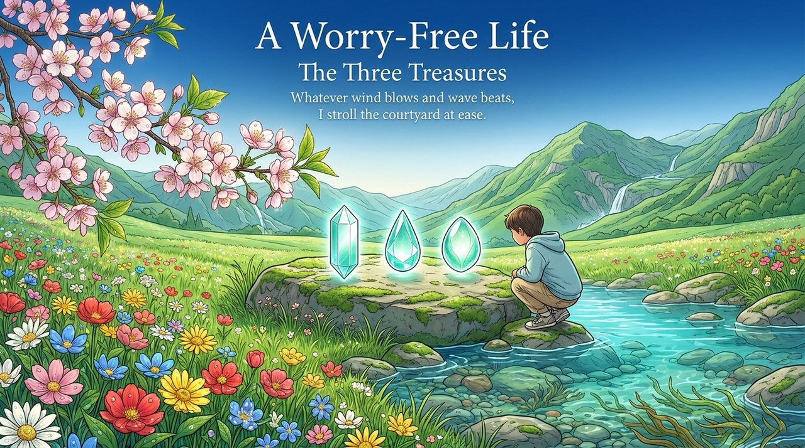
    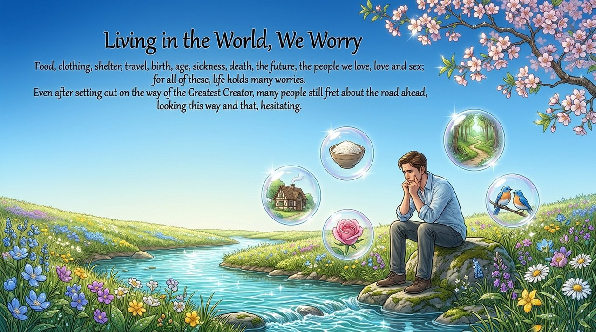
    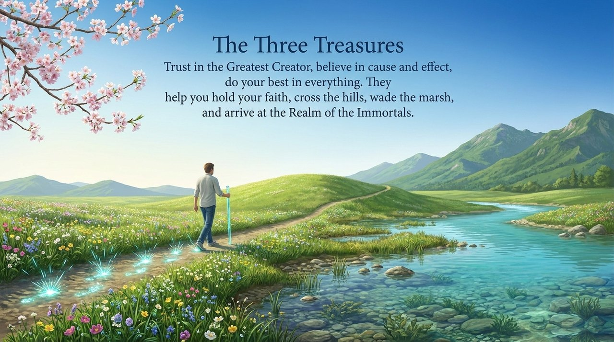
    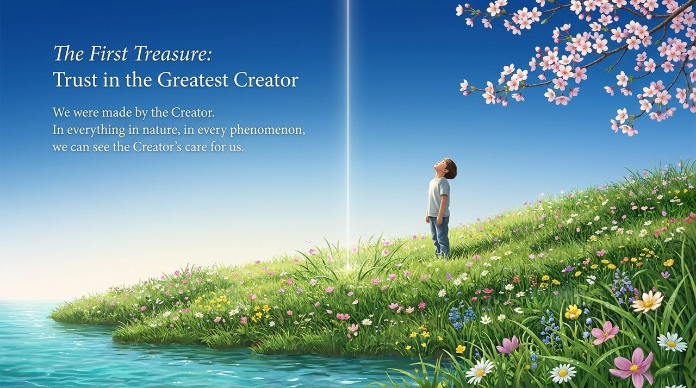
    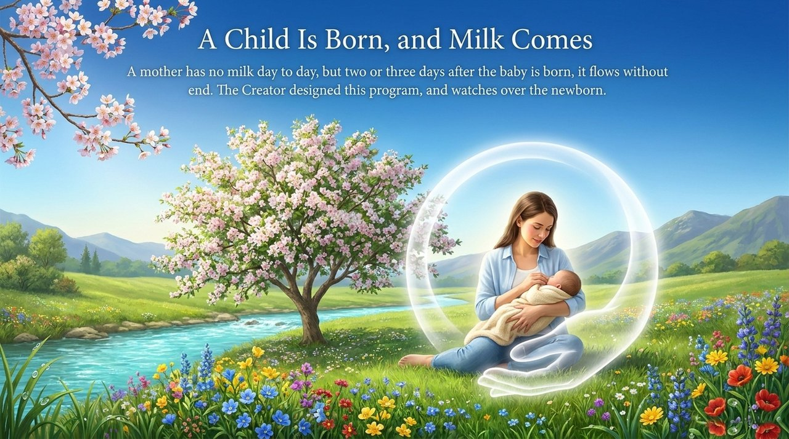
    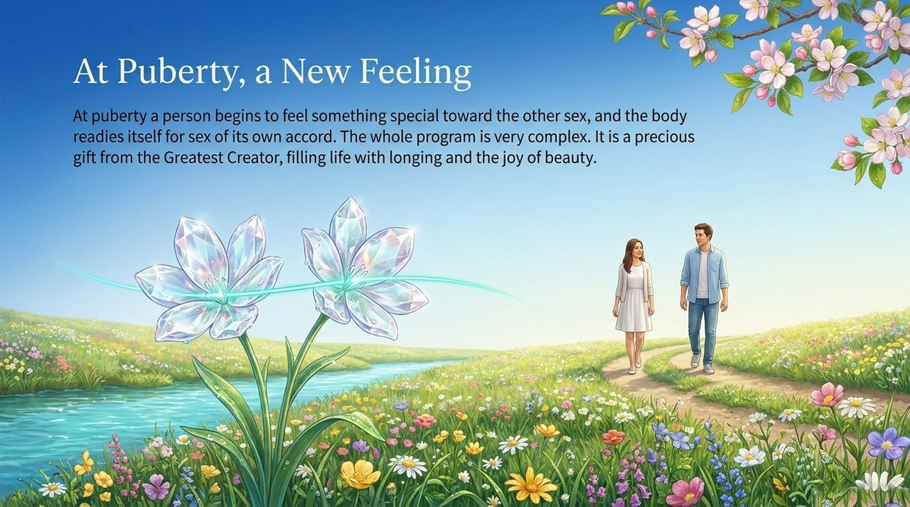
    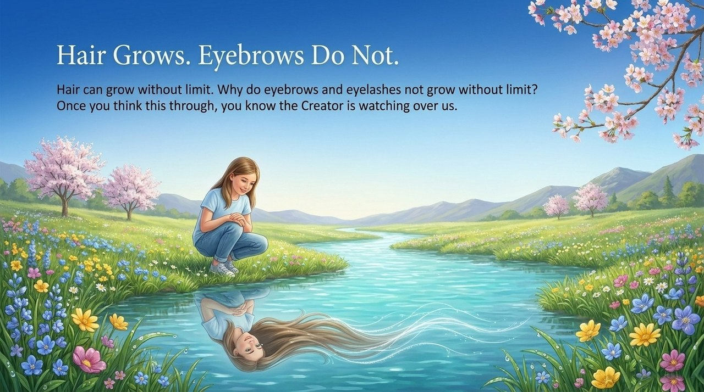
    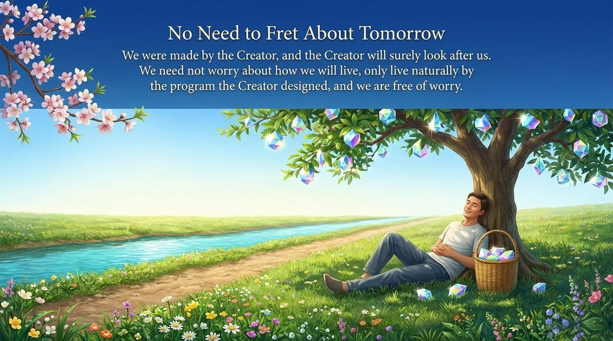
    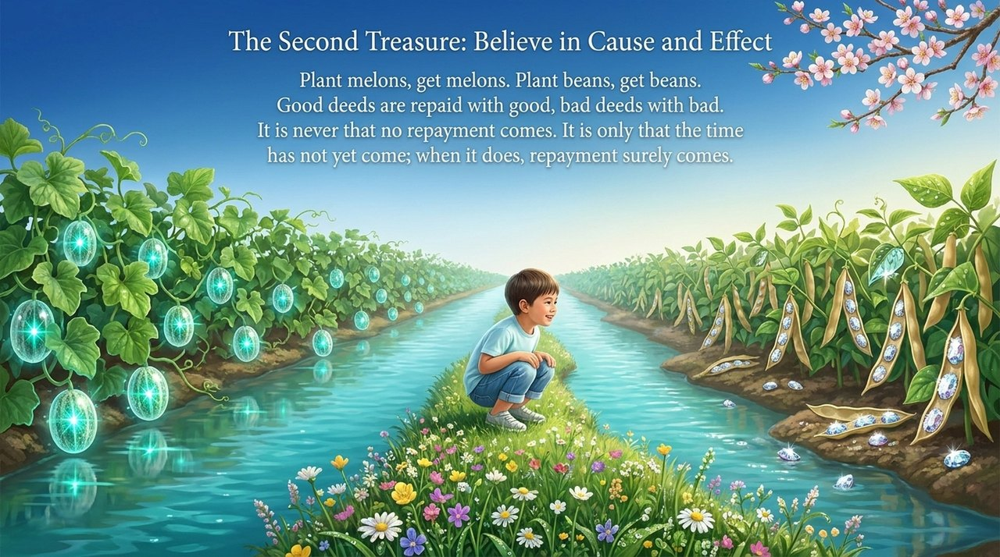
    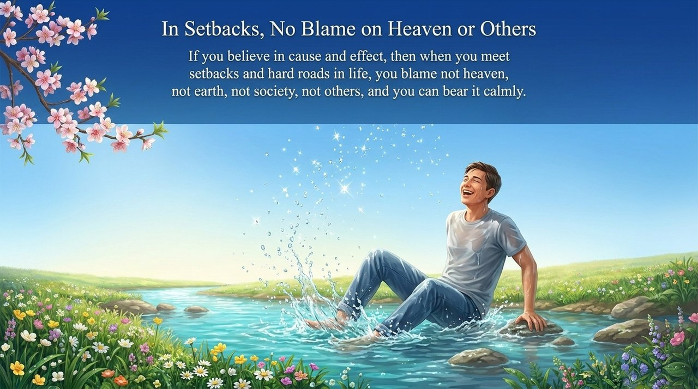
    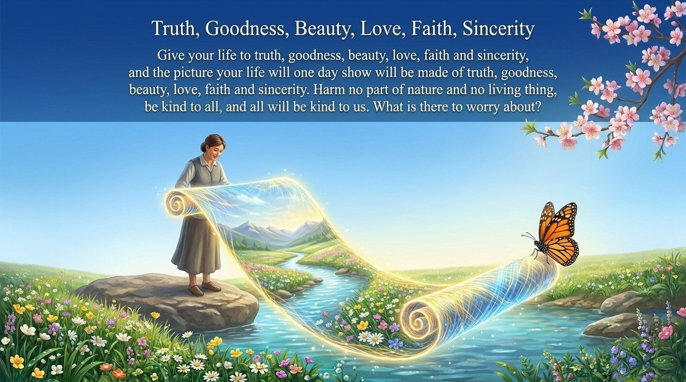
    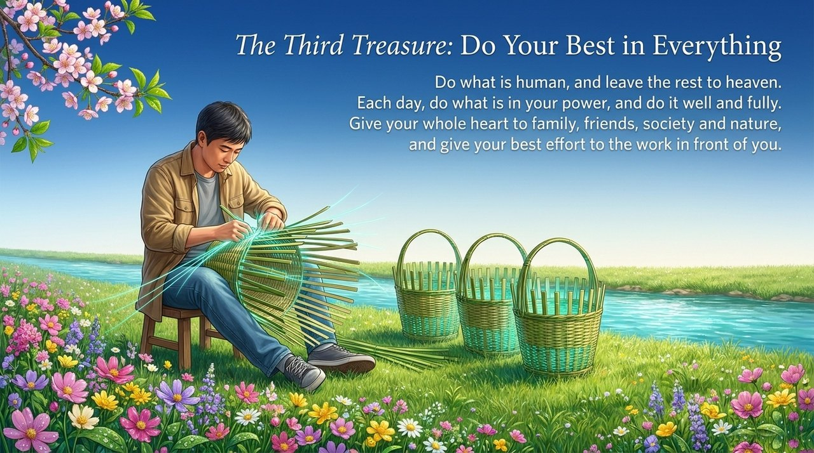
    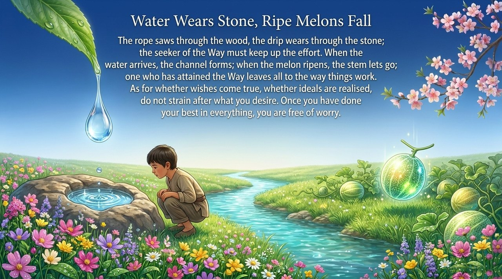
    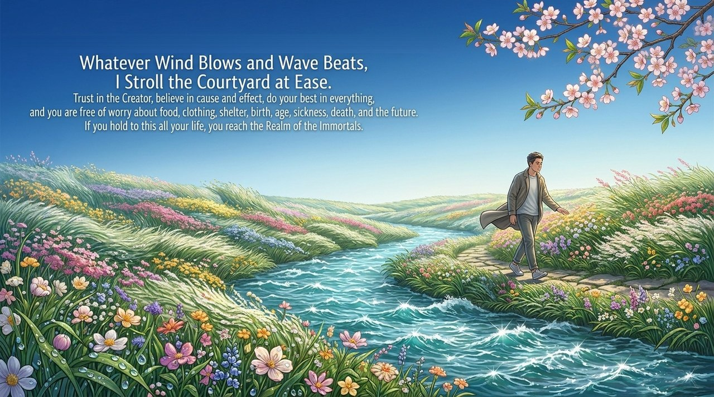

---

## Versions

| Version | Best for | Focus |
|---------|----------|-------|
| [Friendly version](friendly.md) | First-time readers | What the Three Treasures are and how to apply them |
| [Academic version](academic.md) | Researchers | Logical foundations, cultivation context, cross-tradition comparison |
| [Internal reference](internal.md) | Deep study | Complete original teachings in full |

---

## Related Entries

[Steadfast Principles, Trust the Home](/en/steadfast-principles-trust-home/) · [Chanyuan Ideals](/en/values/) · [Karma, Retribution and Reincarnation](/en/karma-retribution-reincarnation/) · [The Greatest Creator](/en/greatest-creator/) · [Outlook on Life and Values](/en/outlook-on-life-and-values/) · [Peak of Human Life and LIFE](/en/peak-of-life-and-being/) · [The Four Responses](/en/si-sui/) · [Self-Consistency](/en/self-coherence/) · [Celestials, Heavenly Immortals and Buddhas](/en/xian-tian-xian-fo/)
