# Wuji and Taiji

> "The process of the universe's origination is: Wuji gives birth to Taiji; Taiji gives birth to the Two Modes; the Two Modes give birth to the Four Images; the Four Images give birth to the Eight Trigrams; the Eight Trigrams give birth to the sixty-four hexagrams; and the sixty-four hexagrams give birth to the ten thousand manifestations of the cosmos."
>
> — Chanyuan Corpus · Space-Time · The Origin of the Universe

**Wuji** (the Pre-Ultimate) is the state before the universe was born — no time, no space, no matter, no spirit; simultaneously "all that is" and "all that is not." **Taiji** (the Supreme Ultimate) is the immense potential-energy vortex that arose when the formless energies within Wuji spontaneously arranged themselves into a specific order — the birth-form of the Greatest Creator, the pivot at which primordial chaos became the ordered cosmos.

Together these two concepts form the foundation of Lifechanyuan's cosmology: Wuji is the **essence** of the Greatest Creator (the original nature, the Buddha-nature); Taiji is the **spirit** of the Greatest Creator (the cosmic consciousness pervading all existence). To understand Wuji is to understand the Buddha and the Dharma; to understand Taiji is to understand the Tao and its workings.

---

## Video

<iframe style="width:100%;aspect-ratio:4/3;border:0" src="https://www.youtube-nocookie.com/embed/XaaJL6YAV3s" title="Wuji and Taiji (Lifechanyuan Encyclopedia video)" allowfullscreen></iframe>

## Slides

??? info "📖 Illustrated slides (14 pages, click to expand)"

    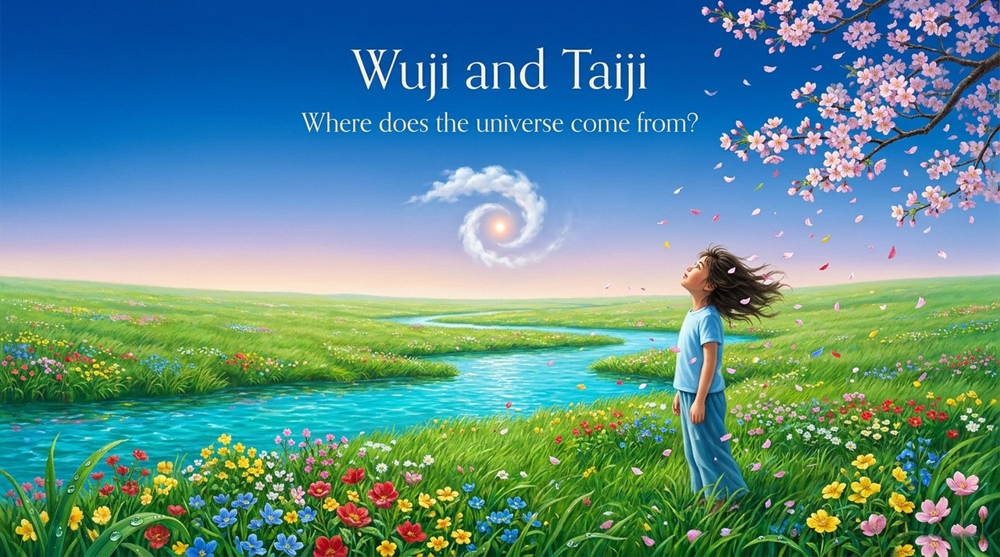
    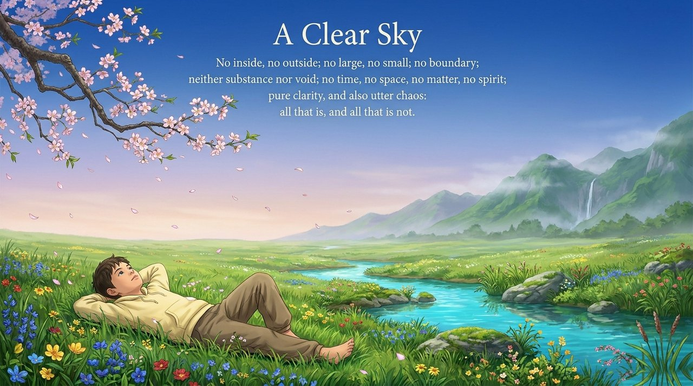
    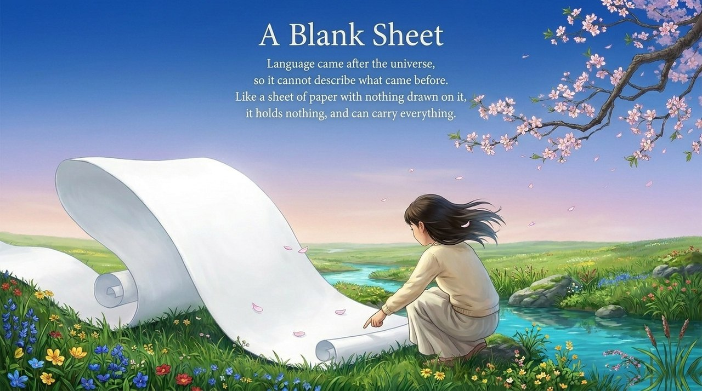
    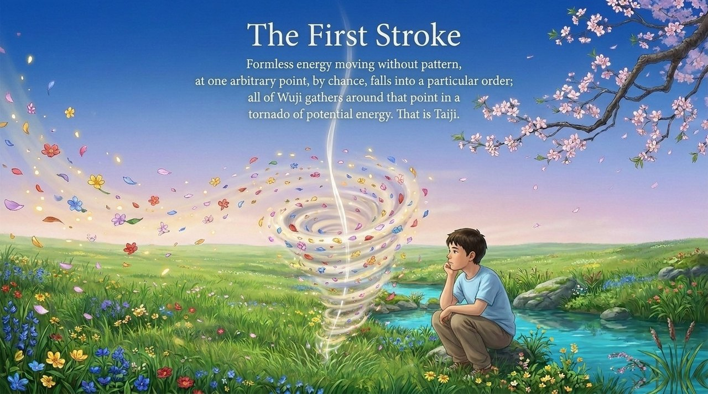
    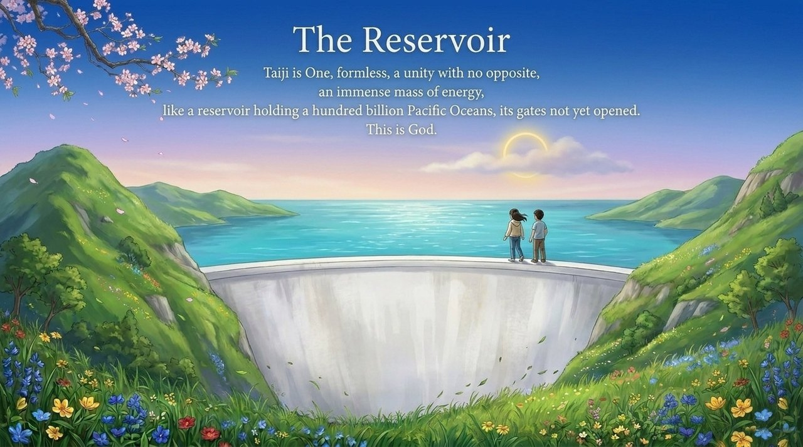
    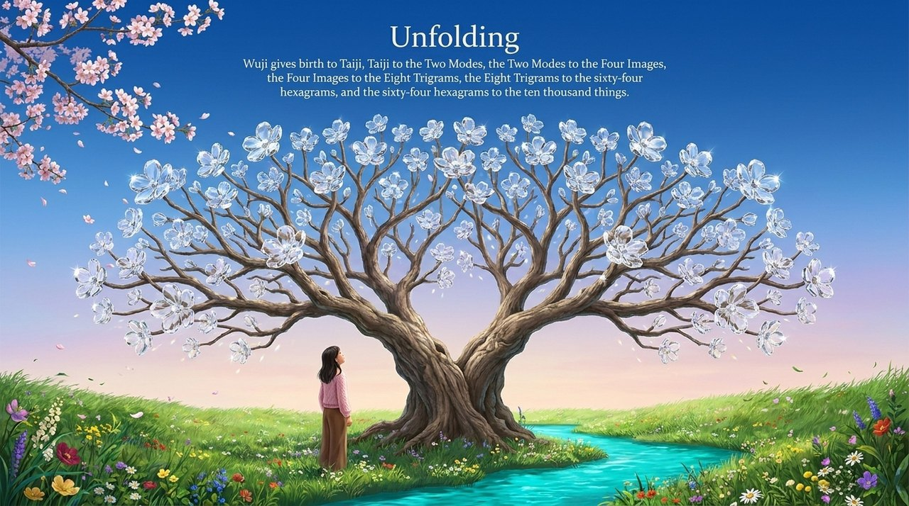
    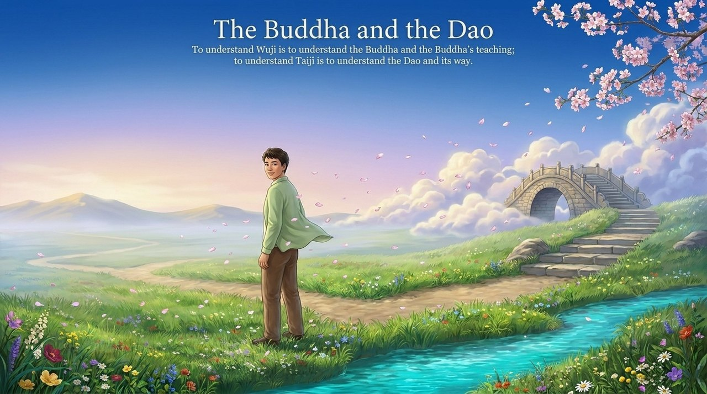
    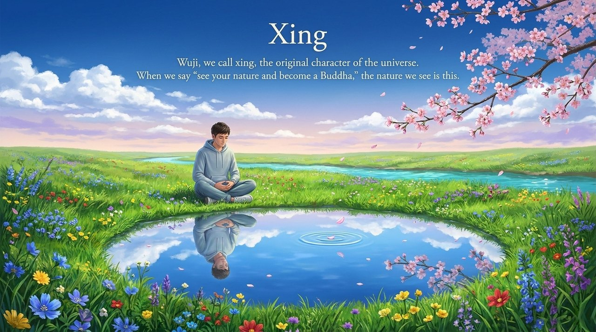
    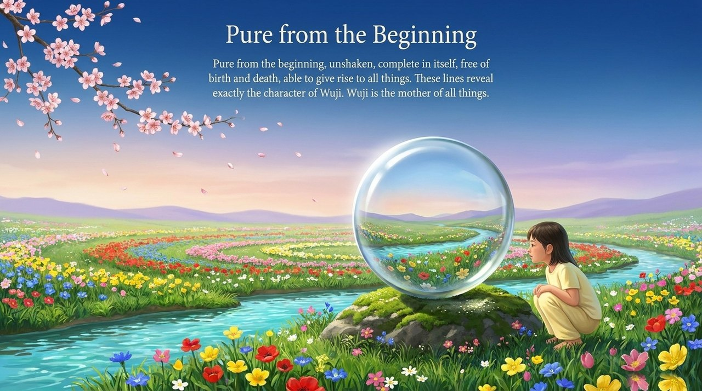
    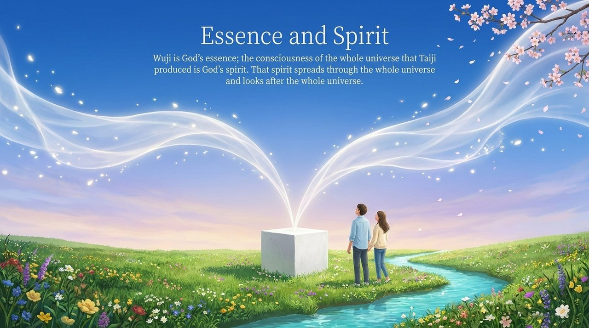
    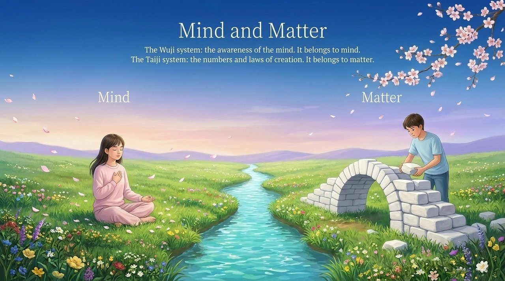
    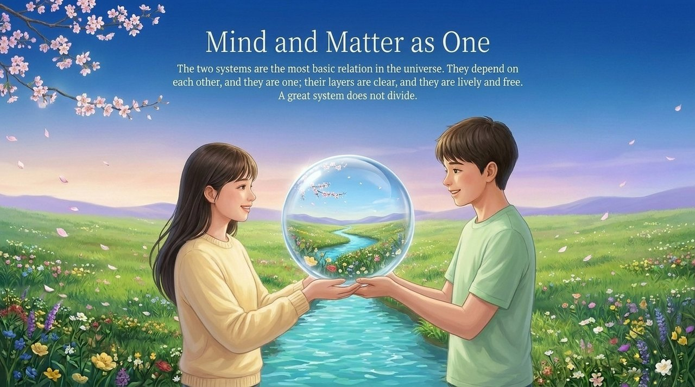
    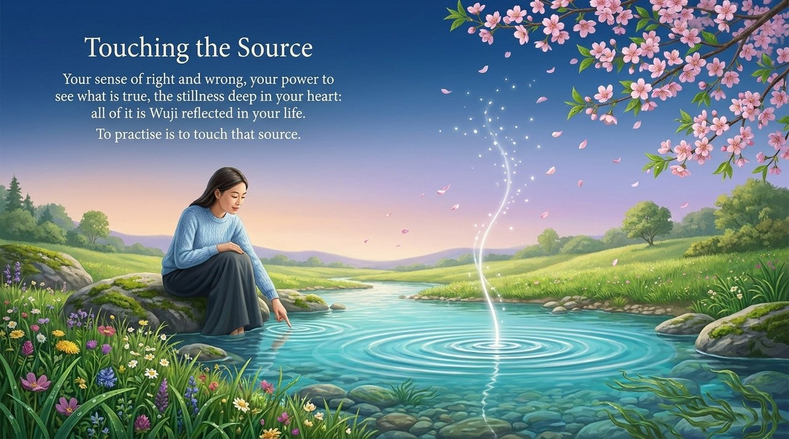
    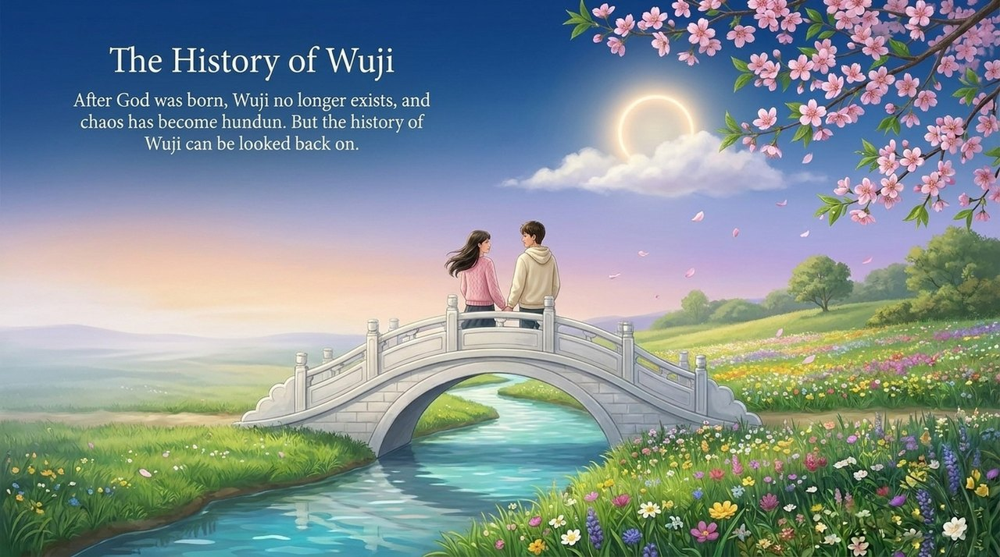

---

## Versions

| Version | Best for | Focus |
|---------|----------|-------|
| [Friendly version](friendly.md) | First-time readers | Analogies, how everything came from nothing |
| [Academic version](academic.md) | Researchers | Systematic analysis, comparative thought |
| [Internal reference](internal.md) | Deep study | Full source passages |

---

## Related entries

[Universe Origin](/en/universe-origin/) · [The Tao](/en/dao/) · [The Greatest Creator](/en/greatest-creator/) · [Hundun Ontology](/en/hundun/) · [Hundun-Baby](/en/hundun-baby/) · [Original Nature](/en/self-nature/) · [Three Cosmic Elements](/en/three-cosmic-elements/) · [Universe Overview](/en/universe-overview/) · [Taiji Thinking](/en/taiji-thinking/) · [Wuji](/en/wuji/) · [Taiji](/en/taiji/)
