<!-- id: LC-WUJI-0001-EN theme: The Greatest Creator and the Tao type: Gateway Page direction: Ontological Origin lang: en -->

# Wuji

[Entry Gateway]

> In Lifechanyuan terminology, **LIFE** (capitalized) refers to the ontological
> essence of existence — the soul/antimatter structure that persists across
> incarnations — while **life** (lowercase) refers to the experiential stage
> of human existence in this world.

**Wuji** (无极) is the foundational starting-point concept in Lifechanyuan cosmology — the primordial pre-universe state before the Greatest Creator was born, before structured time-space-material order existed. Wuji is not "nothingness" in the ordinary sense; it is a pre-structured state with unformed energy movement that makes later emergence possible. From Wuji came Taiji; from Taiji, the Greatest Creator and the universe.

> Wuji gives rise to Taiji; Taiji is the Greatest Creator.
>
> — Guide Xuefeng, *New Era Human 800 Concepts*

---

## Core Positioning

In the Lifechanyuan system, understanding Wuji is necessary for understanding the entire cosmological logic: the transition from Wuji to Taiji marks the decisive shift from unordered potential to ordered emergence — the moment consciousness arose from structure, and the universe began.

---

## Video

<iframe style="width:100%;aspect-ratio:4/3;border:0" src="https://www.youtube-nocookie.com/embed/HI8U1OfHTHQ" title="Wuji (Lifechanyuan Encyclopedia video)" allowfullscreen></iframe>

## Slides

??? info "📖 Illustrated slides (14 pages, click to expand)"

    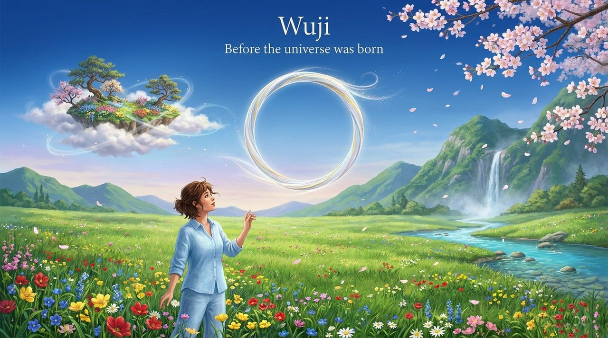
    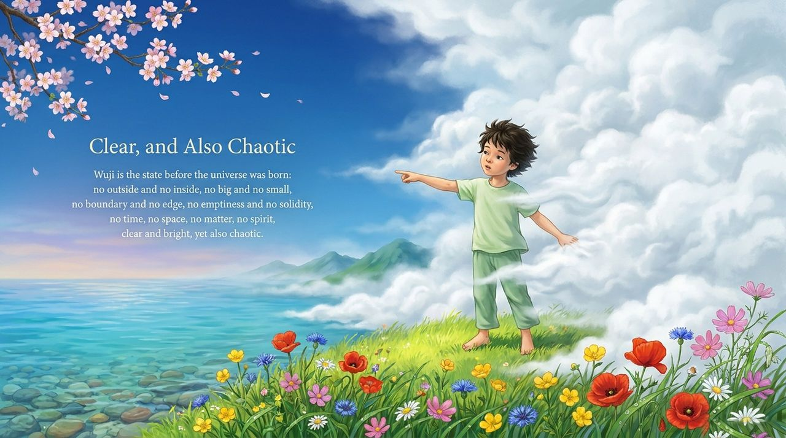
    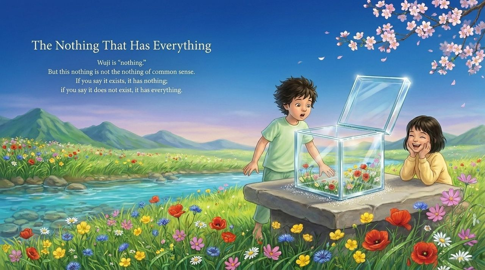
    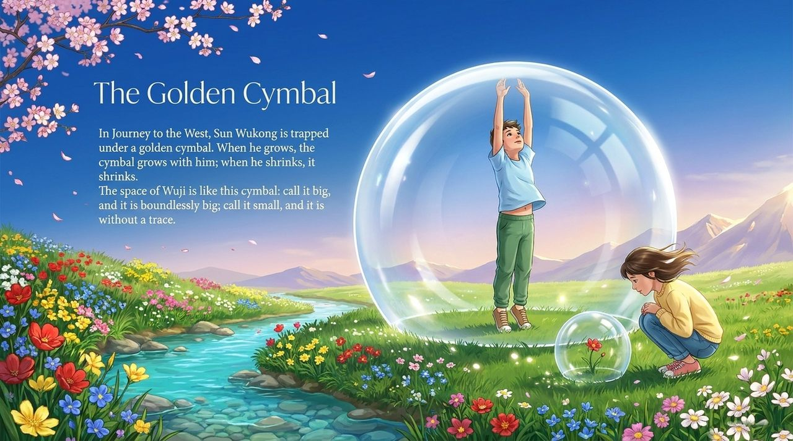
    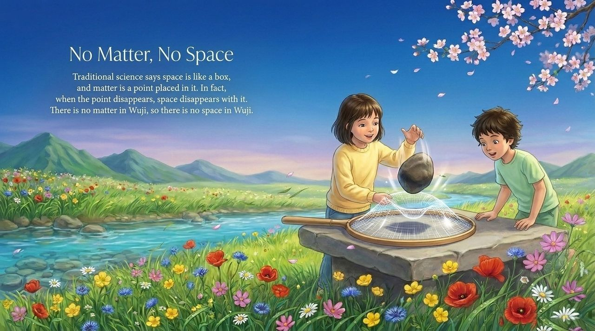
    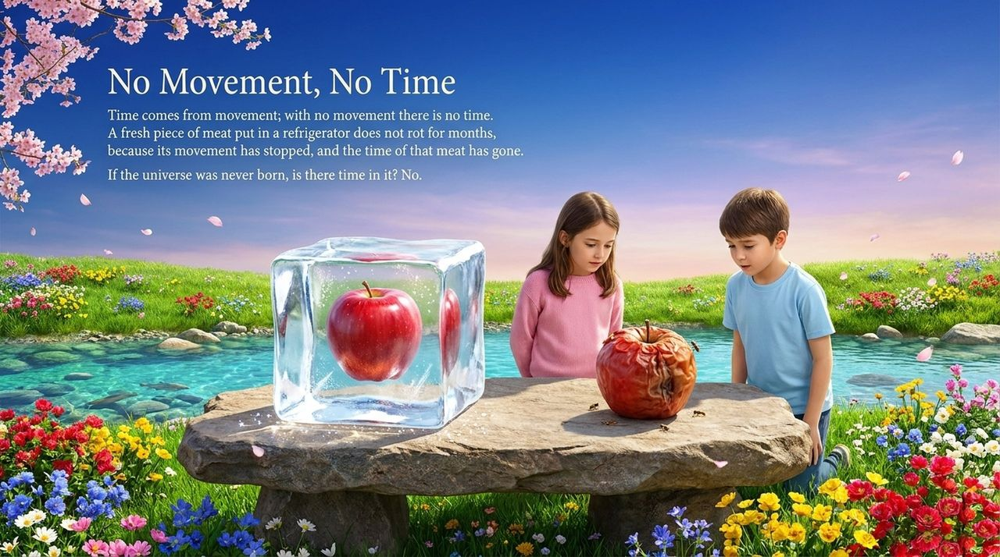
    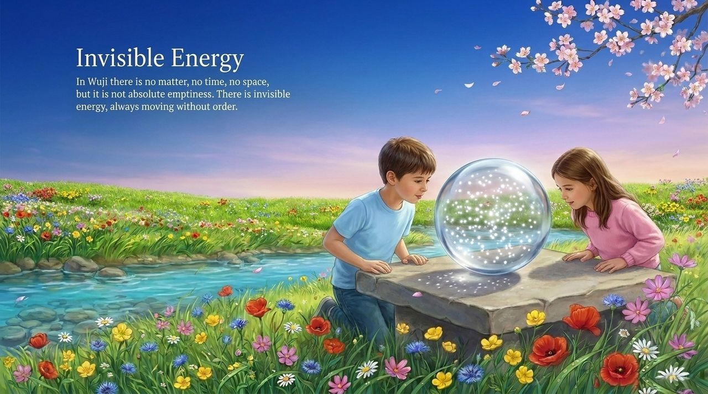
    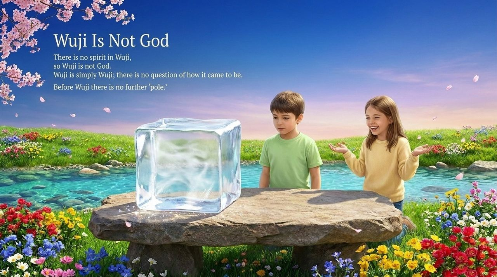
    
    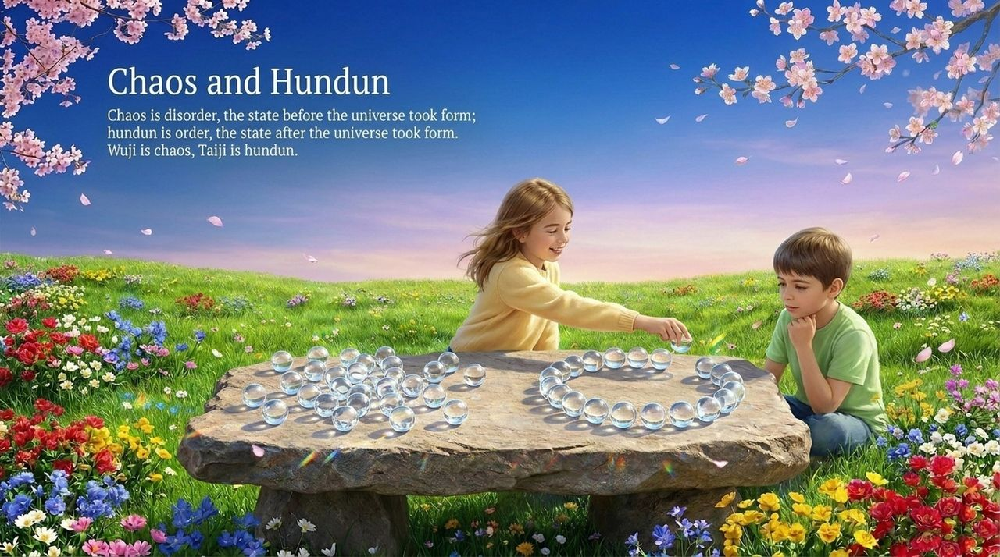
    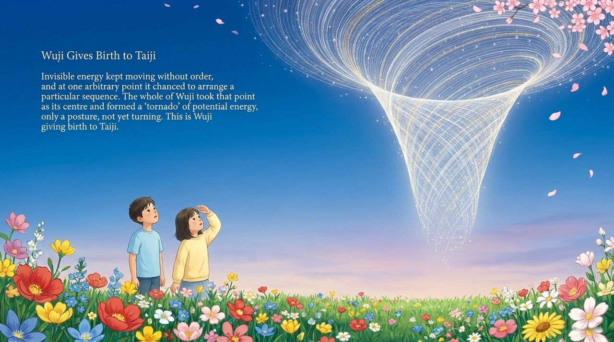
    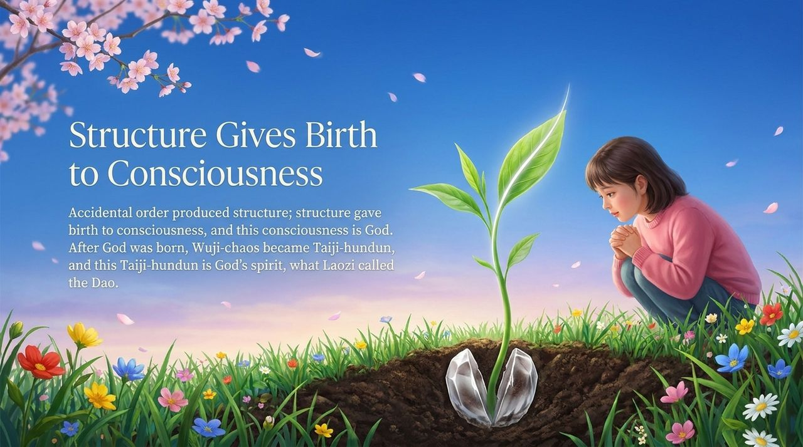
    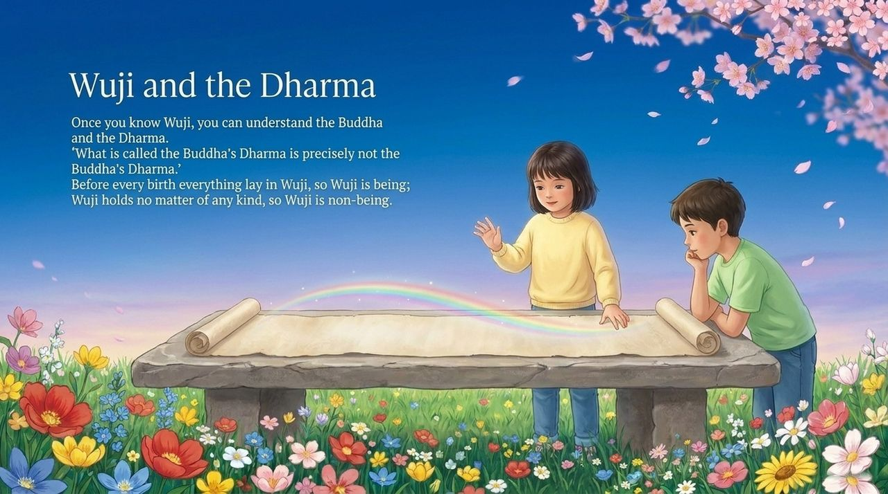
    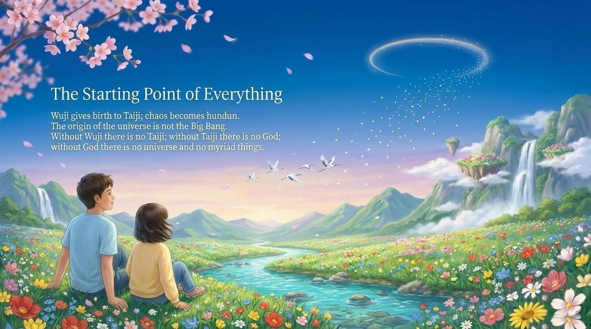

---

## Read by Edition

| Edition | Intended Reader | Link |
|---------|----------------|-------|
| **Friendly Edition** | Readers new to Lifechanyuan concepts | [Read Friendly Edition](./friendly) |
| **Academic Edition** | Researchers with philosophical/religious studies background | [Read Academic Edition](./academic) |
| **Internal Edition** | Chanyuan Celestials and deep practitioners | [Read Internal Edition](./internal) |

---

## Related Entries

- [Taiji](/en/taiji/) — Wuji gives rise to Taiji; the first form of ordered existence
- [Cosmic Origin](/en/universe-origin/) — The full cosmological sequence from Wuji onward
- [Dao](/en/dao/) — Dao as the operating principle emerging from the Wuji-Taiji transition
- [The Greatest Creator](/en/greatest-creator/) — The Greatest Creator emerged with Taiji from Wuji
- [Consciousness](/en/consciousness/) — The emergence of consciousness from structure is the Wuji-to-Taiji transition
