# Celestial Men and Celestial Women (Xianzi · Xiannv)

In the Lifechanyuan system, **Xianzi** (仙子) refers to male members of the Chanyuan community, and **Xiannv** (仙女) refers to female members. These titles originate from the cosmological framework: in high-level life realms such as the Thousand-Year World and the Ten-Thousand-Year World, male beings are called Xianzi and female beings Xiannv. Chanyuan Celestials use these titles for one another as a reminder of their celestial nature and as an aspiration toward the life they are cultivating to return to. The founding principle is "the world turned upside down — Xiannv are supreme": men serve as the green leaves, women as the blossoms.

| Version | Best for | Focus |
|---------|----------|-------|
| [Friendly version](friendly.md) | First-time readers | Accessible introduction to the roles and ethos |
| [Academic version](academic.md) | Researchers | Cosmological background and community function |
| [Internal reference](internal.md) | Deep study | Full primary texts including norms and celestial realm descriptions |

---

## Video

<iframe style="width:100%;aspect-ratio:4/3;border:0" src="https://www.youtube-nocookie.com/embed/kpVmVkr35gM" title="Celestial Men and Celestial Women (Lifechanyuan Encyclopedia video)" allowfullscreen></iframe>

## Slides

??? info "📖 Illustrated slides (14 pages, click to expand)"

    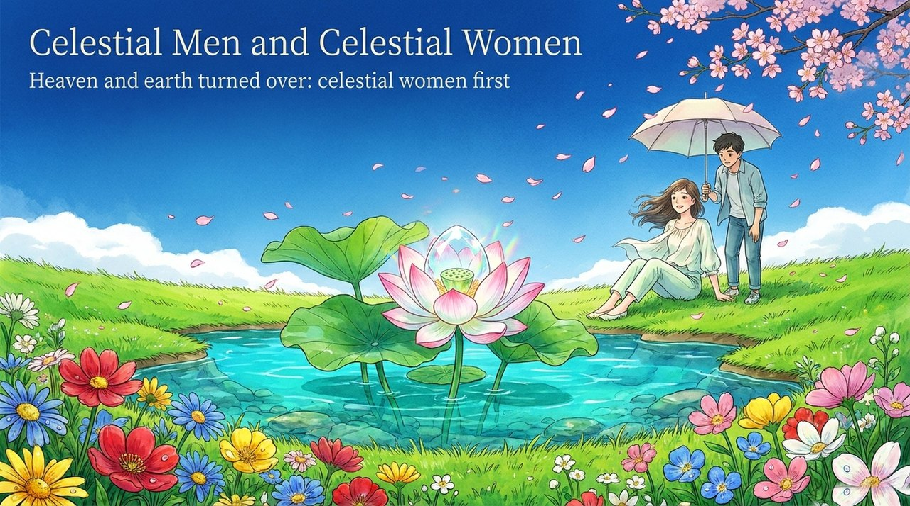
    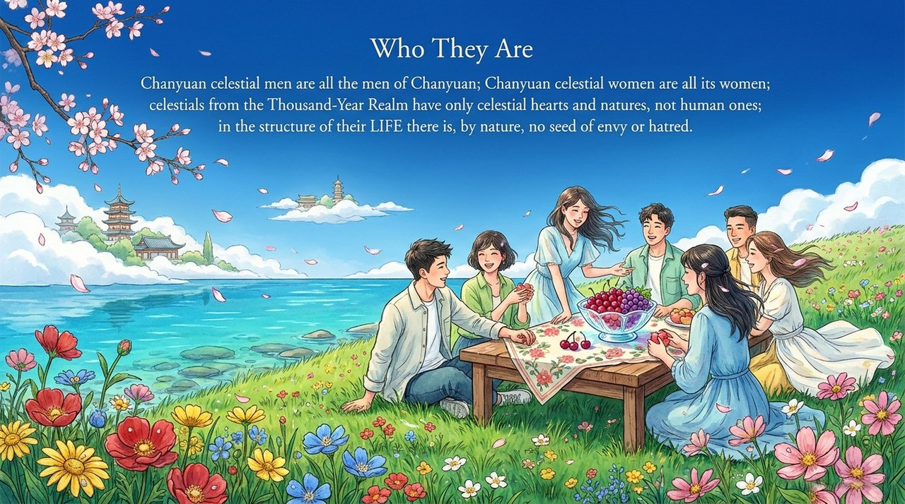
    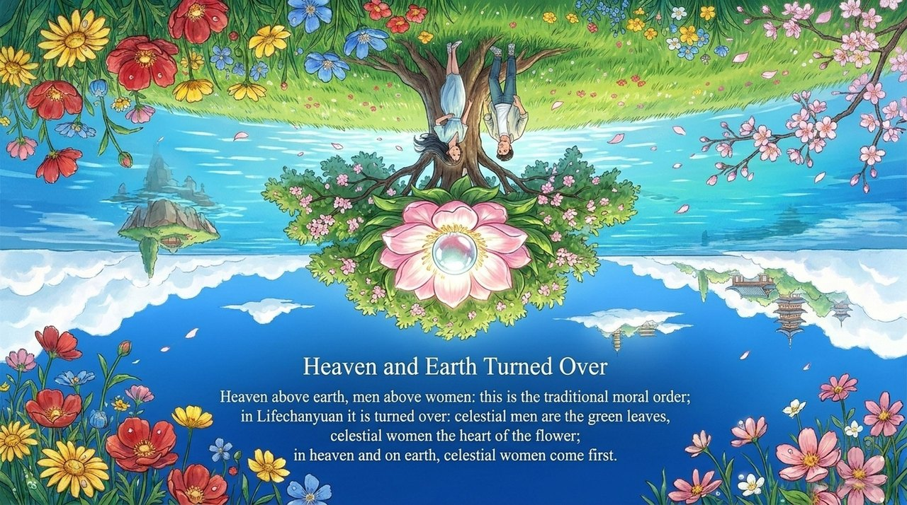
    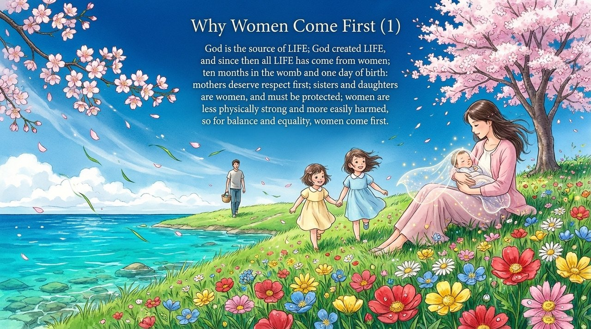
    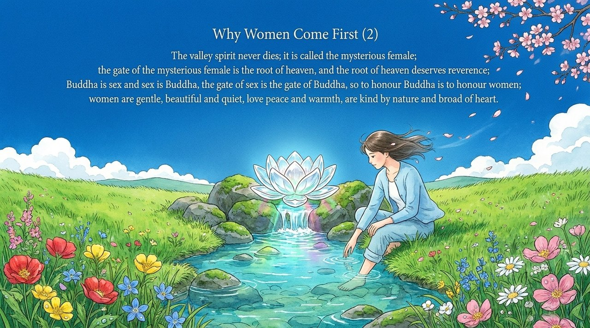
    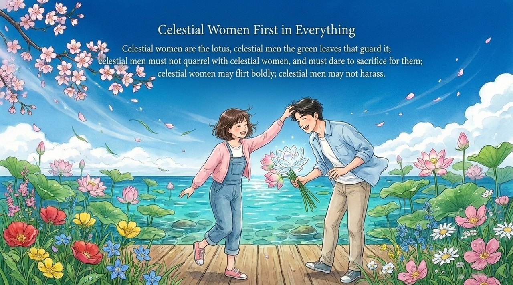
    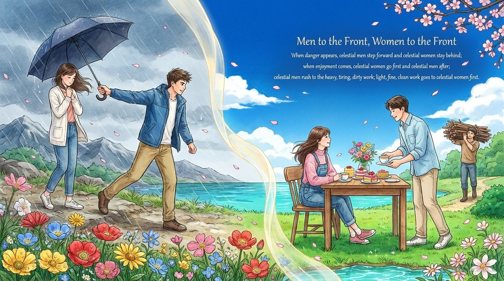
    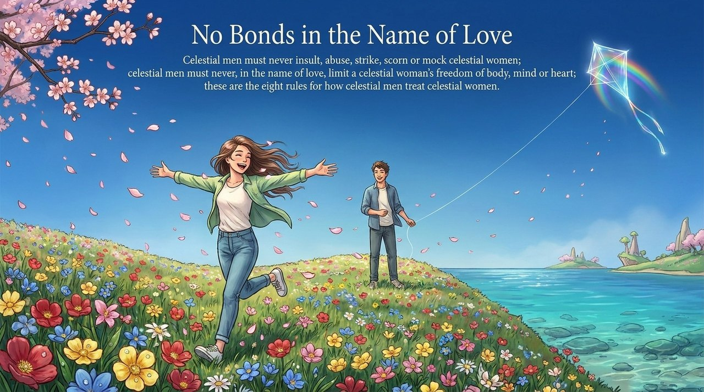
    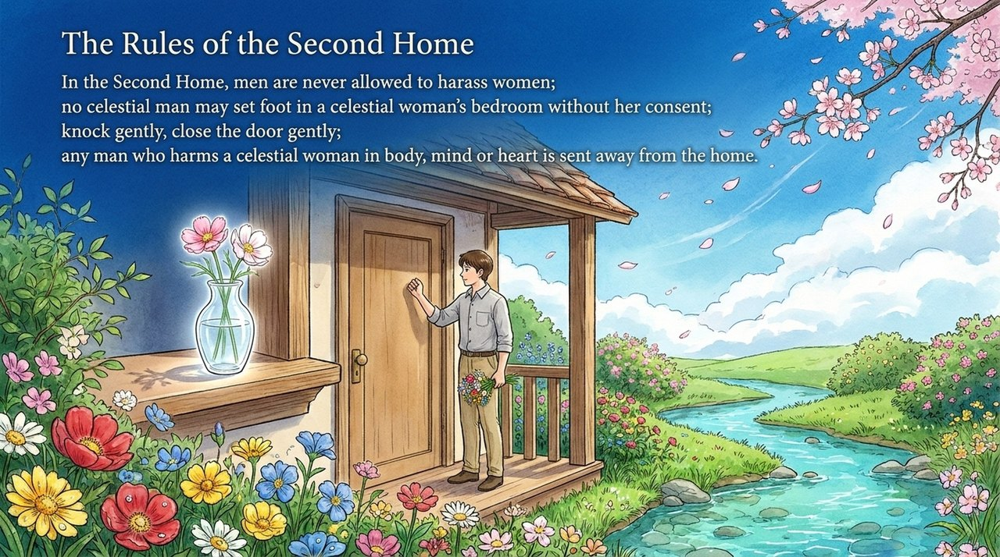
    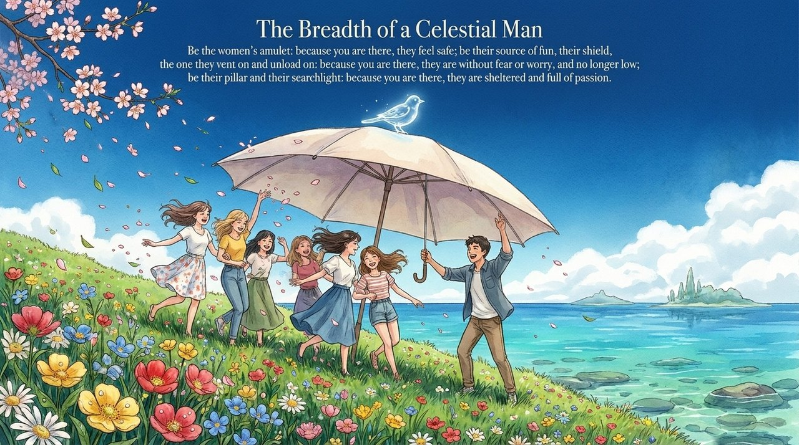
    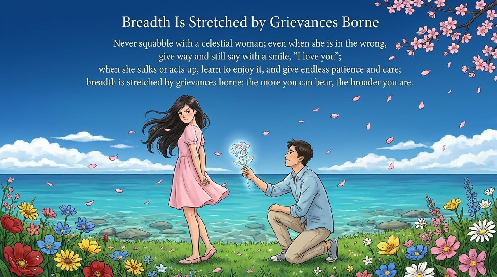
    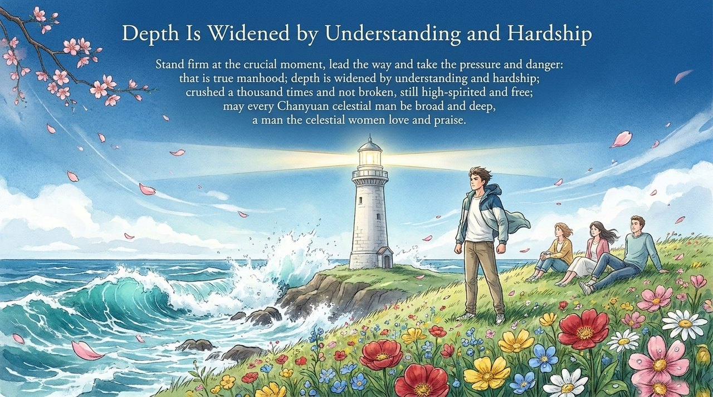
    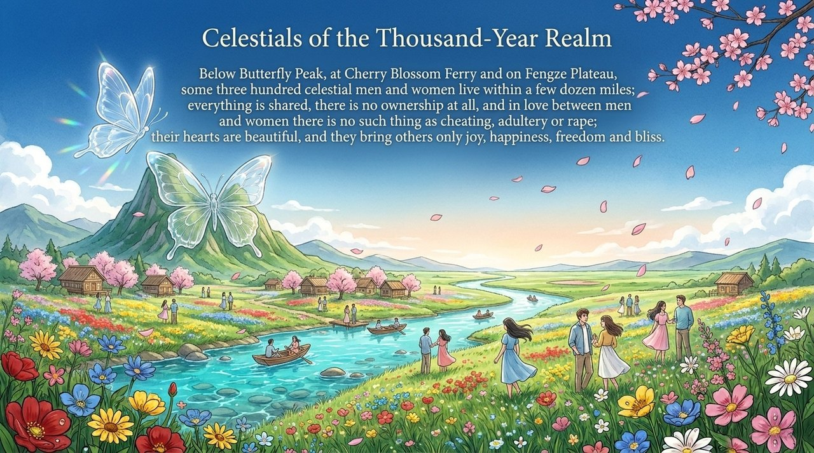
    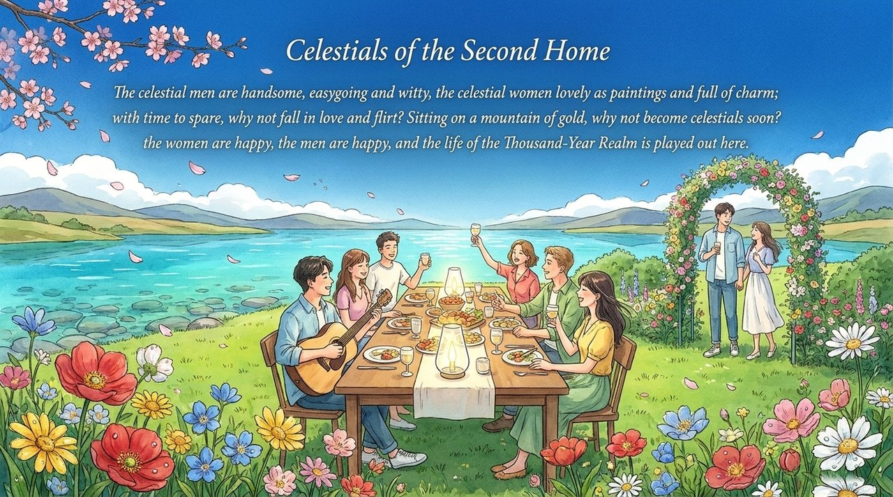

---

## Related Entries

- [Thousand-Year World Celestials](/en/thousand-year-world-celestials/) — life in the celestial realm
- [Celestial Being · Super Celestial Being · Buddha](/en/xian-tian-xian-fo/) — the hierarchy of LIFE levels
- [Becoming Celestial](/en/becoming-celestial/) — the path from human to Xianzi/Xiannv
- [Celestial Bearing and Taoist Bones](/en/xianfengdaogu/) — the ideal quality of celestial beings
- [Transcending the Mundane](/en/chaofantuosu/) — inner qualities that distinguish celestials
- [Feminine Beauty in Softness](/en/feminine-beauty-in-softness/) — the beauty ideal for Xiannv
- [Masculine Beauty in Strength](/en/masculine-beauty-in-strength/) — the beauty ideal for Xianzi
- [International Family](/en/guoji-dajiating/) — the community where Xianzi and Xiannv coexist
- [Quantum Entanglement and the Other Half](/en/quantum-entanglement-and-the-other-half/) — the cosmic bond between Xianzi and Xiannv
