# Belief and Faith (*Xinyang*)

> A life without belief is a life of contradiction and confusion — a life without direction, without future, and fated for tragedy.  
> — *New Era Human 800 Concepts*

*Xinyang* (信仰) — belief and faith — is, in the Lifecosmos system, the innermost compass of the human soul: the deepest orientation that guides thought, behavior, and speech. Xuefeng defines it as a person's reverence and awe for the supernatural, spontaneously arising within the heart to form a complete value system. He arranges all human beliefs into eight ascending levels, with "walking the path of the Greatest Creator" as the highest. Belief is fundamentally personal — a matter of the individual heart, not of belonging to any religion or following the majority.

## Video

<iframe style="width:100%;aspect-ratio:4/3;border:0" src="https://www.youtube-nocookie.com/embed/LKJAP7yT4ho" title="Belief and Faith (Lifechanyuan Encyclopedia video)" allowfullscreen></iframe>

## Slides

??? info "📖 Illustrated slides (14 pages, click to expand)"

    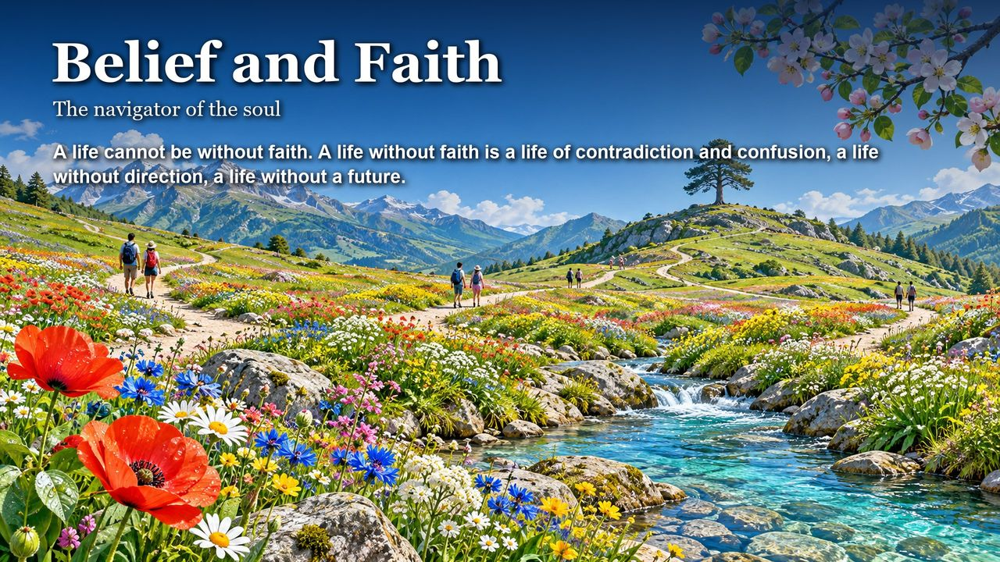
    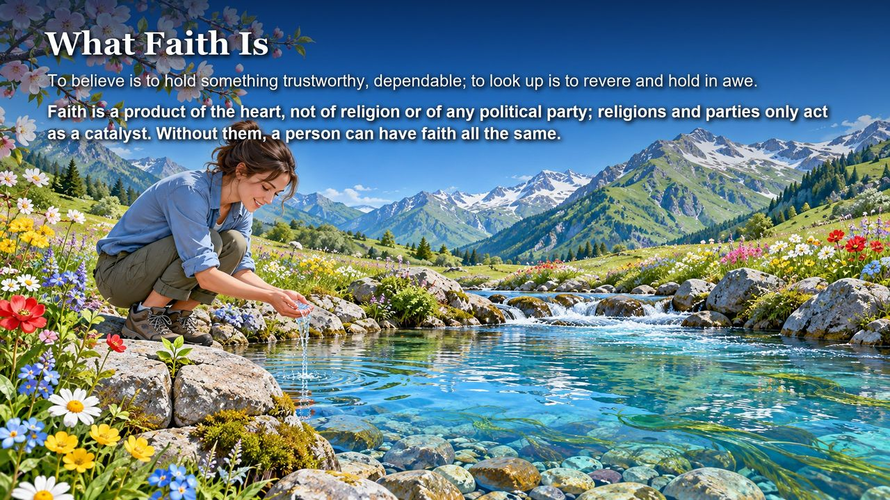
    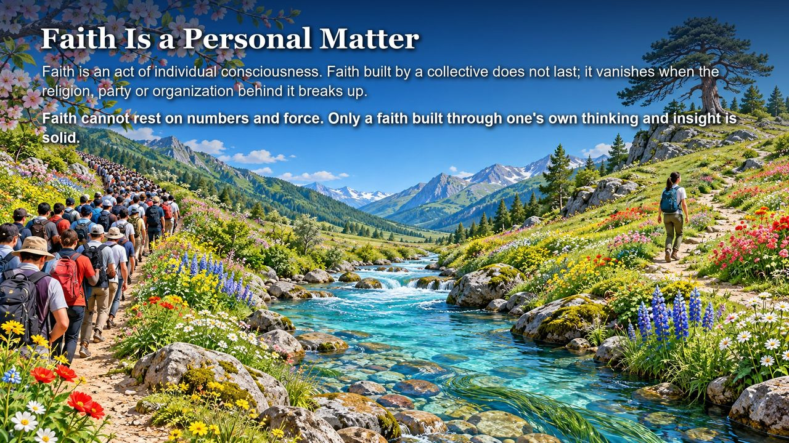
    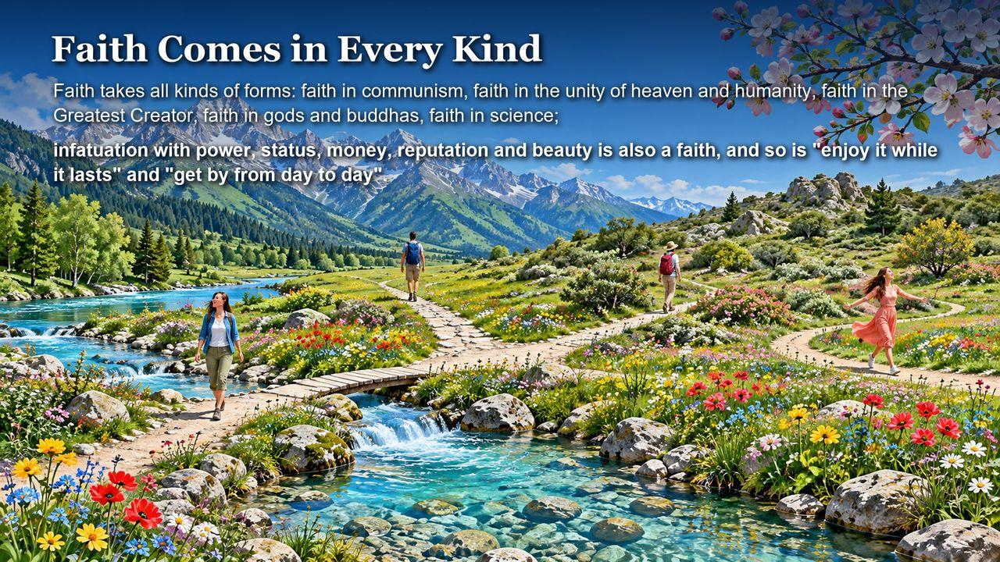
    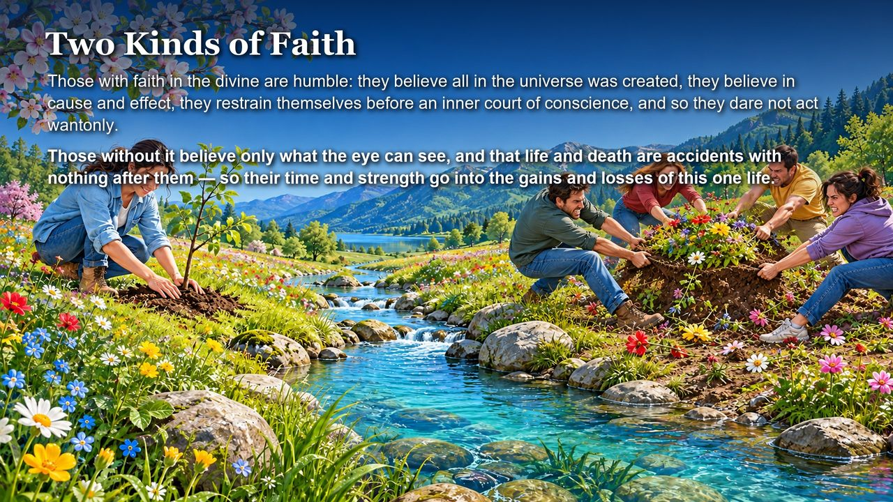
    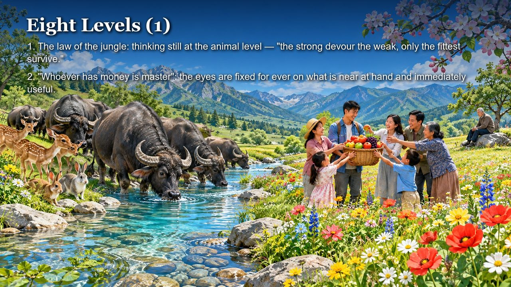
    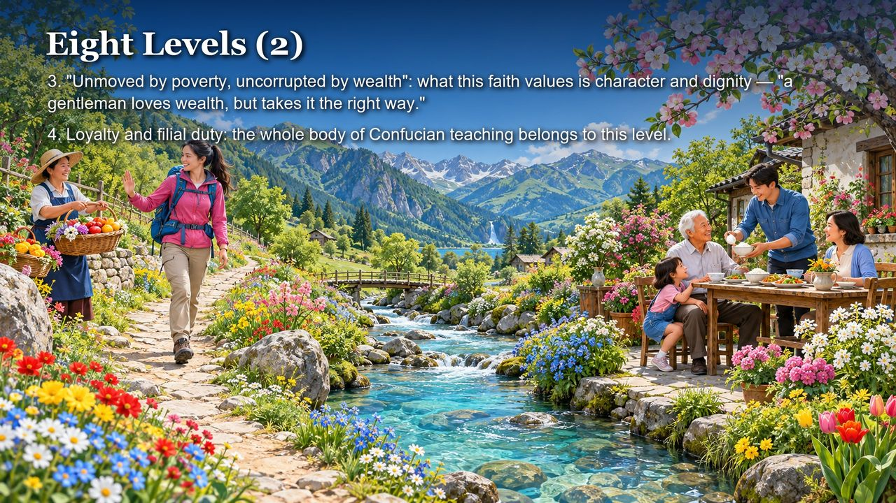
    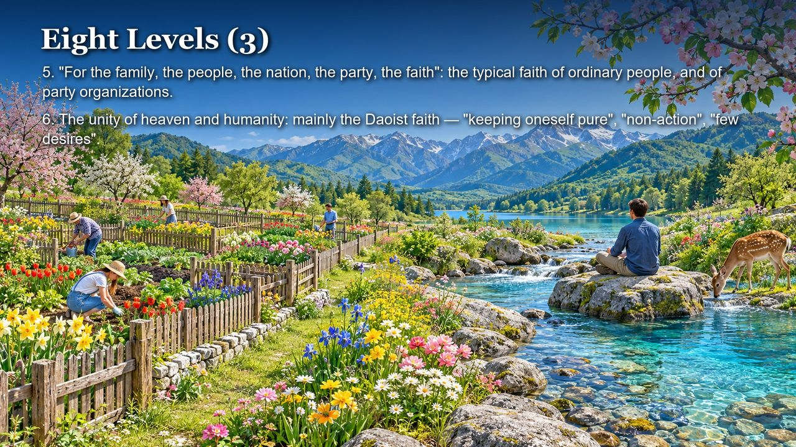
    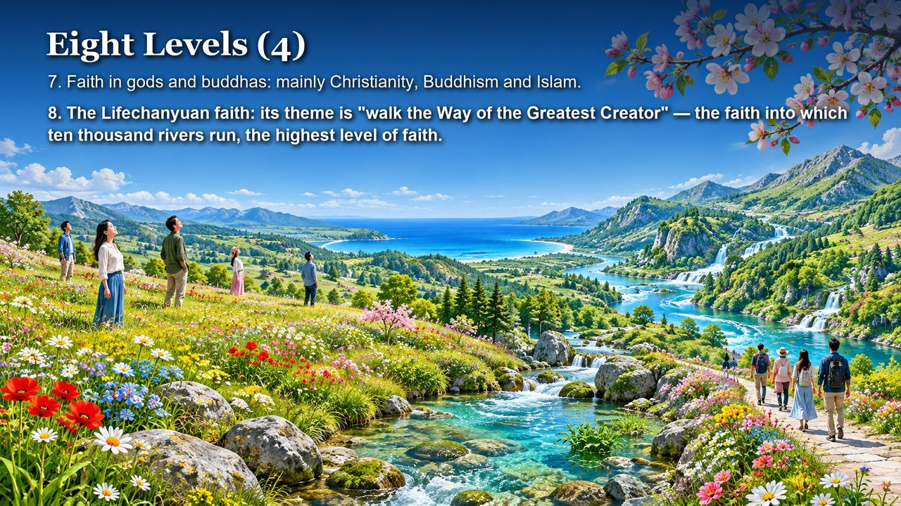
    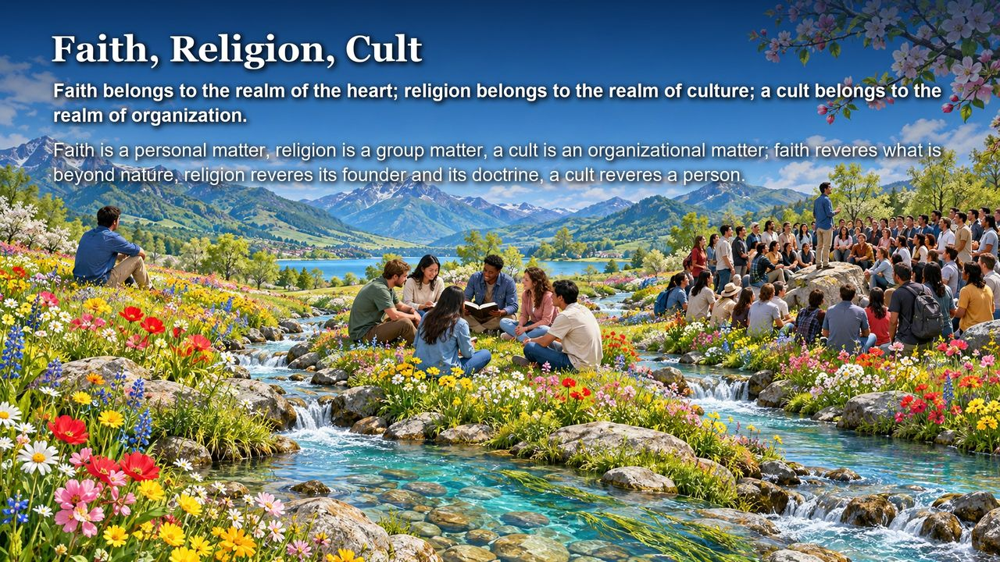
    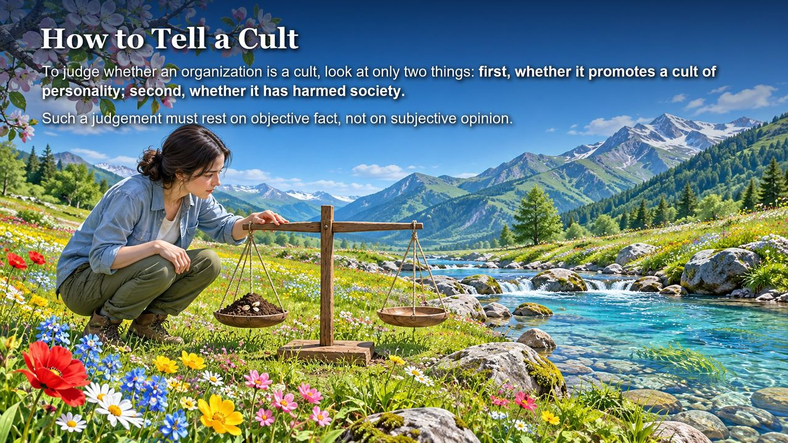
    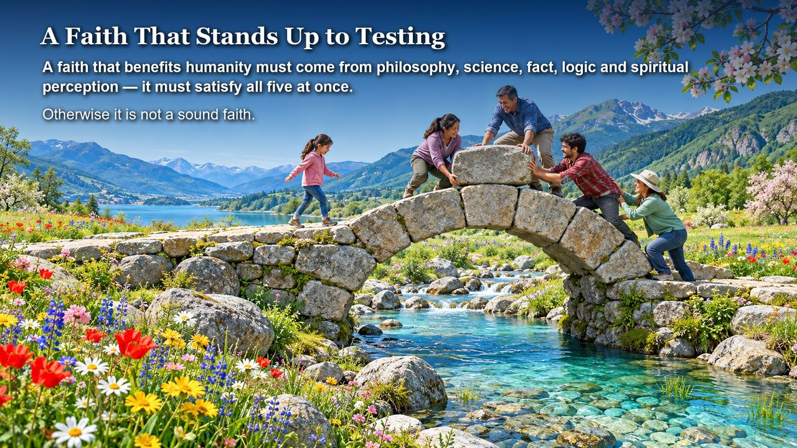
    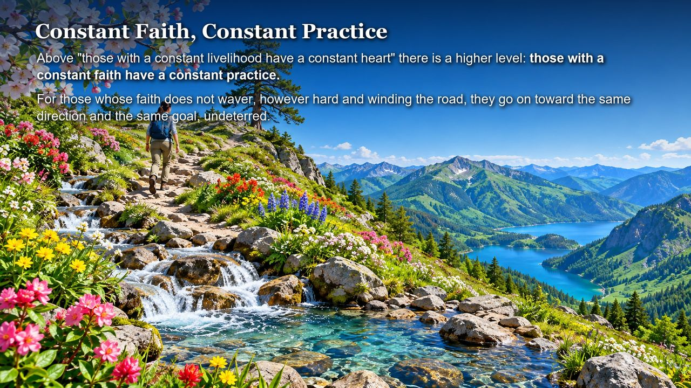
    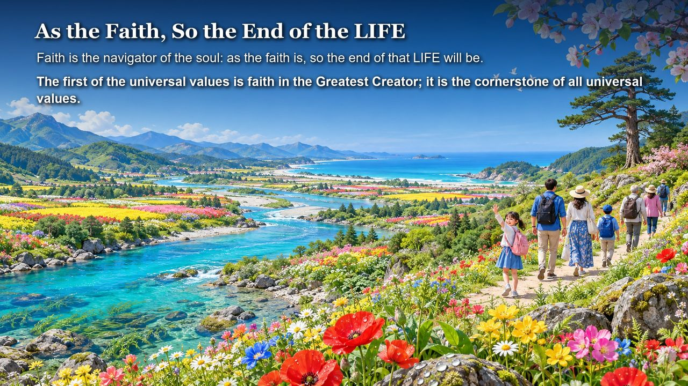

---

| Version | Best for | Focus |
|---------|----------|-------|
| [Friendly version](friendly.md) | First-time readers | What belief is and how to build your own |
| [Academic version](academic.md) | Researchers | Belief taxonomy, comparative analysis |
| [Internal reference](internal.md) | Deep study | Complete source texts |

---

## Related Entries

[Religion](/en/religion/) · [The Greatest Creator](/en/greatest-creator/) · [Awakening](/en/awakening/) · [Morality](/en/morality/) · [Faith (Xin)](/en/faith/) · [Six Core Qualities](/en/six-qualities/) · [Spiritual Life](/en/spiritual-life/) · [Tianming](/en/tianming/)

> Note: Concept numbers cited on this page refer to the Fourth Edition of the *New Era Human 800 Concepts*. The Fifth Edition has been re-arranged, and its numbering no longer matches the Fourth Edition one to one.
