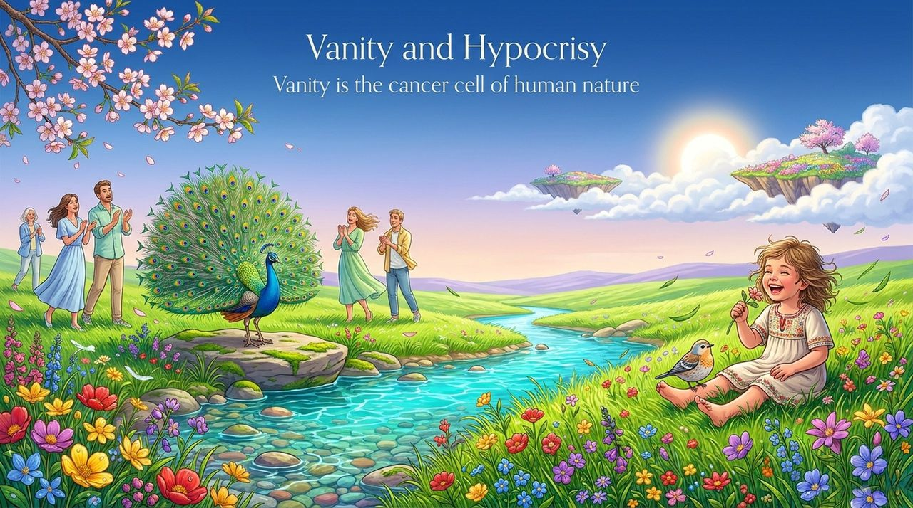
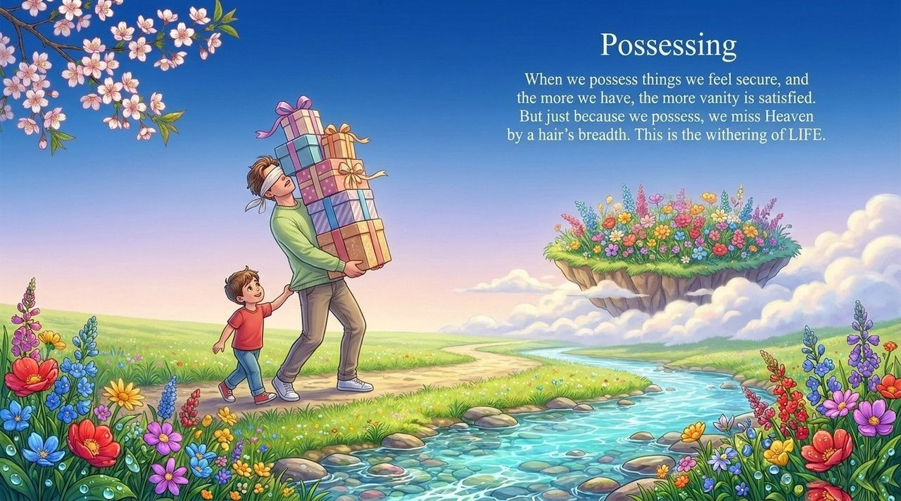
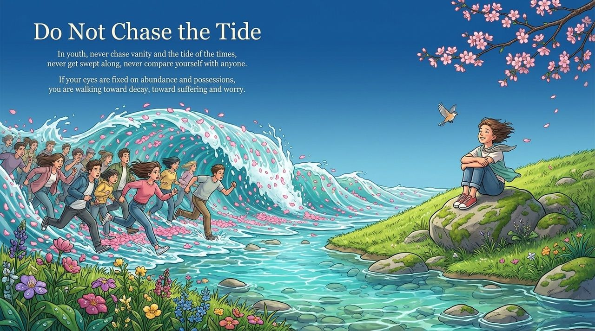
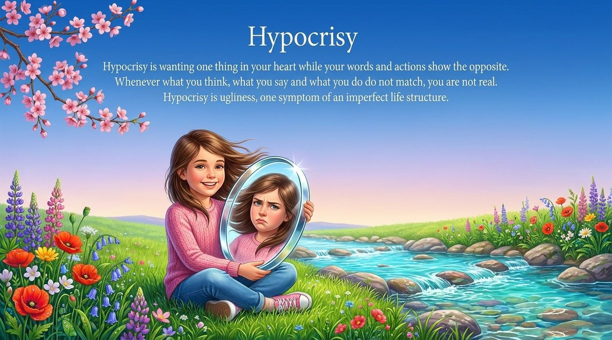
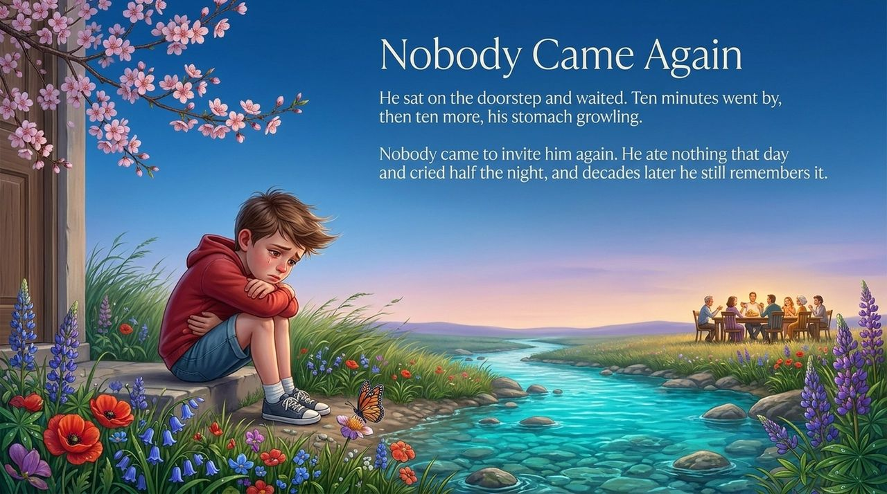
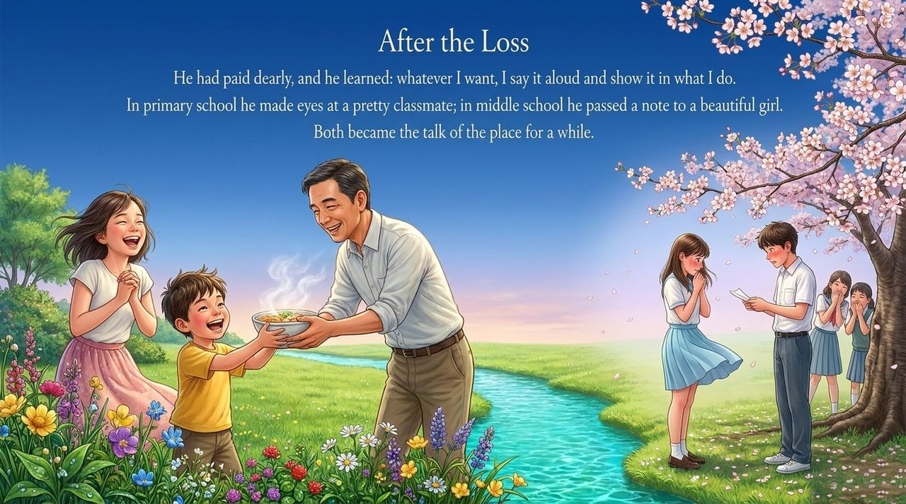
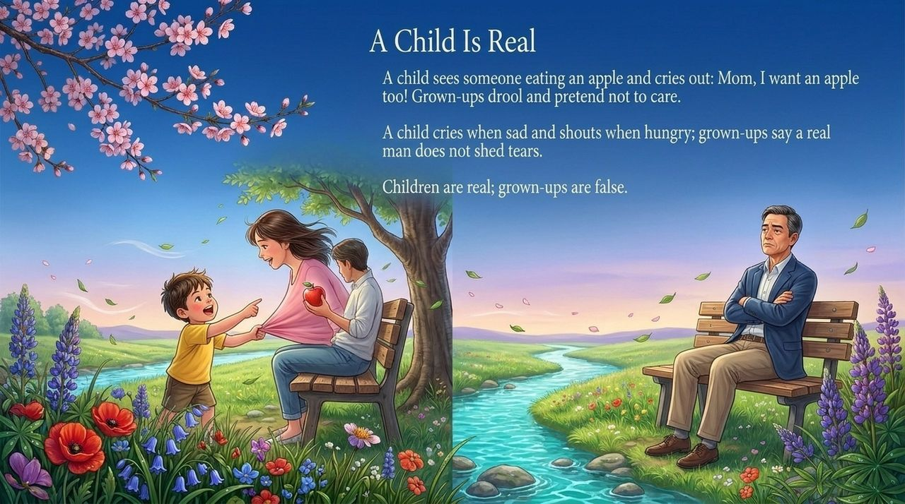
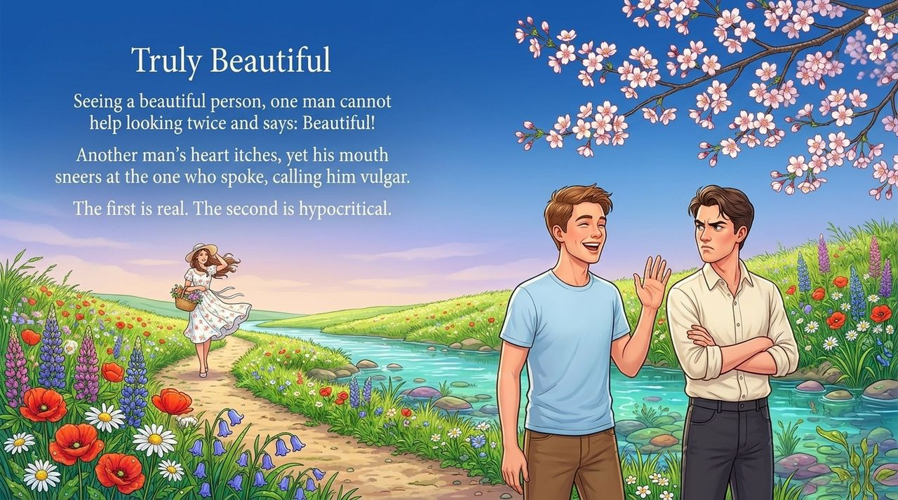
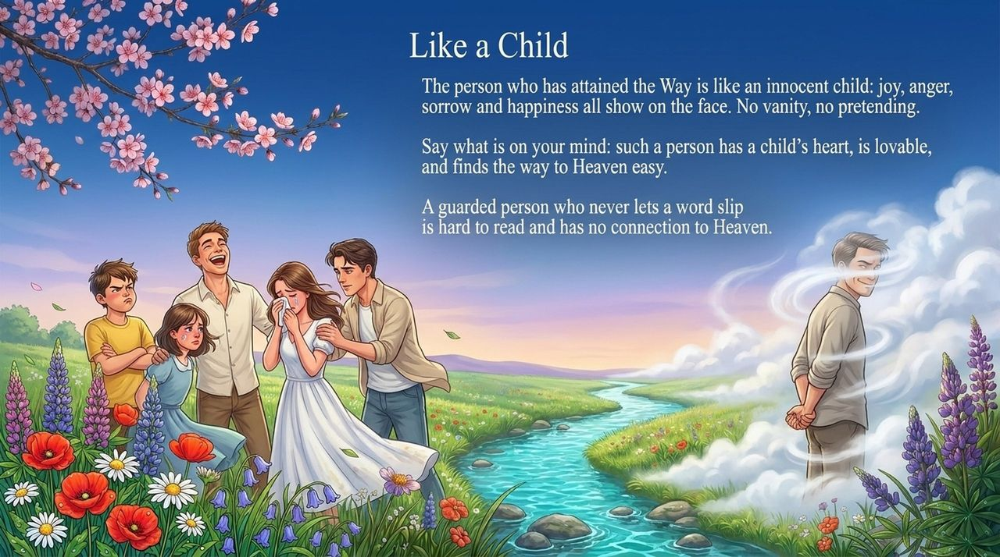
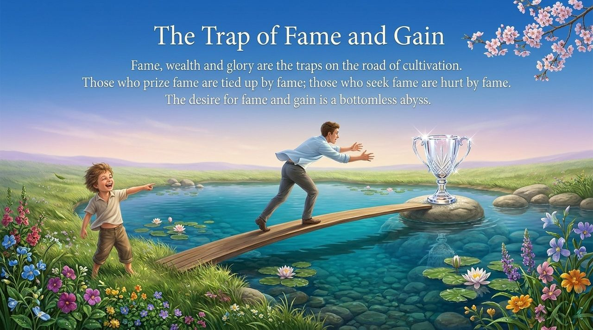

<!-- id: LC-XY-0001-EN theme: Cultivation type: Navigation direction: Character Cultivation lang: en -->

# Vanity and Hypocrisy

Vanity is the disposition that takes others' evaluations and praise as the primary source of life satisfaction — it is the cancer cell of human nature. Hypocrisy is the state of wanting one thing inwardly while expressing the opposite in word and deed — a symptom of an imperfect life structure. The two are inseparable: vanity drives the performance; hypocrisy is its outward expression. In the Lifechanyuan system, **authenticity** (purity, naturalness, flowing with one's true nature) stands as the positive counterpart to hypocrisy, and is both the hallmark of the enlightened and a prerequisite for entering the Kingdom of Heaven.

---

## Video

<iframe style="width:100%;aspect-ratio:4/3;border:0" src="https://www.youtube-nocookie.com/embed/NRIByW3OL3w" title="Vanity and Hypocrisy (Lifechanyuan Encyclopedia video)" allowfullscreen></iframe>

## Slides

??? info "📖 Illustrated slides (14 pages, click to expand)"

    
    
    
    
    
    
    
    
    
    
    
    
    
    

---

## Version Navigation

| Version | Intended Reader | Features |
|---------|----------------|---------|
| [Accessible](friendly.md) | First-time readers | Everyday scenarios · Children's authenticity vs adult hypocrisy · Path to honesty |
| [Academic](academic.md) | Scholars · Cross-cultural comparison | Confucian sincerity · Buddhist māyā · Goffman's dramaturgical theory · Christian hypocrisy |
| [Practitioner](internal.md) | Cultivators · Researchers | Complete verbatim quotes · Six-section framework · In-depth system understanding |

---

## Related Entries

[Selfishness and Selflessness](/en/zisi-wusi/) · [Demonic Nature](/en/moxing/) · [Arrogance](/en/aoman/) · [Humility](/en/humility/) · [Gratitude](/en/gratitude/) · [Truth](/en/truth/) · [Sincerity](/en/sincerity/) · [Letting Go](/en/letting-go/) · [Soul Garden](/en/soul-garden/)
