# Yangsheng — Life Cultivation (Elementary · Intermediate · Advanced)

**Yangsheng** (养生, life cultivation or nourishing life) in the Lifechanyuan system is a three-tier cultivation framework: the elementary level focuses on protecting the physical body; the intermediate level addresses both the physical body and the nonmaterial LIFE body simultaneously; the advanced level works primarily through the nonmaterial LIFE body via conscious visualization. Its overarching purpose is to "preserve health, attain longevity, shed mortal bones, and achieve the Celestial Way" — ultimately serving the perfection of the nonmaterial structure of LIFE and the elevation toward becoming a Celestial or Buddha.

> Everyone in the New Era needs yangsheng, minimizing illness to the greatest extent possible. Yangsheng primarily cultivates essence, qi, spirit, and form. Cultivating yangsheng begins with cultivating the heart-mind; cultivating the heart-mind begins with cultivating virtue; cultivating virtue begins with entering the Dao.
>
> — 800 Values for New Era Humanity (4th ed.), Value 743

---

## Version Navigation

| Version | Best for | Focus |
|---------|----------|-------|
| [Friendly version](friendly.md) | First-time readers | Life cultivation as a practical journey from health to transcendence |
| [Academic version](academic.md) | Researchers | Theoretical framework, cross-traditional comparison, body–LIFE analysis |
| [Internal reference](internal.md) | Deep study | Original texts by the Guide, fully sourced |

---

## Video

<iframe style="width:100%;aspect-ratio:4/3;border:0" src="https://www.youtube-nocookie.com/embed/NvBkPPe8PGU" title="Yangsheng — Life Cultivation (Lifechanyuan Encyclopedia video)" allowfullscreen></iframe>

## Slides

??? info "📖 Illustrated slides (14 pages, click to expand)"

    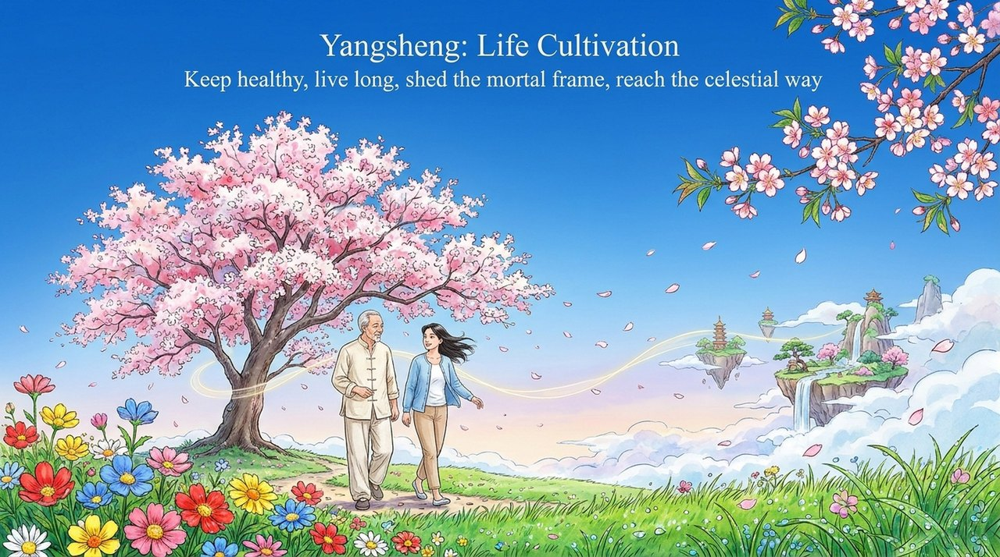
    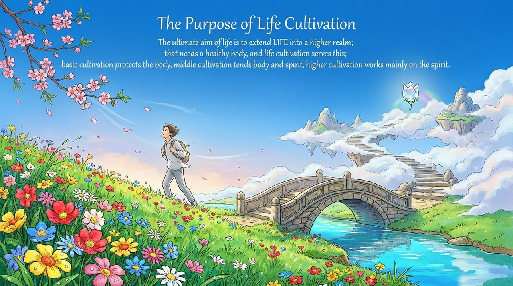
    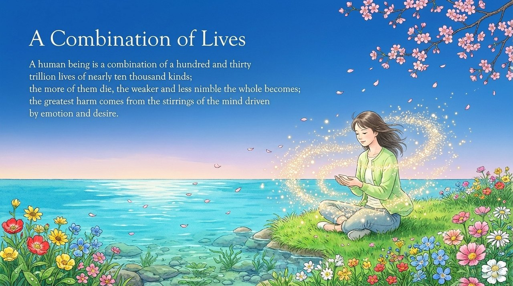
    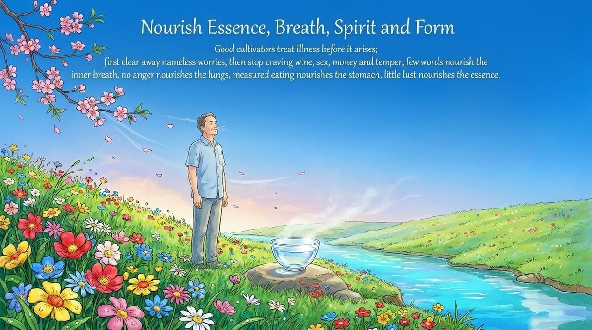
    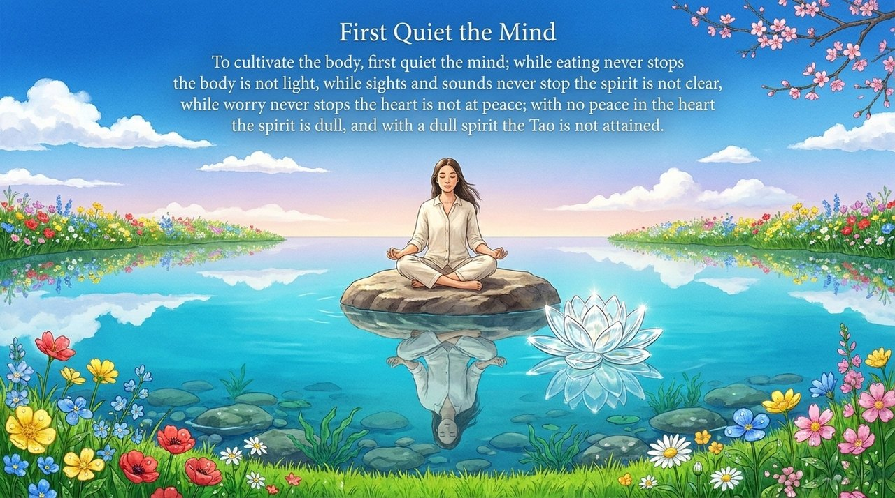
    
    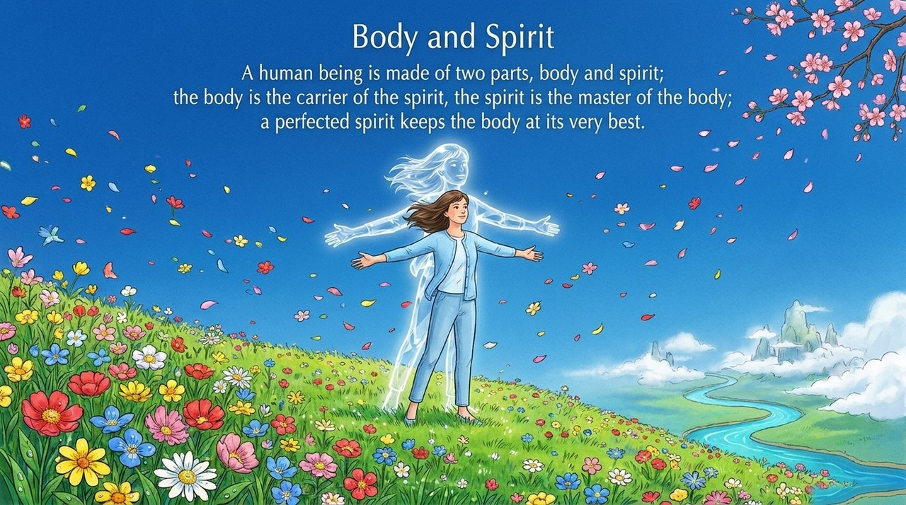
    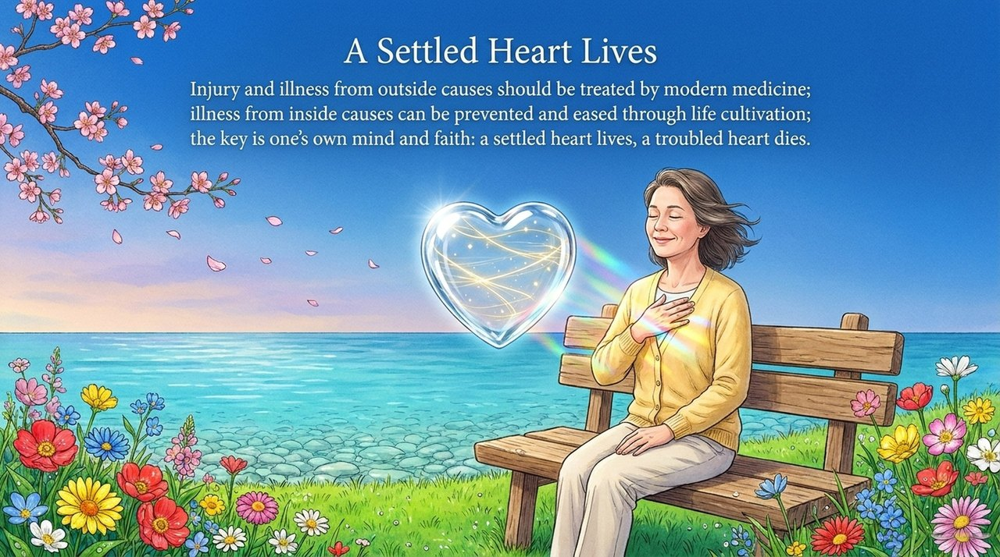
    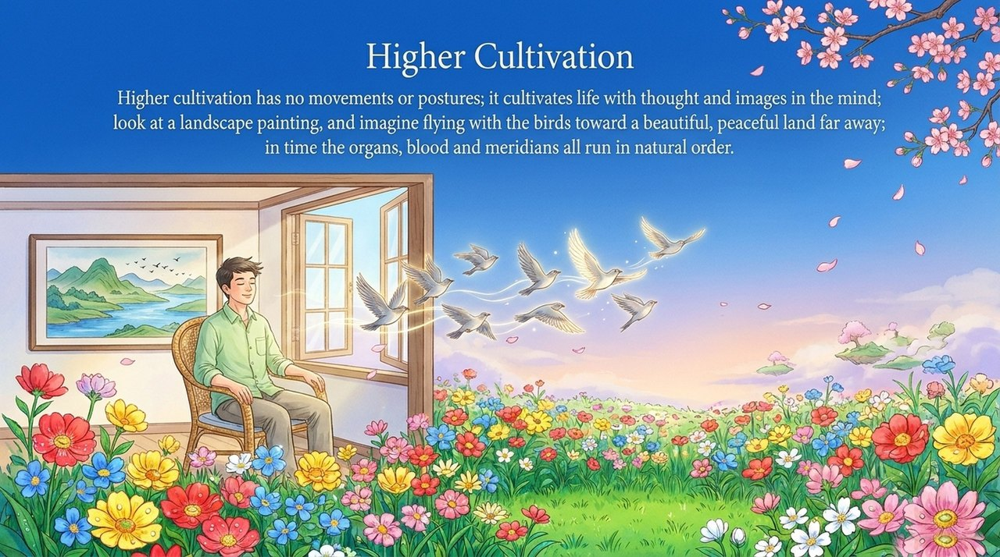
    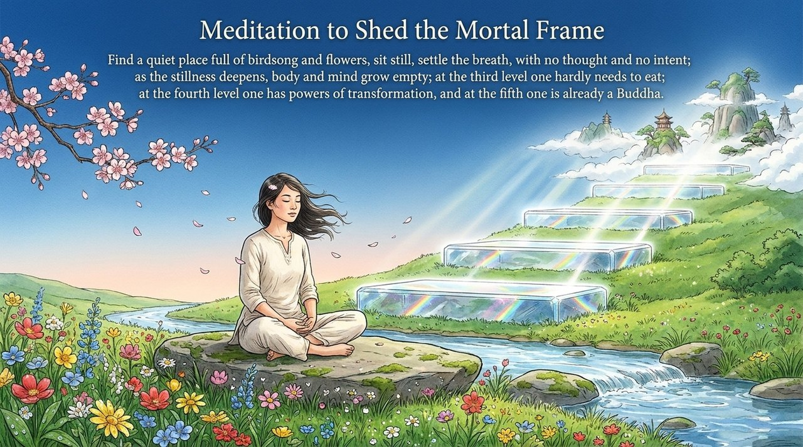
    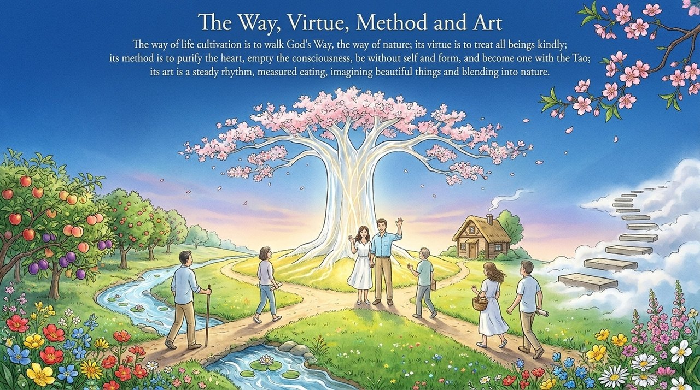
    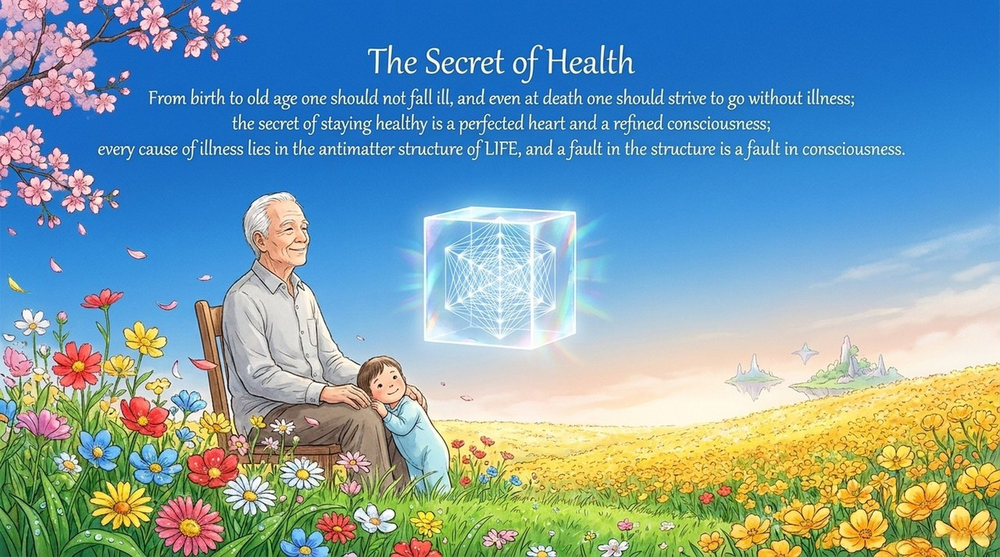
    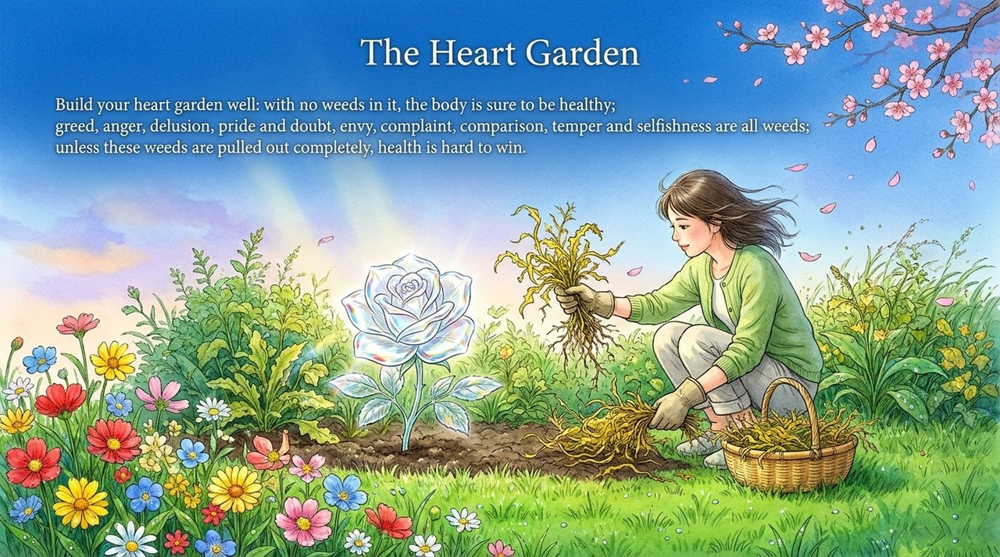
    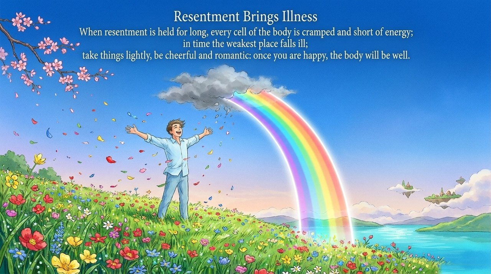

---

## Related Entries

[Purifying the Heart-Mind](/en/jinghuaxinling/) · [Soul Garden](/en/soul-garden/) · [Neigong — Inner Cultivation](/en/neigong/) · [Settled Stillness — Meditation Practice](/en/settled-stillness/) · [Becoming a Celestial](/en/becoming-celestial/) · [Disease and Health](/en/disease-health/) · [Nonmaterial Structure of LIFE](/en/antimatter-structure/) · [Elementary Refinement](/en/elementary-refinement/) · [Advanced Refinement](/en/advanced-refinement/)
