# The Mysteries of Food and Diet

The **Mysteries of Food and Diet** (*Yin Shi Ao Mi* 饮食奥秘) in the Lifechanyuan system refers to the profound connection between what we eat and the state of our spiritual life. Guide Xuefeng teaches that food is more than biological fuel — every food carries structure and information that shapes one's antimatter structure (spiritual state). Lifechanyuan's dietary framework recognizes four ascending levels: *eating meat clouds the mind, eating vegetables clears it, eating grains cultivates wisdom, and absorbing qi (energy directly from nature) leads to transcendence*. At the same time, Xuefeng emphasizes that human joy and freedom do not depend on the richness of one's diet, but on the state of the mind and spirit — simplicity in eating liberates rather than deprives.

> Those who eat meat grow heavy-minded; those who eat vegetables grow clear; those who eat grains grow wise; those who consume qi become spiritually radiant.
>
> — Chanyuan Corpus · Yangsheng Chapter · Elementary Yangsheng

## Version Navigation

| Version | Best for | Focus |
|---------|----------|-------|
| [Friendly version](friendly/) | First-time readers | Dietary simplicity and soul freedom |
| [Academic version](academic/) | Researchers | Systematic analysis of diet levels and spiritual cultivation |
| [Internal reference](internal/) | Deep study | Guide's original text · Source archive |

---

## Video

<iframe style="width:100%;aspect-ratio:4/3;border:0" src="https://www.youtube-nocookie.com/embed/6Hng4HDEj5c" title="The Mysteries of Food and Diet (Lifechanyuan Encyclopedia video)" allowfullscreen></iframe>

## Slides

??? info "📖 Illustrated slides (14 pages, click to expand)"

    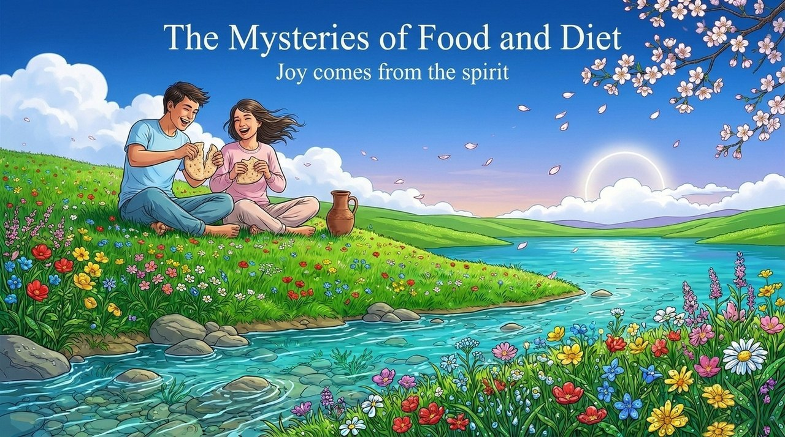
    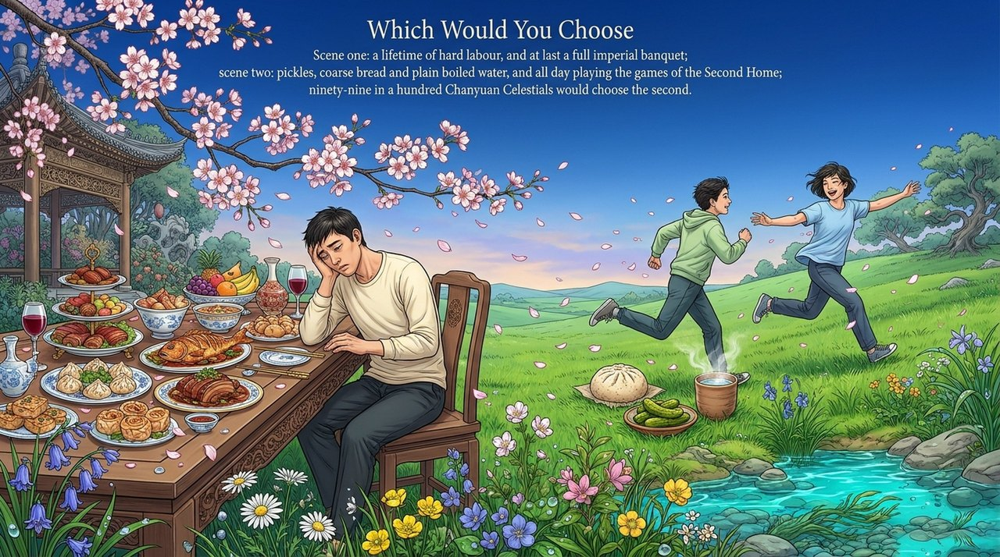
    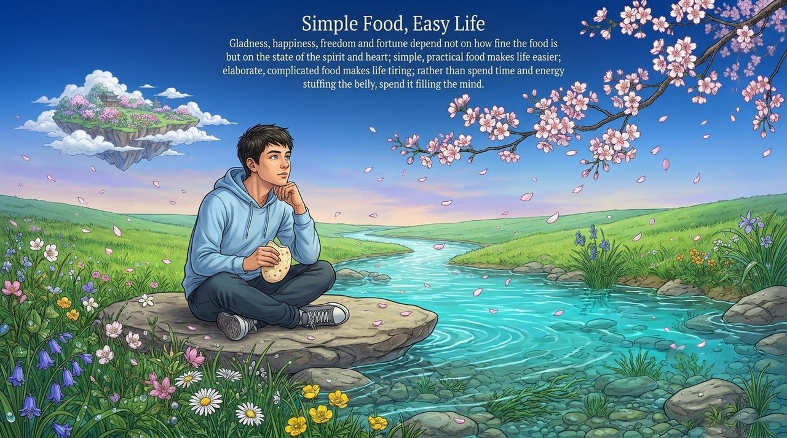
    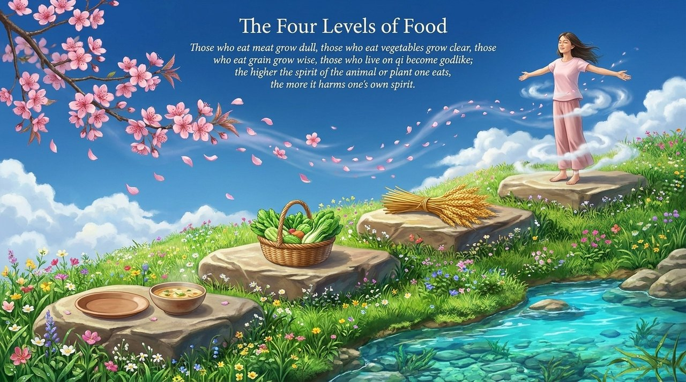
    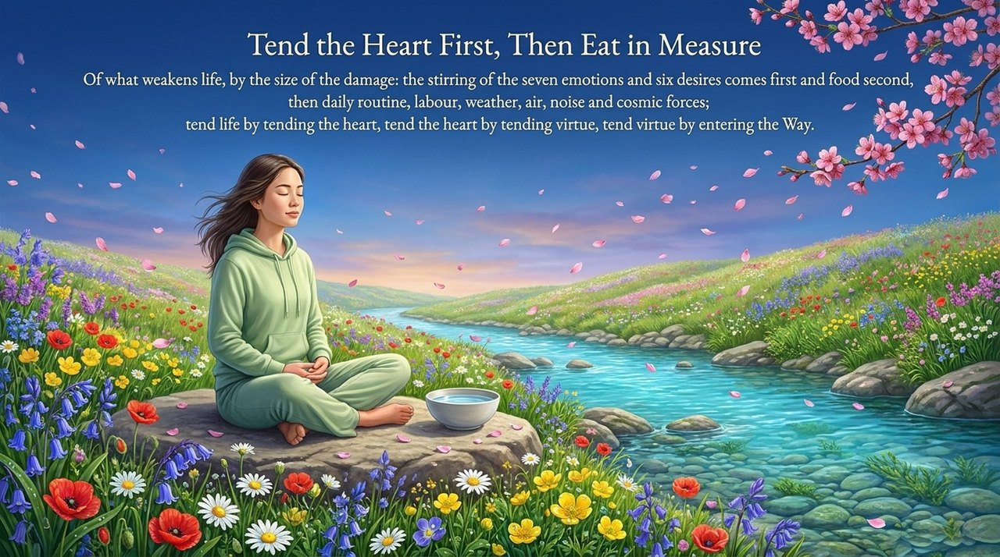
    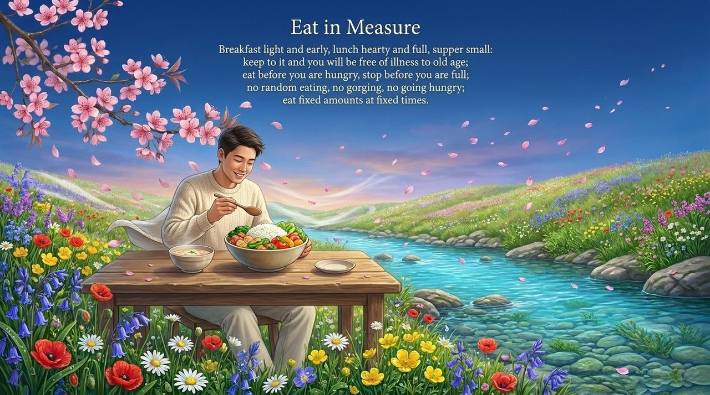
    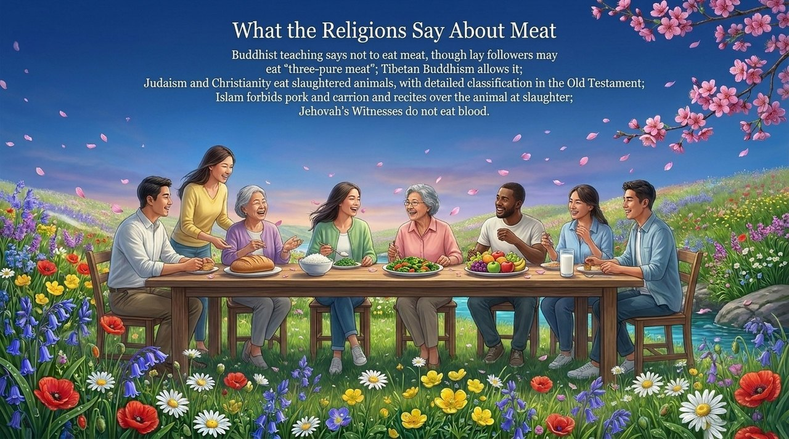
    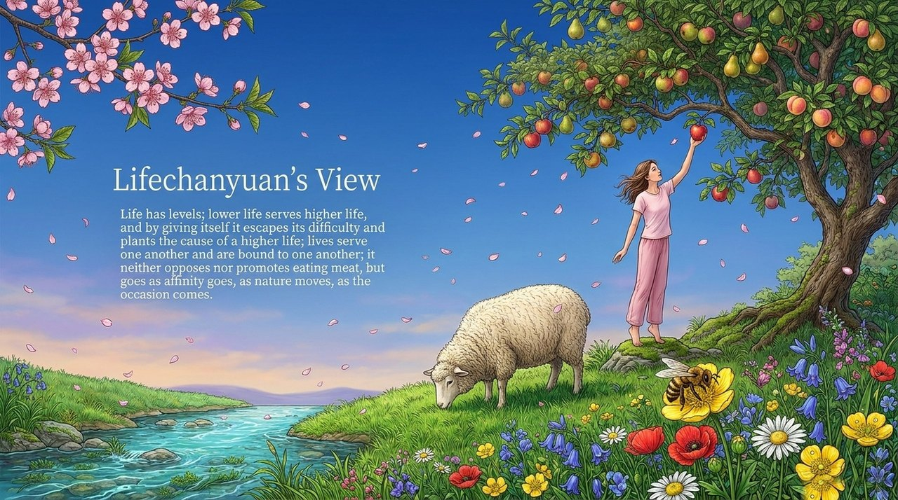
    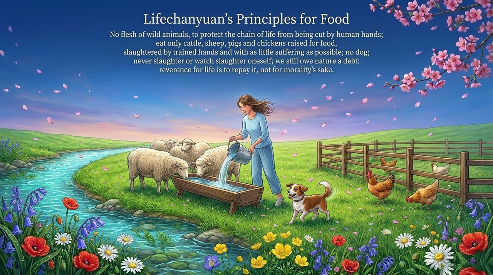
    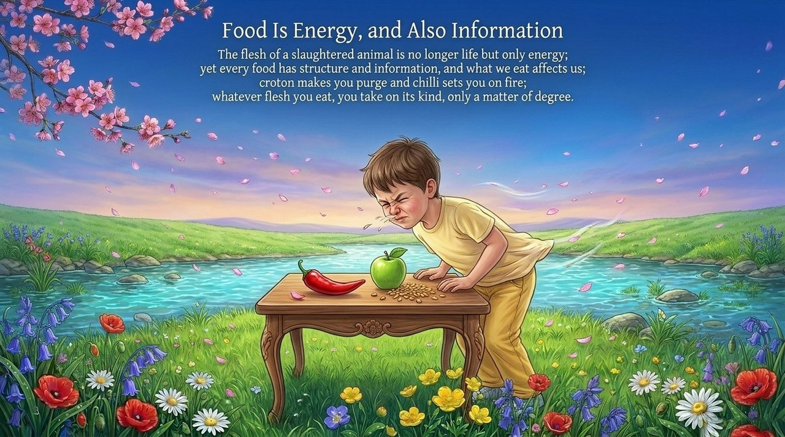
    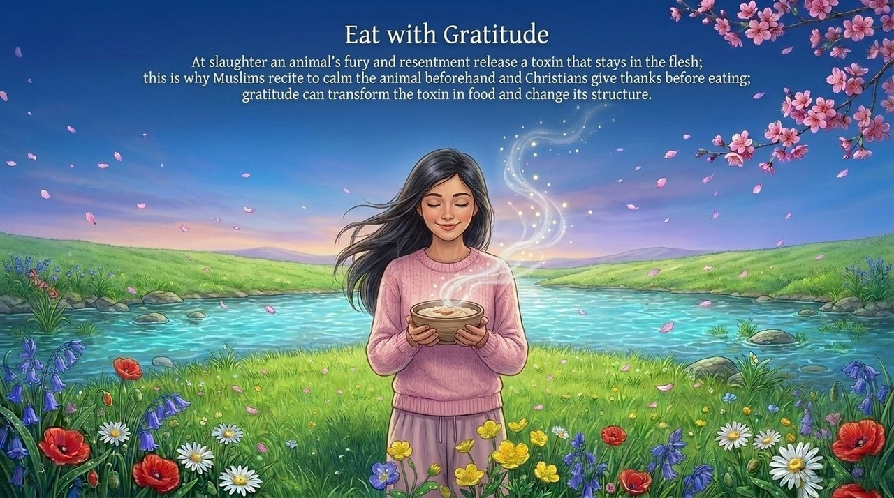
    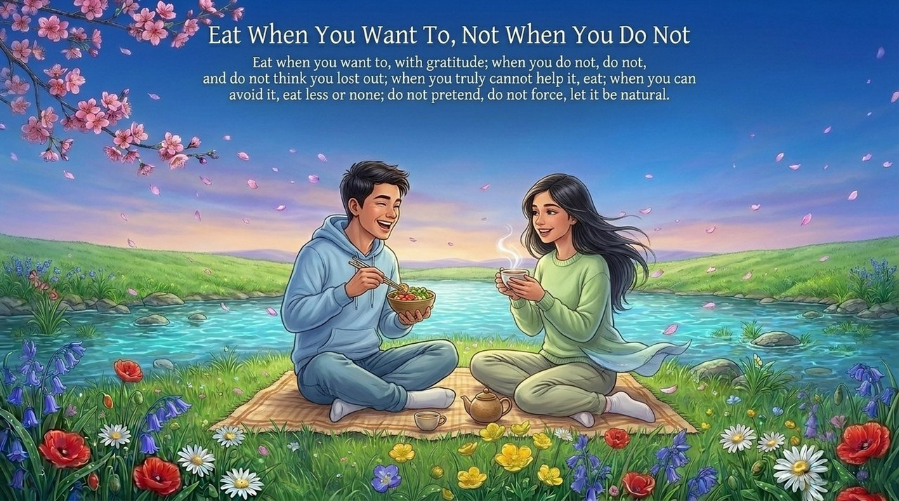
    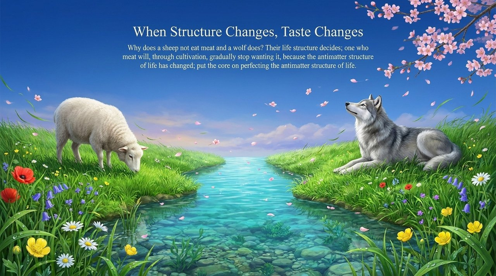
    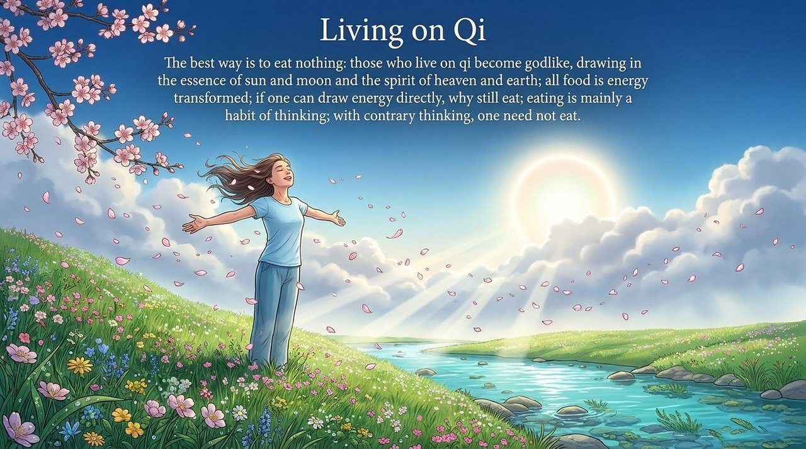

---

## Related Entries

[Yangsheng — Life Cultivation](/en/yangsheng/) · [Purifying the Mind](/en/jinghuaxinling/) · [Antimatter Structure](/en/antimatter-structure/) · [Spirituality](/en/spirituality/) · [Rectifying Body and Mind](/en/neigong/) · [Life Oasis Three Maxims](/en/life-oasis-three-maxims/) · [Gratitude](/en/gratitude/)
