<!-- id: LC-ZW-0001-EN theme: cultivation type: Navigation direction: character-cultivation lang: en -->

# Selfishness and Selflessness

Selfishness — putting personal gain above all else — is the cancer cell of LIFE's gene. Selflessness — transcending the limits of self-interest — is LIFE's most perfect quality. Heaven is the domain of the selfless; the lives of the extremely selfish converge into a sea of suffering. Those who are selfless belong to the life of the Kingdom of Heaven; those who have some selfishness belong to human life; those whose selfishness is heavy belong to the life of hell.

---

## Video

<iframe style="width:100%;aspect-ratio:4/3;border:0" src="https://www.youtube-nocookie.com/embed/ACekEWG6qVs" title="Selfishness and Selflessness (Lifechanyuan Encyclopedia video)" allowfullscreen></iframe>

## Slides

??? info "📖 Illustrated slides (14 pages, click to expand)"

    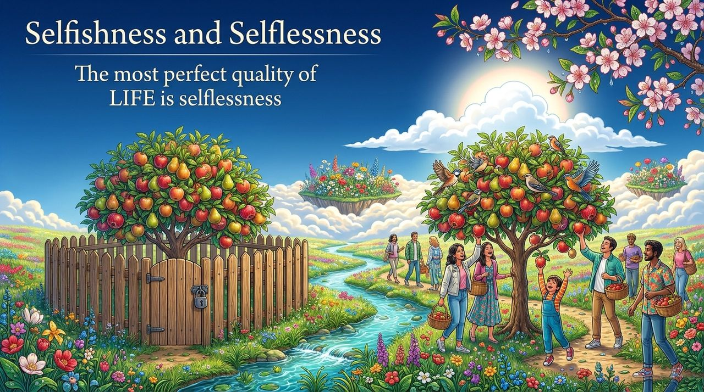
    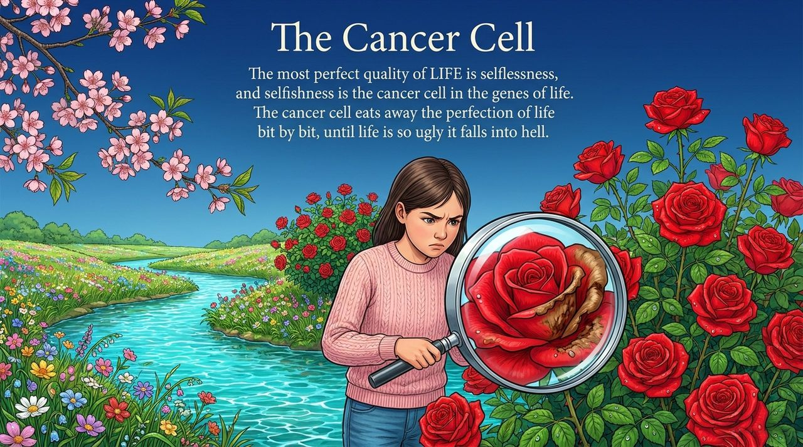
    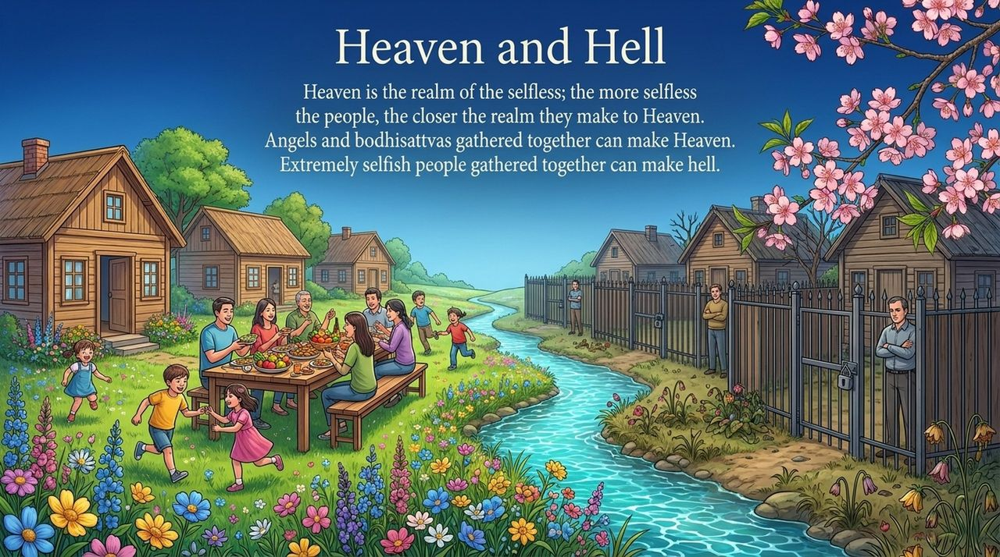
    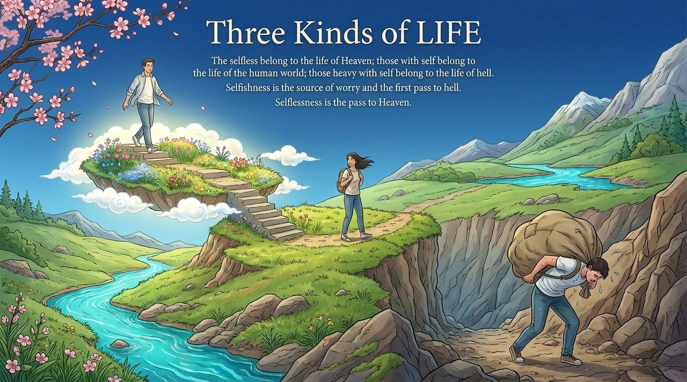
    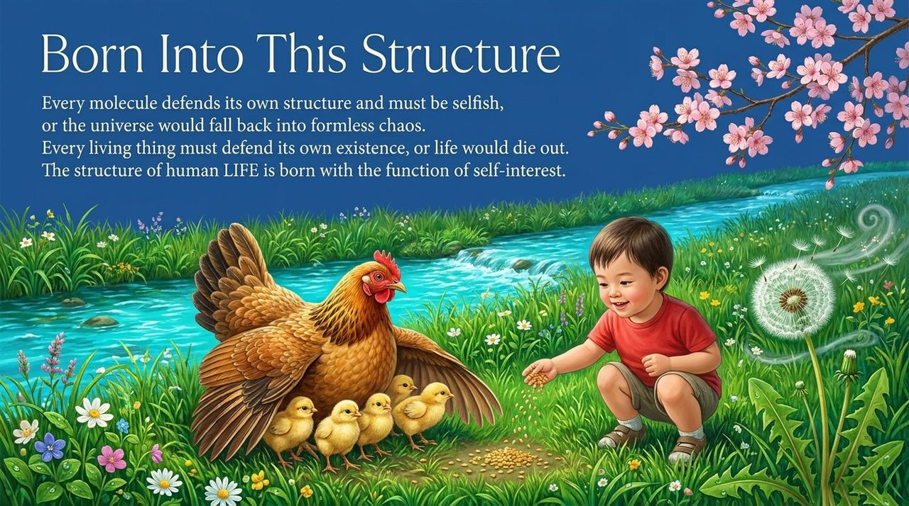
    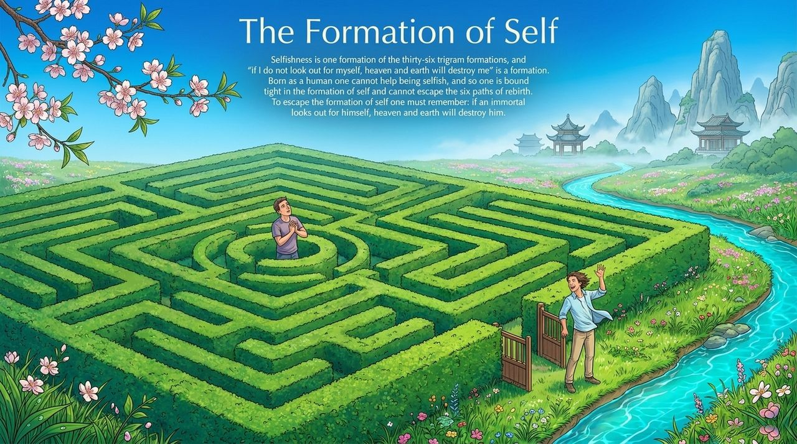
    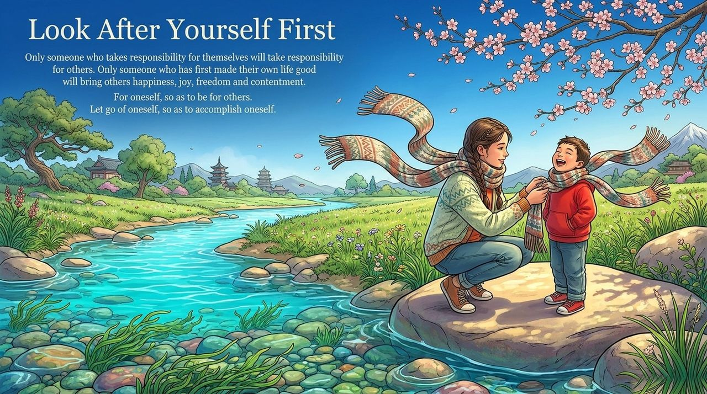
    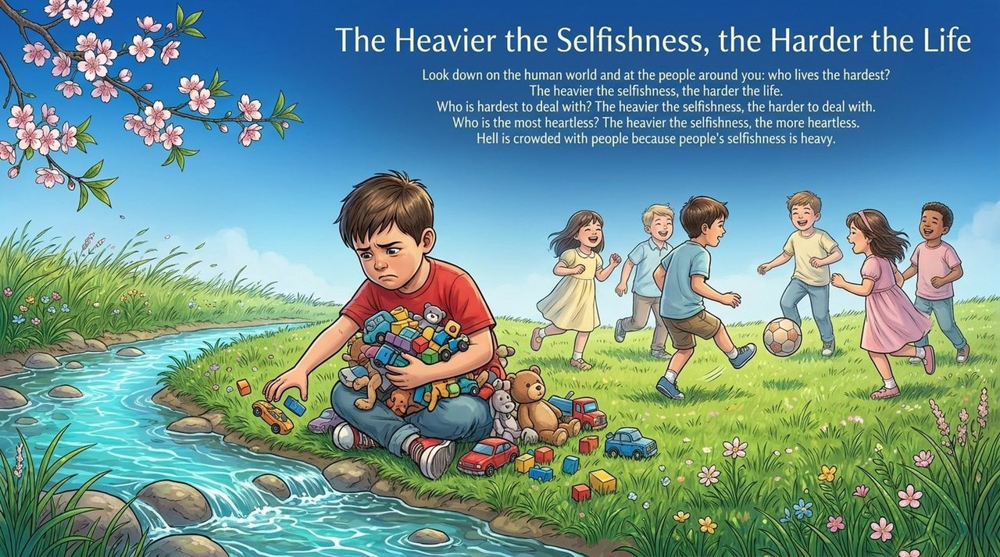
    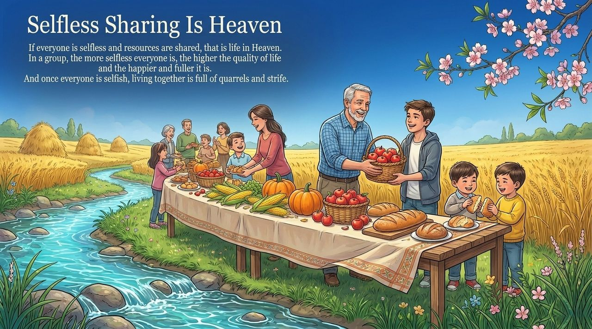
    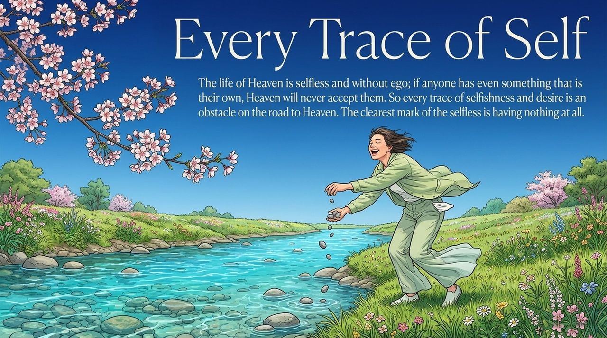
    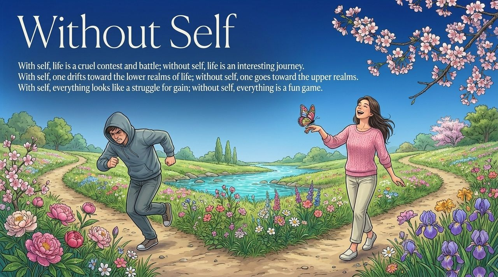
    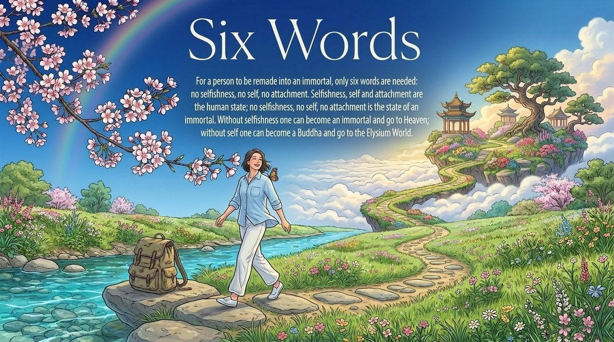
    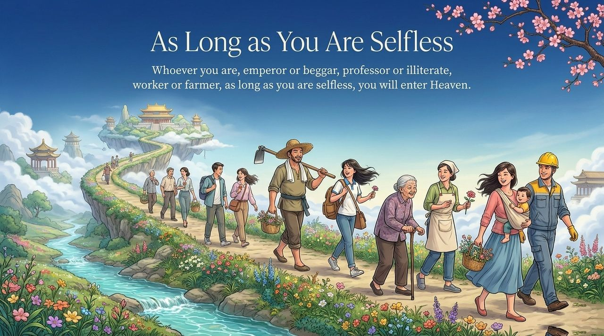
    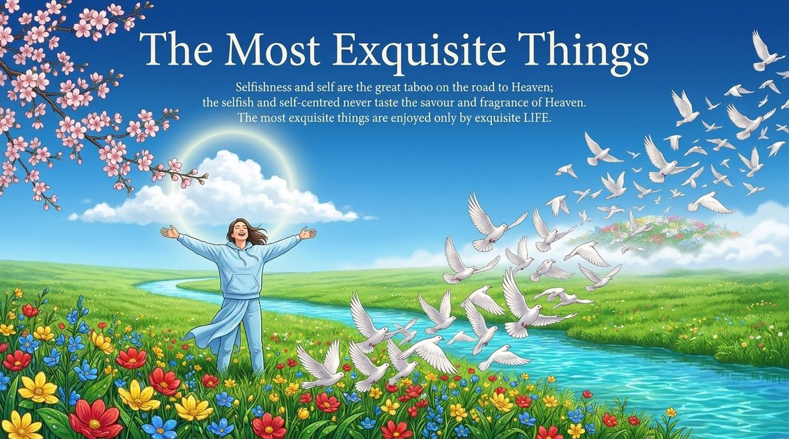

---

## Version Navigation

| Version | Best for | What it offers |
|---------|----------|----------------|
| [Accessible Version](friendly.md) | First-time readers | Everyday situations · the three-tier boundary · starting points for change |
| [Academic Version](academic.md) | Scholars & cross-cultural researchers | Comparison with Buddhist anattā, Confucian self-cultivation, and economic self-interest theory |
| [Internal Version](internal.md) | Practitioners & researchers | Complete source texts · seven-section framework · in-depth understanding |

---

## Related Entries

[Demonic Nature (Moxing)](/en/moxing/) · [Arrogance (Aoman)](/en/aoman/) · [Humility](/en/humility/) · [Gratitude](/en/gratitude/) · [Repentance](/en/repentance/) · [Letting Go](/en/letting-go/) · [No-Self, No-Form](/en/no-self-no-form/) · [Soul Garden](/en/soul-garden/) · [Becoming a Celestial Being and a Buddha](/en/becoming-celestial-buddha/)
