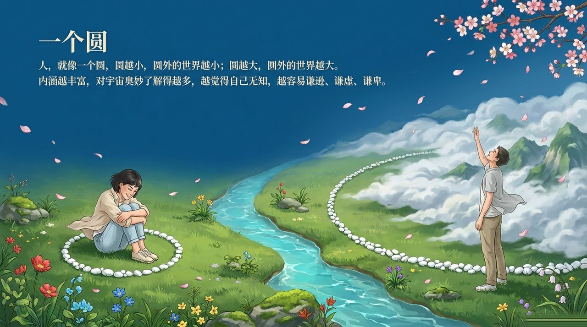
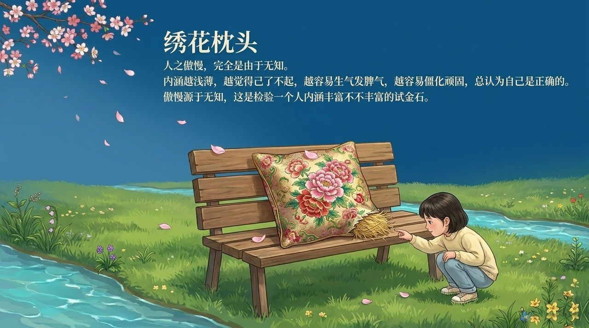
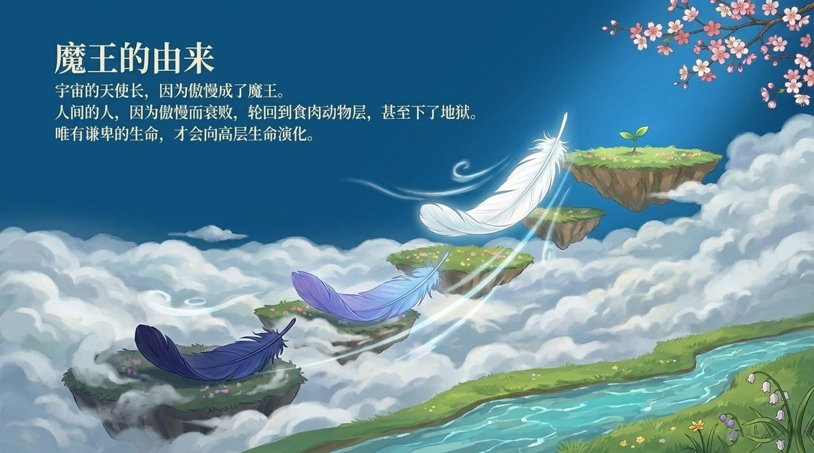
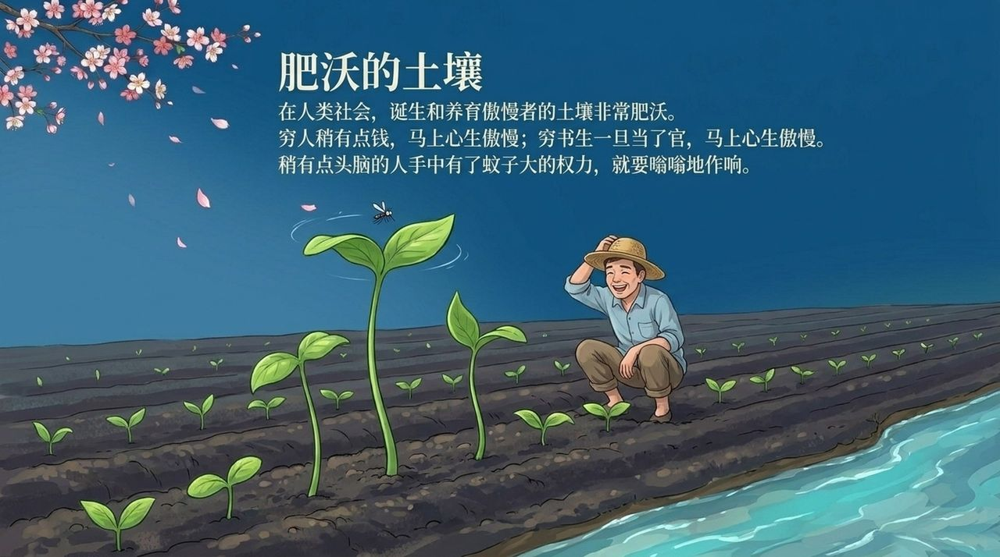
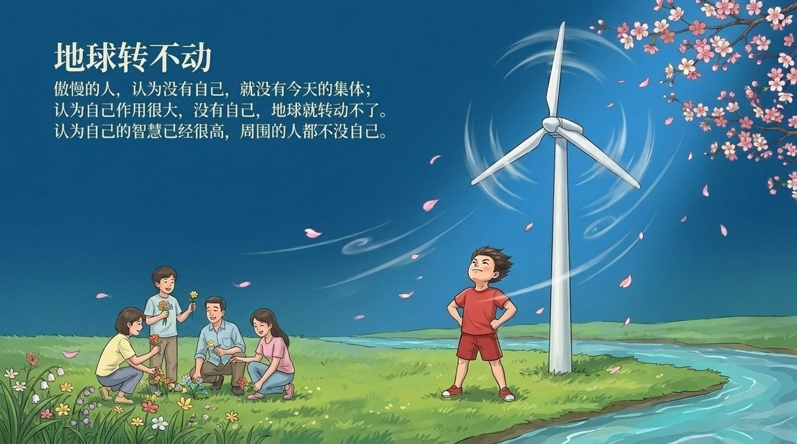
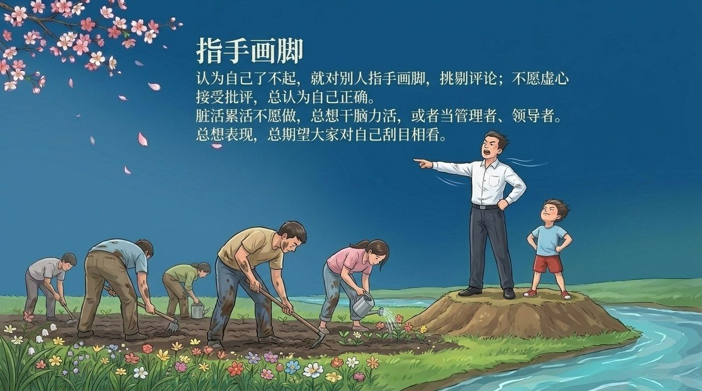
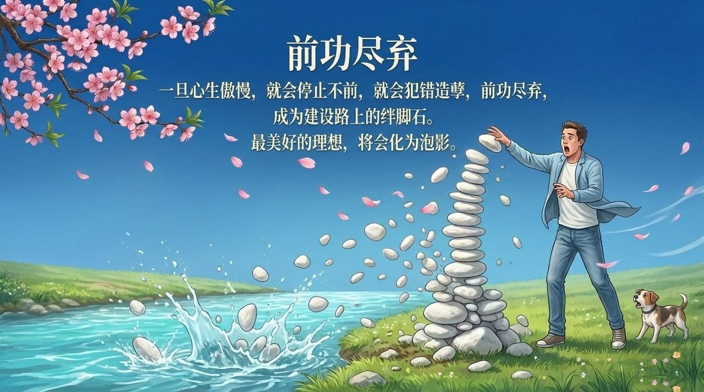
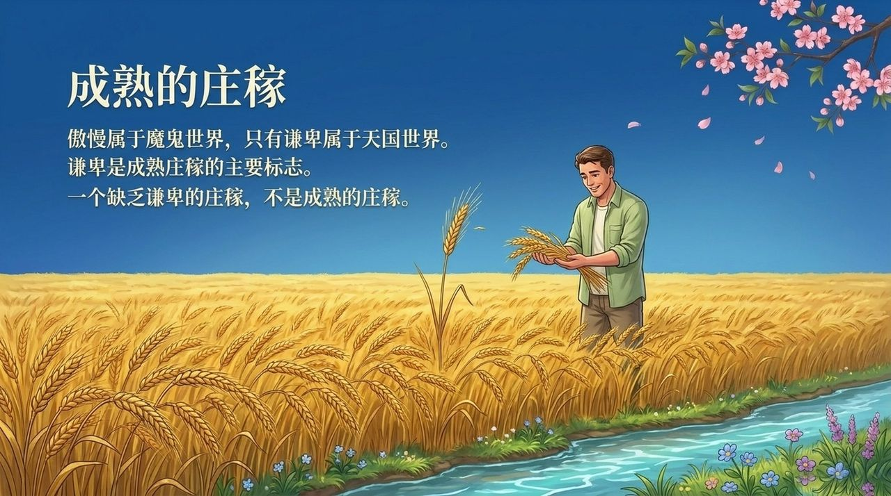

<!-- id: LC-AM-0001-ZH theme: 修行 type: 导航 direction: 品性修炼 lang: zh -->

# 傲慢

傲慢，是无知在言行中的必然显现，是生命与魔性同频的第一步，也是成仙成佛路上最难察觉、破坏力最大的心灵杂草——宇宙的天使长因傲慢成了魔王，人间的修行者因傲慢而前功尽弃。

---

## 视频版

<iframe style="width:100%;aspect-ratio:4/3;border:0" src="https://www.youtube-nocookie.com/embed/H8TCweEdO3U" title="傲慢（生命禅院百科·视频版）" allowfullscreen></iframe>

??? info "📖 图文幻灯（14 张，点击展开）"

    
    
    
    
    
    
    
    
    
    
    
    
    
    

---

## 版本导航

| 版本 | 适合读者 | 特点 |
|------|---------|------|
| [通俗版](friendly.md) | 初次了解者 | 日常情境·自我检视·从傲慢到谦卑的实践路径 |
| [学术版](academic.md) | 学者·跨文化比较 | 与基督教七罪宗·佛教慢心·达克效应对照分析 |
| [内部版](internal.md) | 修行者·研究者 | 完整引文·六节框架·体系内深度理解 |

---

## 关联词条

[谦卑](/zh/humility/) · [我执](/zh/wo-zhi/) · [感恩](/zh/gratitude/) · [魔性](/zh/moxing/) · [成仙成佛](/zh/becoming-celestial-buddha/) · [心灵花园](/zh/soul-garden/) · [天性·秉性·习性](/zh/tianxing-bingxing-xixing/) · [降服魔性](/zh/moxing/)
