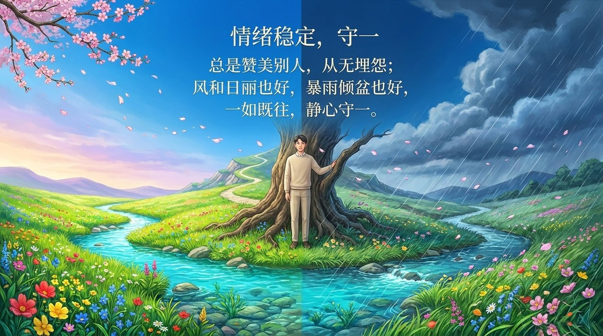
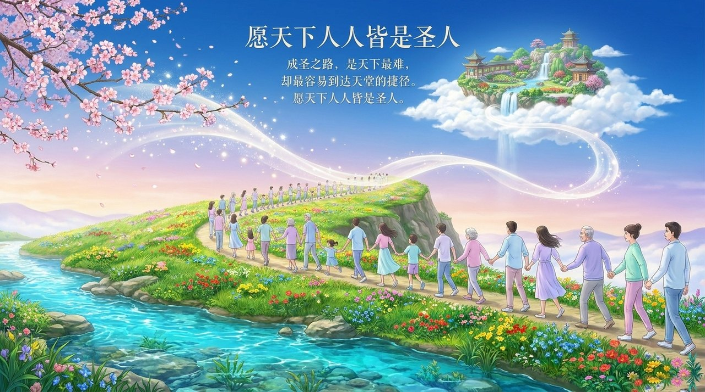

<!-- id: LC-BS-0001-ZH theme: 修行修炼 type: index direction: 修行修炼 lang: zh -->

# 成圣

**成圣**，是生命禅院修行修炼体系中最高的人间境界，指一个人彻底化去自我、以利益天下苍生为唯一驱动，达到无我、无私、无执、无恨的生命状态，成为真正意义上的圣人，并由此开启进入极乐界仙岛群岛洲的天命之路。

---

## 视频版

<iframe style="width:100%;aspect-ratio:4/3;border:0" src="https://www.youtube-nocookie.com/embed/1hQGOCJes4g" title="成圣（生命禅院百科·视频版）" allowfullscreen></iframe>

??? info "📖 图文幻灯（14 张，点击展开）"

    
    
    
    
    
    
    
    
    
    
    
    
    
    

---

## 版本导航

| 版本 | 适合读者 | 核心角度 |
|------|---------|---------|
| [友好版](friendly.md) | 初次了解者 | 成圣是什么感觉？最简单的成圣路是什么？ |
| [学术版](academic.md) | 研究者 | 圣人八无标准、成圣七条件、程序与道德的关系 |
| [内部版](internal.md) | 深度研修 | 完整文集引文、七位毕业生特征、成圣的天命归宿 |

---

## 相关词条

[成仙](/zh/becoming-celestial/) · [成佛](/zh/becoming-buddha/) · [成仙成佛](/zh/becoming-celestial-buddha/) · [仙·天仙·佛](/zh/xian-tian-xian-fo/) · [圣人·贤人](/zh/sages-and-worthies/) · [极乐界](/zh/elysium-world/) · [大乘心愿](/zh/dasheng-xinyuan/) · [无我无相](/zh/no-self-no-form/) · [八无境界](/zh/eight-no-realms/) · [明心见性](/zh/illuminate-mind-see-nature/)
