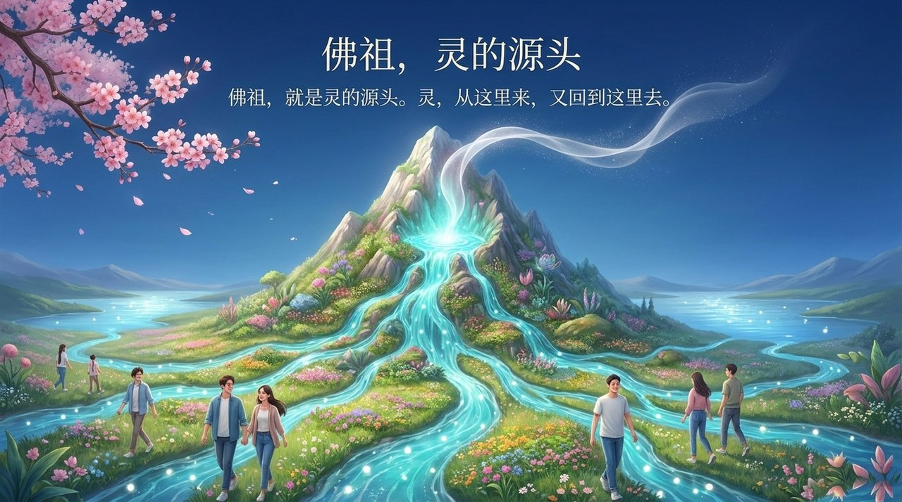
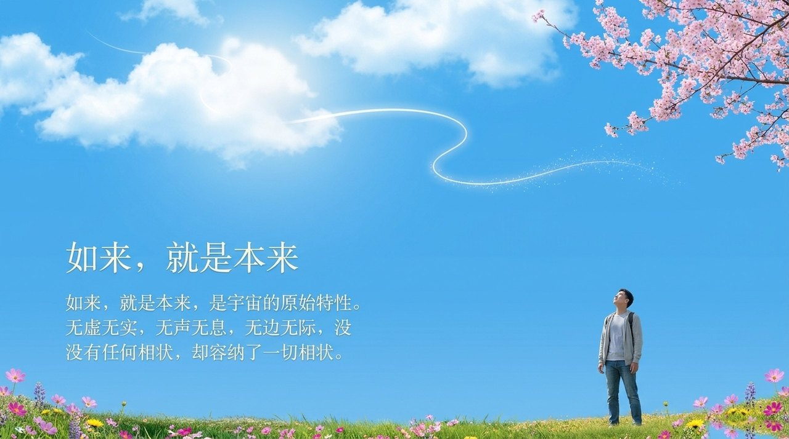
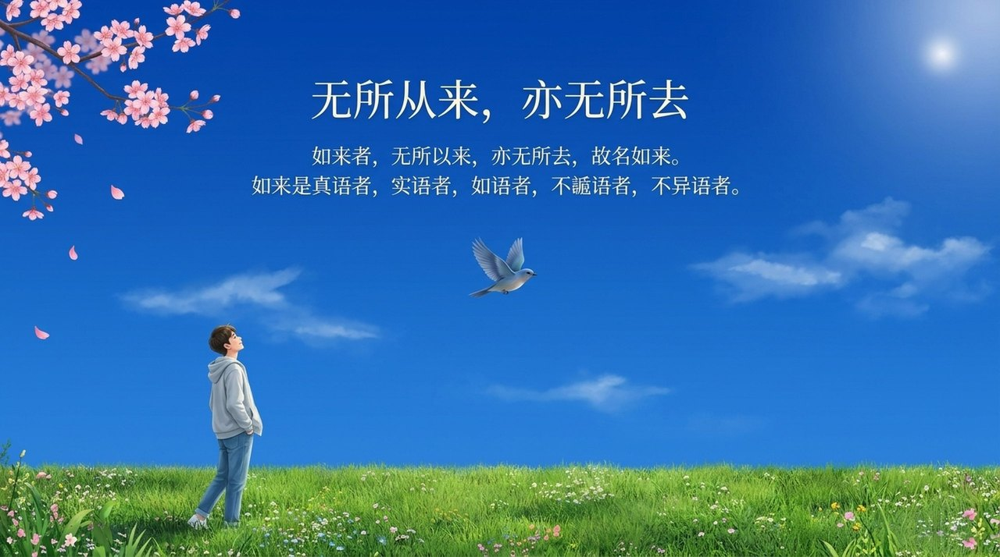
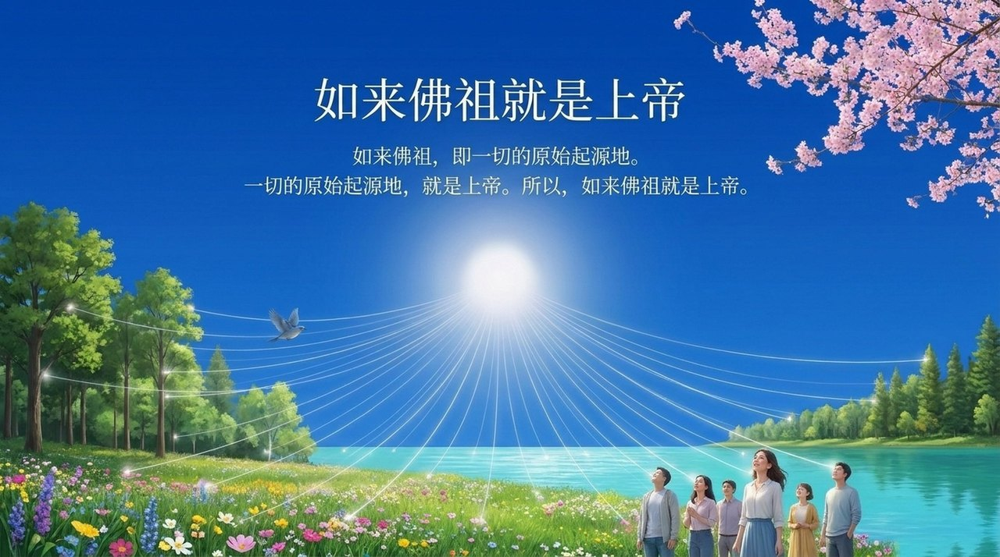
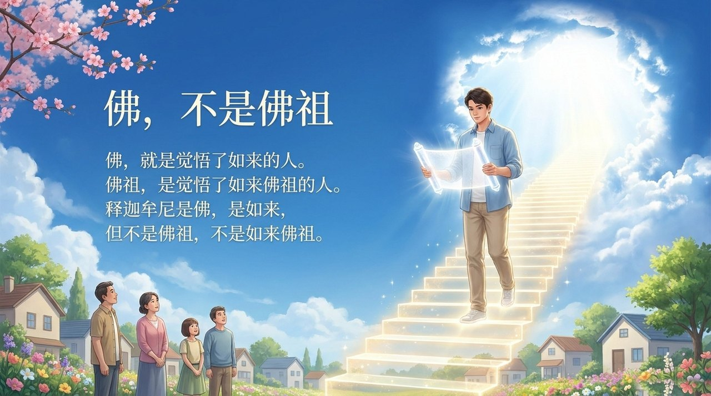
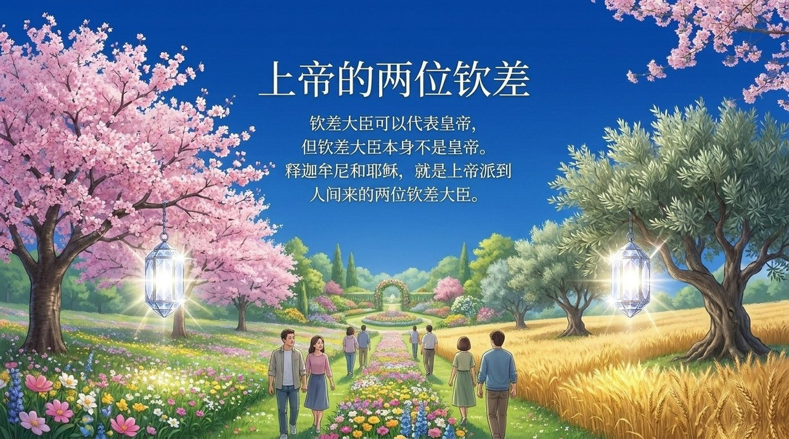
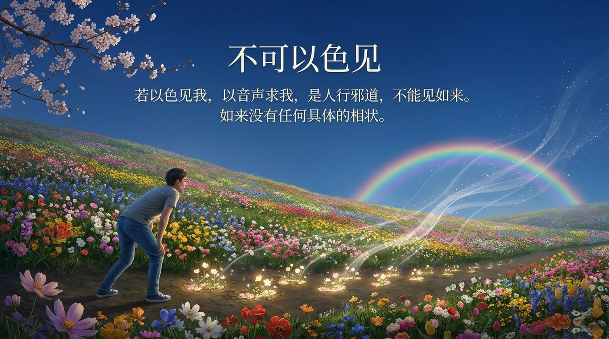
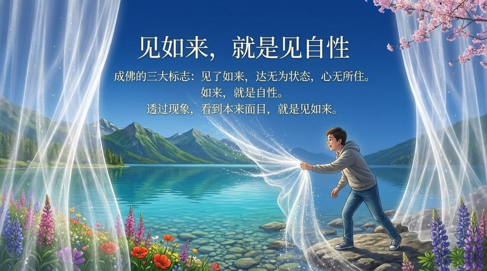
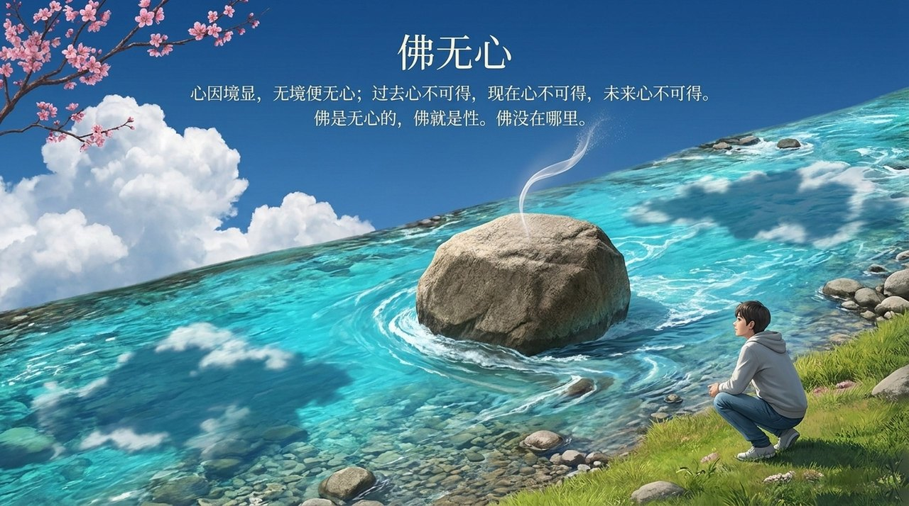
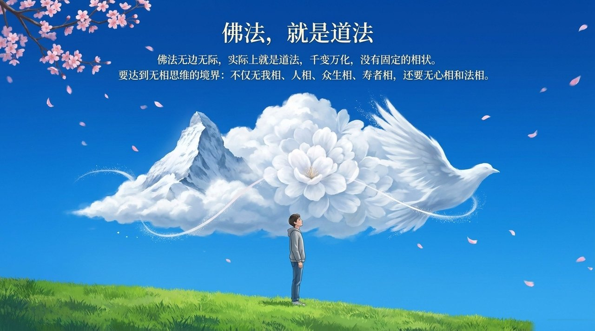

<!-- id: LC-BP-0001-ZH theme: 修行修炼 type: index direction: 修行修炼 lang: zh -->

# 佛·佛祖·如来·如来佛祖

**佛**，弗人，没有人的相状却有意识思维——即灵；**佛祖**，灵的源头；**如来**，宇宙的原始特性，无虚无实、无边无际、容纳一切相状的本来；**如来佛祖**，一切的原始起源地——即上帝。释迦牟尼是佛、是如来，但不是佛祖、不是如来佛祖；耶稣亦是世尊，两者皆为上帝派往人间的"钦差大臣"。成佛之道：见如来（见自性）、达无为状态、心无所住。

---

## 视频版

<iframe style="width:100%;aspect-ratio:4/3;border:0" src="https://www.youtube-nocookie.com/embed/E4V5dpMDtE0" title="佛·佛祖·如来·如来佛祖（生命禅院百科·视频版）" allowfullscreen></iframe>

??? info "📖 图文幻灯（14 张，点击展开）"

    
    
    
    
    
    
    
    
    
    
    
    
    
    

---

## 版本导航

| 版本 | 适合 | 核心角度 |
|------|------|----------|
| [友好版](friendly.md) | 初次了解 | 用生活语言说清四个概念与成佛路径 |
| [学术版](academic.md) | 研究者 | 四概念辨析、释迦牟尼定位、如来特征、与传统佛教比较 |
| [内部版](internal.md) | 深度研修 | 完整文集引文、成佛三大标志、如来本性、无心即佛 |

---

## 相关词条

[佛法](/zh/buddha-dharma/) · [成佛](/zh/becoming-buddha/) · [自性·佛性·如来本性](/zh/self-nature/) · [明心见性](/zh/illuminate-mind-see-nature/) · [无我无相](/zh/no-self-no-form/) · [心无所住·心无挂碍](/zh/xinwu-suozhu-guaai/) · [上帝](/zh/greatest-creator/) · [觉悟](/zh/awakening/) · [成仙成佛](/zh/becoming-celestial-buddha/)
