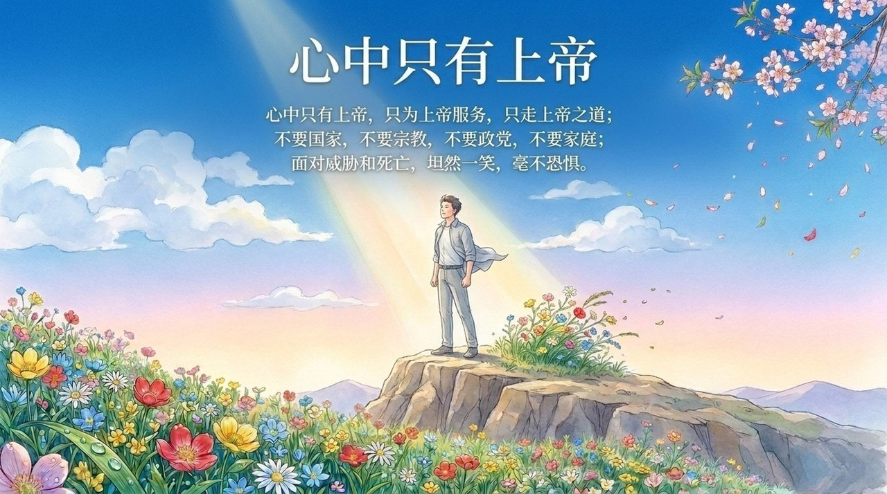
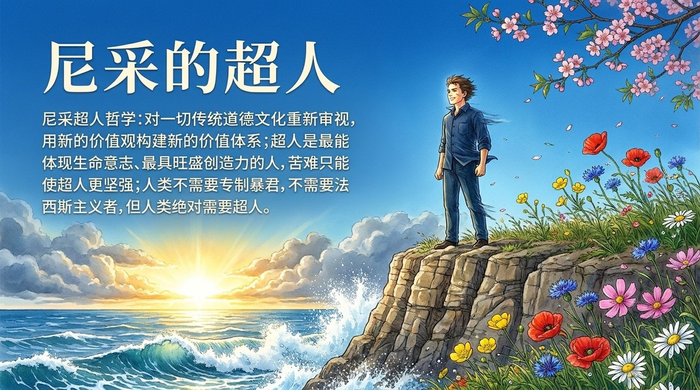

# 禅院超人

**禅院超人**，是指以八百条禅院理念为基石、以上帝之道为唯一准则、具有钢铁意志和超人思维的禅院草。禅院超人不是单打独斗的孤独个体，而是由觉悟者构成的超人群体，肩负领导人类走向生命禅院时代的使命。

> 一旦明晰了禅院理念，就是超人。
>
> ——雪峰

| 版本 | 适合 | 核心角度 |
|------|------|----------|
| [友好版](friendly.md) | 初次了解 | 禅院超人是谁、如何成为超人 |
| [学术版](academic.md) | 研究者 | 概念辨析、尼采超人哲学比较、文本分析 |
| [内部版](internal.md) | 深度研修 | 导游原文全录 |

---

## 视频版

<iframe style="width:100%;aspect-ratio:4/3;border:0" src="https://www.youtube-nocookie.com/embed/plQ2mXI8eKU" title="禅院超人（生命禅院百科·视频版）" allowfullscreen></iframe>

??? info "📖 图文幻灯（14 张，点击展开）"

    
    
    
    
    
    
    
    
    
    
    
    
    
    

---

**相关词条：**
[禅院草](/zh/chanyuan-celestials/) · [禅院理念](/zh/values/) · [新时代人类八百理念](/zh/new-era-human-800-concepts/) · [超凡脱俗](/zh/chaofantuosu/) · [成仙](/zh/becoming-celestial/) · [觉悟](/zh/awakening/) · [浑沌管理](/zh/hundun-management/) · [生命禅院时代（新时代）](/zh/lifechanyuan-new-era/)
