<!-- id: LC-CLN-0001-ZH theme: 修行修炼 type: index direction: 生活修炼 lang: zh -->

# 小孩子模样

**小孩子模样**是生命禅院修行修炼体系中的核心境界，源自基督耶稣的教诲："你们若不变成小孩子的模样，断然进不了天国。"在生命禅院体系中，这与老子的"复归于婴儿"、佛陀的"离一切诸相"同指一处：天性纯真、无忧无虑、自由游戏，不受世俗观念与权钱名色束缚的心灵状态，是进入天国（千年界及以上高层生命空间）的必要条件。

> 孩子的模样就是淘气、顽皮、调皮、纯朴、天真、幼稚、真诚——一句话，开心快乐游戏的模样就是小孩子的模样。
>
> —— 雪峰文集·禅院篇·游戏中游戏 游戏中建设

---

## 视频版

<iframe style="width:100%;aspect-ratio:4/3;border:0" src="https://www.youtube-nocookie.com/embed/jj6XWYdkXB8" title="小孩子模样（生命禅院百科·视频版）" allowfullscreen></iframe>

??? info "📖 图文幻灯（14 张，点击展开）"

    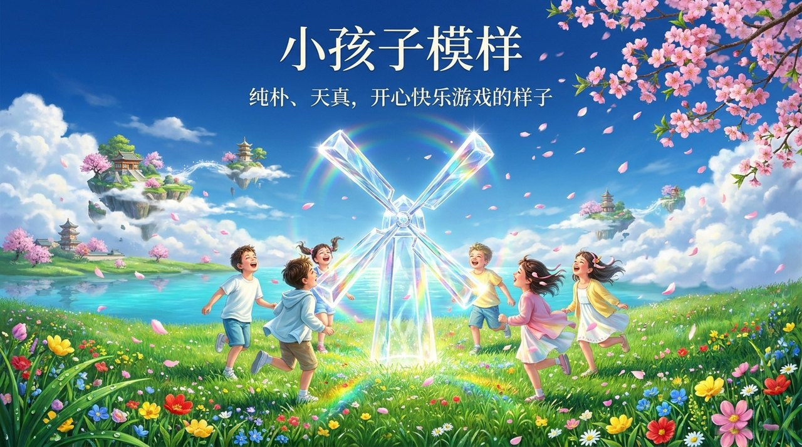
    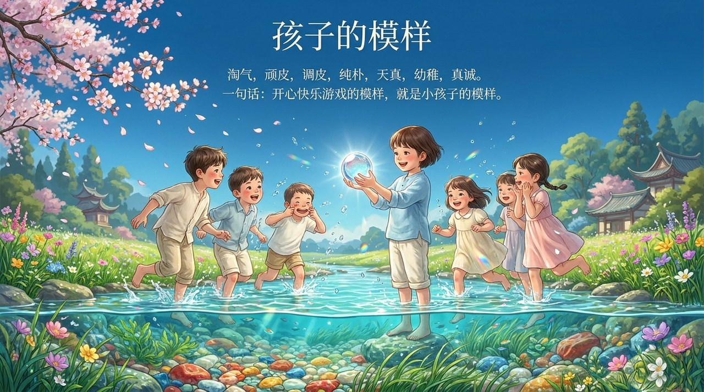
    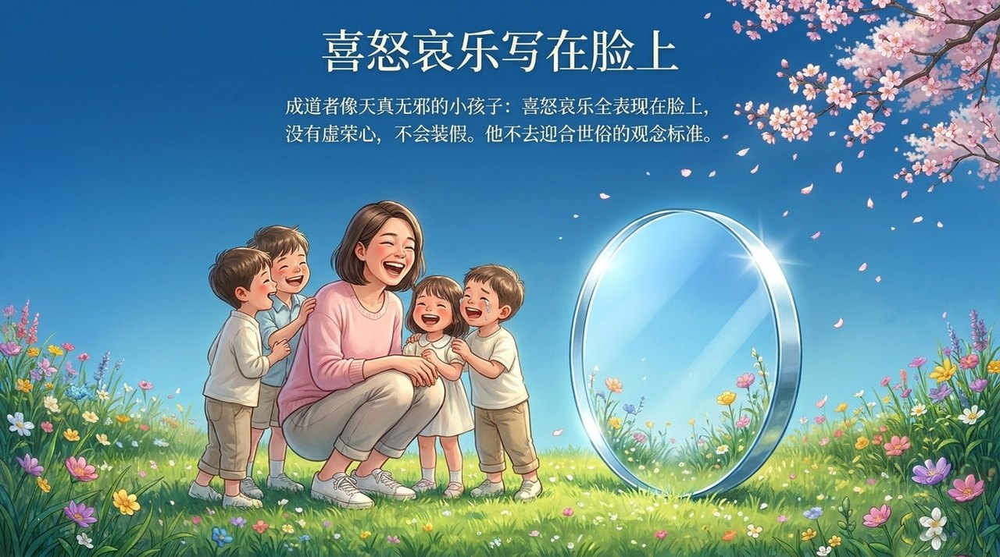
    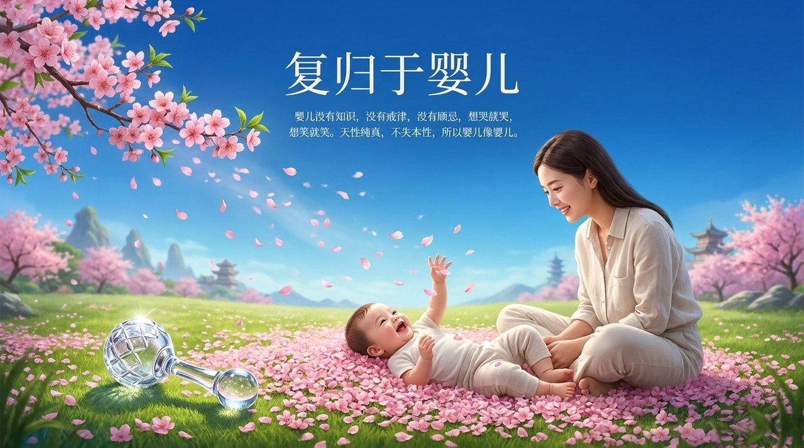
    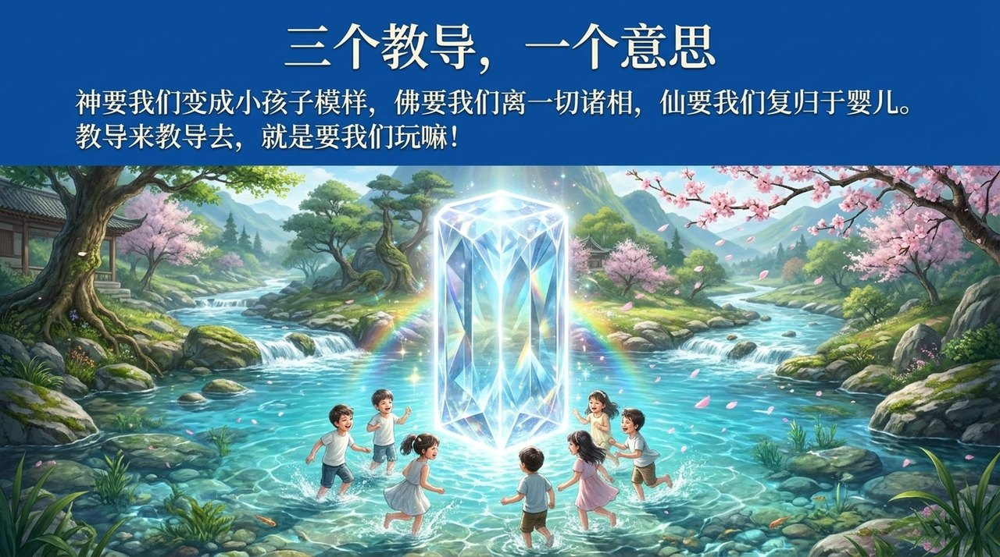
    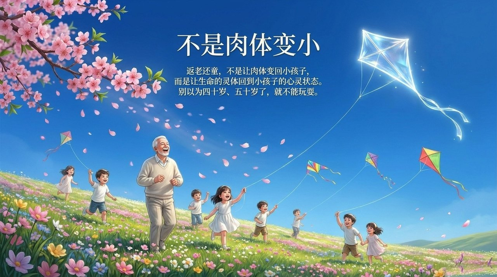
    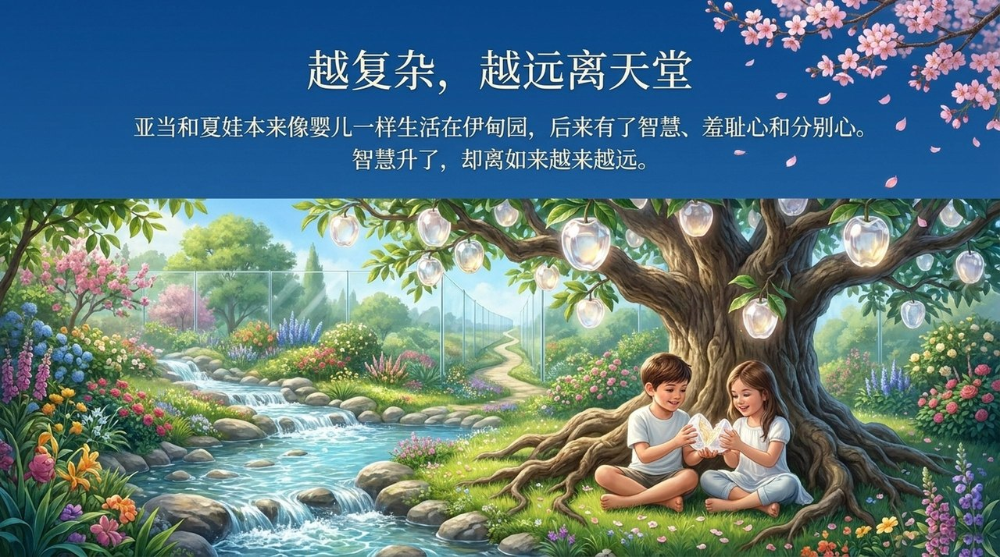
    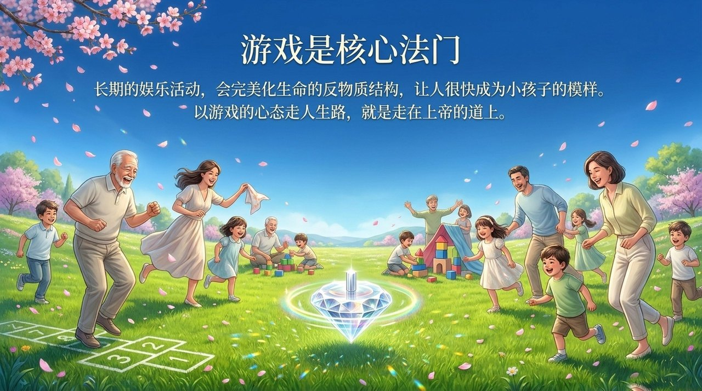
    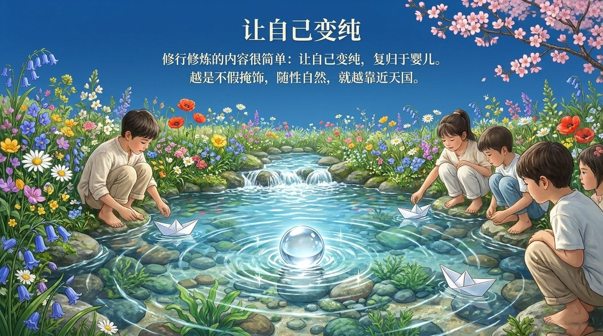
    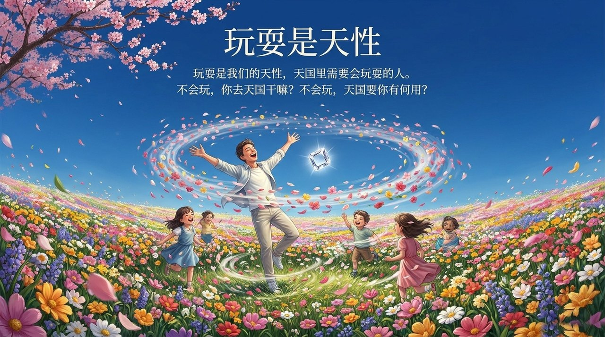
    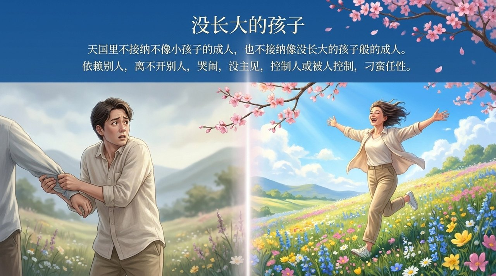
    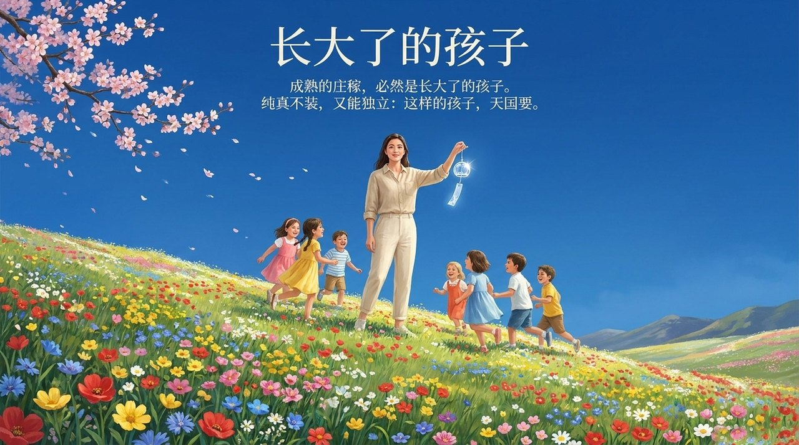
    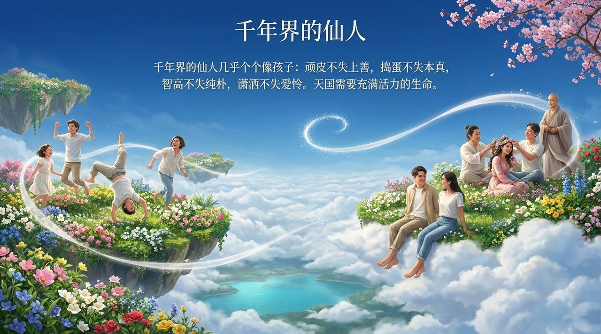
    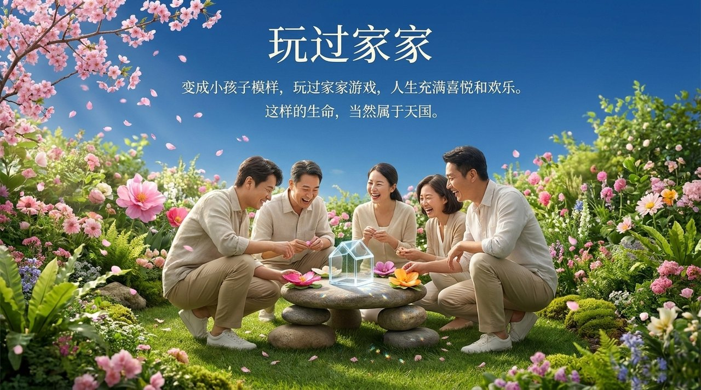

---

## 版本导航

| 版本 | 适合读者 | 核心内容 |
|------|---------|---------|
| [友好版](friendly.md) | 初次了解者 | 小孩子模样是什么感觉？为何天国需要它？怎样在生活中找回它？ |
| [学术版](academic.md) | 研究者 | 三教归一分析、"小孩子"与浑沌天性的关系、两种"没长大"的辨析 |
| [内部版](internal.md) | 深度研读 | 完整文集引文、修炼路径、障碍剖析、天国仙人的描述 |

---

## 相关词条

[返老还童（青春永驻·长生不老）](/zh/fanlaohuantong/) · [随性而动](/zh/suixing-er-dong/) · [灵活圆融](/zh/linghuoyuanrong/) · [无我无相](/zh/no-self-no-form/) · [明心见性](/zh/illuminate-mind-see-nature/) · [自性·佛性·如来本性](/zh/self-nature/) · [浑沌元初](/zh/hundun-baby/) · [天国财宝](/zh/heavenly-treasures/) · [去天国路线图](/zh/route-to-heaven/) · [打坐·静坐·定静功夫](/zh/settled-stillness/)
