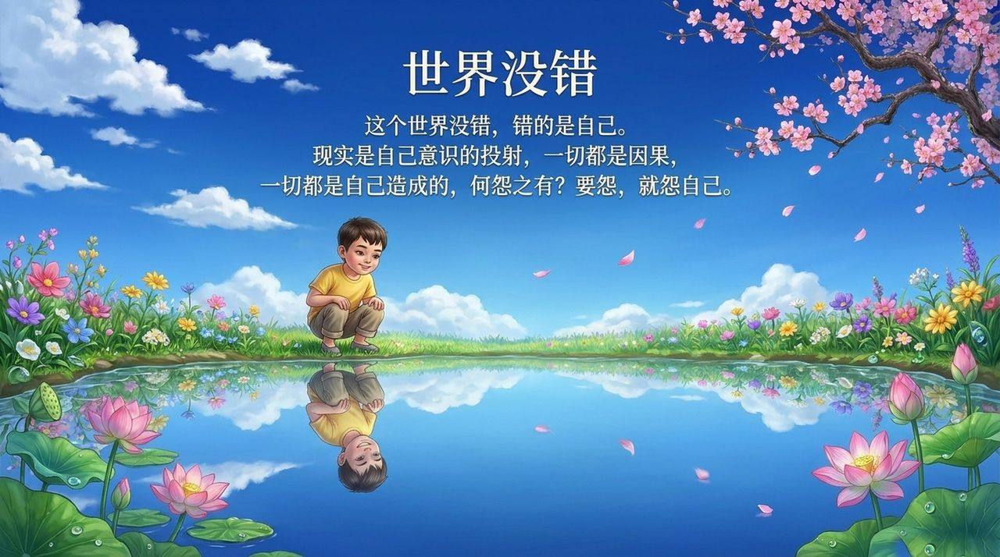
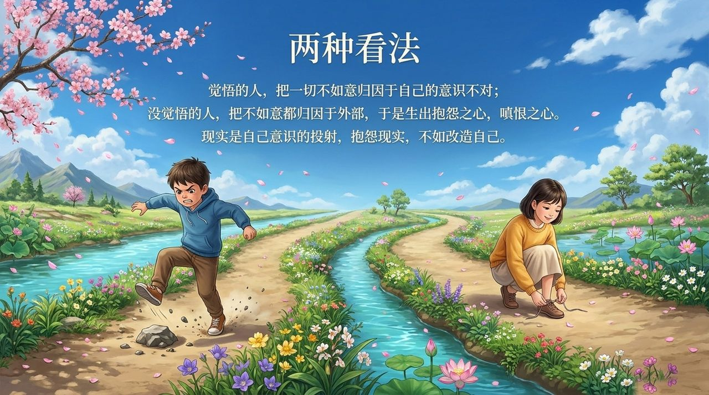
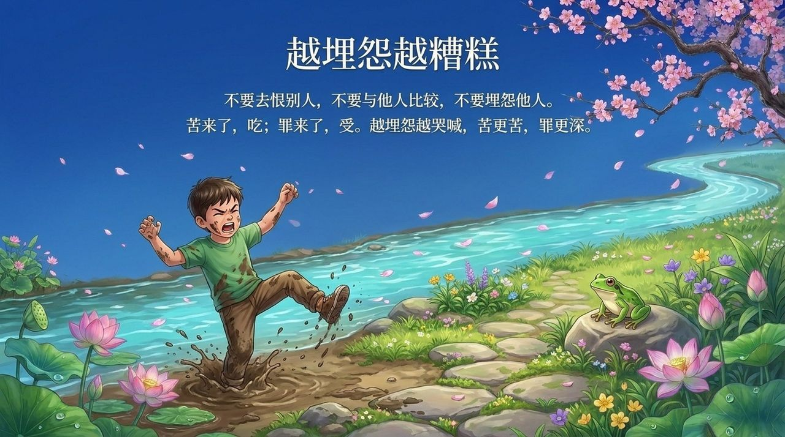
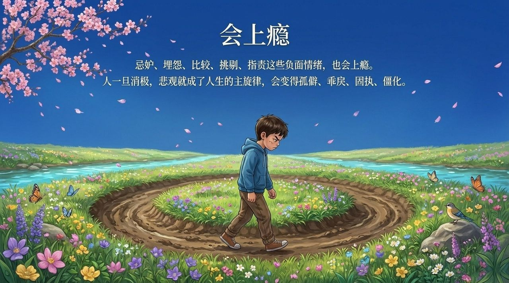
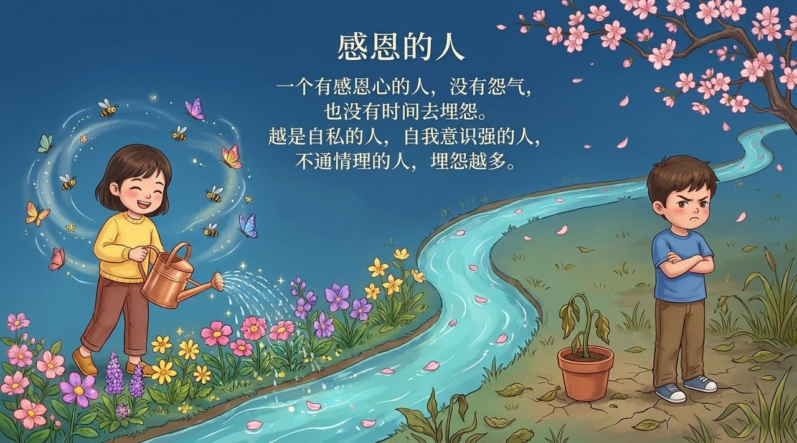
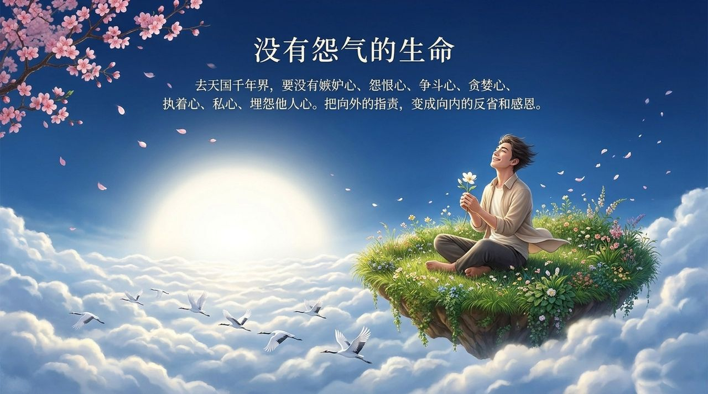

<!-- id: LC-CG-0001-ZH theme: 修行 type: 导航 direction: 生活修炼 lang: zh -->

# 埋怨·抱怨

埋怨与抱怨，在生命禅院体系中被视为导致人生痛苦的十八因素之一，是"射向他人的毒箭"，是进入天国前须洗涤的二十项心灵尘垢之一。其根源在于：将自身处境的不如意归咎于外部世界，而忽视了"现实是自己意识的投射，一切皆因果"这一基本认知。

生命禅院的修炼要求是：不怨天、不怨地、不怨社会、不怨他人，将向外的指责转化为向内的反省与感恩，因为越是自私的人，埋怨越多；而有感恩心的人，没有怨气。

---

## 视频版

<iframe style="width:100%;aspect-ratio:4/3;border:0" src="https://www.youtube-nocookie.com/embed/Esc-lMEWpEQ" title="埋怨·抱怨（生命禅院百科·视频版）" allowfullscreen></iframe>

??? info "📖 图文幻灯（14 张，点击展开）"

    
    
    
    
    
    
    
    
    
    
    
    
    
    

---

## 版本导航

| 版本 | 适合 | 核心角度 |
|------|------|----------|
| [友好版](friendly.md) | 初次了解 | 生活情境·毒箭比喻·转化路径 |
| [学术版](academic.md) | 研究者 | 概念辨析·体系定位·与感恩的对立 |
| [内部版](internal.md) | 深度研修 | 完整引文·六节框架·天国障碍 |

---

## 相关词条

[感恩](/zh/gratitude/) · [忌妒·嫉妒](/zh/jealousy-envy/) · [宽恕](/zh/forgiveness/) · [放下](/zh/letting-go/) · [忏悔](/zh/repentance/) · [自私与无私](/zh/zisi-wusi/) · [完美人性的标准](/zh/perfect-human-nature/) · [觉悟](/zh/awakening/) · [天国财宝](/zh/heavenly-treasures/) · [道德](/zh/morality/)
