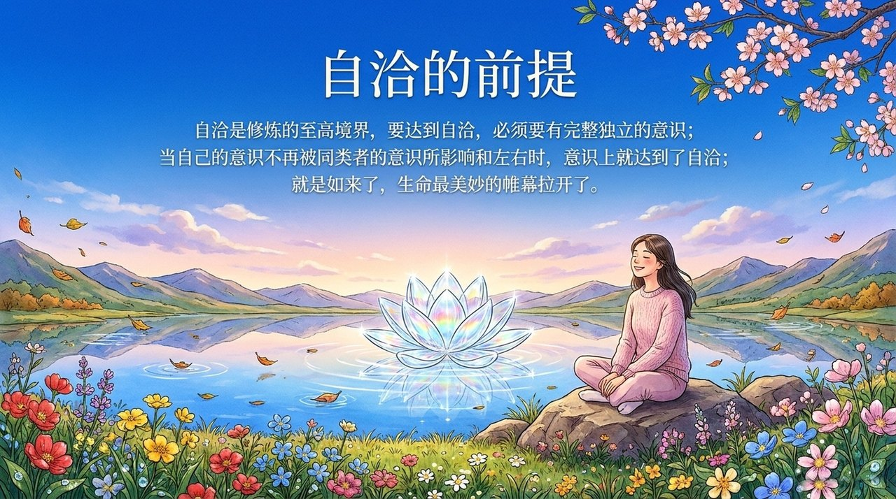
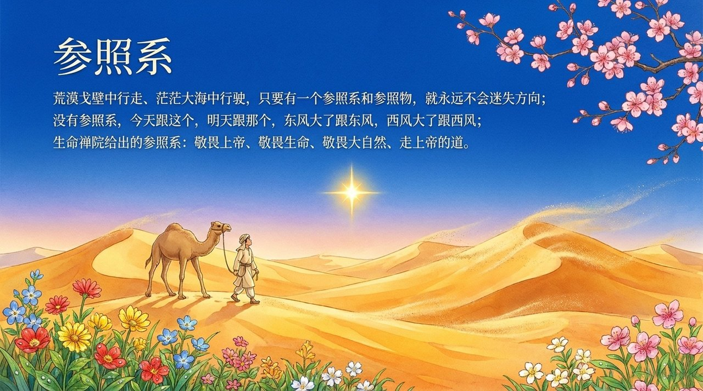
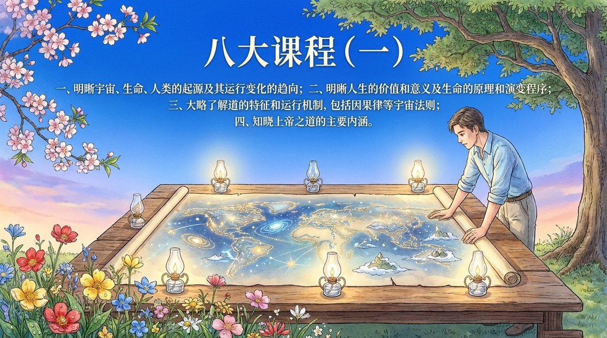
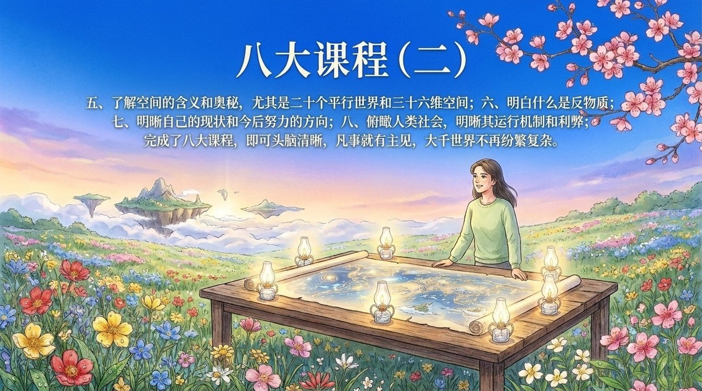
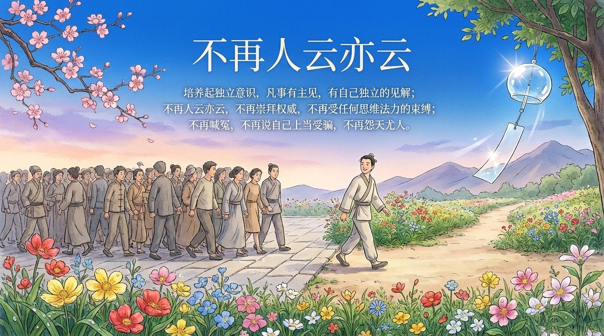

<!-- id: LC-CIC-0001-ZH theme: Mystery of LIFE type: Index lang: zh -->

# 完整独立意识

完整独立意识，是生命禅院修行体系的核心概念之一：一个人的人生观、价值观、生命观、宇宙观符合上帝之道，在此基础上能够游刃有余地处理人生旅途上的一切事务，而不受他人意识的左右和影响。它是达到自洽——修炼最高境界——的前提，也是禅院草从必然王国进入自由王国的关键。

---

- [通俗版](friendly.md) — 用生活语言理解完整独立意识
- [学术版](academic.md) — 系统分析与文献溯源
- [内部版](internal.md) — 文集引文与完整论述

---

## 视频版

<iframe style="width:100%;aspect-ratio:4/3;border:0" src="https://www.youtube-nocookie.com/embed/SGYoyCmRNjw" title="完整独立意识（生命禅院百科·视频版）" allowfullscreen></iframe>

??? info "📖 图文幻灯（14 张，点击展开）"

    
    
    
    
    
    
    
    
    
    
    
    
    
    

---

**关联词条：** [自洽](/zh/self-coherence/) · [觉悟](/zh/awakening/) · [意识](/zh/consciousness/) · [道](/zh/dao/) · [三十六维空间](/zh/thirty-six-dimensional-space/) · [反物质结构](/zh/antimatter-structure/)
