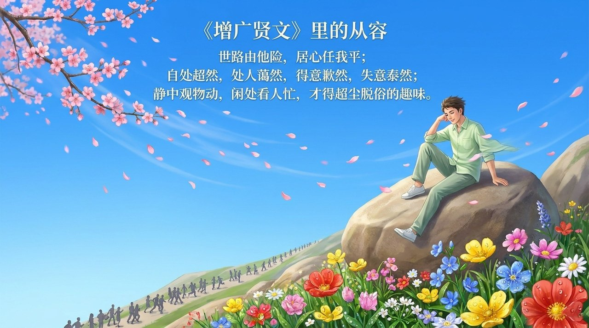

# 淡泊明志·宁静致远

**淡泊明志·宁静致远**，语出诸葛孔明家训"非淡泊无以明志，非宁静难以致远"，在生命禅院体系中被导游雪峰诠释为修仙路径的根本心态——淡泊是明志的清明之基，唯有不为功名利禄所惑，方能看清人生路径与修仙方向；宁静是神明的住所，唯有内心清静，神明才能驻留，才能看透人世的声色货利而不被迷惑，从而真正"致远"，抵达仙道境界。

> 淡泊明志，宁静致远，修仙者不可不察。
>
> ——禅院文集·修仙篇·淡泊明志、宁静致远

## 视频版

<iframe style="width:100%;aspect-ratio:4/3;border:0" src="https://www.youtube-nocookie.com/embed/yhqESA-wVb4" title="淡泊明志·宁静致远（生命禅院百科·视频版）" allowfullscreen></iframe>

??? info "📖 图文幻灯（14 张，点击展开）"

    
    
    
    
    
    
    
    
    
    
    
    
    
    

---

## 版本导航

| 版本 | 适合 | 核心角度 |
|------|------|----------|
| [友好版](friendly/) | 初次了解 | 生活感受与修仙启示 |
| [学术版](academic/) | 研究者 | 系统分析与跨文化比较 |
| [内部版](internal/) | 深度研修 | 导游原文存档 |

## 相关词条

[少私寡欲·宠辱不惊](/zh/shao-si-gua-yu/) · [随缘放旷·任运逍遥](/zh/sui-yuan-fangguan/) · [深根固柢·长生久视](/zh/shen-gen-gu-di/) · [中庸之道](/zh/golden-mean/) · [无为而无不为](/zh/wu-wei/) · [自洽](/zh/self-coherence/) · [归零](/zh/return-to-zero/) · [成仙](/zh/becoming-celestial/) · [超凡脱俗](/zh/chaofantuosu/)
