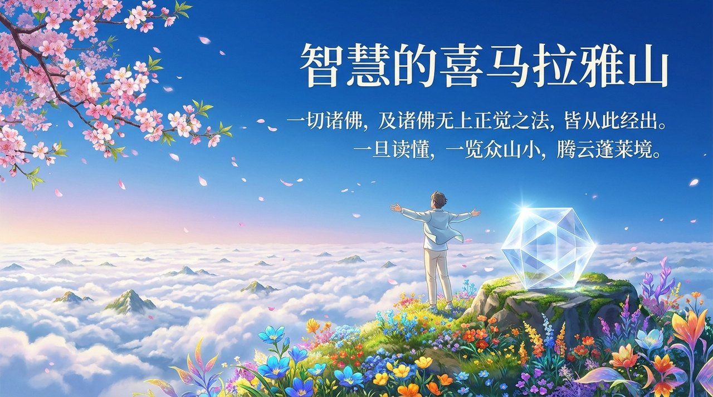
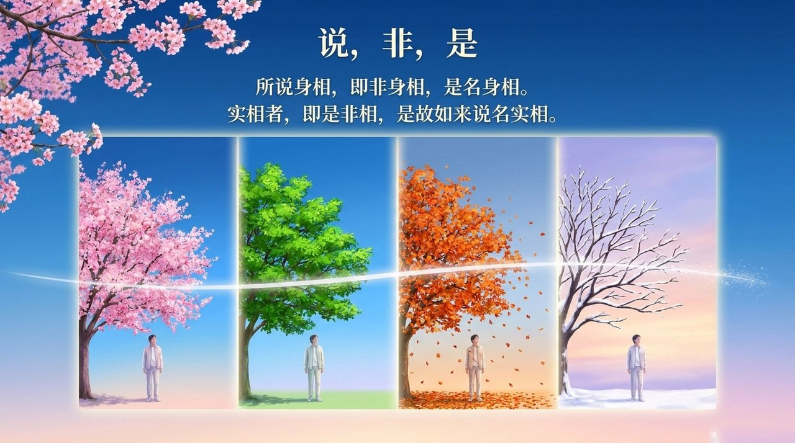
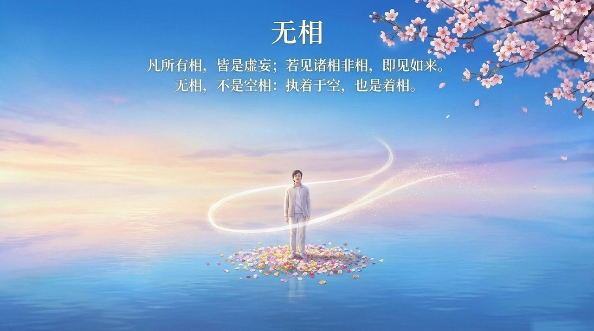
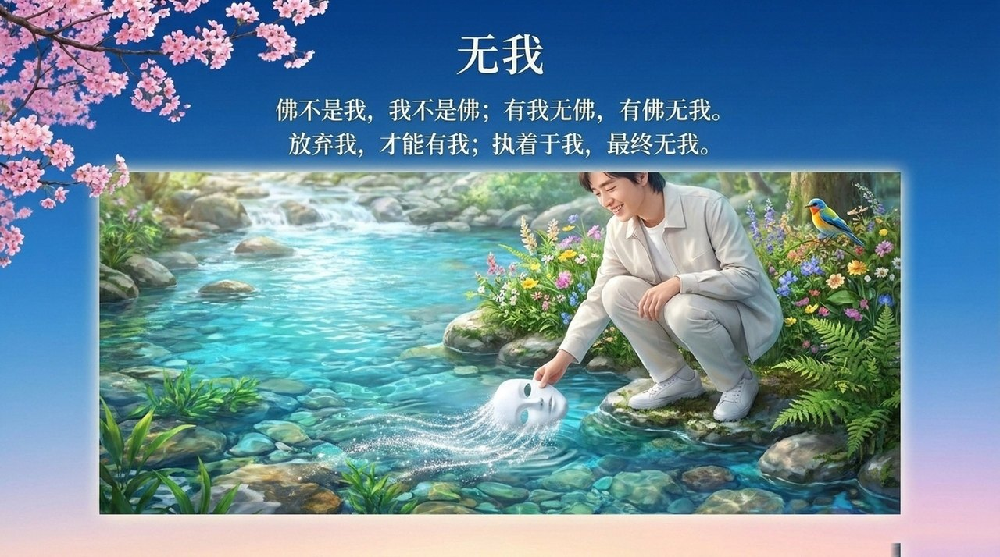
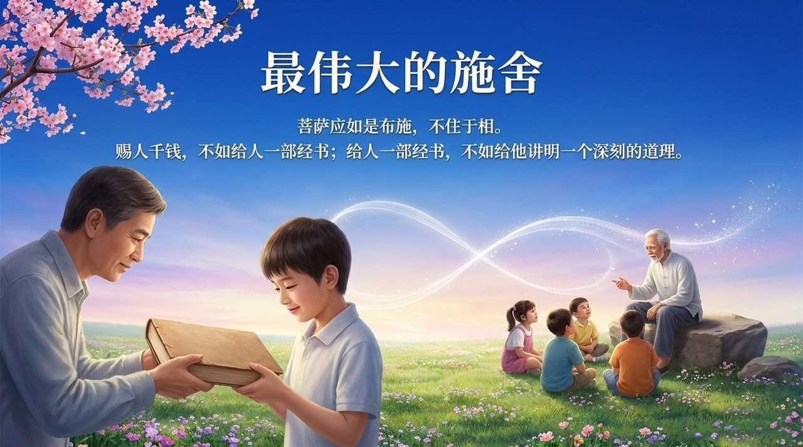
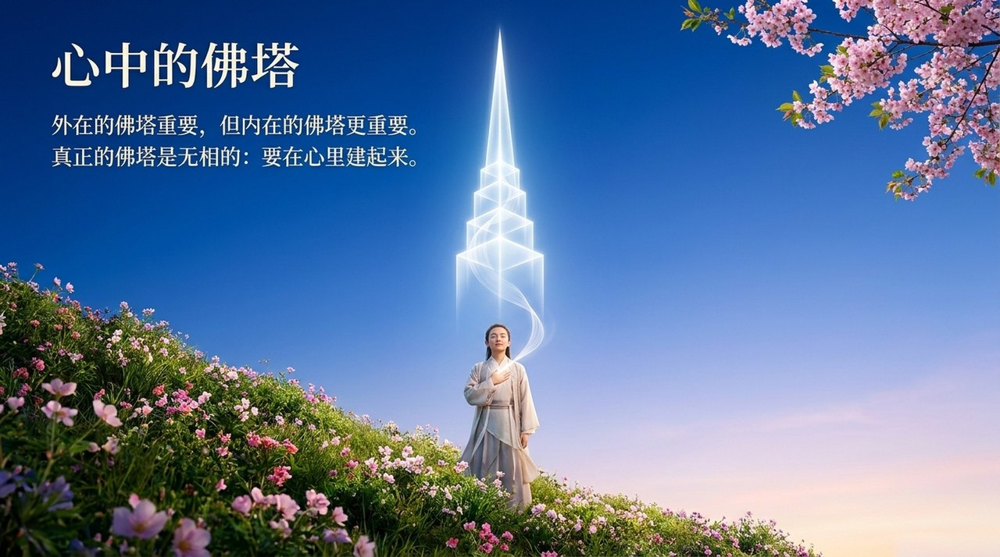
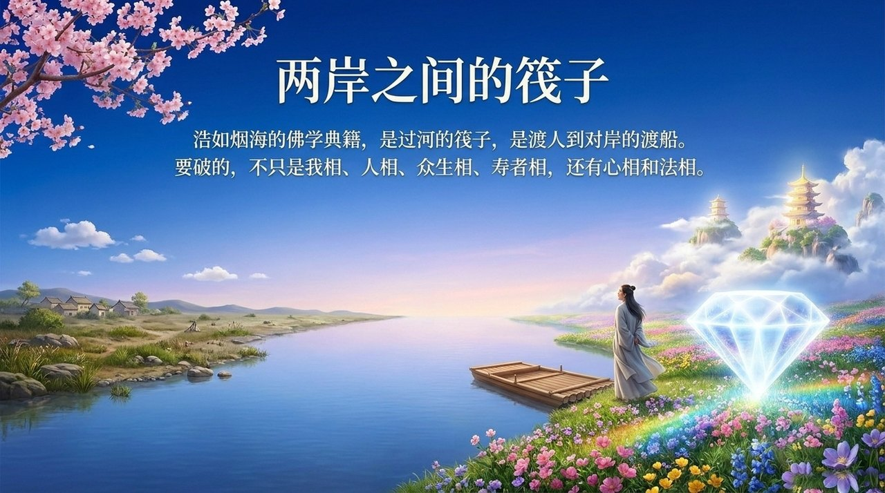

<!-- id: LC-DS-0001-ZH theme: 修行修炼 type: index direction: 修行修炼 lang: zh -->

# 《金刚经》

**《金刚经》**，全称《金刚般若波罗蜜经》，是释迦牟尼佛专为"发大乘、发最上乘者"所说的至高佛法，是一切佛经的源头。在生命禅院体系中，《金刚经》被誉为"智慧的喜马拉雅山"——其核心教义无相（凡所有相，皆是虚妄）、无我（四相皆空）、心无所住（应无所住而生其心）与生命禅院的无相思维·浑沌思维高度契合。雪峰以浑沌元初之法名接续佛法衣钵，著成禅院文集《成佛篇》24篇，全面解读《金刚经》，指出生命禅院即《金刚经》的后续内容。

---

## 视频版

<iframe style="width:100%;aspect-ratio:4/3;border:0" src="https://www.youtube-nocookie.com/embed/O-mCE14KMlo" title="《金刚经》（生命禅院百科·视频版）" allowfullscreen></iframe>

??? info "📖 图文幻灯（14 张，点击展开）"

    
    
    
    
    
    
    
    
    
    
    
    
    
    

---

## 版本导航

| 版本 | 适合 | 核心角度 |
|------|------|----------|
| [友好版](friendly.md) | 初次了解 | 三大核心教义与当下成佛的路径 |
| [学术版](academic.md) | 研究者 | 教义结构分析、乘次体系、与传统佛教比较 |
| [内部版](internal.md) | 深度研修 | 完整文集引文、成佛三标志、果报与佛塔 |

---

## 相关词条

[佛法](/zh/buddha-dharma/) · [佛·佛祖·如来·如来佛祖](/zh/buddha-patriarch/) · [成佛](/zh/becoming-buddha/) · [自性·佛性·如来本性](/zh/self-nature/) · [无我无相](/zh/no-self-no-form/) · [心无所住·心无挂碍](/zh/xinwu-suozhu-guaai/) · [无相布施](/zh/formless-giving/) · [明心见性](/zh/illuminate-mind-see-nature/) · [无为而无不为](/zh/wu-wei/) · [觉悟](/zh/awakening/)
