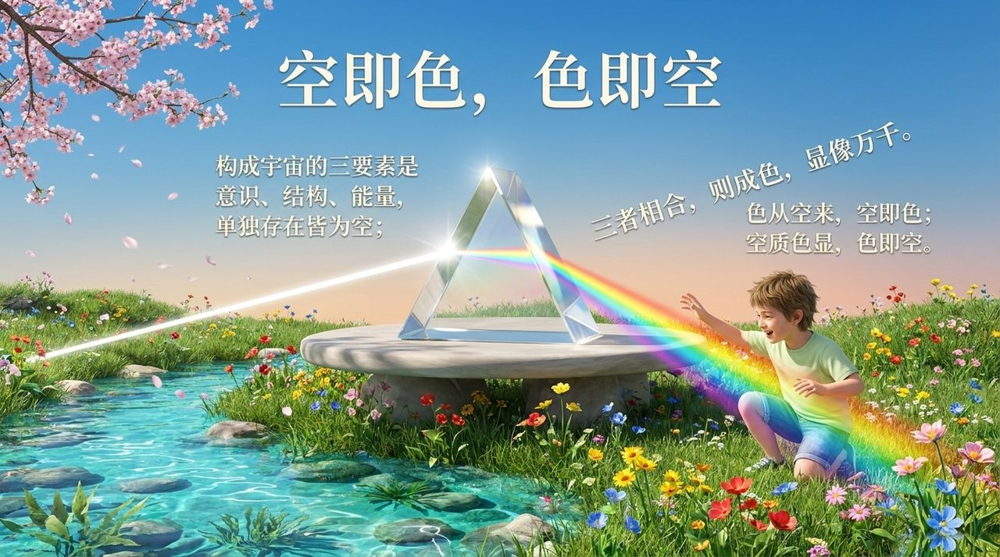
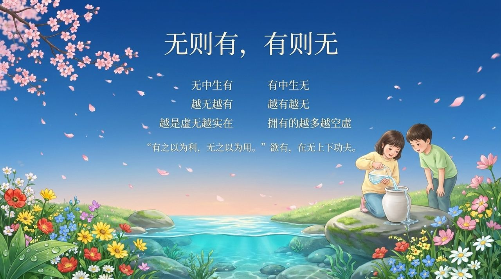
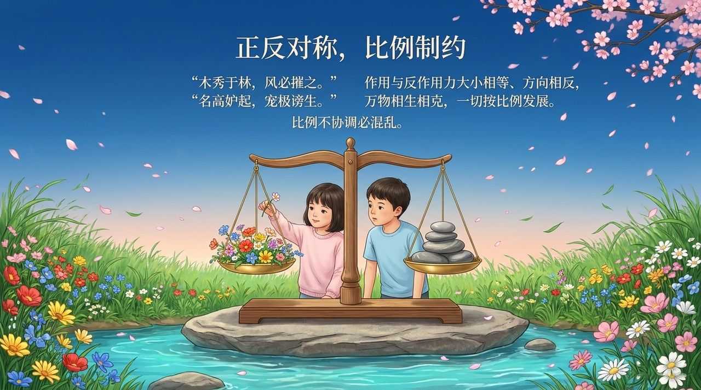
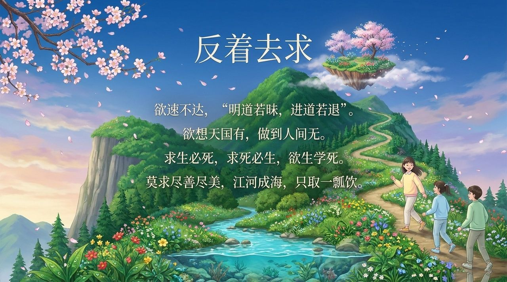
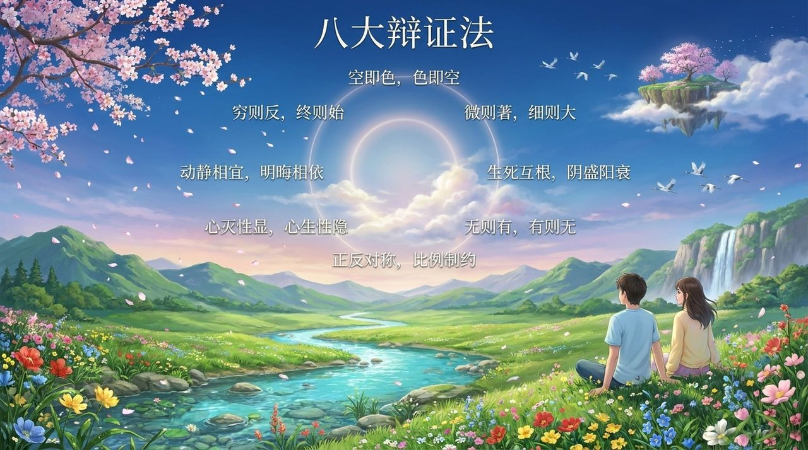

# 宇宙八大辩证法

> 一阴一阳谓之道，阴阳平衡谓之理，知晓辩证谓之明，遵从自然谓之德。  
> ——雪峰《宇宙八大辩证法》

宇宙八大辩证法是导游雪峰从太极思维出发提炼出的八对宇宙根本辩证规律：**空即色色即空、穷则反终则始、微则著细则大、生死互根阴盛阳衰、无则有有则无、心灭性显心生性隐、动静相宜明晦相依、正反对称比例制约**。这八大规律揭示宇宙万物的运行法则，也是修行者升华生命的实践向导。

## 视频版

<iframe style="width:100%;aspect-ratio:4/3;border:0" src="https://www.youtube-nocookie.com/embed/vRZXCXzgOdo" title="宇宙八大辩证法（生命禅院百科·视频版）" allowfullscreen></iframe>

??? info "📖 图文幻灯（14 张，点击展开）"

    
    
    
    
    
    
    
    
    
    
    
    
    
    

---

| 版本 | 适合 | 核心角度 |
|------|------|----------|
| [友好版](friendly.md) | 初次了解 | 八大规律的生活智慧 |
| [学术版](academic.md) | 研究者 | 系统分析与体系比较 |
| [内部版](internal.md) | 深度研修 | 完整文集与修炼路径 |

---

## 相关词条

[辩证法](/zh/dialectics/) · [浑沌（本体论）](/zh/hundun/) · [太极思维](/zh/taiji-thinking/) · [无极与太极（合篇）](/zh/wuji-taiji/) · [明心见性](/zh/illuminate-mind-see-nature/) · [心无所住·心无挂碍](/zh/xinwu-suozhu-guaai/) · [自性·佛性·如来本性](/zh/self-nature/) · [无我无相](/zh/no-self-no-form/)
