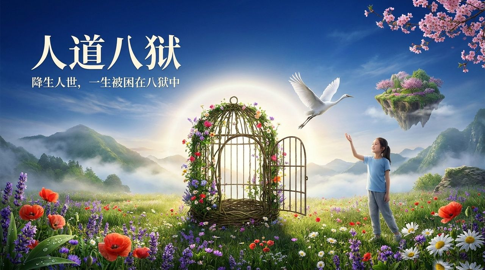
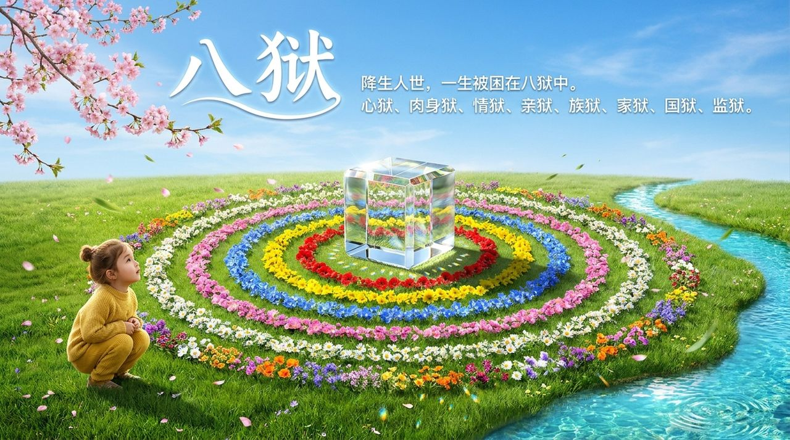
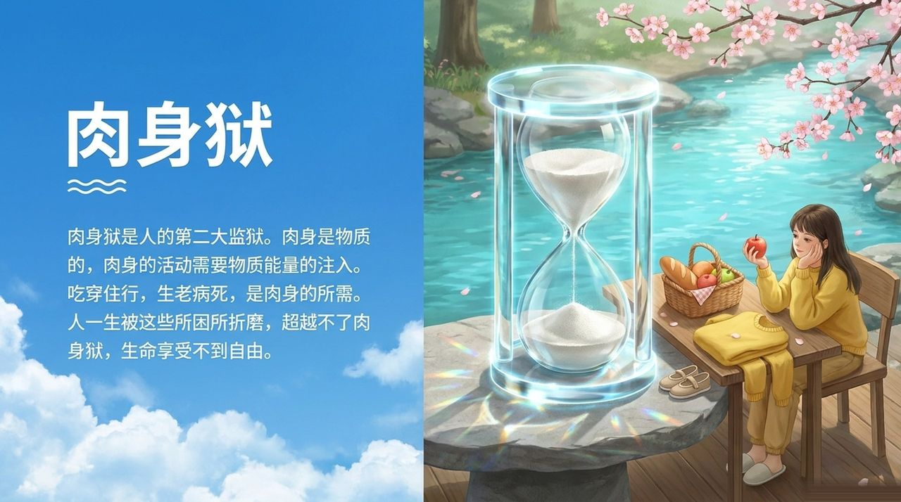
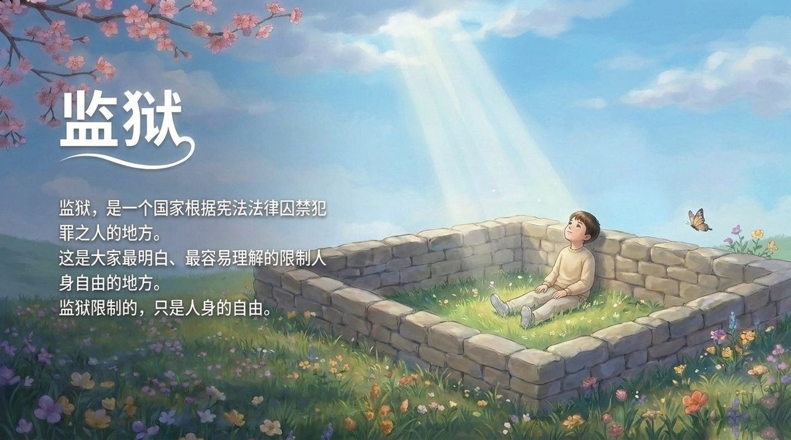

<!-- id: LC-EPH-0001-ZH theme: 修行修炼 type: index direction: 修行修炼 lang: zh -->

# 人道八狱

**人道八狱**是雪峰对人降生人世所面临的八重监狱的系统揭示：心狱、肉身狱、情狱、亲狱、族狱、家狱、国狱、监狱。其中心狱是最大最厉害的监狱——万象生心，心中生发忌妒心、分别心、贪婪心，将人困在万象中；有形的监狱只限制人身自由，无形的心狱才限制生命自由。一旦觉悟，八大监狱消失，宇宙处处都是道场，都是天堂。

---

## 视频版

<iframe style="width:100%;aspect-ratio:4/3;border:0" src="https://www.youtube-nocookie.com/embed/nFyQns6WD5g" title="人道八狱（生命禅院百科·视频版）" allowfullscreen></iframe>

??? info "📖 图文幻灯（14 张，点击展开）"

    
    
    
    
    
    
    
    
    
    
    
    
    
    

---

## 版本导航

| 版本 | 适合读者 | 核心角度 |
|------|---------|---------|
| [友好版](friendly.md) | 初次了解者 | 哪八座监狱？哪个最难逃？怎么才能真正自由？ |
| [学术版](academic.md) | 研究者 | 八狱的层次结构、心狱与其他七狱的关系、觉悟的解放意义 |
| [内部版](internal.md) | 深度研修 | 完整文集引文，传道篇全文 |

---

## 相关词条

[人生八悲](/zh/eight-sorrows-of-life/) · [觉悟](/zh/juewu/) · [心无所住·心无挂碍](/zh/xinwu-suozhu-guaai/) · [无相思维](/zh/non-form-thinking/) · [情（词条）](/zh/qing-affection/) · [三十六道八卦阵](/zh/thirty-six-bagua-formations/) · [夫妻·婚姻·家庭](/zh/marriage-and-family/) · [了却尘缘](/zh/releasing-worldly-bonds/) · [完整独立意识](/zh/complete-independent-consciousness/)
