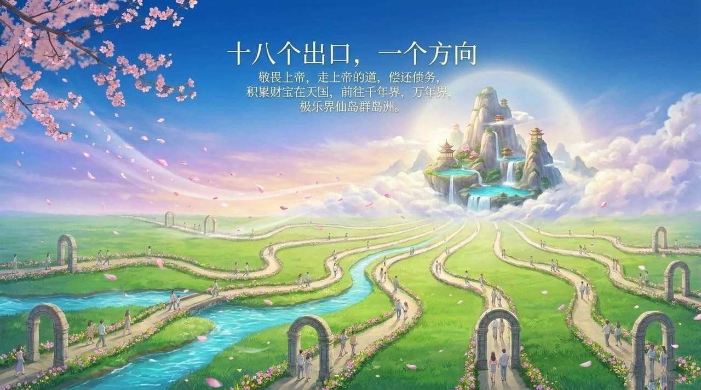

# 18阵破阵法·最简版

> 宇宙中有36道八卦阵，生命中有难以计数的陷阱，只有逃离生命的陷阱，才能获得生命的自由。
>
> ——新时代人类八百理念

**18阵破阵法·最简版**是导游雪峰对三十六道八卦阵中已揭示的十八道阵各自破法的系统整理，以最精简的方式呈现每道阵的本质与核心出口。十八道阵涵盖情、欲、伦、属、心、智、时间、思维、空间、结构、命、引力、性、惰娱、定数、本能、智慧、生死，每一阵皆有留有出口，逃出者可升华进入更高的生命空间。

---

| 版本 | 适合 | 核心角度 |
|------|------|----------|
| [友好版](friendly.md) | 初次了解 | 生活类比，18阵一览 |
| [学术版](academic.md) | 研究者 | 系统梳理，结构分析 |
| [内部版](internal.md) | 深度研修 | 文集逐阵全集 |

---

## 视频版

<iframe style="width:100%;aspect-ratio:4/3;border:0" src="https://www.youtube-nocookie.com/embed/SB9v1GwVD1Y" title="18阵破阵法·最简版（生命禅院百科·视频版）" allowfullscreen></iframe>

??? info "📖 图文幻灯（14 张，点击展开）"

    
    
    
    
    
    
    
    
    
    
    
    
    
    

---

## 相关词条

[三十六道八卦阵](/zh/thirty-six-bagua-formations/) · [完整独立意识](/zh/complete-independent-consciousness/) · [四随](/zh/si-sui/) · [生命的轮回](/zh/life-reincarnation/) · [成仙](/zh/becoming-celestial/) · [了却尘缘](/zh/releasing-worldly-bonds/) · [偿还债务](/zh/debt-repayment/) · [导游路线图](/zh/tour-guide-route-map/) · [人的意识·仙的意识](/zh/ren-xian-yishi/) · [天性·秉性·习性](/zh/tianxing-bingxing-xixing/)

> 注：本页引用的《新时代人类八百理念》条号，均为第四版的编号。第五版已重新编排，条号与第四版不再一一对应。
