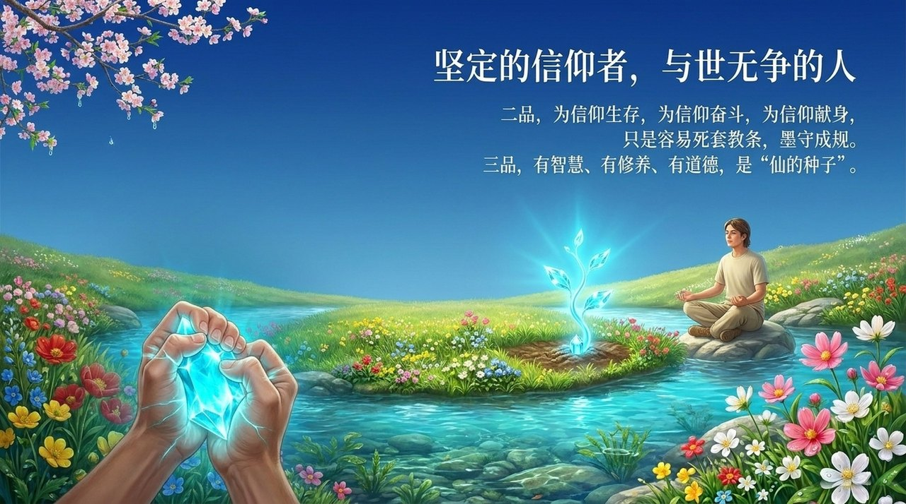
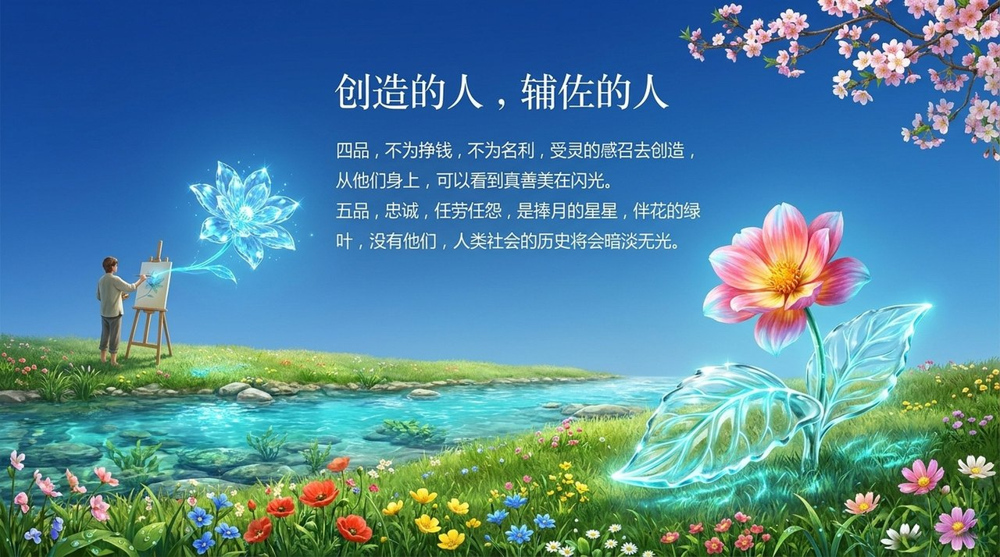
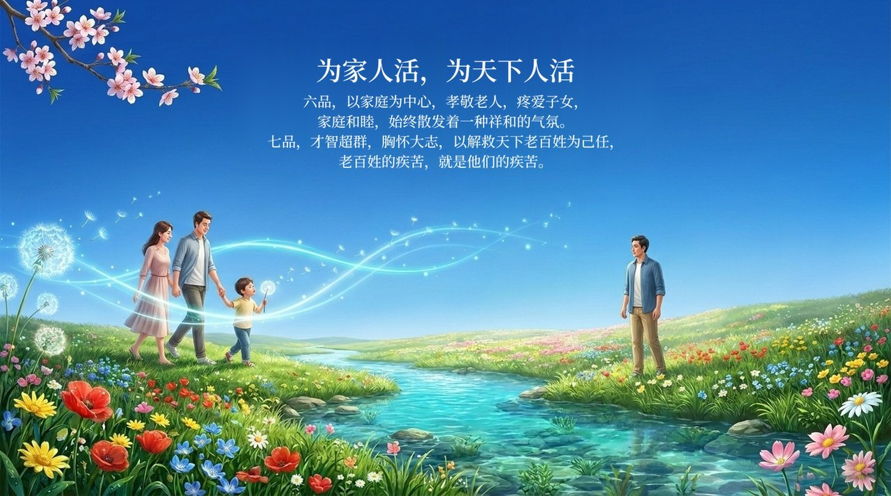
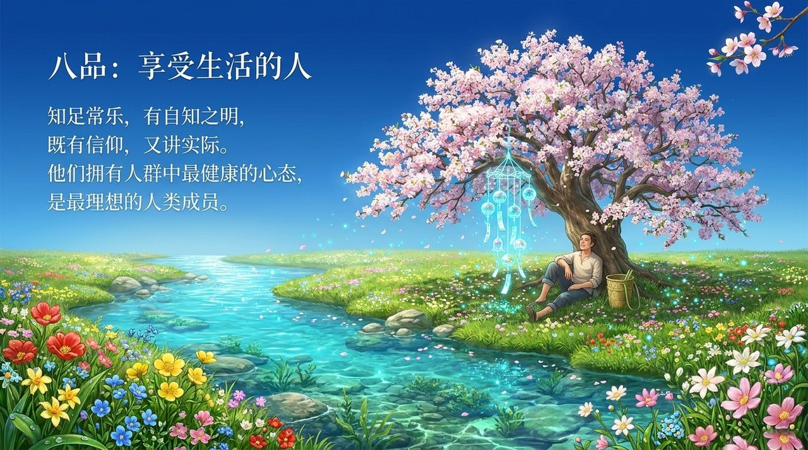
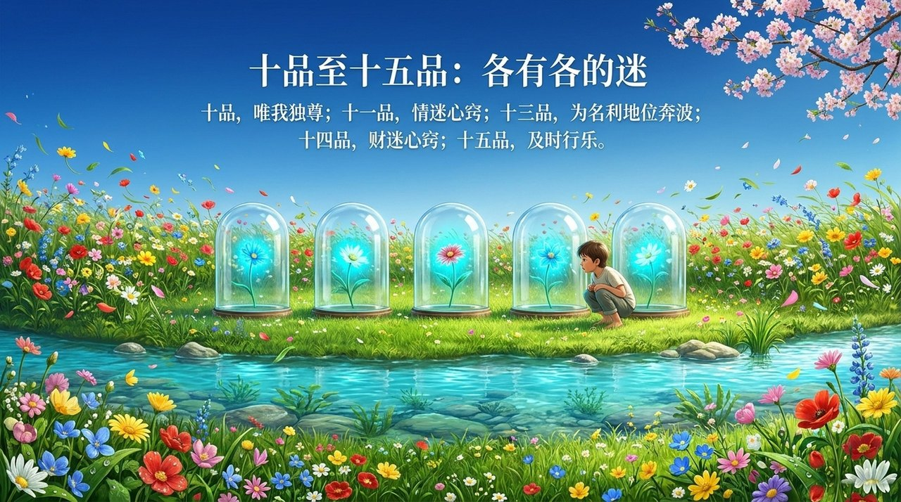
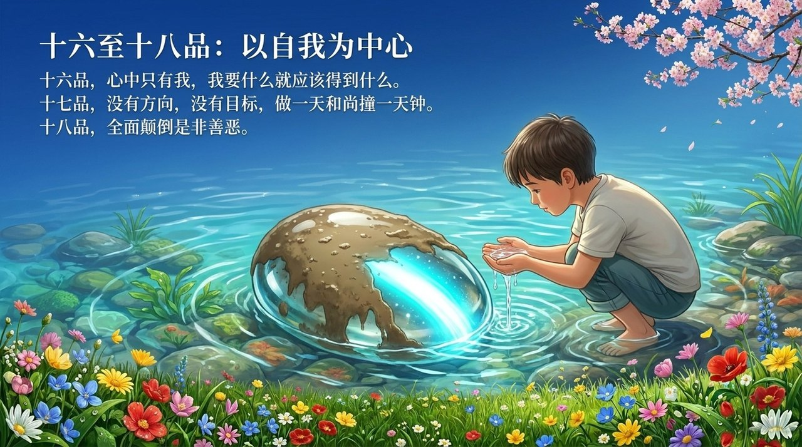

<!-- id: LC-EGL-0001-ZH theme: 修行修炼 type: 索引 lang: zh -->

# 人生十八品

**人生十八品是雪峰依据"灵性在人性中百分数的含量"对人类进行的品位分类体系。** 灵性含量越大，品位越高；含量越小，品位越低。一品为超凡脱俗、传播上帝旨意的得道者；十八品为全面颠倒是非善恶者。以社会地位、财富高低衡量人，不是生命禅院的标准——以灵性高低衡量，才是。无论身处哪一品，只要明确人生的意义，静下心来，就有机会改变自己，延伸生命至高层生命空间。

---

## 视频版

<iframe style="width:100%;aspect-ratio:4/3;border:0" src="https://www.youtube-nocookie.com/embed/KxLDjl4RczY" title="人生十八品（生命禅院百科·视频版）" allowfullscreen></iframe>

??? info "📖 图文幻灯（14 张，点击展开）"

    
    
    
    
    
    
    
    
    
    
    
    
    
    

---

## 版本导航

| 版本 | 适合读者 | 核心内容 |
|------|---------|---------|
| [友好版](friendly.md) | 初次接触者 | 十八品概览、如何对照参照自身 |
| [学术版](academic.md) | 研究者 | 十八品的结构逻辑、与灵性体系的关联分析 |
| [内部版](internal.md) | 深入研究 | 文集完整引文、十八品逐条出处 |

---

## 相关词条

[人生观·价值观](/zh/outlook-on-life-and-values/) · [人生的价值·意义和目的](/zh/value-meaning-purpose-of-life/) · [人生的八大纲领·八大玄机·八大天机·八大迷](/zh/eight-life-principles/) · [灵性](/zh/spirituality/) · [生命的层次](/zh/levels-of-life/) · [觉悟](/zh/awakening/) · [人群分类](/zh/eighteen-grades-of-life/)
