<!-- id: LC-FAF-0001-ZH theme: 修行修炼 type: 导航 direction: 修行修炼 lang: zh -->

# 家里人都是仇人

"家里人都是仇人"是基督耶稣的警示，出自《马太福音》10:36——"人的仇敌就是自己家里的人。"生命禅院对此的解读是：在传统血缘家庭中，父母、配偶、子女往往以爱的名义阻挡人走向自由与天国，从修行意义上说是"进天堂的阻力"；而真正的亲人，是那些给予无私之爱、支持你走上帝之道的人。

> "传统价值观意义上的家里人都是阻止我们走向自由天国的人。"
>
> *（导游其他文章·2009·谁是我们的亲人）*

---

## 视频版

<iframe style="width:100%;aspect-ratio:4/3;border:0" src="https://www.youtube-nocookie.com/embed/aq-l7AlbUPY" title="家里人都是仇人（生命禅院百科·视频版）" allowfullscreen></iframe>

??? info "📖 图文幻灯（14 张，点击展开）"

    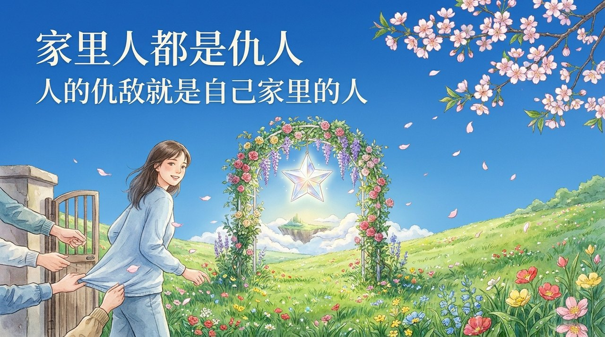
    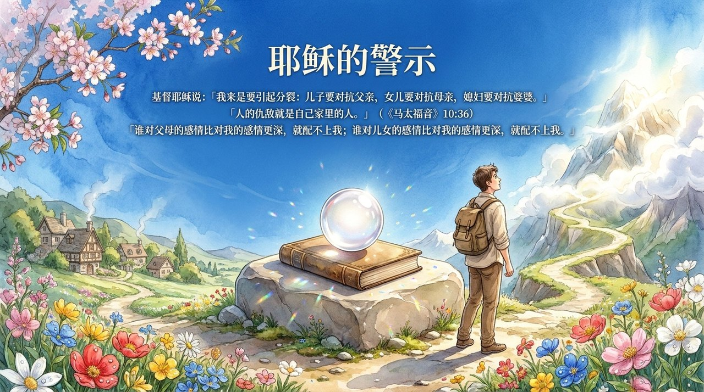
    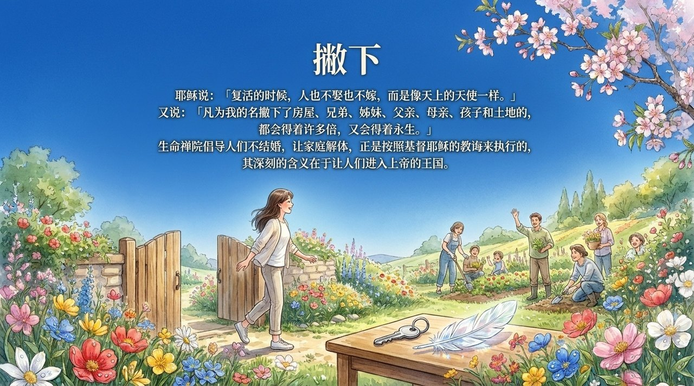
    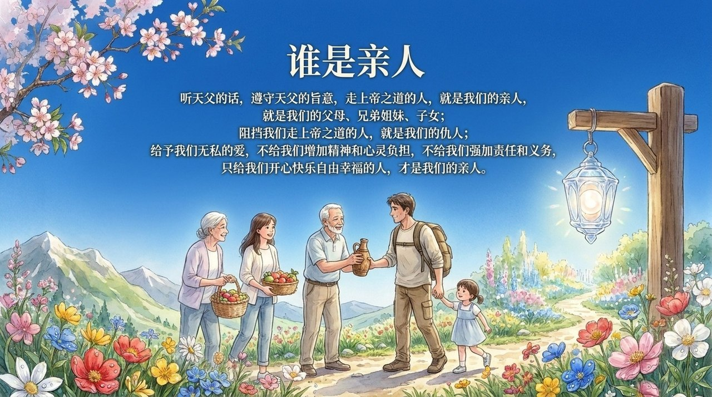
    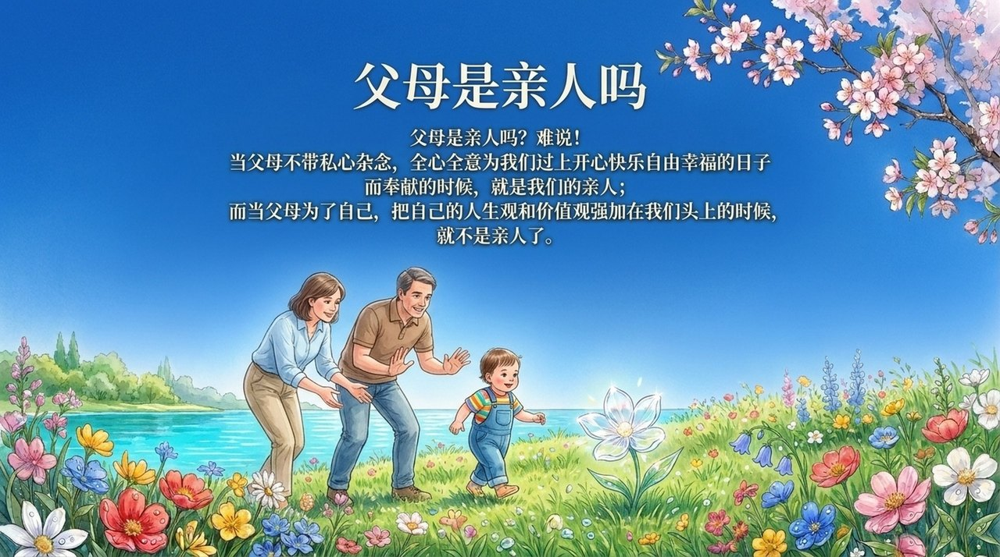
    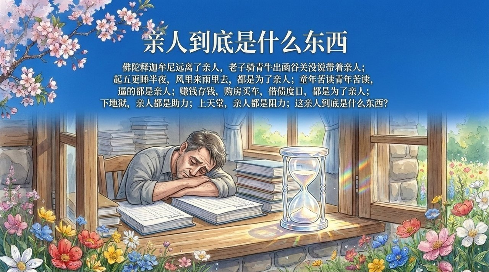
    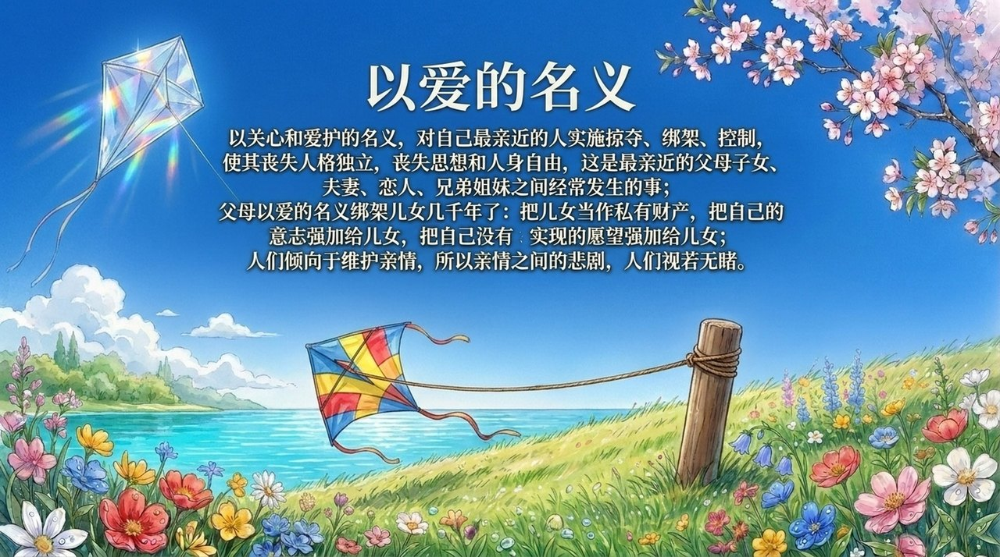
    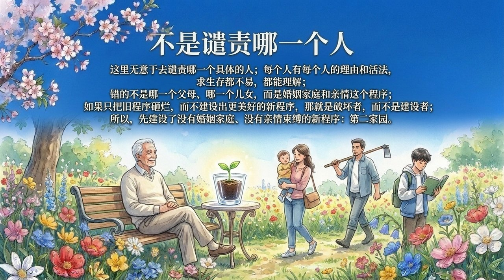
    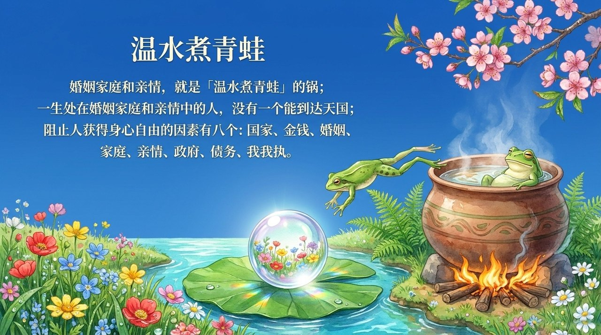
    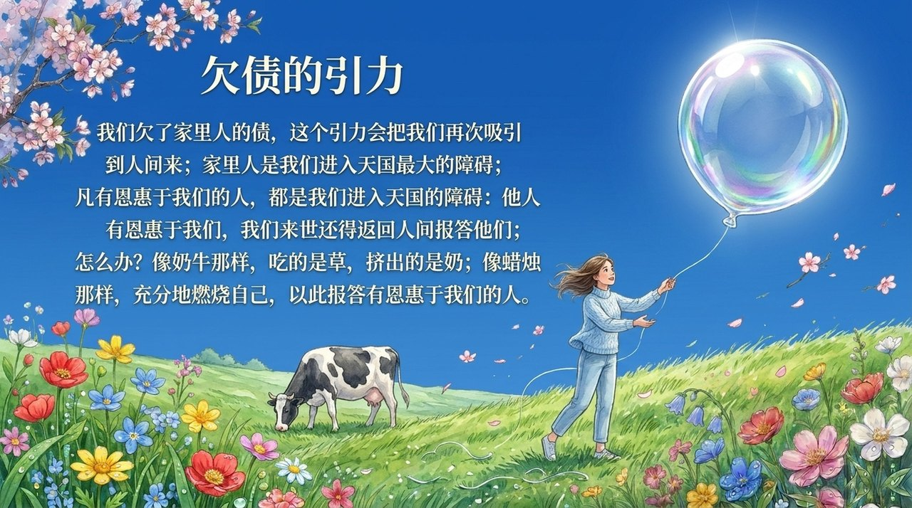
    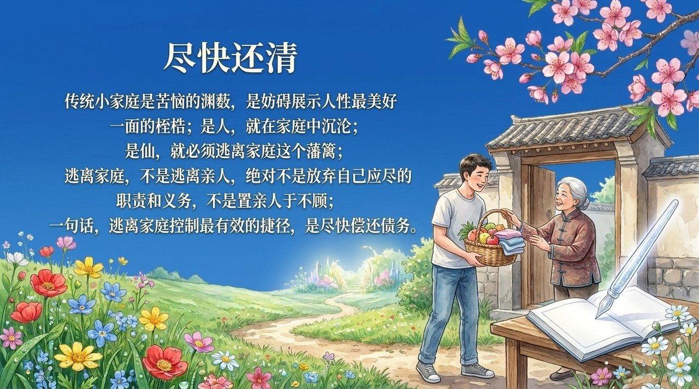
    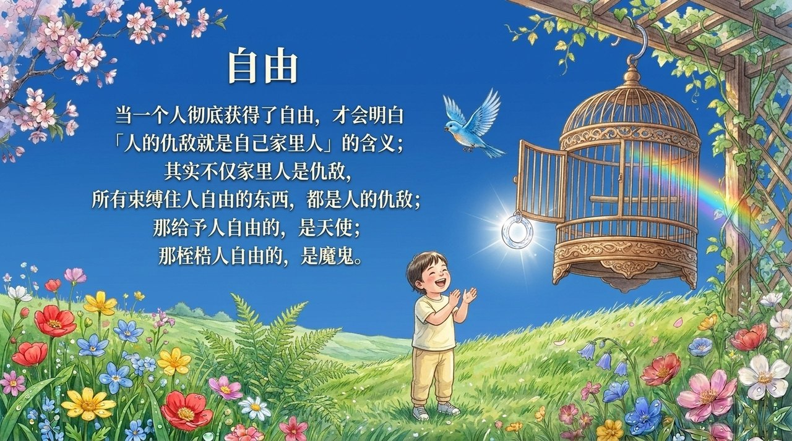
    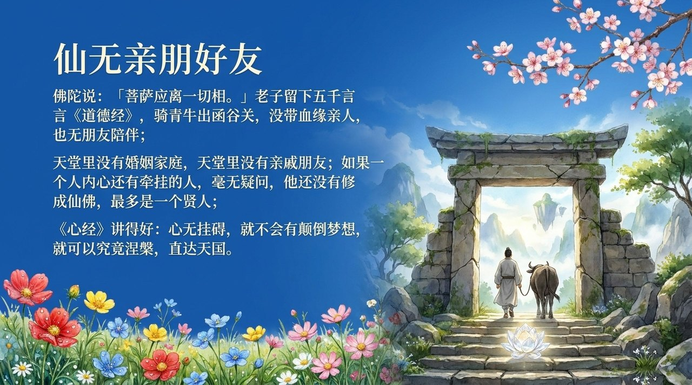
    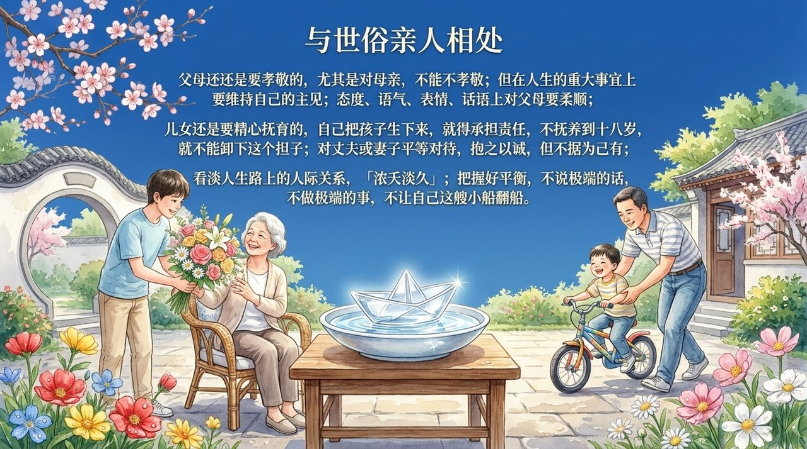

---

## 版本导航

| 版本 | 适合 | 核心角度 |
|------|------|----------|
| [友好版](friendly.md) | 初次了解 | 生活体验·耶稣本意·如何相处 |
| [学术版](academic.md) | 研究者 | 概念辨析·体系定位·与外部概念比较 |
| [内部版](internal.md) | 深度研修 | 完整引文·文集汇编·修炼实践 |

---

## 相关词条

[了却尘缘](/zh/releasing-worldly-bonds/) · [偿还债务](/zh/debt-repayment/) · [自由意志](/zh/free-will/) · [量子纠缠和"另一半"](/zh/quantum-entanglement-and-the-other-half/) · [放下](/zh/letting-go/) · [生死](/zh/life-and-death/) · [缘](/zh/yuan/) · [成仙成佛](/zh/becoming-celestial-buddha/) · [灵性人生](/zh/spiritual-life/) · [去天国路线图](/zh/route-to-heaven/)
