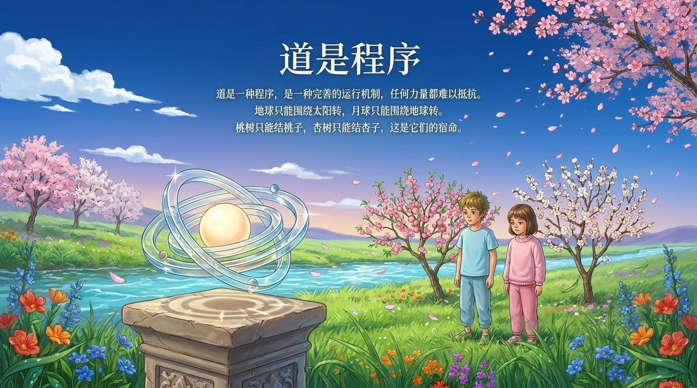
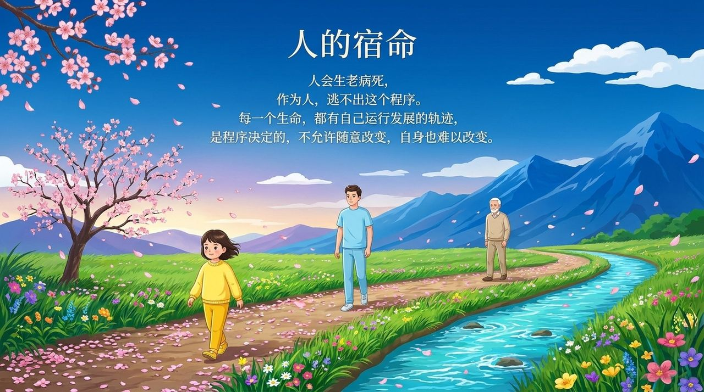
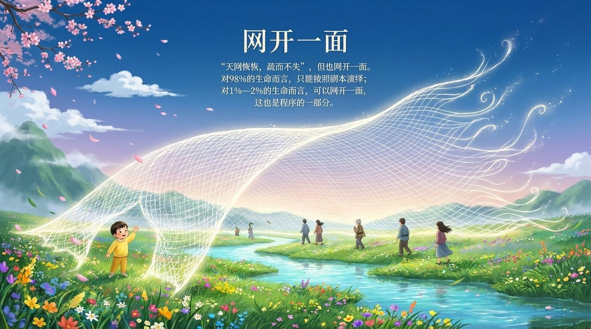

# 宿命与超越

**宿命**，是生命按照上帝所设程序运行的必然轨迹；**超越宿命**，是极少数觉悟者通过深知生命奥秘、运用反常思维与禅院法门，从必然王国跃入自由王国的生命蜕变。

> 对98%的大众而言，一切是宿命使然，对1-2%的禅院草而言，一切皆识与心。
>
> ——雪峰

## 视频版

<iframe style="width:100%;aspect-ratio:4/3;border:0" src="https://www.youtube-nocookie.com/embed/gk40nP1nuao" title="宿命与超越（生命禅院百科·视频版）" allowfullscreen></iframe>

??? info "📖 图文幻灯（14 张，点击展开）"

    
    
    
    
    
    
    
    
    
    
    
    
    
    

---

| 版本 | 适合 | 核心角度 |
|------|------|----------|
| [友好版](friendly.md) | 初次了解 | 宿命是什么，如何突破 |
| [学术版](academic.md) | 研究者 | 概念辨析、文本分析、比较研究 |
| [内部版](internal.md) | 深度研修 | 导游原文全录 |

---

**相关词条：**
[人生剧本](/zh/life-script/) · [人生轨迹](/zh/life-trajectory/) · [一切都是注定的](/zh/everything-is-destined/) · [自由意志](/zh/free-will/) · [因果·报应·轮回](/zh/karma-retribution-reincarnation/) · [反常思维](/zh/abnormal-thinking/) · [意识](/zh/consciousness/) · [觉悟](/zh/awakening/)
