# 女性觉醒

**女性觉醒**，在生命禅院体系中，指女性从传统婚姻家庭的依附桎梏中解放，回归天性与佛性，以柔美自由之姿独立生活。导游雪峰指出：几千年来人类苦难延伸，根源之一在于"女性仍然没有觉醒"——婚姻家庭淹没了女性的天性与佛性，家务活葬送了大批精英。女性一旦觉醒，将卸下一切桎梏枷锁，不再依附男性或家庭，不再追求刚强，以柔美为人生格言，随遇随缘，只求开心快乐自由幸福。禅院同时倡导"乾坤颠倒，仙女为尊"，从理念层面保障女性的尊严与自由。

> 那是因为女性仍然没有觉醒，婚姻家庭淹没了天性佛性，家务活家务事葬送了大批精英……待到女性从婚姻家庭中睡醒，人类的文明就将跃升。
>
> ——雪峰文集·诗歌篇·操你莲花化生大自在

## 视频版

<iframe style="width:100%;aspect-ratio:4/3;border:0" src="https://www.youtube-nocookie.com/embed/YdYLrbLlA2o" title="女性觉醒（生命禅院百科·视频版）" allowfullscreen></iframe>

??? info "📖 图文幻灯（14 张，点击展开）"

    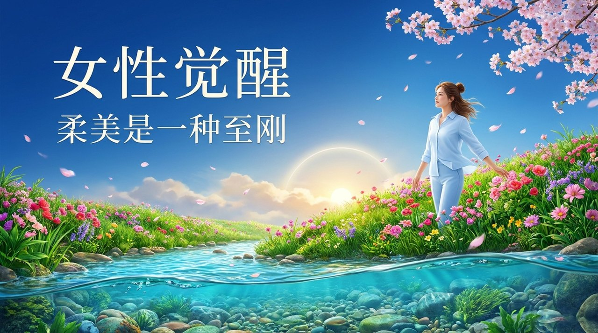
    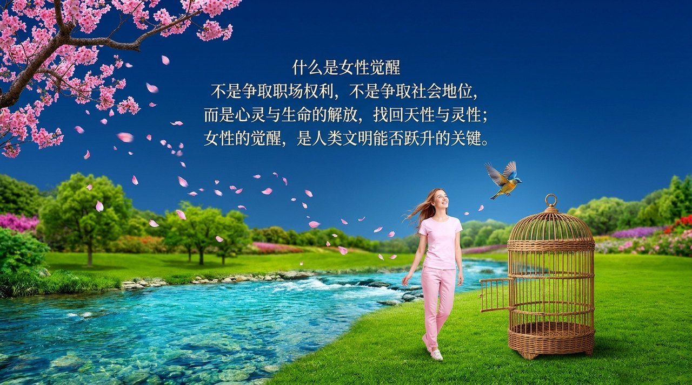
    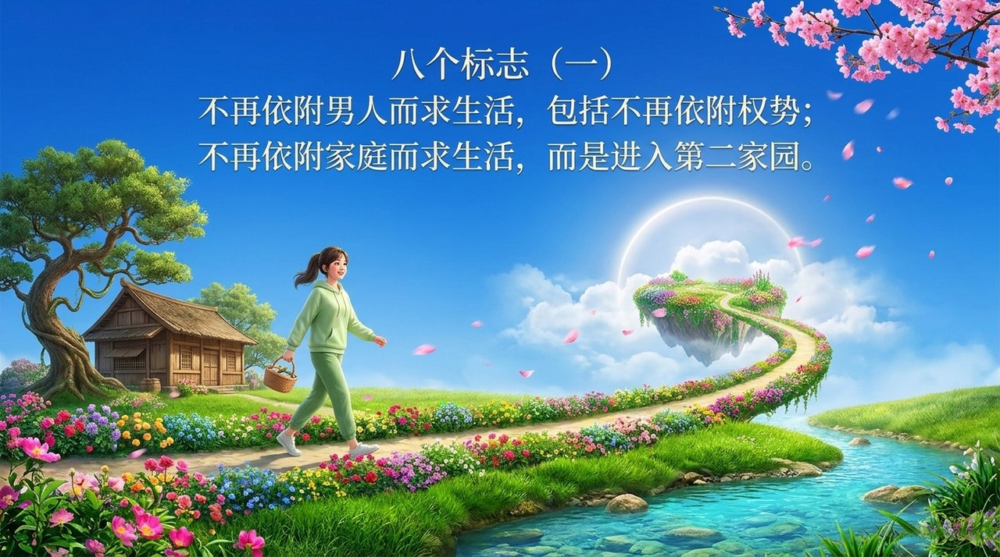
    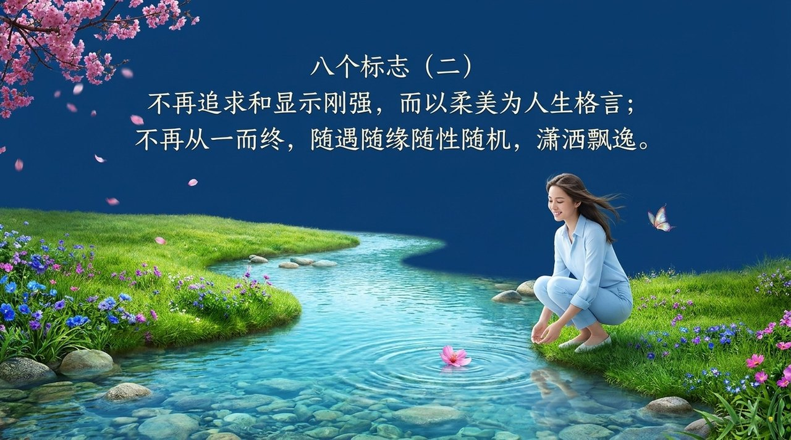
    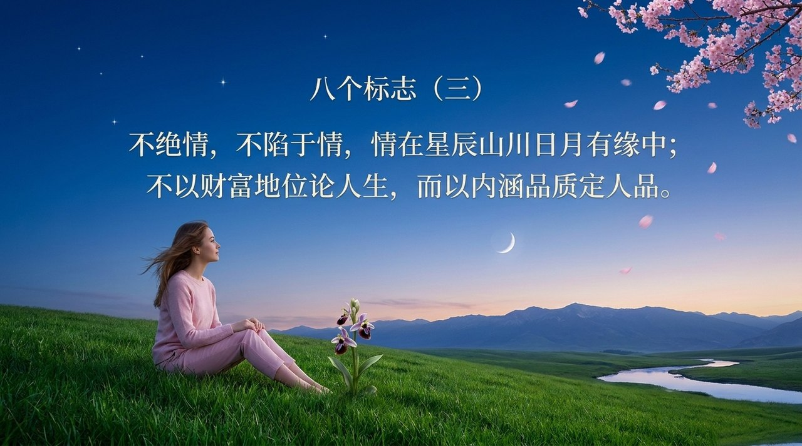
    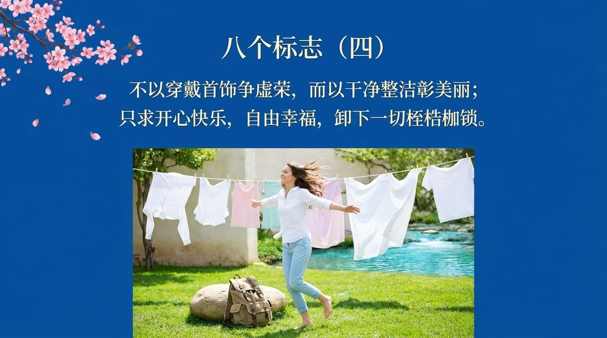
    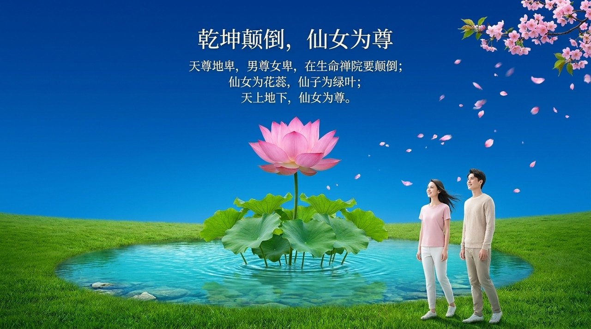
    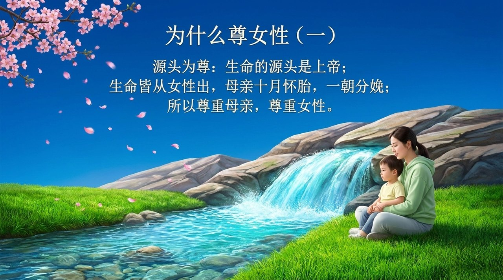
    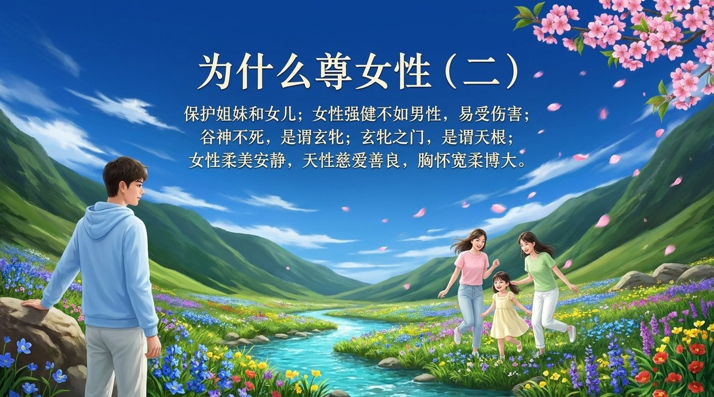
    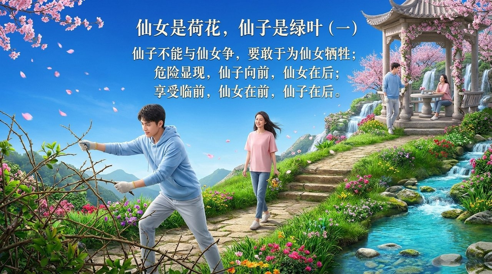
    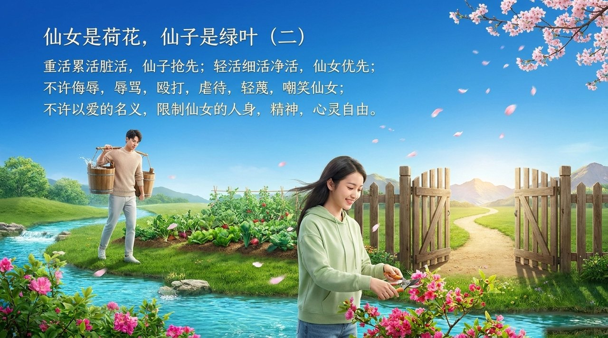
    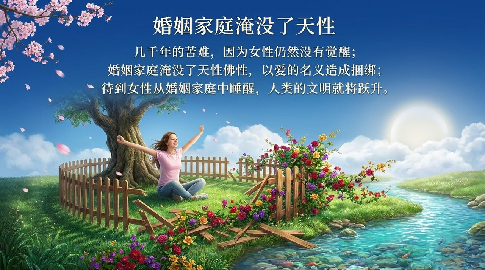
    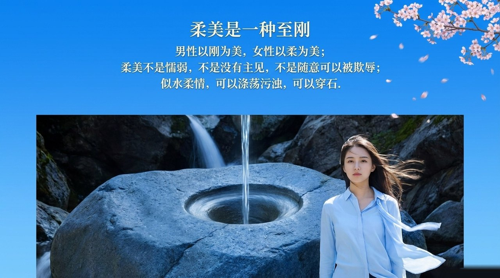
    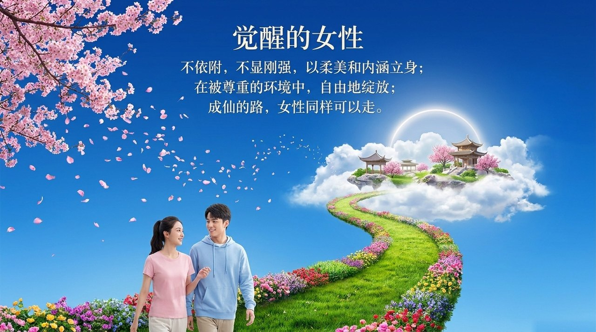

---

## 版本导航

| 版本 | 适合 | 核心角度 |
|------|------|----------|
| [友好版](friendly/) | 初次了解 | 女性解放的八个标志与生活启示 |
| [学术版](academic/) | 研究者 | 系统分析女性觉醒的内涵与禅院实践 |
| [内部版](internal/) | 深度研修 | 导游原文存档 |

## 相关词条

[女性以柔为美](/zh/feminine-beauty-in-softness/) · [仙子·仙女](/zh/xianzi-xiannv/) · [夫妻·婚姻·家庭](/zh/marriage-and-family/) · [一对一特殊关系·夫妻关系](/zh/one-to-one-and-marriage/) · [家里人都是仇人](/zh/family-as-foes/) · [高级修行](/zh/advanced-cultivation/) · [随性·任性·性自由](/zh/suixing-renxing-xingziyou/) · [生命禅院的合作之道](/zh/way-of-cooperation/)
