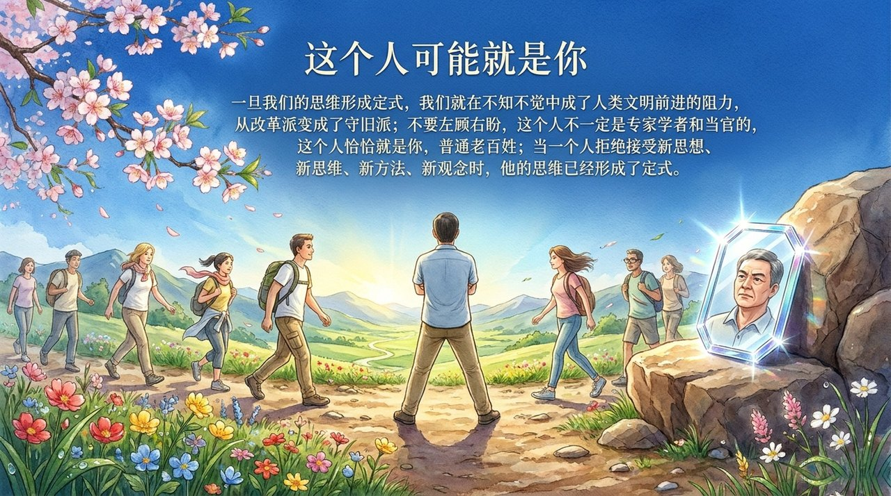
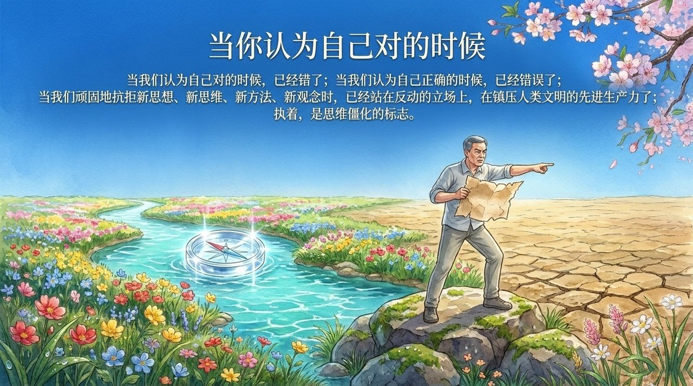
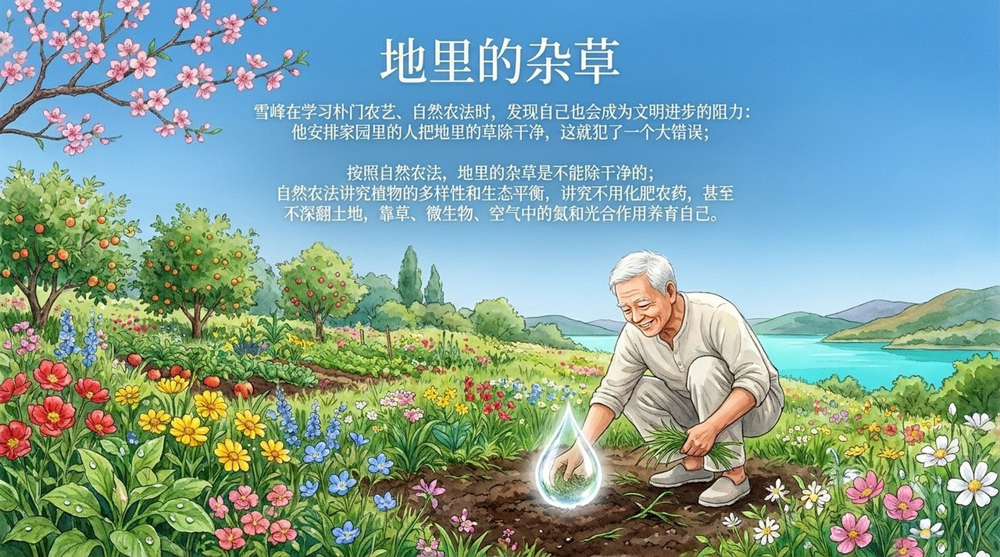
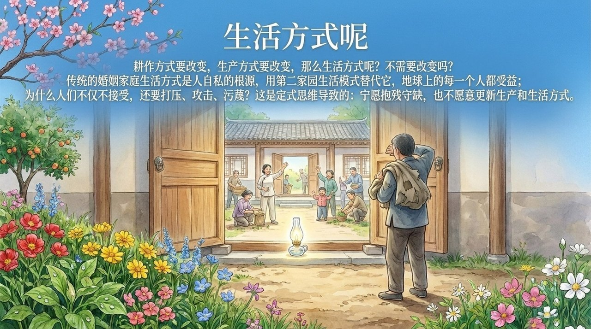
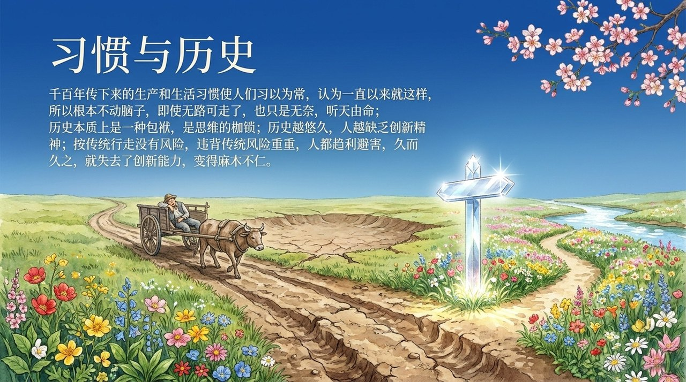
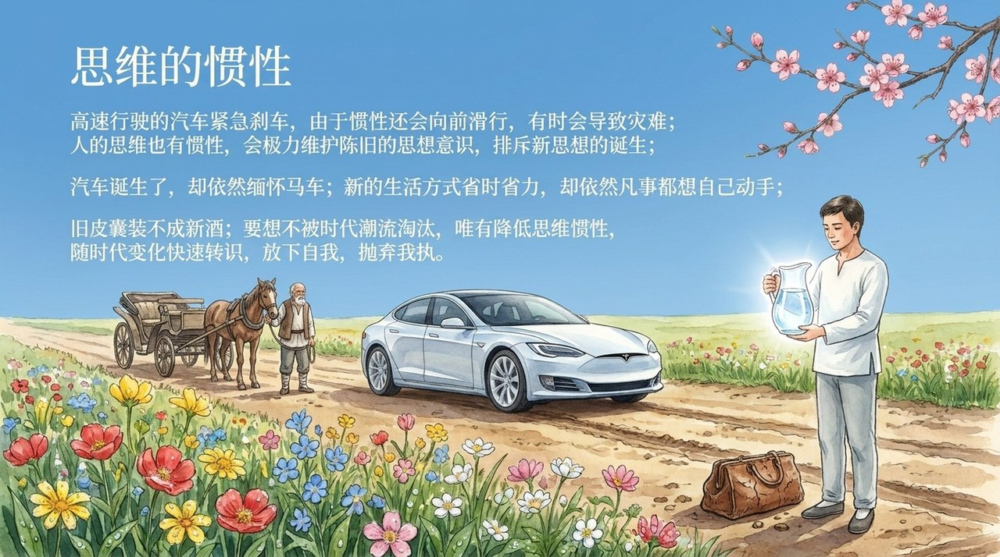
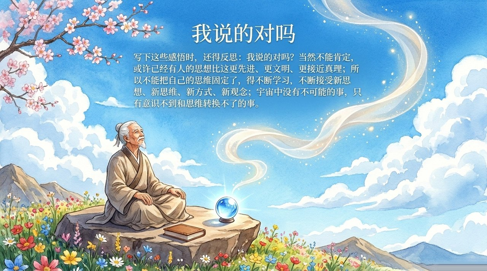

<!-- id: LC-FXM-0001 theme: 思维修炼 type: 入口页 direction: 意识跃升路径 lang: zh -->

# 定式思维

> 定式思维是人类文明前进的最大障碍。
>
> ——《新时代人类八百理念》

> 一旦我们的思维形成定式，我们就变成了人类文明前进的阻力，我们从改革派变成了守旧派，从进步人士变成了反动人士。
>
> ——雪峰，《雪峰文集·X01警世篇·定式思维是人类文明前进的最大阻力》

**定式思维**是思维在长期**习惯、知识积累和历史经验**的反复固化下，形成的一种不知不觉拒绝新思想、新方法、新观念，只按既有模式运行的僵化意识状态。它是人类文明前进的最大障碍，是从改革派变成守旧派、从进步人士变成反动人士的思维学根源，是人类一切墨守陈规、固守传统的意识底层机制。

定式思维不只存在于专家学者中——普通老百姓同样深陷其中。突破定式的唯一出路是**反常思维**。

---

## 各版本

| 版本 | 适合人群 | 核心内容 |
|------|----------|----------|
| [友好版](/zh/fixed-mindset/friendly/) | 初次接触者 | 你的思维是不是也被锁住了？三把锁的白话解读 |
| [学术版](/zh/fixed-mindset/academic/) | 研究者 | 与库恩范式论、布尔迪厄惯习理论、认知心理学的比较研究 |
| [内部版](/zh/fixed-mindset/internal/) | 禅院草 | 文集完整原文，16个板块全量照引 |

---

## 视频版

<iframe style="width:100%;aspect-ratio:4/3;border:0" src="https://www.youtube-nocookie.com/embed/6Ooa966SD3w" title="定式思维（生命禅院百科·视频版）" allowfullscreen></iframe>

??? info "📖 图文幻灯（14 张，点击展开）"

    
    
    
    
    
    
    
    
    
    
    
    
    
    

---

## 相关词条

- [反常思维](/zh/abnormal-thinking/)
- [颠倒思维](/zh/inverted-thinking/)
- [1+1思维](/zh/one-plus-one-thinking/)
- [物质思维](/zh/material-thinking/)

> 注：本页引用的《新时代人类八百理念》条号，均为第四版的编号。第五版已重新编排，条号与第四版不再一一对应。
