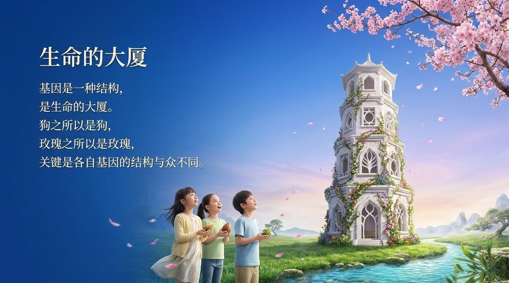
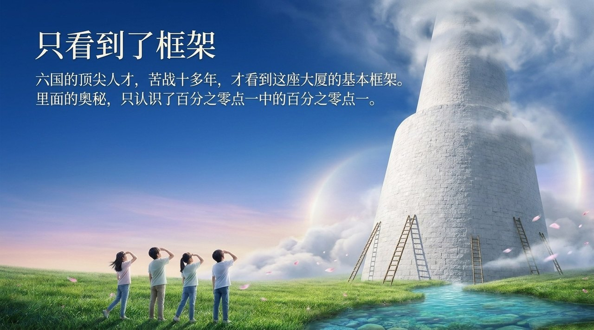
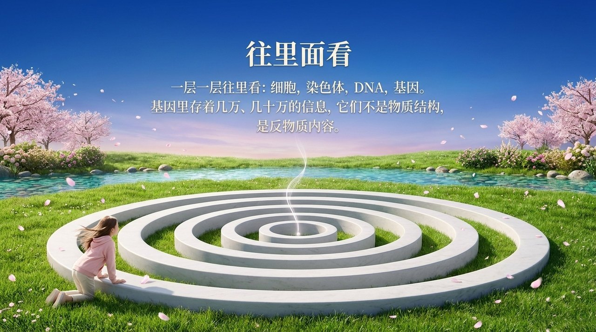
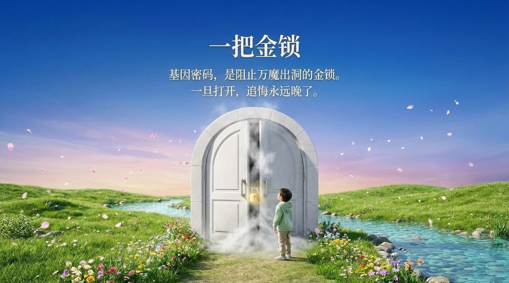

<!-- id: LC-GENE-0001 theme: 生命奥秘 type: 入口页 direction: 生命本质探索 lang: zh -->

# 基因

> 大脑是宇宙的缩影；基因是生命的天书。
>
> ——《新时代人类八百理念》

**基因**，在生命禅院体系中被称为"生命的天书"，是DNA分子中具有遗传效应的特定核苷酸序列，决定了生命的形态、特征与生命历程。它是上帝智慧凝结于物质世界的杰作，然而只是生命天书的表现形式——真正的生命本质是有灵性的反物质结构。生物基因工程则被明确警示为异常危险的工程。

---

## 各版本

| 版本 | 适合 | 核心角度 |
|------|------|----------|
| [友好版](friendly.md) | 初次了解 | 什么是基因？为什么它是天书？生活类比解读 |
| [学术版](academic.md) | 研究者 | 基因的宇宙地位、与反物质结构的关系、基因工程的危险 |
| [内部版](internal.md) | 深度研修 | 文集原文全量，含12段独立引文 |

---

## 视频版

<iframe style="width:100%;aspect-ratio:4/3;border:0" src="https://www.youtube-nocookie.com/embed/mXnT0h3eFJ0" title="基因（生命禅院百科·视频版）" allowfullscreen></iframe>

??? info "📖 图文幻灯（14 张，点击展开）"

    
    
    
    
    
    
    
    
    
    
    
    
    
    

---

## 相关词条

- [生命](/zh/life/)
- [反物质结构](/zh/antimatter-structure/)
- [生命的特征](/zh/life-characteristics/)
- [人体——奇迹程序和奥秘](/zh/human-body-miracle/)
- [上帝](/zh/greatest-creator/)
- [道](/zh/dao/)
- [生命起源](/zh/life-origin/)

> 注：本页引用的《新时代人类八百理念》条号，均为第四版的编号。第五版已重新编排，条号与第四版不再一一对应。
