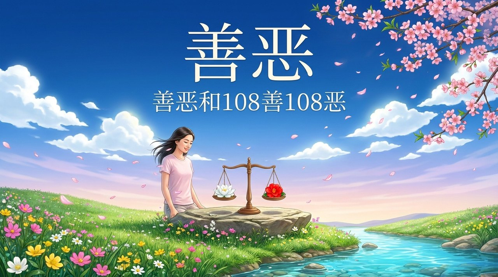
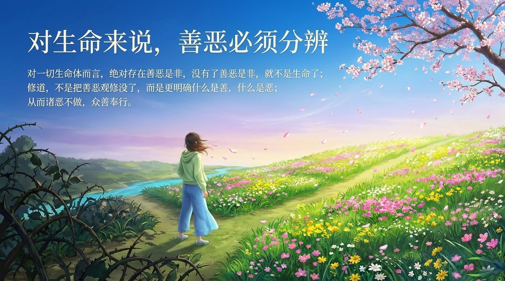
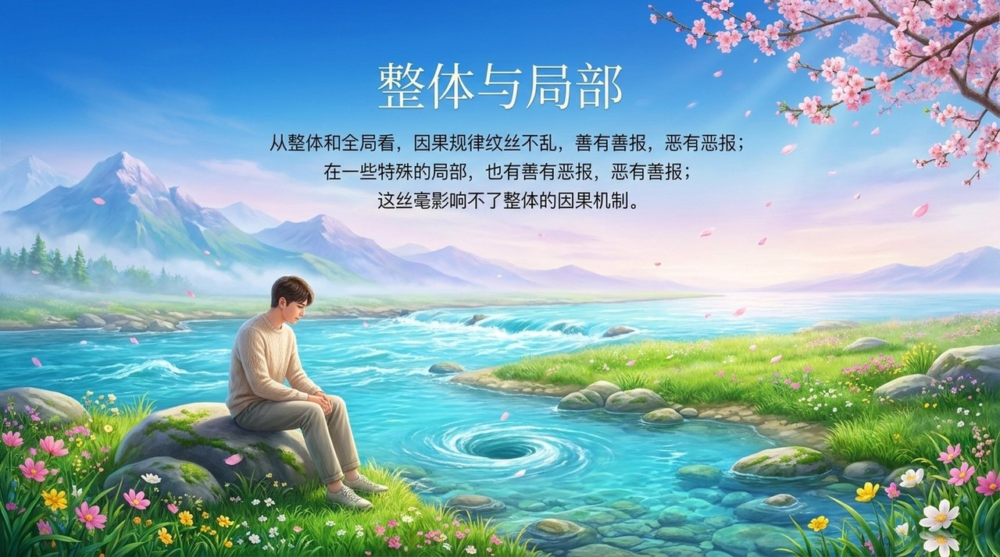
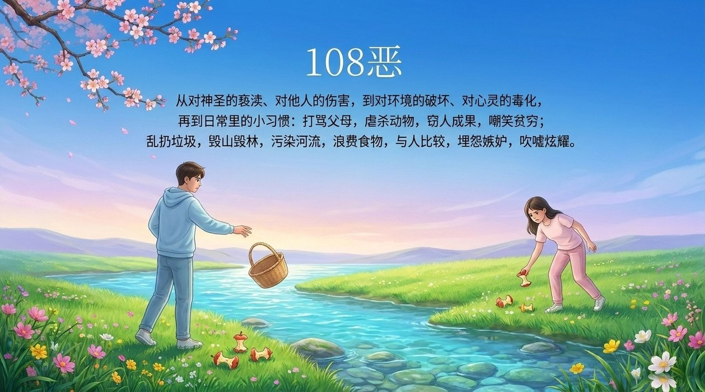
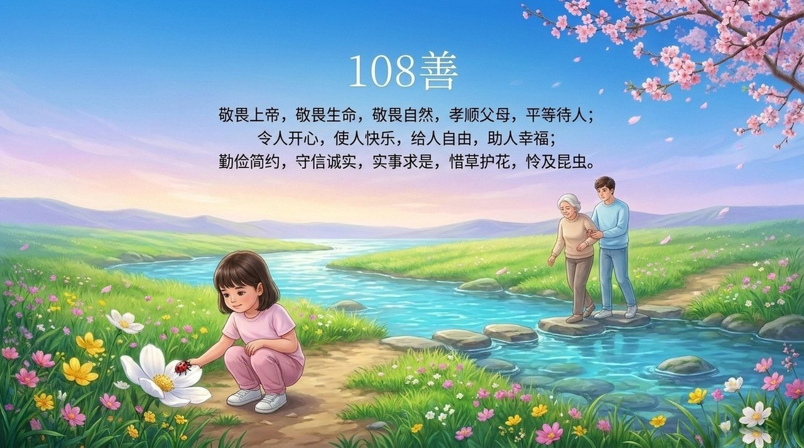
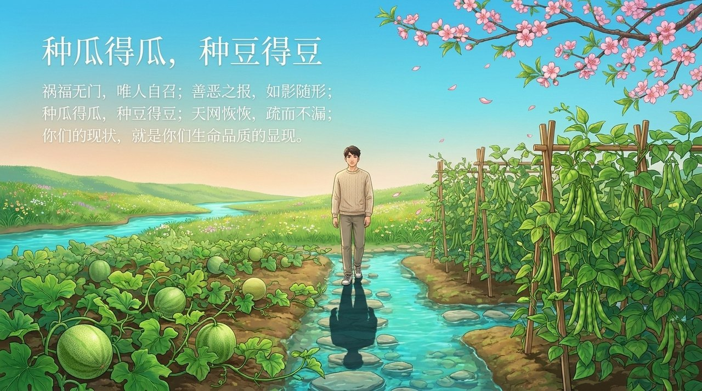
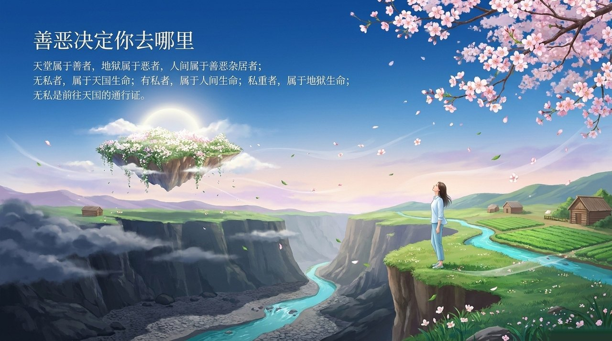
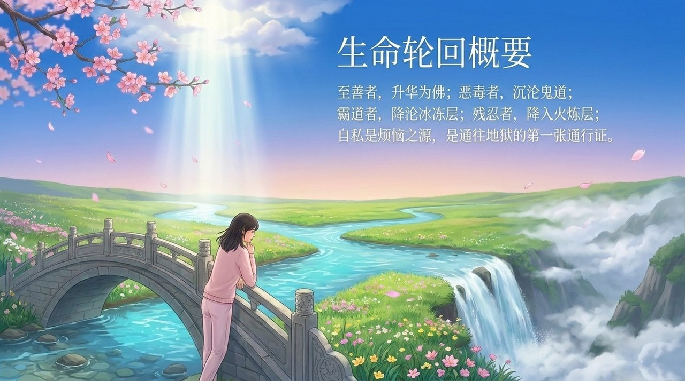
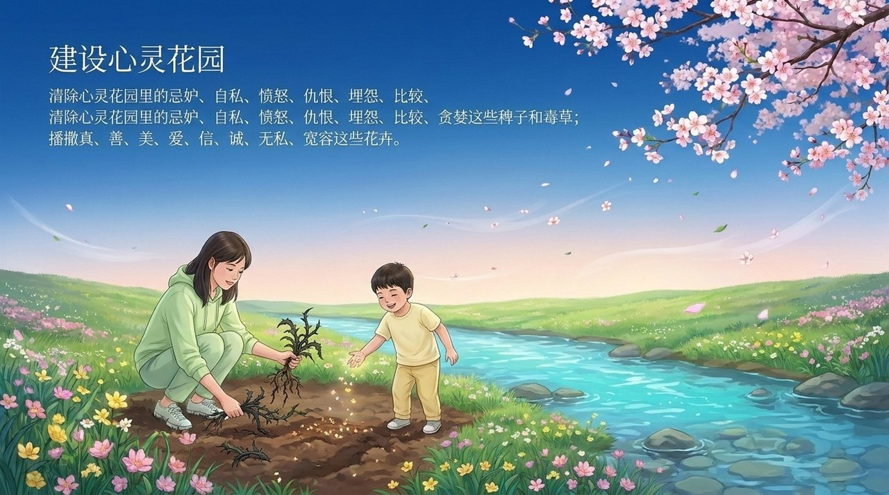

# 善恶和108善108恶

**善恶**，在生命禅院体系中具有两个层面：在浑沌体系和道的运行层面，不存在善恶之分，只有对称平衡；但对一切生命体而言，善恶之辨绝对存在，是生命能否升华、能否前往天堂的根本依据。《新时代人类八百理念》列出完整的**108恶**与**108善**，是禅院体系中最具体的善恶行为清单，也是日常修行的对照标准。

> 天堂属于善者，地狱属于恶者，人间属于善恶杂居者。

---

## 视频版

<iframe style="width:100%;aspect-ratio:4/3;border:0" src="https://www.youtube-nocookie.com/embed/FW4u1OT6m3s" title="善恶和108善108恶（生命禅院百科·视频版）" allowfullscreen></iframe>

??? info "📖 图文幻灯（14 张，点击展开）"

    
    
    
    
    
    
    
    
    
    
    
    
    
    

---

## 版本导航

| 版本 | 适合读者 | 入口 |
|------|----------|------|
| 友好版 | 初次接触，希望轻松理解 | [阅读友好版](/zh/good-evil-108/friendly/) |
| 学术版 | 深入研究，系统梳理 | [阅读学术版](/zh/good-evil-108/academic/) |
| 内部版 | 禅院草，研读文集 | [阅读内部版](/zh/good-evil-108/internal/) |

---

## 相关词条

[道德](/zh/morality/) · [因果·报应·轮回](/zh/karma-retribution-reincarnation/) · [心灵花园](/zh/soul-garden/) · [天国](/zh/kingdom-of-heaven/) · [浑沌](/zh/hundun/) · [觉悟](/zh/awakening/) · [忏悔](/zh/repentance/) · [上帝之道](/zh/way-of-the-greatest-creator/)

> 注：本页引用的《新时代人类八百理念》条号，均为第四版的编号。第五版已重新编排，条号与第四版不再一一对应。
