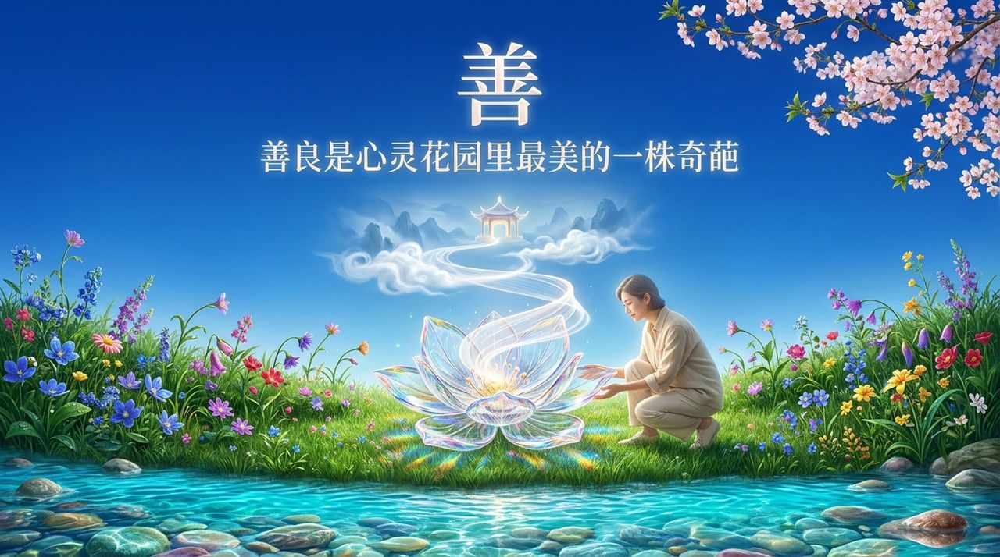
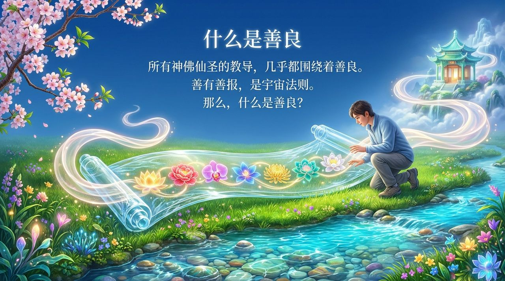
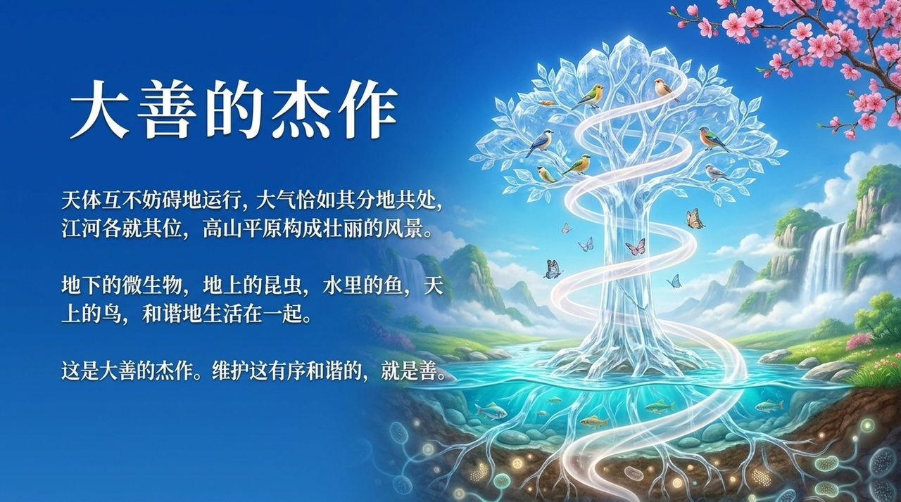
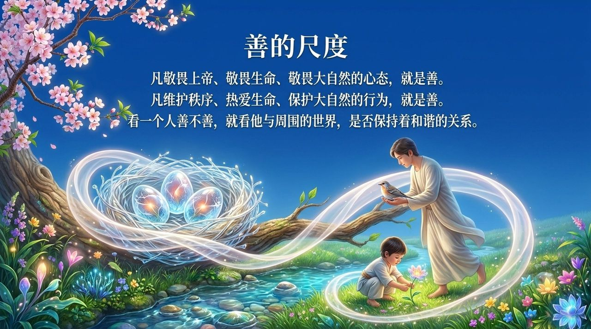
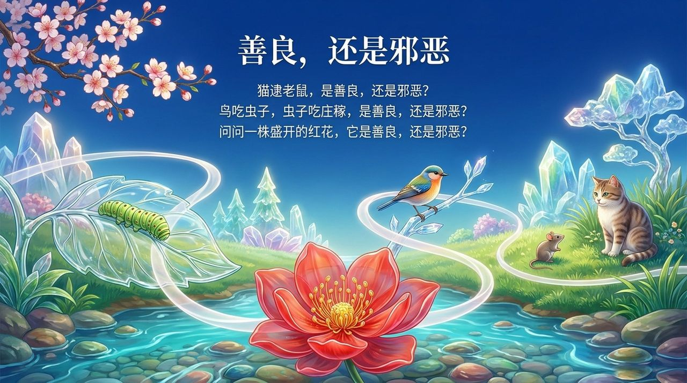
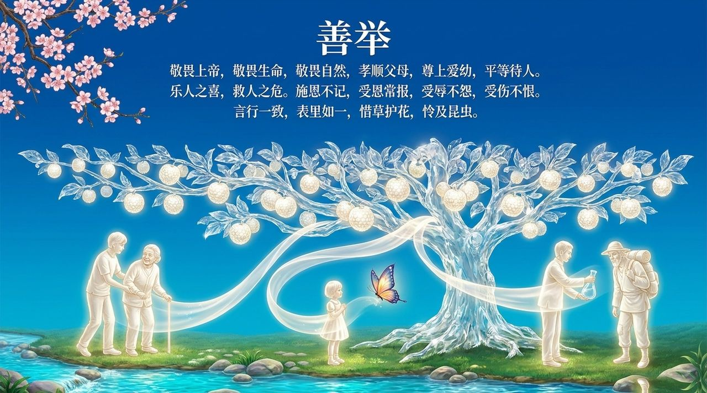
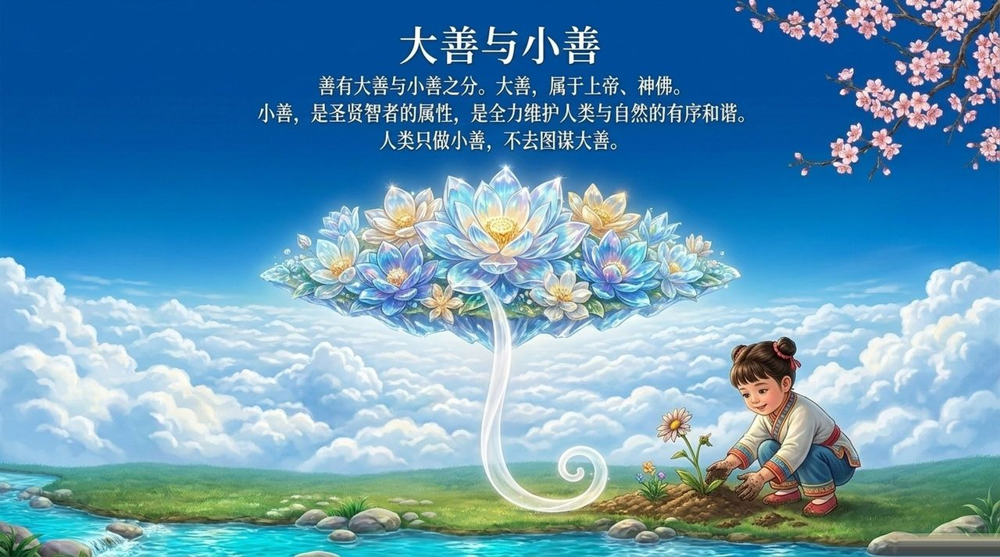
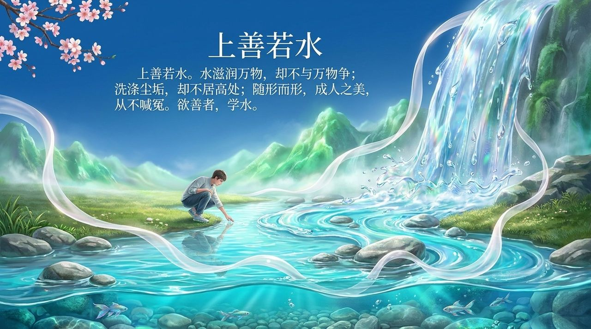
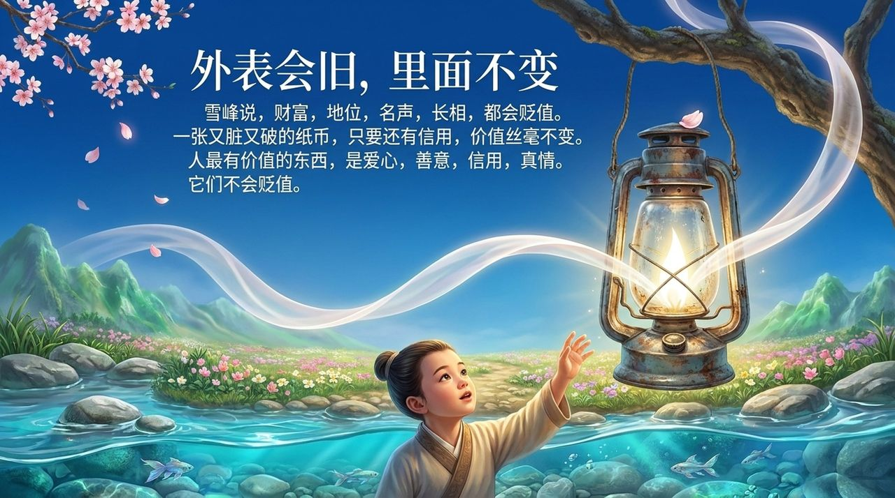
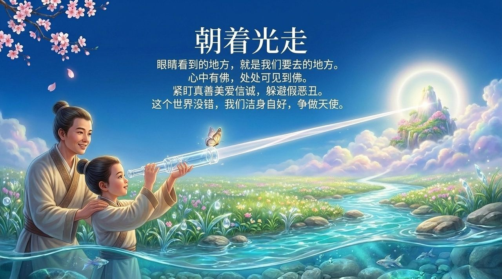

# 善

**善**，是生命禅院理论体系中"真善美爱信诚"六大核心生命品质之一，是上帝的属性，是人性的核心价值，是心灵花园里最重要的花卉之一，是衡量一个生命层次的重要尺度，也是前往天国千年界的必要条件。善不是软弱，不是愚蠢，更不是无原则地迁就，而是按照上帝的意愿活人。

> 善良是心灵花园里最美的一株奇葩。按照创造者的意图，按照上帝的意愿活人，我认为这就是善良。
>
> ——导游雪峰《禅院文集·智慧篇·我们是否应当保持善良》

## 视频版

<iframe style="width:100%;aspect-ratio:4/3;border:0" src="https://www.youtube-nocookie.com/embed/n1dAke8O1uo" title="善（生命禅院百科·视频版）" allowfullscreen></iframe>

??? info "📖 图文幻灯（14 张，点击展开）"

    
    
    
    
    
    
    
    
    
    
    
    
    
    

---

## 版本导航

| 版本 | 适合 |
|------|------|
| [友好版](friendly/) | 首次接触，内容丰满、可读性强 |
| [学术版](academic/) | 理论研究与引用 |
| [内部版](internal/) | 体系内核心学习，以文集原文为准 |

## 相关词条

[真](/zh/truth/) · [美](/zh/beauty/) · [爱](/zh/love/) · [信](/zh/faith/) · [诚](/zh/sincerity/) · [真善美爱信诚](/zh/six-qualities/) · [心灵花园](/zh/soul-garden/)
