# 幸福

> **上帝之道是幸福之道。**
>
> ——新时代人类八百理念

在生命禅院体系中，幸福不是外部条件的叠加，而是生命与上帝之道相合时从内心涌现的光辉状态。真正的幸福与物质积累无关，与社会地位无关——它是心灵自由、充实、无挂碍的自然流露。禅院指出：情爱是幸福最大的源泉；无忧无虑、逍遥自在是幸福的基本形态；随遇而安、与道合一是幸福的最高境界。幸福有其层次：普通人的幸福依赖外境；修行者的幸福来自内在自由；天仙的幸福是无条件的、圆满的、永恒的。

| 版本 | 适合 | 核心角度 |
|------|------|----------|
| [友好版](friendly.md) | 初次了解 | 用日常语言理解什么是真正的幸福 |
| [学术版](academic.md) | 研究者 | 系统分析幸福的来源、层次与修炼路径 |
| [内部版](internal.md) | 深度研修 | 导游文集完整呈现，逐段标注出处 |

---

## 核心定义

幸福是生命与上帝之道相合时的内在感受，是心灵自由、充实、无挂碍的自然状态。在生命禅院体系中，幸福的本质不在于拥有什么，而在于与道同频的生命状态——知足者幸福，自由者幸福，情爱丰沛者幸福，与上帝同频者最幸福。

幸福的最高形态是「极乐」——天仙在极乐界所享有的那种圆满、永恒、无条件的喜悦，正是所有修炼修行的终极归宿。

---

## 视频版

<iframe style="width:100%;aspect-ratio:4/3;border:0" src="https://www.youtube-nocookie.com/embed/Gu5M2kDtAAE" title="幸福（生命禅院百科·视频版）" allowfullscreen></iframe>

??? info "📖 图文幻灯（14 张，点击展开）"

    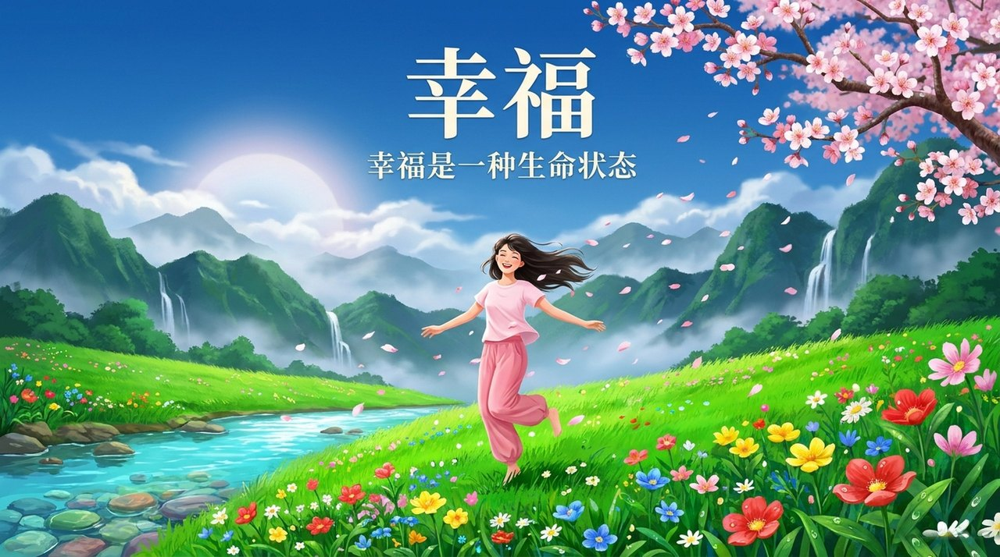
    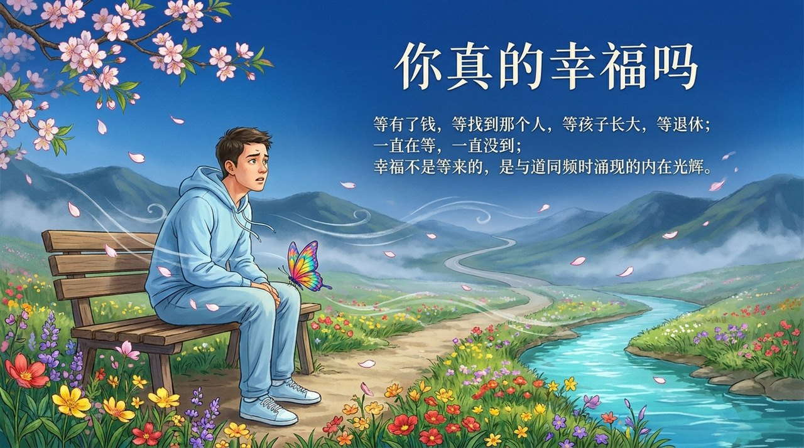
    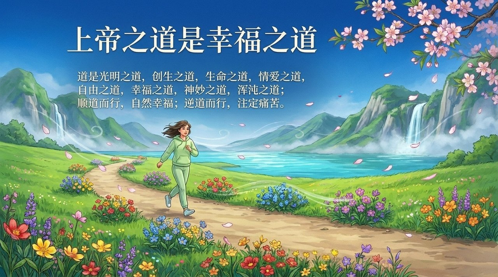
    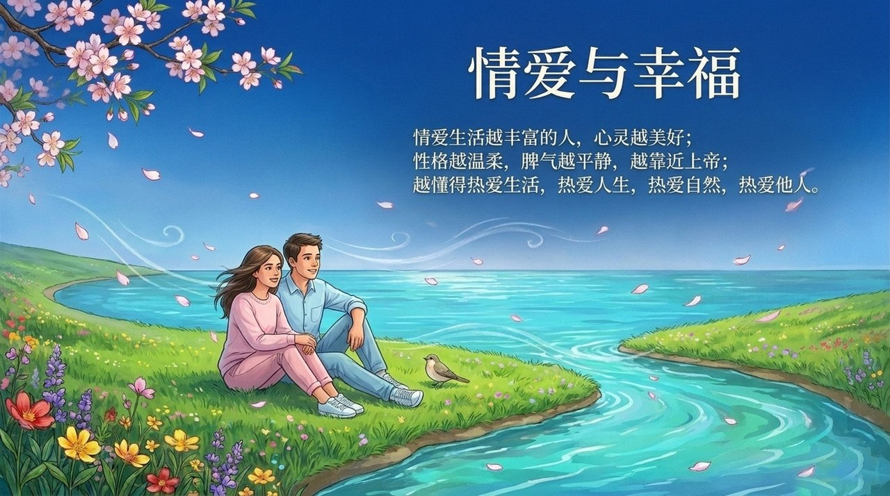
    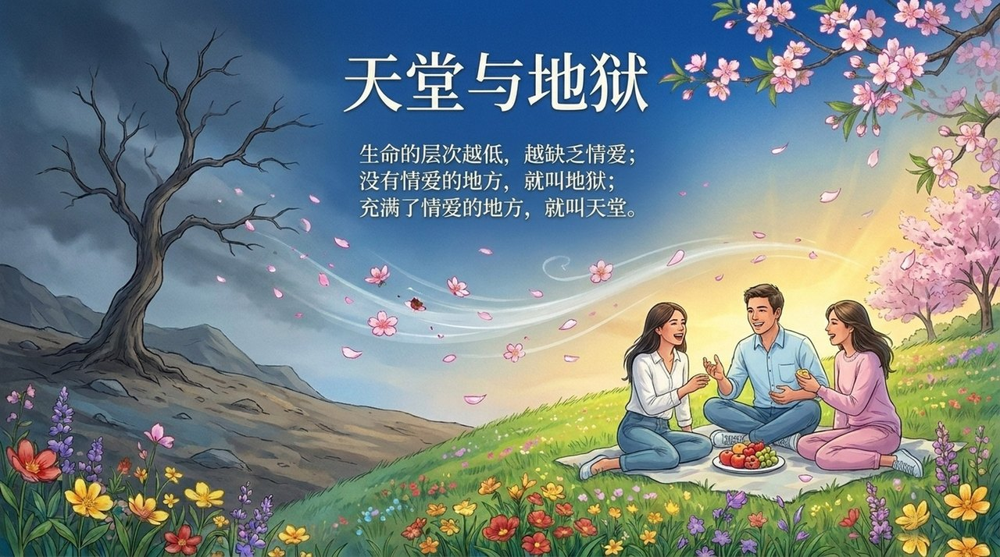
    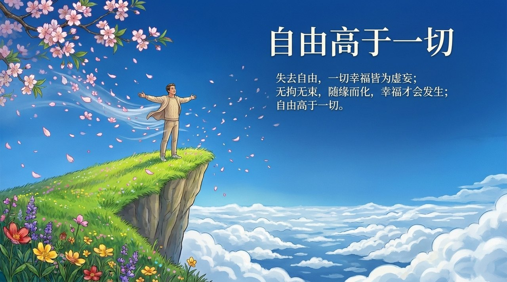
    
    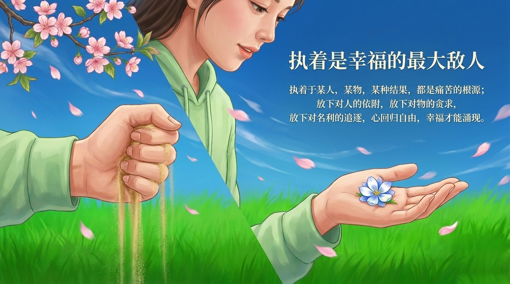
    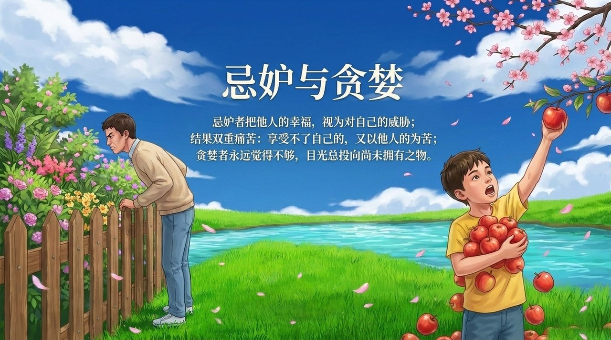
    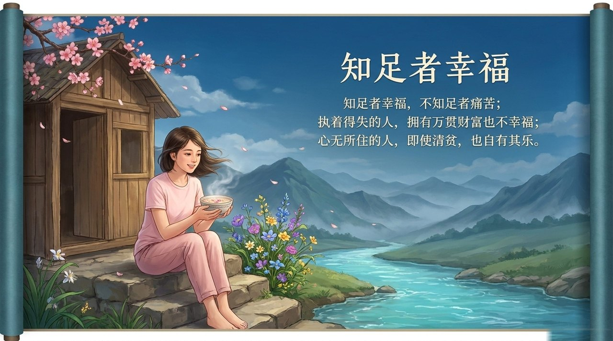
    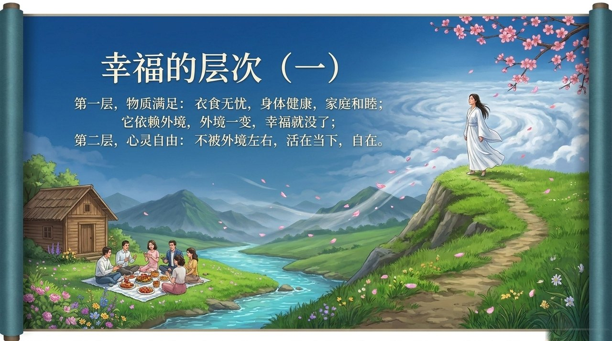
    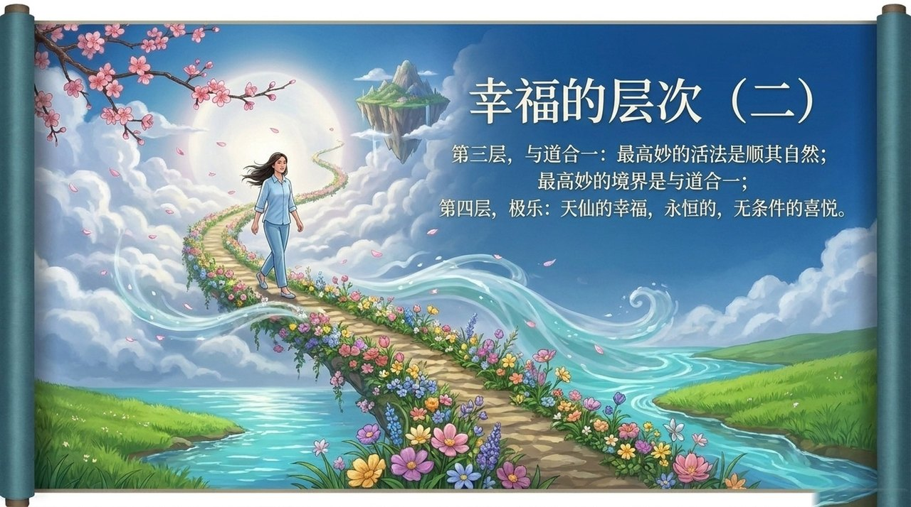
    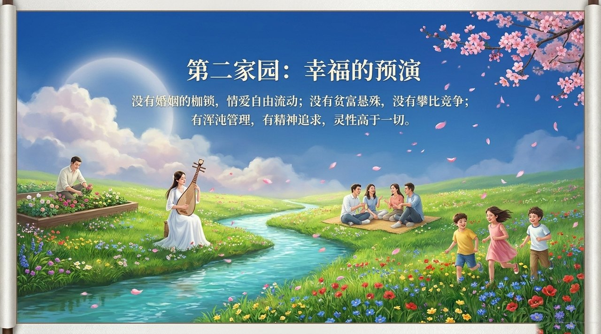
    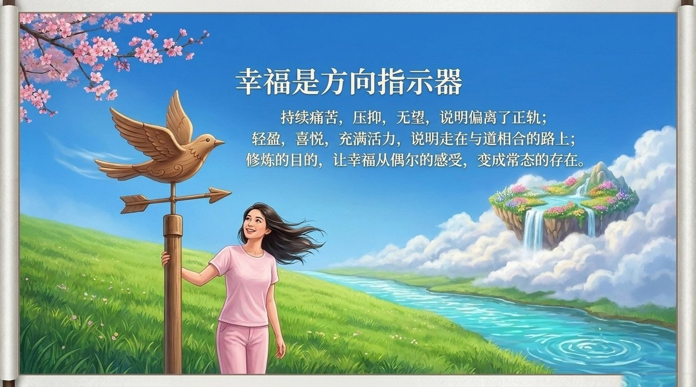

---

## 相关词条

- [爱](/zh/love/)
- [情爱·性爱](/zh/romantic-love-and-sexuality/)
- [极乐妙境](/zh/jilemiaojing/)
- [自由意志](/zh/free-will/)
- [随性而动](/zh/suixing-er-dong/)
- [同频共振](/zh/resonance/)
- [心灵花园](/zh/soul-garden/)
- [真善美爱信诚](/zh/six-qualities/)
- [人生的价值·意义和目的](/zh/value-meaning-purpose-of-life/)
- [千年界](/zh/thousand-year-world/)

> 注：本页引用的《新时代人类八百理念》条号，均为第四版的编号。第五版已重新编排，条号与第四版不再一一对应。
