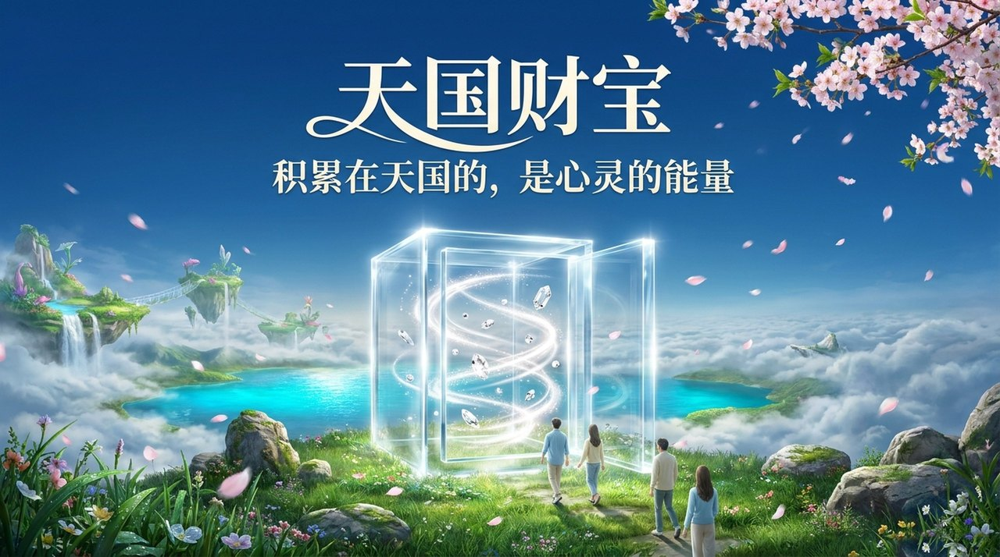
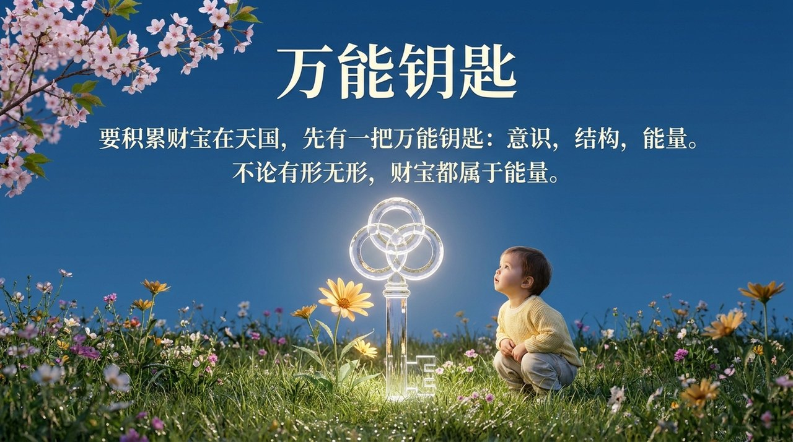
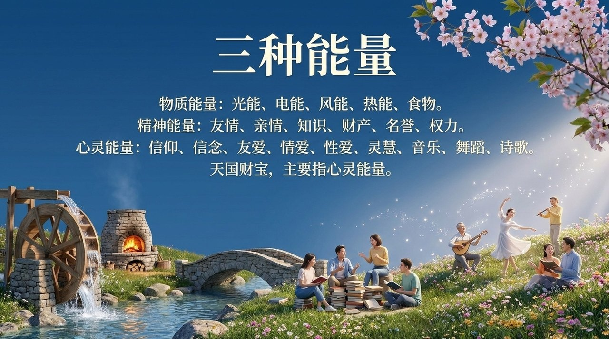
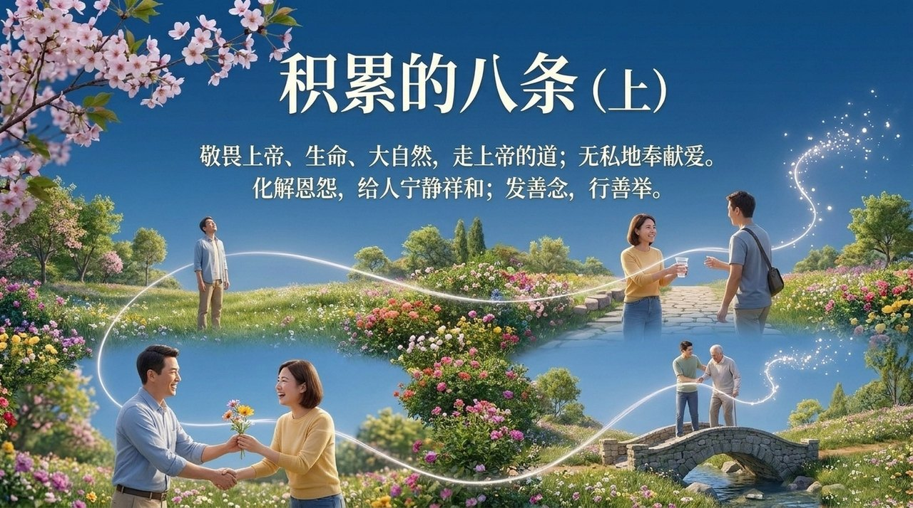
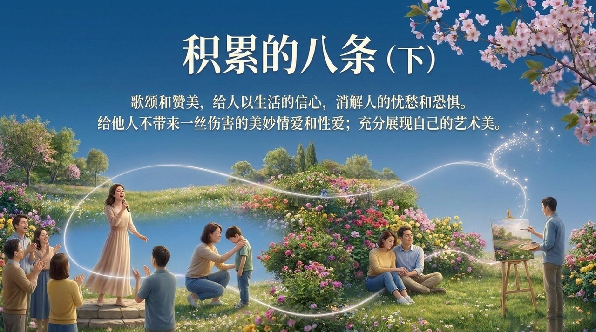
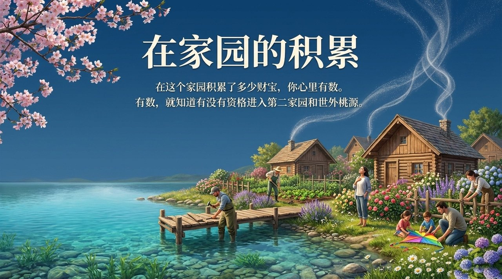
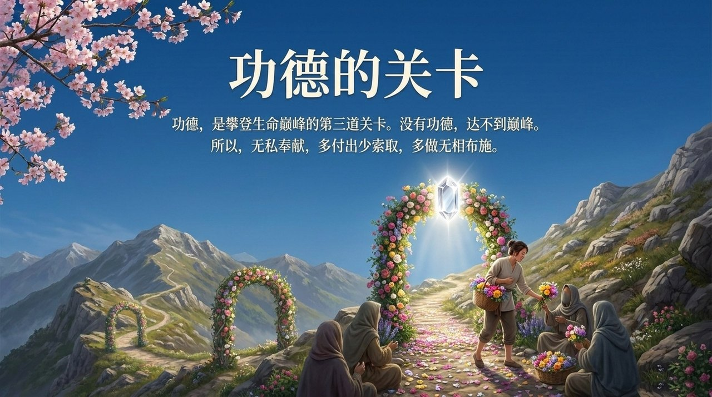
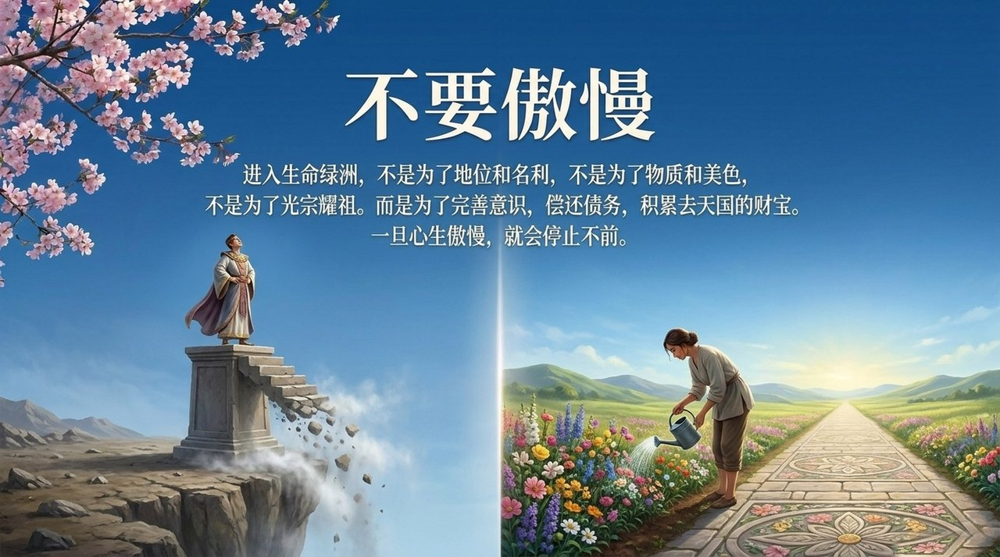
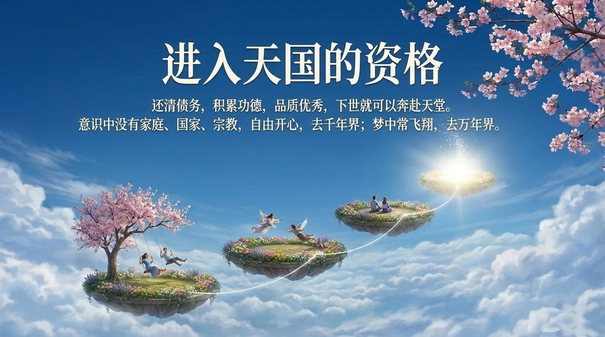
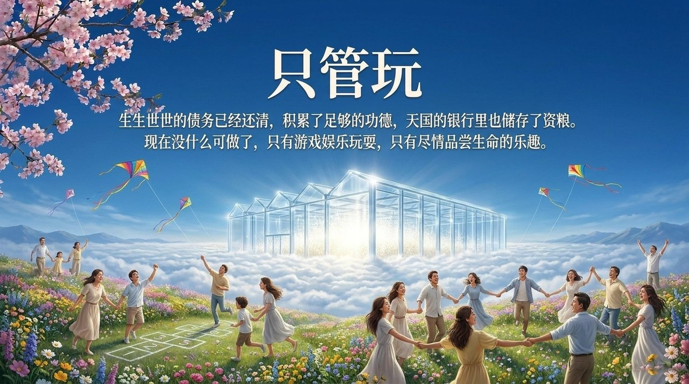

<!-- id: LC-HT-0001-ZH theme: 修行修炼 type: index direction: 修行修炼 lang: zh -->

# 天国财宝

**天国财宝**，在生命禅院体系中特指**心灵能量**——对上帝、神佛仙的信仰，对美好未来的信念和憧憬，以及爱、善、真善美爱、艺术美等。天国财宝是禅院草的四大修行任务之一，也是能够进入天国千年界、万年界、极乐界仙岛群岛洲的三大必要条件之一。基督耶稣教诲"你们要积累财宝在天国"是这一概念的文集根源。

> "天国财宝主要指心灵能量，物质能量和精神能量不属于天国财宝。"
> —— 雪峰，《天国财宝及其计算法》，2009

---

## 视频版

<iframe style="width:100%;aspect-ratio:4/3;border:0" src="https://www.youtube-nocookie.com/embed/-3lTyESIAx8" title="天国财宝（生命禅院百科·视频版）" allowfullscreen></iframe>

??? info "📖 图文幻灯（14 张，点击展开）"

    
    
    
    
    
    
    
    
    
    
    
    
    
    

---

## 版本导航

| 版本 | 适合读者 | 核心内容 |
|------|---------|---------|
| [友好版](friendly.md) | 初次了解者 | 什么是天国财宝？怎样积累？怎样损耗？ |
| [学术版](academic.md) | 研究者 | 心灵能量的本体论分析、积累方法的系统梳理、与佛基道三家的比较 |
| [内部版](internal.md) | 深度研修 | 完整文集引文、计算方法、F币与天国财宝的关系 |

---

## 相关词条

- [去天国路线图](/zh/route-to-heaven/)
- [偿还债务](/zh/debt-repayment/)
- [无相布施](/zh/formless-giving/)
- [心灵花园](/zh/soul-garden/)
- [F币](/zh/f-coin/)
- [了却尘缘](/zh/releasing-worldly-bonds/)
- [极乐界](/zh/elysium-world/)
- [天国](/zh/kingdom-of-heaven/)
