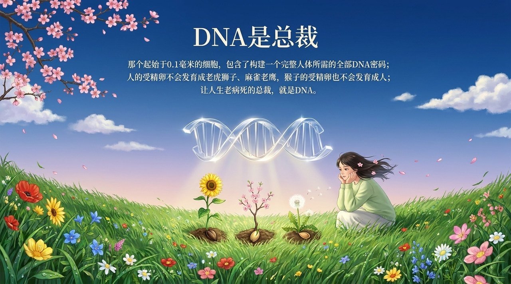
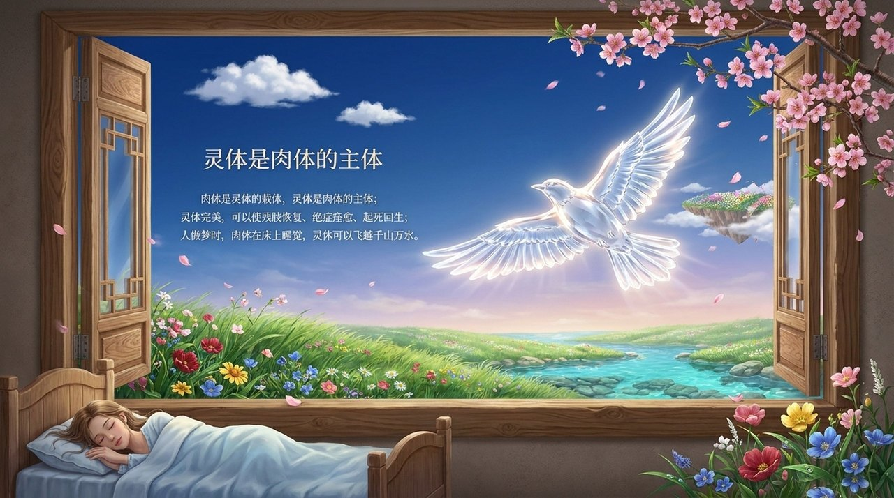

# 人体——奇迹程序和奥秘

> **人体的复杂程度不亚于整个宇宙的复杂度。**
>
> ——雪峰（禅院文集·生命篇·生命程序 DNA）

在生命禅院体系中，人体是上帝依照道的程序精密设计的生命载体——一个从0.1毫米的受精卵开始、严格按照DNA程序自动发育的宇宙级奇迹工程。人体由有形的肉体与无形的灵体共同构成，内置八大奇迹程序，暗藏无穷宝藏，是通往高层生命空间的物质基础。

| 版本 | 适合 | 核心角度 |
|------|------|----------|
| [友好版](friendly.md) | 初次了解 | 用生活语言揭开人体的神奇秘密 |
| [学术版](academic.md) | 研究者 | 系统分析人体的结构、程序与灵体关系 |
| [内部版](internal.md) | 深度研修 | 导游文集完整呈现，逐段标注出处 |

---

## 核心定义

人体是程序，生命就是由程序构成，没有程序就没有生命。DNA是这个程序的总裁，从起始于0.1毫米的受精卵开始，精密调控人体的五官七窍、五脏六腑、神经系统、情感系统，分毫不乱，严格到小数点后上百位。

人体同时内置了**八大奇迹程序**：自燃、获救、放毒、施丹、神通、发疯、着魔、极乐——当条件具备时，这八个程序会自动开启运行。

---

## 视频版

<iframe style="width:100%;aspect-ratio:4/3;border:0" src="https://www.youtube-nocookie.com/embed/_w-aGScoQ3o" title="人体——奇迹程序和奥秘（生命禅院百科·视频版）" allowfullscreen></iframe>

??? info "📖 图文幻灯（14 张，点击展开）"

    
    
    
    
    
    
    
    
    
    
    
    
    
    

---

## 相关词条

- [生命（总论）](/zh/life/)
- [灵魂](/zh/soul/)
- [生命的特征](/zh/life-characteristics/)
- [反物质结构](/zh/antimatter-structure/)
- [疾病·健康](/zh/disease-health/)
- [潜意识](/zh/subconscious/)
- [意识](/zh/consciousness/)
- [能量](/zh/energy/)
