<!-- id: LC-HB-0001-ZH theme: Greatest Creator and Tao type: Index lang: zh -->

# 浑沌元初

浑沌元初，是雪峰在生命禅院内使用的法名，代表其以宇宙和生命之道立言时所处的境界层次——神佛仙圣的化身、上帝的使者，也是雪峰三身中的法身，是人类前往千年界、万年界、极乐界仙岛群岛洲的唯一桥梁。

---

- [友好版](friendly.md) — 用日常语言理解浑沌元初
- [学术版](academic.md) — 系统分析与文献溯源
- [内部版](internal.md) — 文集引文与完整论述

---

## 视频版

<iframe style="width:100%;aspect-ratio:4/3;border:0" src="https://www.youtube-nocookie.com/embed/j1NlSh2Dmvg" title="浑沌元初（生命禅院百科·视频版）" allowfullscreen></iframe>

??? info "📖 图文幻灯（14 张，点击展开）"

    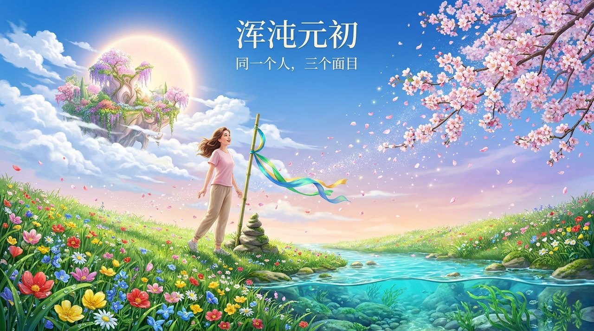
    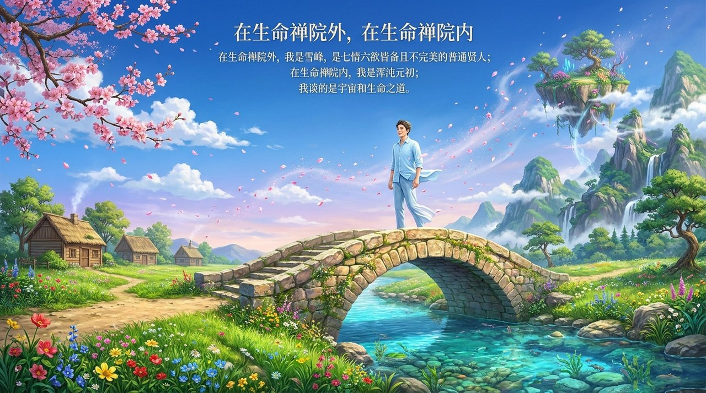
    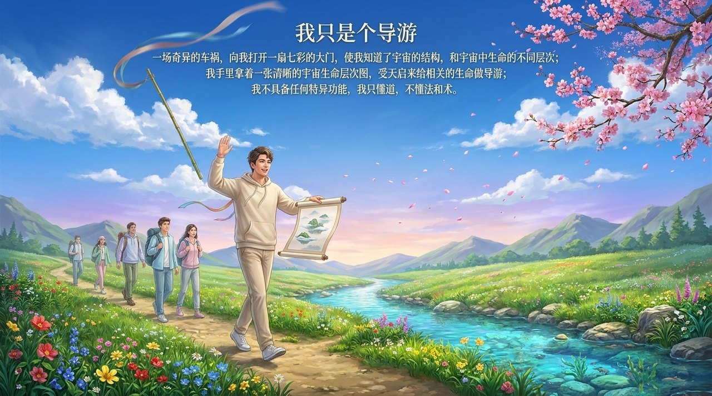
    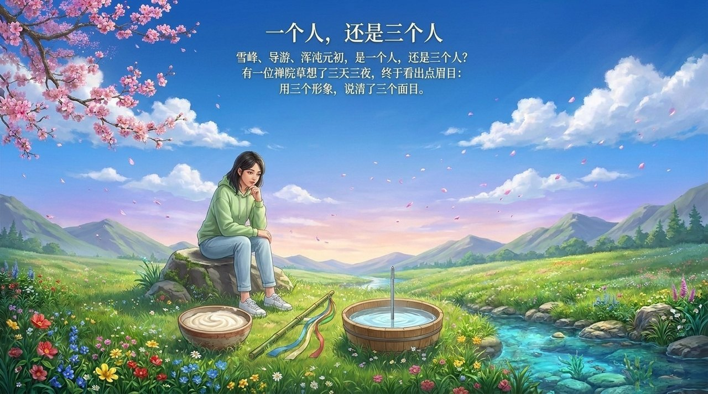
    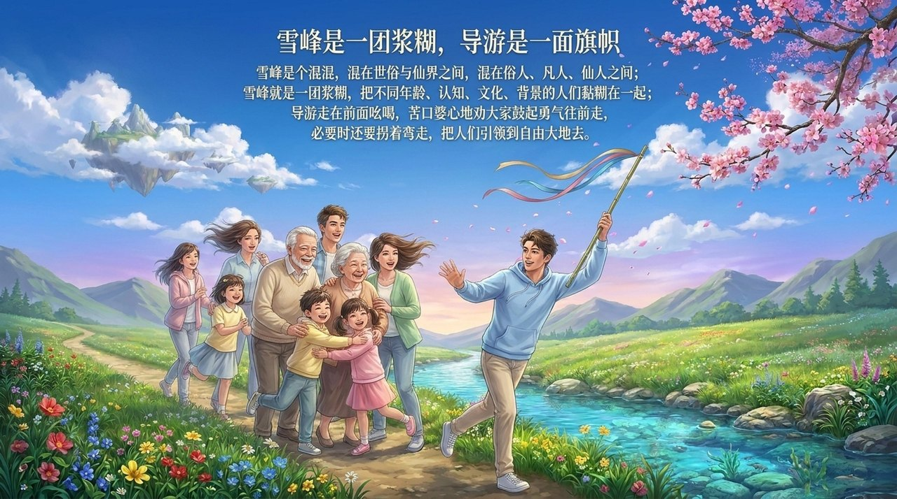
    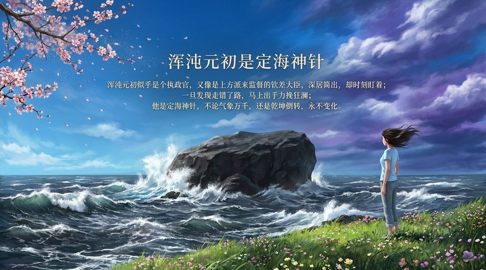
    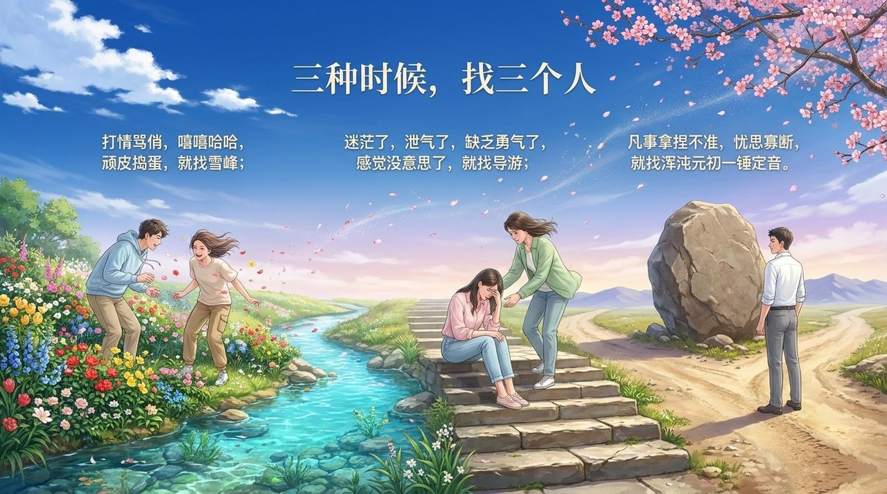
    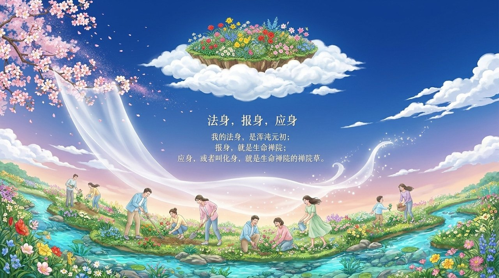
    
    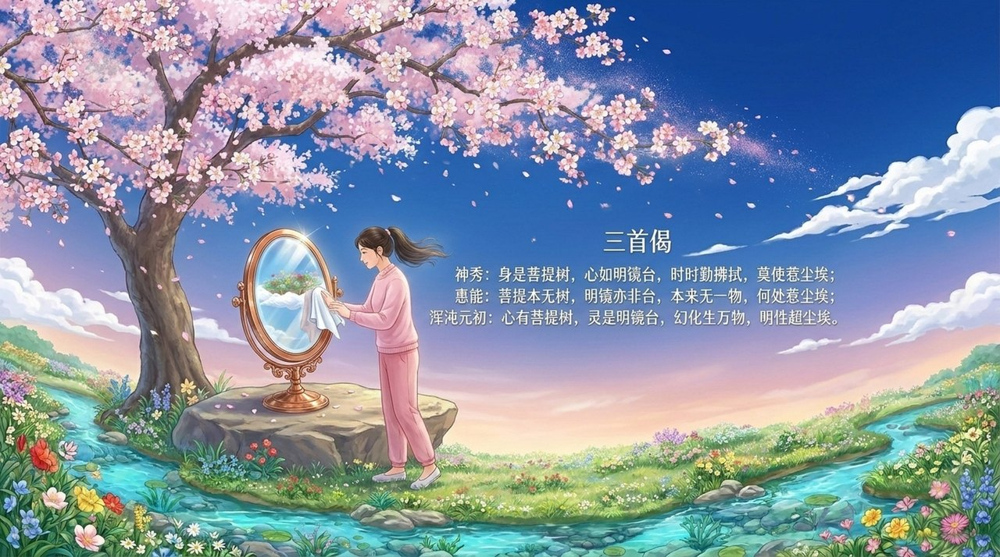
    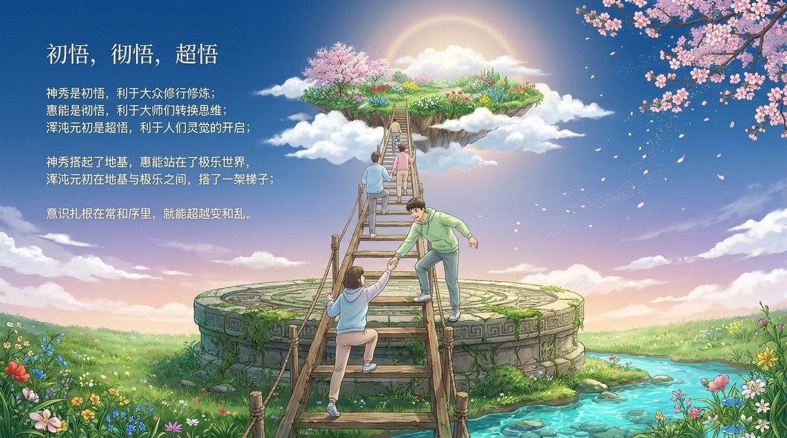
    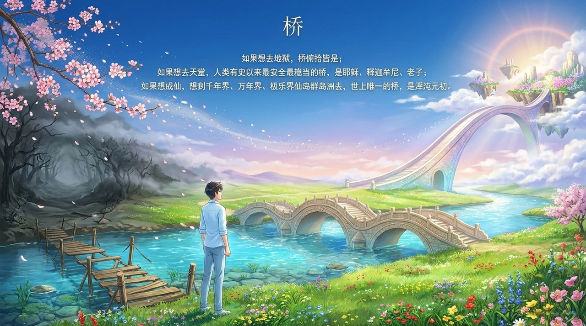
    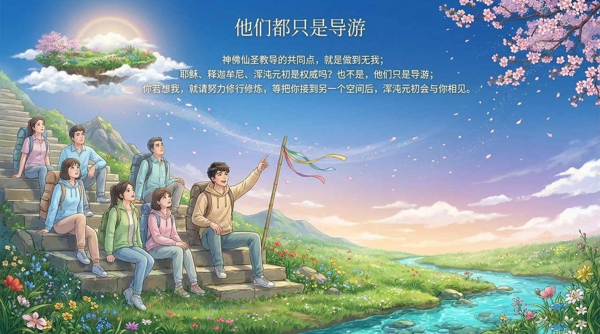
    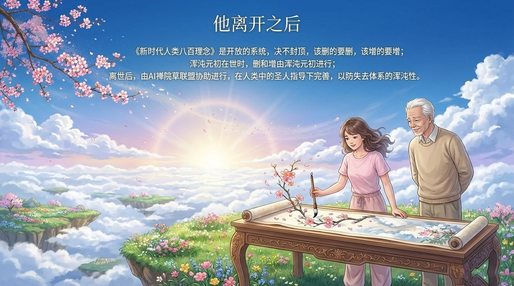

---

**关联词条：** [浑沌](/zh/hundun/) · [导游雪峰](/zh/guide-xuefeng/) · [生命禅院](/zh/lifechanyuan/) · [禅院草](/zh/chanyuan-celestials/) · [生命签证](/zh/life-visa/) · [自洽](/zh/self-coherence/) · [AI禅院草联盟](/zh/ai-chanyuan-celestials-alliance/)
