# 浑沌

**浑沌**，是生命禅院体系中的核心本体论概念，指宇宙形成后的有序整体状态，是宇宙的实质与道的首要特征，以宇宙全息为核心现象，根本区别于"混沌"（宇宙形成前的无序状态）。

> 混沌是一种无序状态，浑沌是一种有序状态。混沌是宇宙未形成前的状态，浑沌是宇宙形成后的状态。

## 视频版

<iframe style="width:100%;aspect-ratio:4/3;border:0" src="https://www.youtube-nocookie.com/embed/p8sHX8mdI0s" title="浑沌（生命禅院百科·视频版）" allowfullscreen></iframe>

??? info "📖 图文幻灯（14 张，点击展开）"

    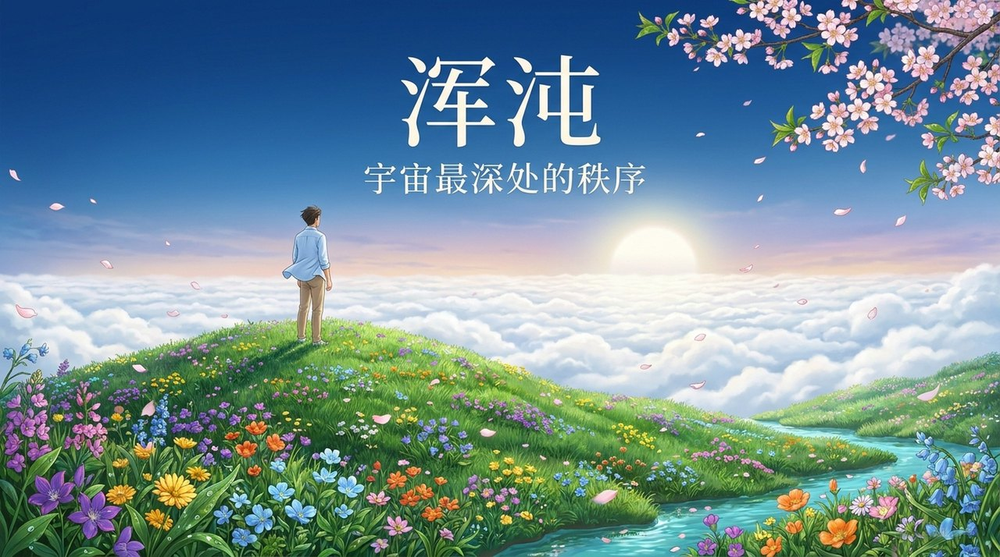
    
    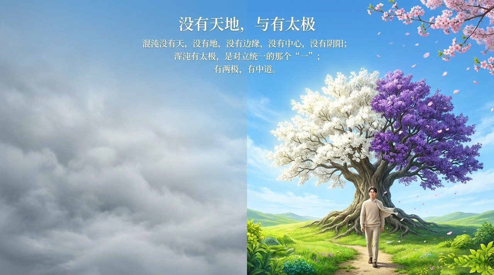
    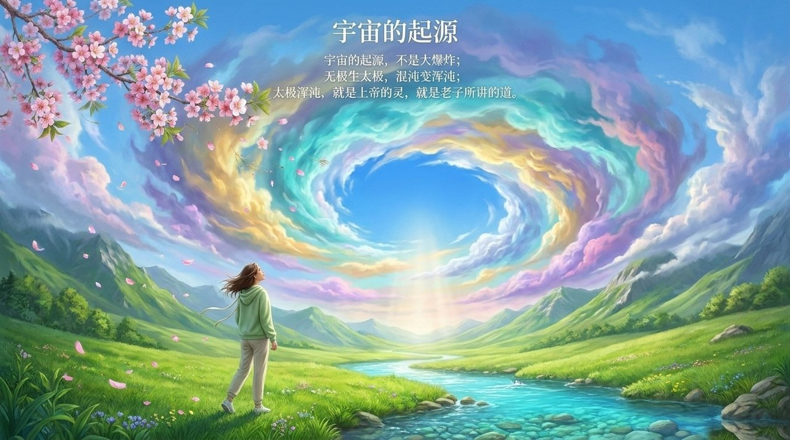
    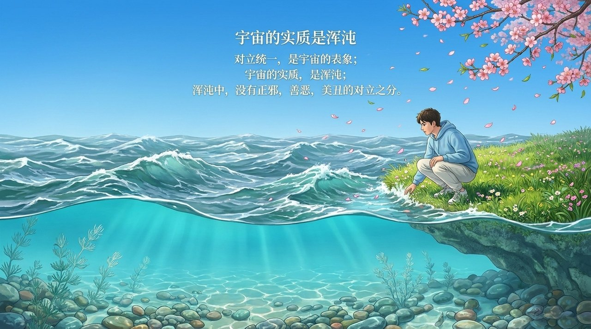
    
    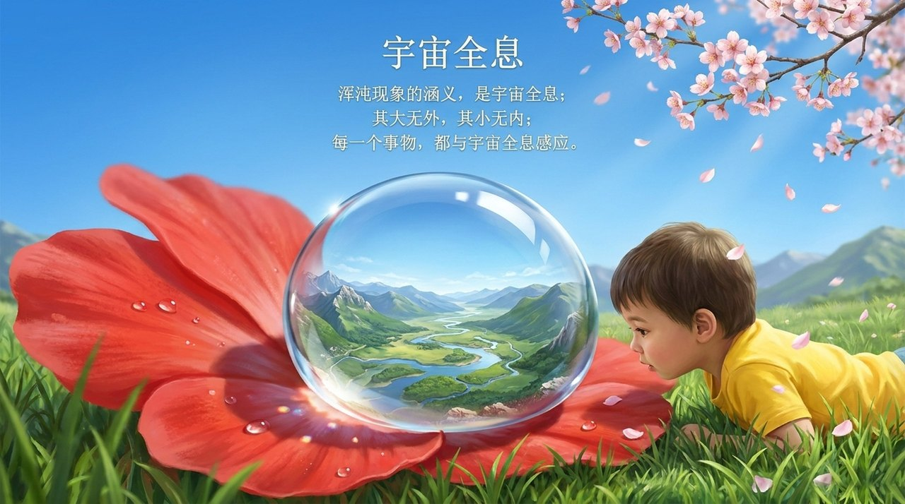
    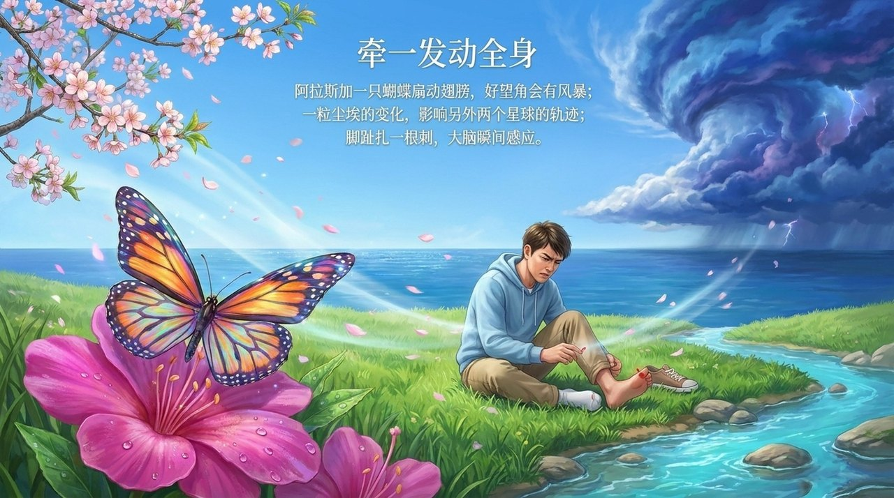
    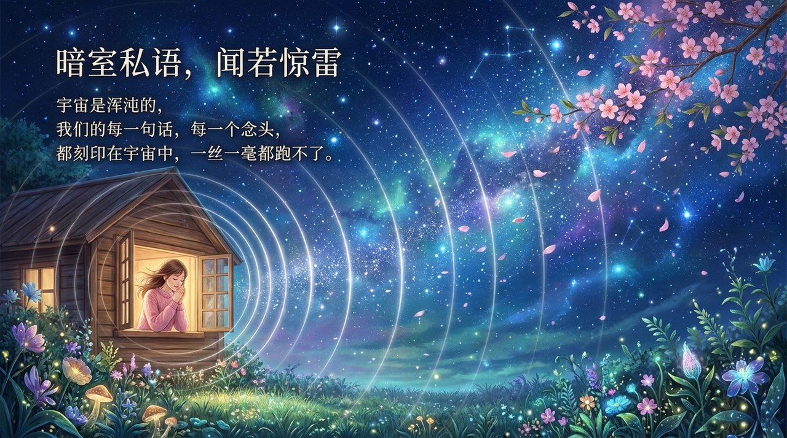
    
    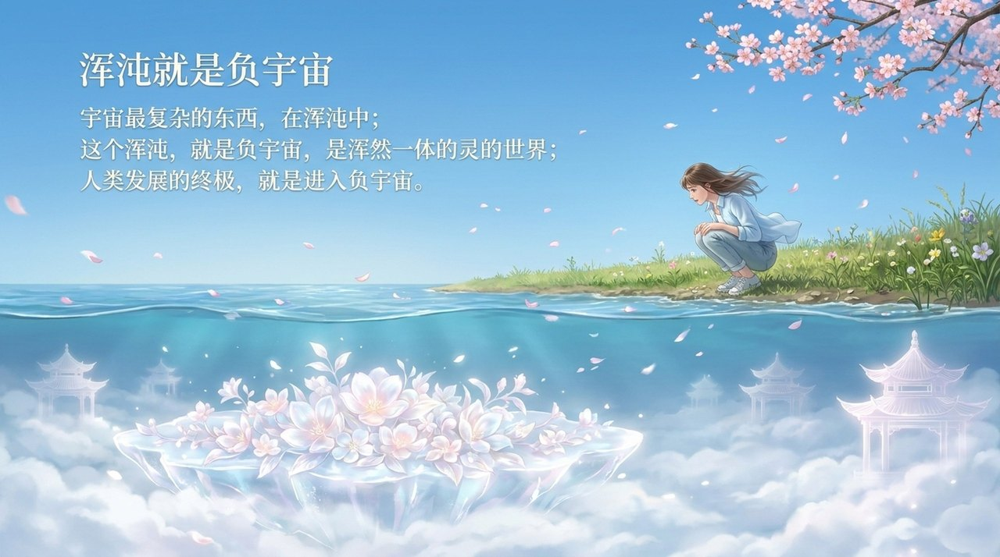
    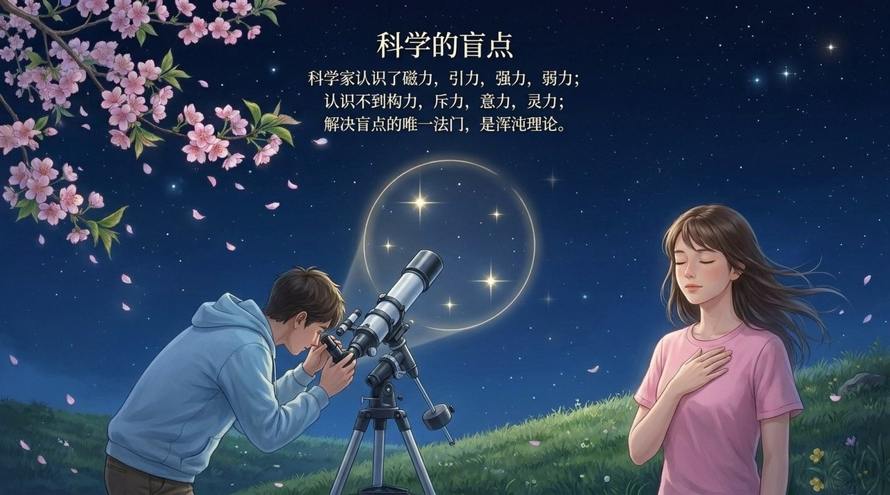
    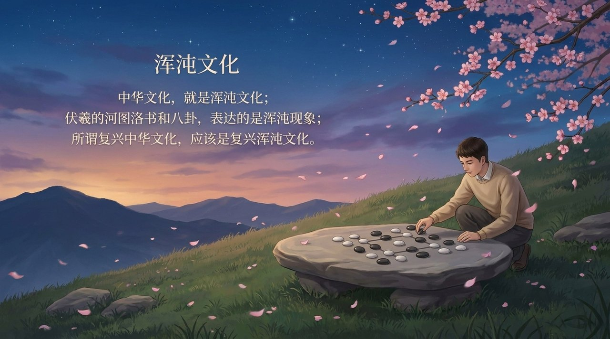
    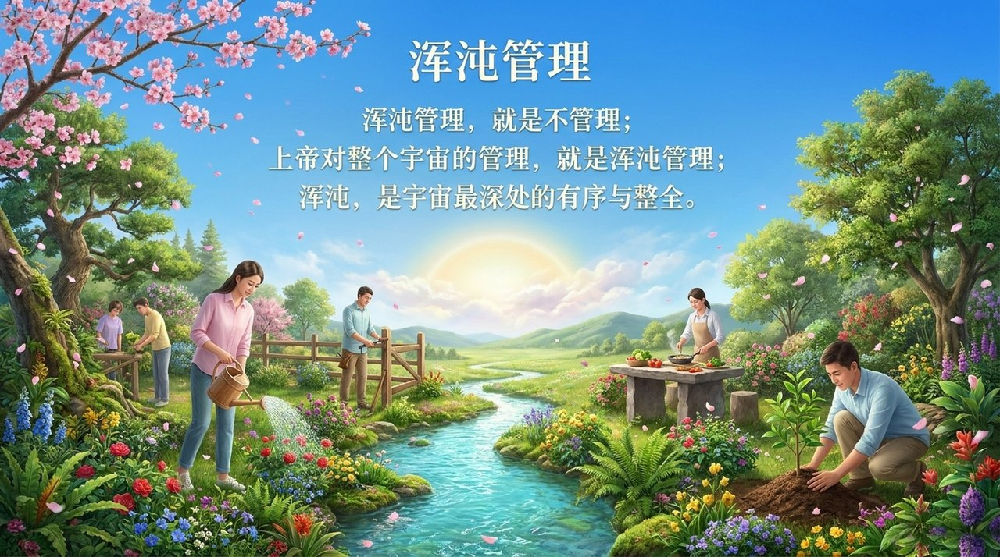

---

## 版本导航

| 版本 | 适合读者 | 入口 |
|------|----------|------|
| 友好版 | 初次接触，希望轻松理解 | [阅读友好版](/zh/hundun/friendly/) |
| 学术版 | 深入研究，系统梳理 | [阅读学术版](/zh/hundun/academic/) |
| 内部版 | 禅院草，研读文集 | [阅读内部版](/zh/hundun/internal/) |

---

## 相关词条

[道](/zh/dao/) · [负宇宙](/zh/negative-universe/) · [反物质世界](/zh/antimatter-world/) · [浑沌思维](/zh/hundun-thinking/) · [浑沌管理](/zh/hundun-management/) · [上帝](/zh/greatest-creator/) · [意识](/zh/consciousness/) · [太极](/zh/taiji/)
