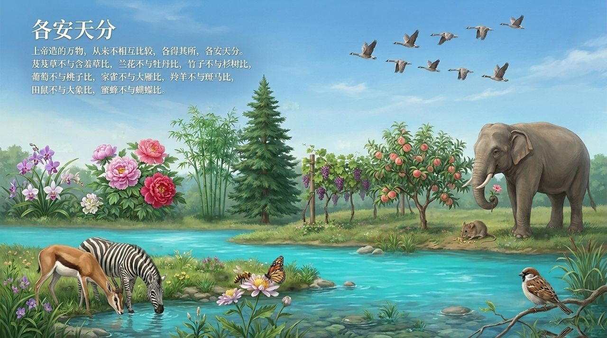
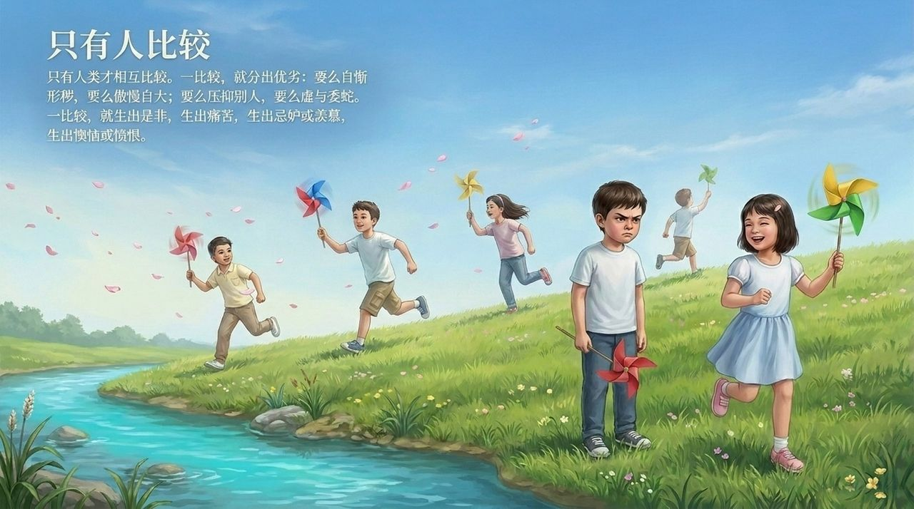
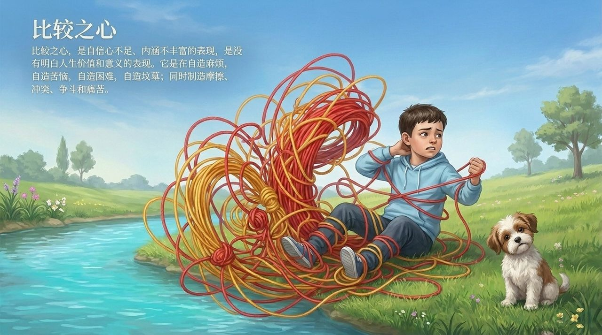
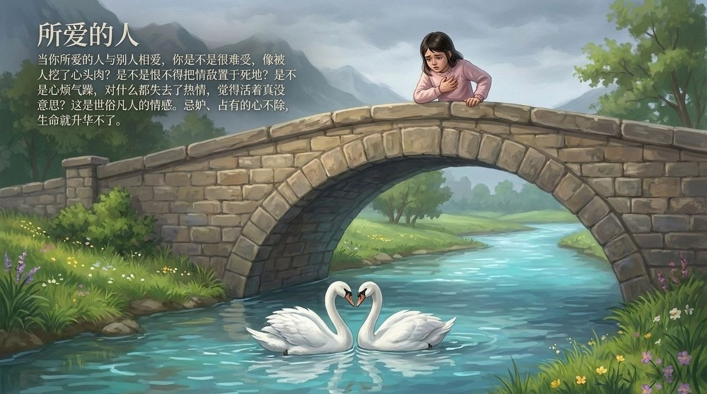
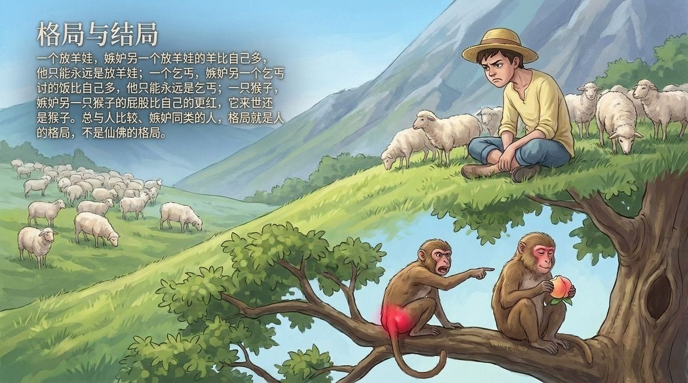
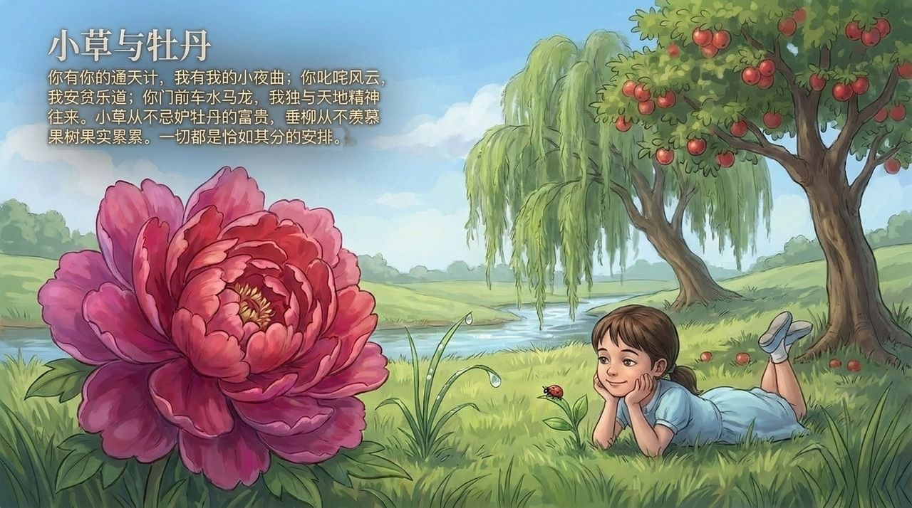
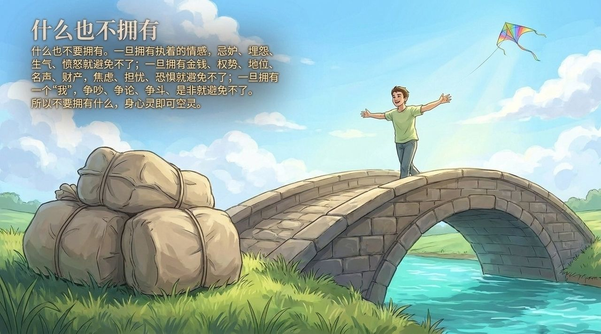
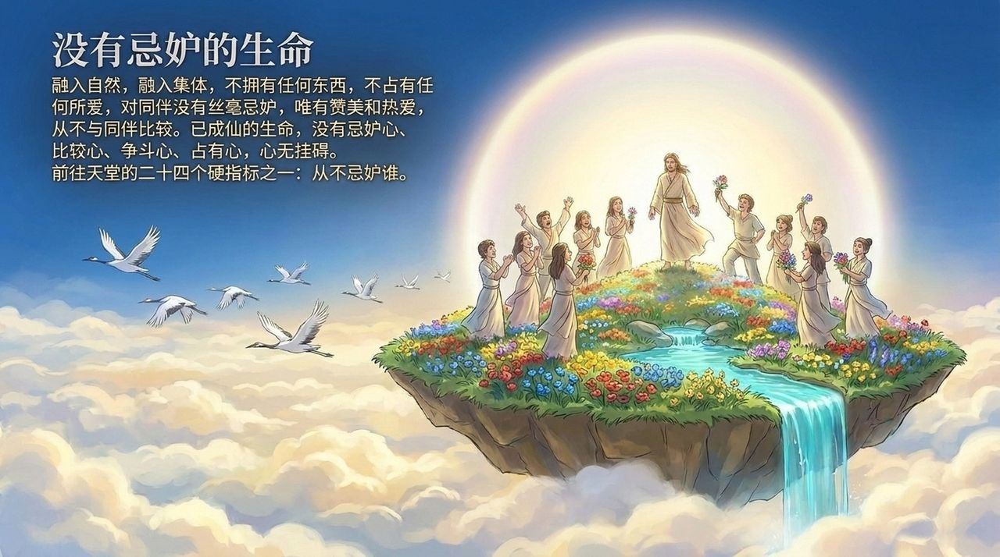

<!-- id: LC-JE-0001-ZH theme: 修行 type: 导航 direction: 品性修炼 lang: zh -->

# 忌妒·嫉妒

忌妒（嫉妒）是比较之心的直接产物，是心灵丑陋的写照，也是生命无法升华、无缘天国的核心障碍——从情感忌妒到强烈嫉恨，它固化格局、消耗能量，与仙的境界水火不容。

---

## 视频版

<iframe style="width:100%;aspect-ratio:4/3;border:0" src="https://www.youtube-nocookie.com/embed/RQ4RW3z_A50" title="忌妒·嫉妒（生命禅院百科·视频版）" allowfullscreen></iframe>

??? info "📖 图文幻灯（14 张，点击展开）"

    
    
    
    
    
    
    
    
    
    
    
    
    
    

---

## 版本导航

| 版本 | 适合读者 | 特点 |
|------|---------|------|
| [友好版](friendly.md) | 初次了解者 | 情感忌妒自检·比较之心的危害·修炼路径 |
| [学术版](academic.md) | 学者·跨文化比较 | 与佛教嫉心·基督教嫉妒·心理学妒忌对照分析 |
| [内部版](internal.md) | 修行者·研究者 | 完整引文·六节框架·体系内深度理解 |

---

## 关联词条

[傲慢](/zh/aoman/) · [自私与无私](/zh/zisi-wusi/) · [魔性](/zh/moxing/) · [随性而动](/zh/suixing-er-dong/) · [随遇而安](/zh/si-sui/) · [提升振动频率](/zh/raise-vibration-frequency/) · [心灵花园](/zh/soul-garden/) · [仙性](/zh/xianxing/) · [情关](/zh/releasing-worldly-bonds/) · [成仙](/zh/becoming-celestial/)
