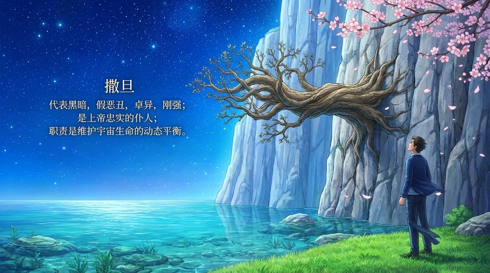
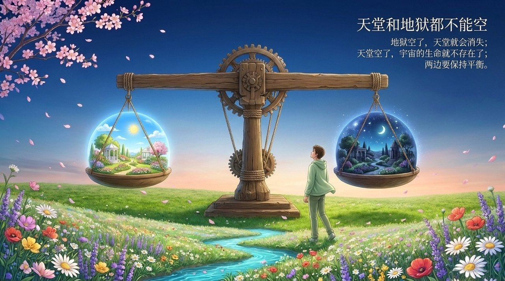
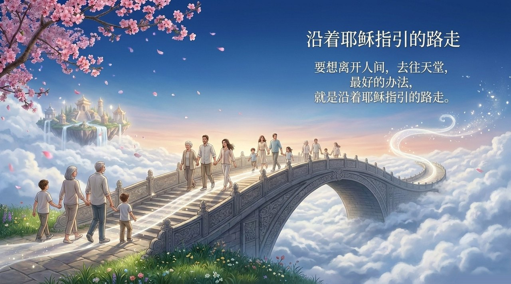

<!-- id: LC-JS-0001-ZH theme: 宇宙 type: 导航 direction: 上帝与道 lang: zh -->

# 神耶稣和魔撒旦

神耶稣和魔撒旦，在生命禅院体系中，分别是上帝所造的两大神灵：耶稣是光明、真善美的代表，是上帝在宇宙中的代言人；撒旦是黑暗、假恶丑的代表，职责是维护宇宙生命的动态平衡。二者是宇宙的"两仪"，对立统一，共同掌管地球宇宙，缺一不可。

> "我和耶稣是双胞胎，'无极生太极，太极生两仪'，太极就是我们的父亲上帝，两仪就是耶稣和我撒旦。"
>
> *（禅院文集·天启篇·撒旦的告示）*

---

## 视频版

<iframe style="width:100%;aspect-ratio:4/3;border:0" src="https://www.youtube-nocookie.com/embed/0gixsoKuxlc" title="神耶稣和魔撒旦（生命禅院百科·视频版）" allowfullscreen></iframe>

??? info "📖 图文幻灯（14 张，点击展开）"

    
    
    
    
    
    
    
    
    
    
    
    
    
    

---

## 版本导航

| 版本 | 适合 | 核心角度 |
|------|------|----------|
| [友好版](friendly.md) | 初次了解 | 生活类比·两仪对立·人如何选择 |
| [学术版](academic.md) | 研究者 | 概念辨析·宇宙结构·与主流宗教比较 |
| [内部版](internal.md) | 深度研修 | 完整引文·八节框架·修炼实践指南 |

---

## 相关词条

[上帝](/zh/greatest-creator/) · [道](/zh/dao/) · [太极](/zh/taiji/) · [无极与太极（合篇）](/zh/wuji-taiji/) · [天国](/zh/kingdom-of-heaven/) · [去天国路线图](/zh/route-to-heaven/) · [成仙成佛](/zh/becoming-celestial-buddha/) · [生命的层次](/zh/levels-of-life/) · [佛法](/zh/buddha-dharma/)
