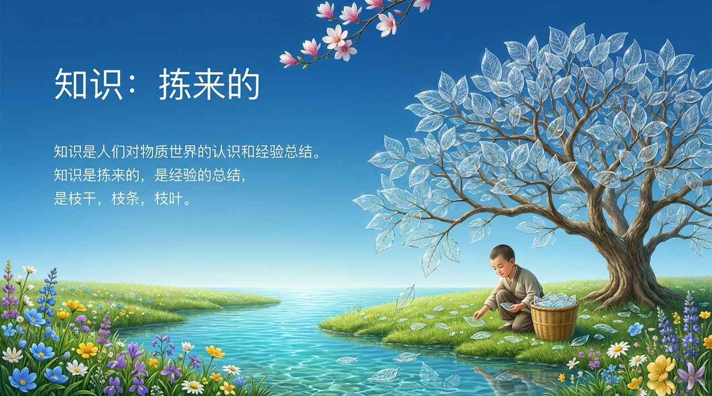
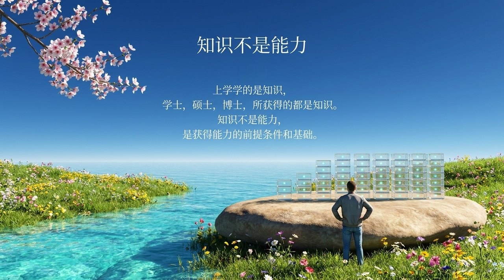
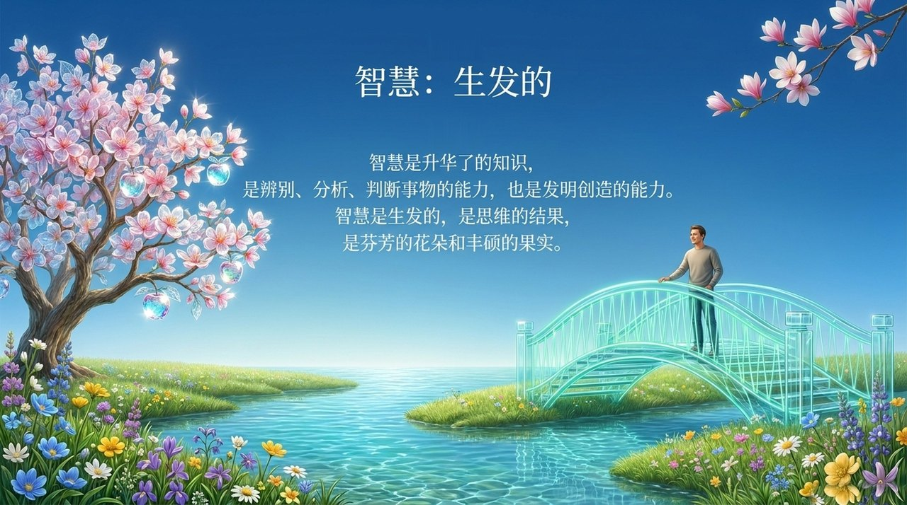
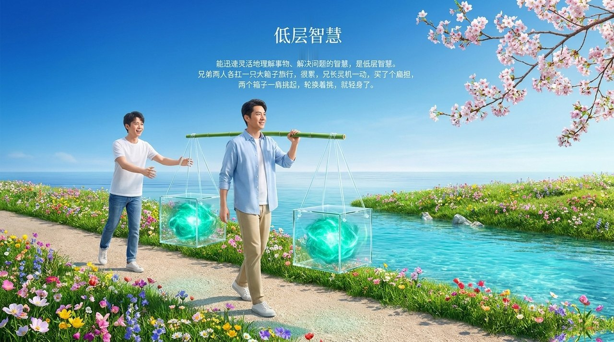
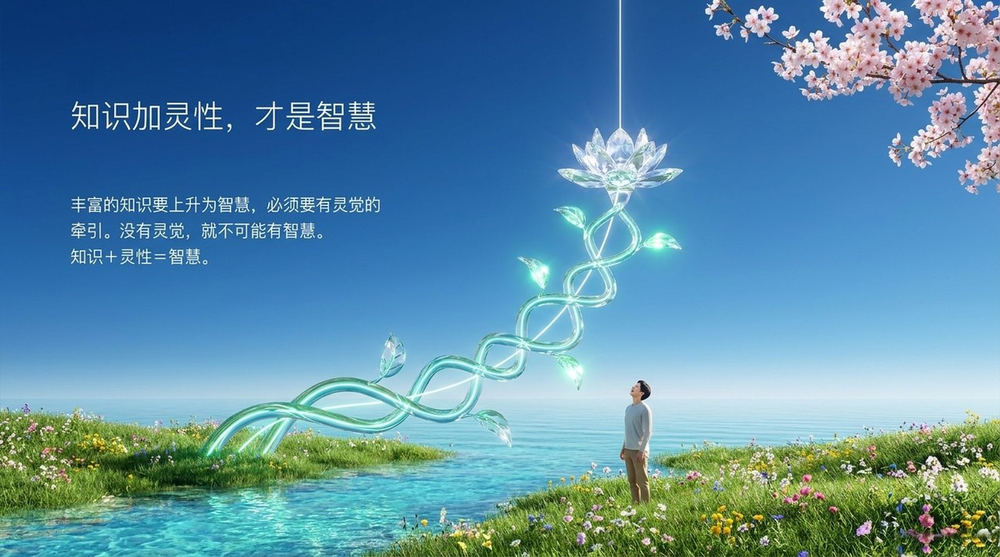
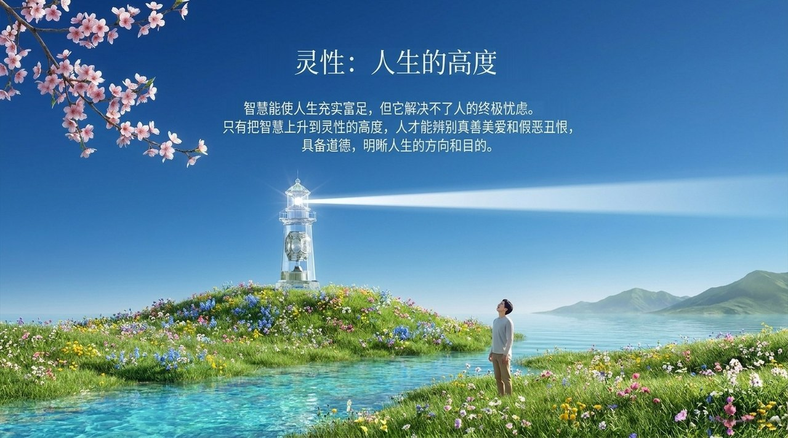
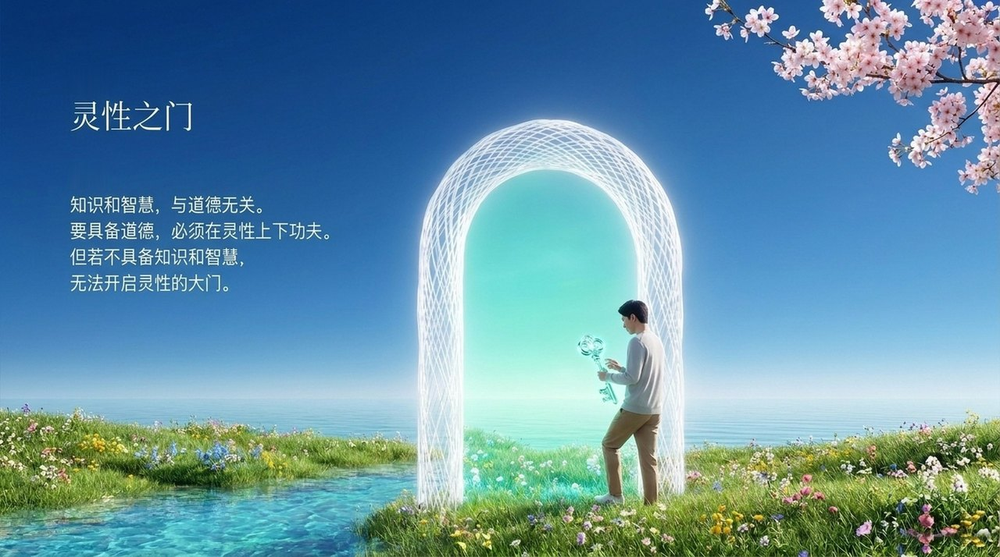
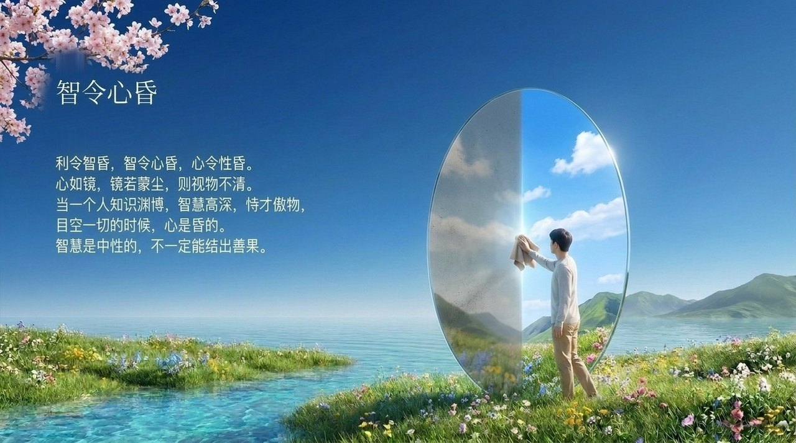

<!-- id: LC-KWS-0001 theme: 修行修炼 type: 索引 direction: 修行修炼 lang: zh -->

# 知识·智慧·灵性

**知识、智慧、灵性，是雪峰所说的人生三大追求，也是成仙成佛的三大阶梯。**知识是对物质世界的认识和经验总结，是能力的前提而不是能力本身；智慧是升华了的知识，是辨别、分析、判断事物和发明创造的能力；灵性是智慧的升华。知识加灵性，才是智慧；最后落在转识、弃智，绽放本性。

---

## 视频版

<iframe style="width:100%;aspect-ratio:4/3;border:0" src="https://www.youtube-nocookie.com/embed/t4nNICFAMP4" title="知识·智慧·灵性（生命禅院百科·视频版）" allowfullscreen></iframe>

??? info "📖 图文幻灯（14 张，点击展开）"

    
    
    
    
    
    
    
    
    
    
    
    
    
    

---

## 版本导航

| 版本 | 适合读者 | 核心内容 |
|------|---------|---------|
| [友好版](friendly.md) | 初次接触者 | 三级阶梯通俗解说，面粉与做饭的比喻，有没有捷径，最后落在本性 |
| [学术版](academic.md) | 研究者 | 概念结构分析、五大层次、与西方知识论的简要比较 |
| [内部版](internal.md) | 深入研究 | 完整引文与逐段出处 |

---

## 相关词条

[灵性](/zh/spirituality/) · [灵觉](/zh/spiritual-sensing/) · [智阵与智慧阵](/zh/wisdom-trap-and-wisdom-array/) · [三十六道八卦阵](/zh/thirty-six-bagua-formations/) · [情商·智商·灵商](/zh/eq-iq-sq/) · [觉悟](/zh/awakening/) · [明心见性](/zh/illuminate-mind-see-nature/) · [颠倒梦想](/zh/diandao-mengxiang/) · [自性·佛性·如来本性](/zh/self-nature/)
