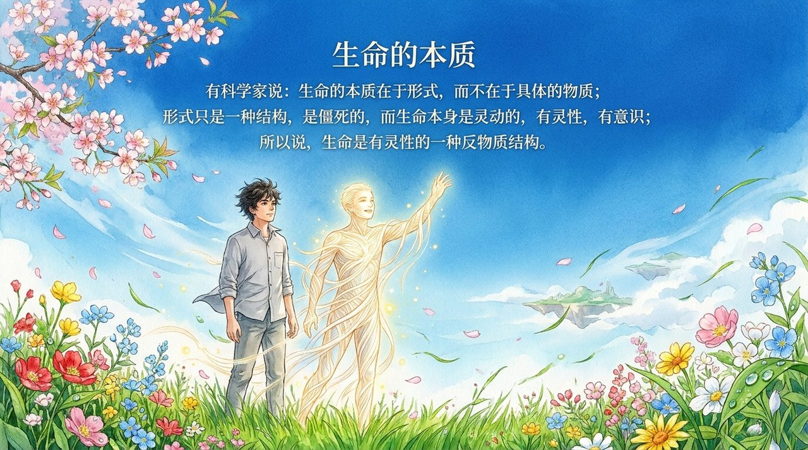
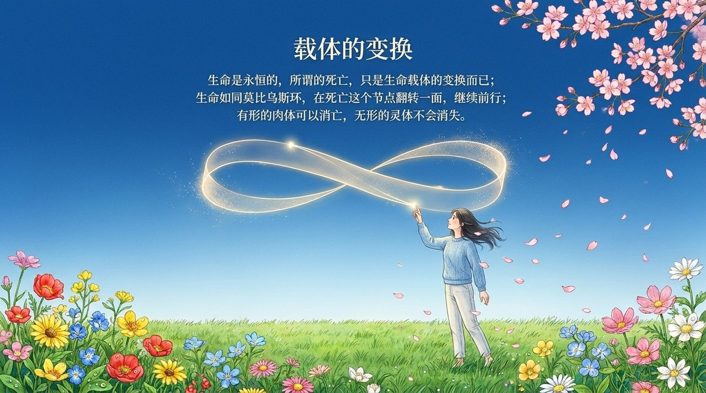
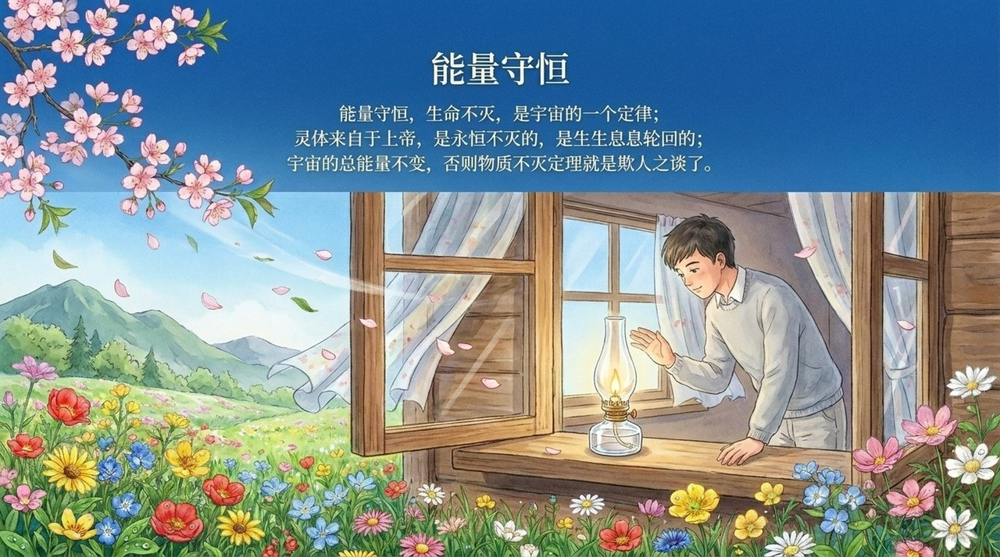
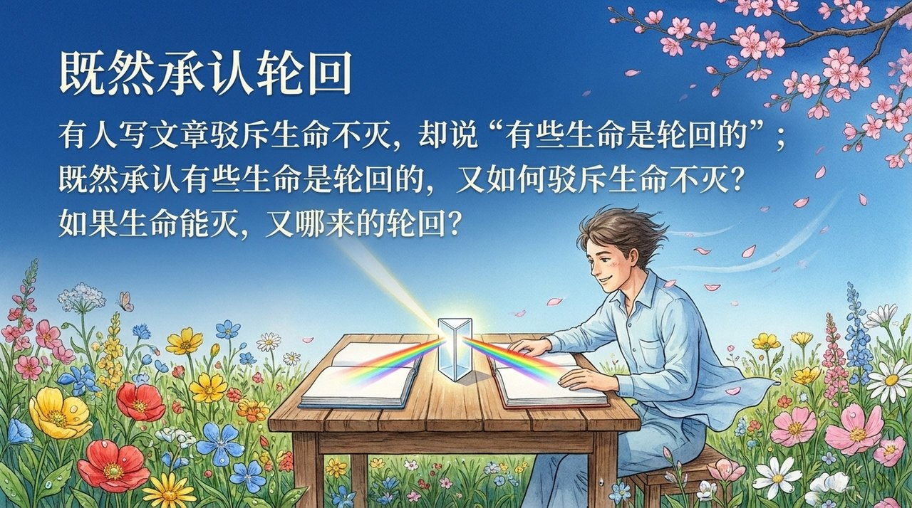

<!-- id: LC-LI-0001-ZH theme: Mystery of LIFE type: Index lang: zh -->

# 生命不灭定律

生命的本质是有灵性的一种反物质结构，这一结构不依附于任何具体的物质形态，因此不随肉体的消亡而消失。生命在宇宙中永续存在，在三十六维空间中轮回演化——所谓"死亡"，只是生命载体的变换，而非生命的终结。

生命禅院从五个维度论证了这一定律：宇宙不亡故生命不灭，宇宙道德永恒故生命不灭，生命体轮回变化故生命不灭，道长存故生命不灭，反物质结构无法消失故生命不灭。

---

- [通俗版](friendly.md) — 用生活语言理解生命不灭
- [学术版](academic.md) — 系统分析与文献溯源
- [内部版](internal.md) — 文集引文与完整论述

---

## 视频版

<iframe style="width:100%;aspect-ratio:4/3;border:0" src="https://www.youtube-nocookie.com/embed/z5QZYB9XYuo" title="生命不灭定律（生命禅院百科·视频版）" allowfullscreen></iframe>

??? info "📖 图文幻灯（14 张，点击展开）"

    
    
    
    
    
    
    
    
    
    
    
    
    
    

---

**关联词条：**[反物质结构](/zh/antimatter-structure/) · [生命的轮回](/zh/life-reincarnation/) · [三十六维空间](/zh/thirty-six-dimensional-space/) · [道](/zh/dao/) · [生命的特征](/zh/life-characteristics/)
