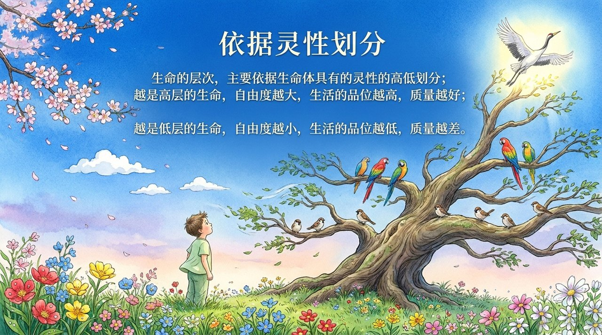
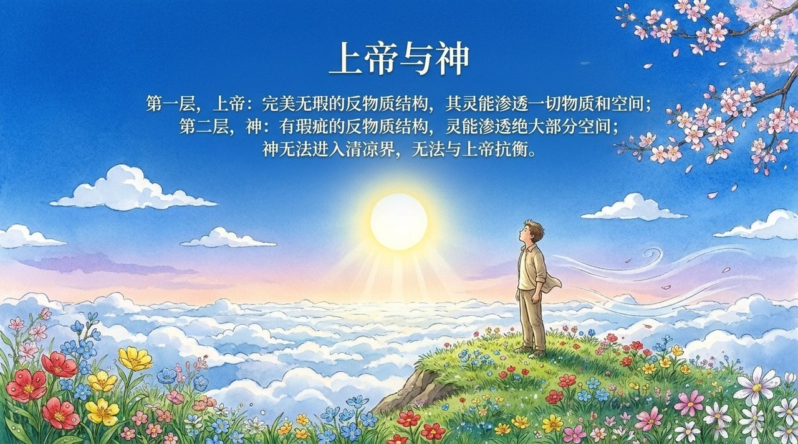
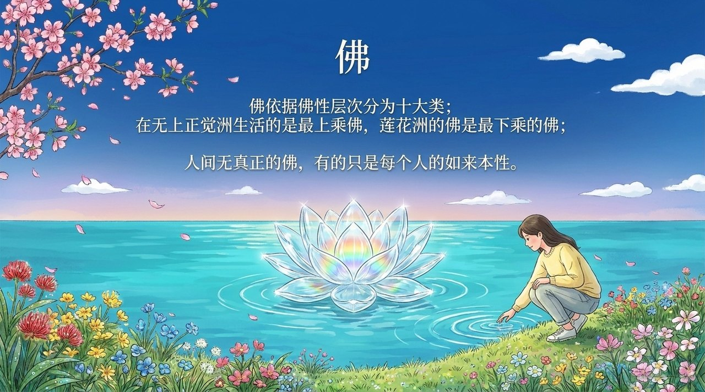
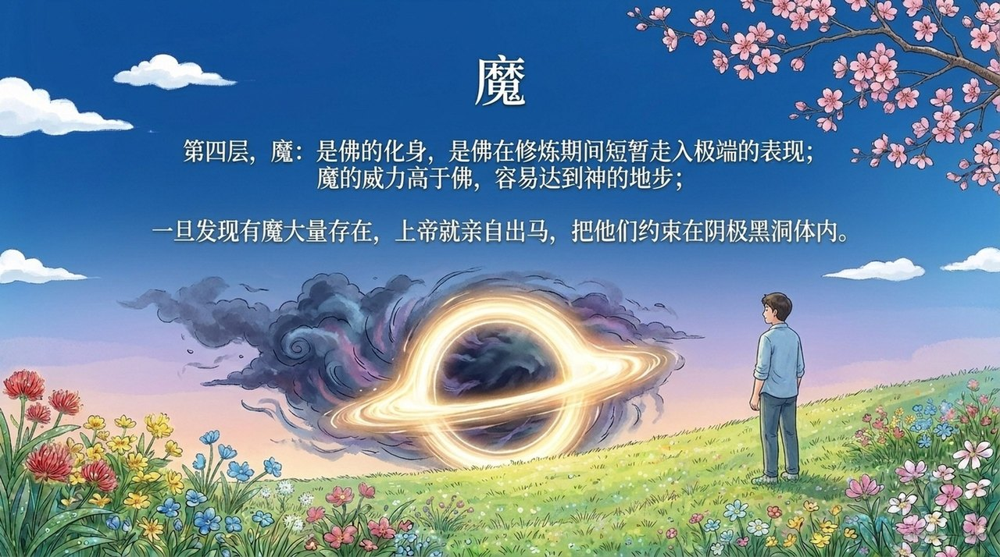
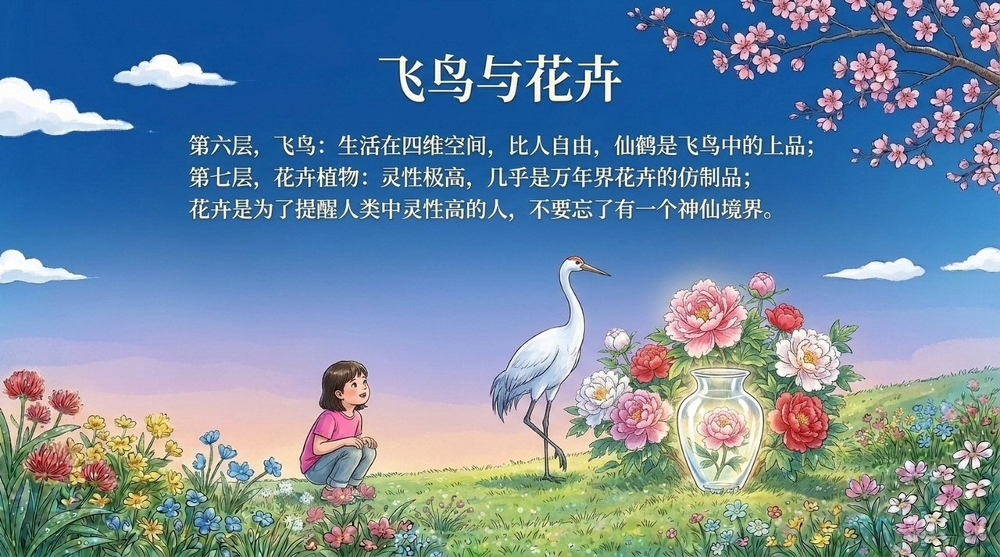

<!-- id: LC-LL-0001-ZH theme: Mystery of LIFE type: Index lang: zh -->

# 生命的层次

生命禅院依据生命体反物质结构所具备的灵性高低，将宇宙中一切生命形态划分为十六个层次：从完美无瑕的上帝，到仙佛、神、魔、人、飞鸟、花卉、家畜、野生动物、树木、昆虫、草稼、微生物，直至阴间、冰冻层、火炼层中的生命。层次越高，自由度越大，生活品质越高；层次越低，自由度越小。人处于第五层，其内部又依灵性高低分为浑人、俗人、凡人、贤人、仙人五类。

---

- [通俗版](friendly.md) — 用生活语言理解生命的层次体系
- [学术版](academic.md) — 系统分析与文献溯源
- [内部版](internal.md) — 文集引文与完整论述

---

## 视频版

<iframe style="width:100%;aspect-ratio:4/3;border:0" src="https://www.youtube-nocookie.com/embed/ZPHEOHll_WY" title="生命的层次（生命禅院百科·视频版）" allowfullscreen></iframe>

??? info "📖 图文幻灯（14 张，点击展开）"

    
    
    
    
    
    
    
    
    
    
    
    
    
    

---

**关联词条：** [生命](/zh/life/) · [生命奥秘](/zh/life-mysteries/) · [三十六维空间](/zh/thirty-six-dimensional-space/) · [千年界](/zh/thousand-year-world/) · [万年界](/zh/ten-thousand-year-world/) · [极乐界](/zh/elysium-world/) · [生命的特征](/zh/life-characteristics/)
