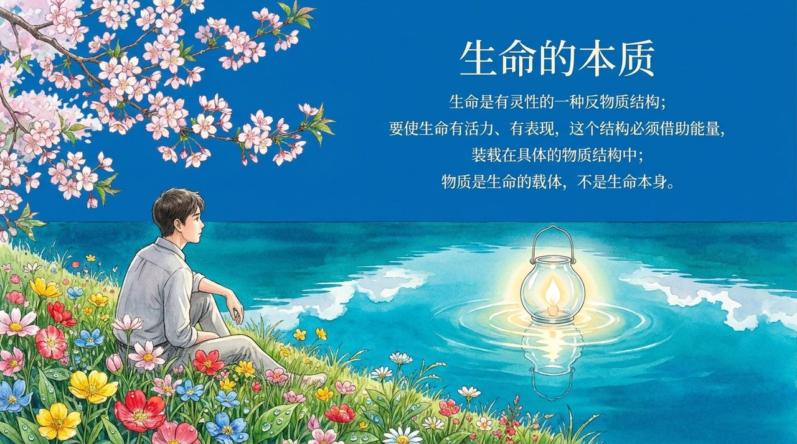
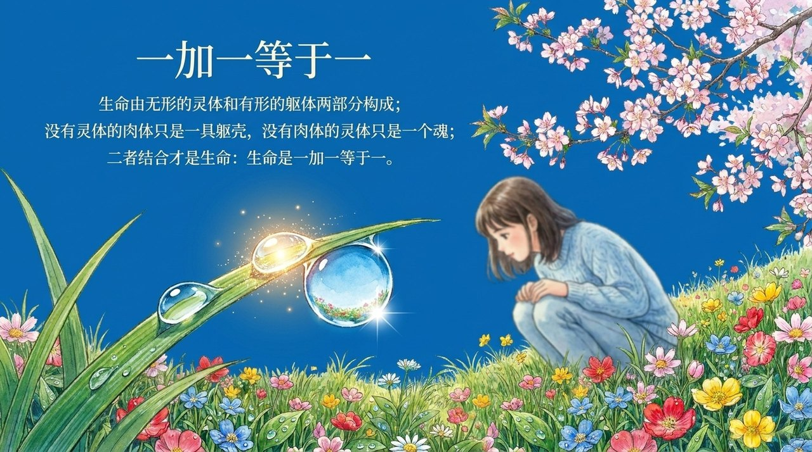
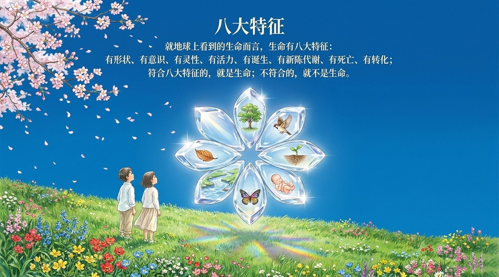
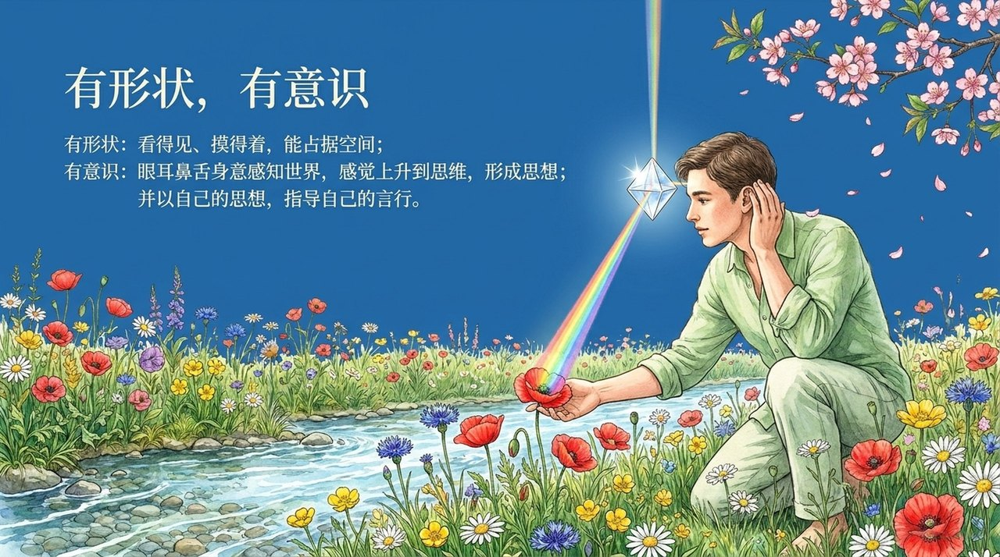
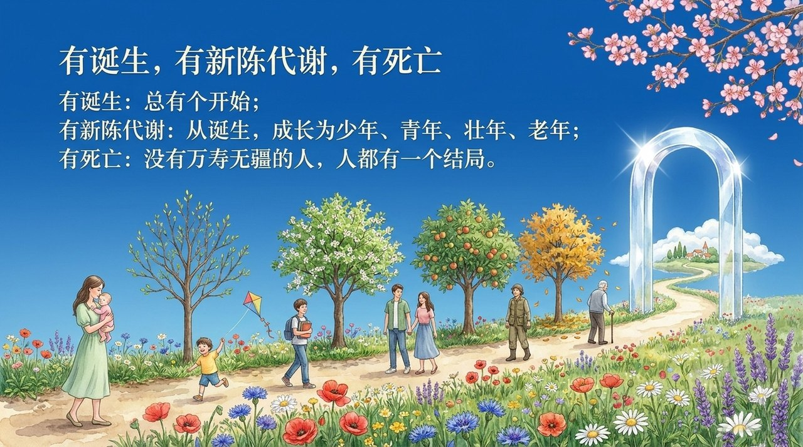
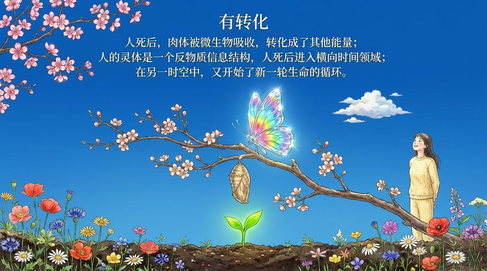
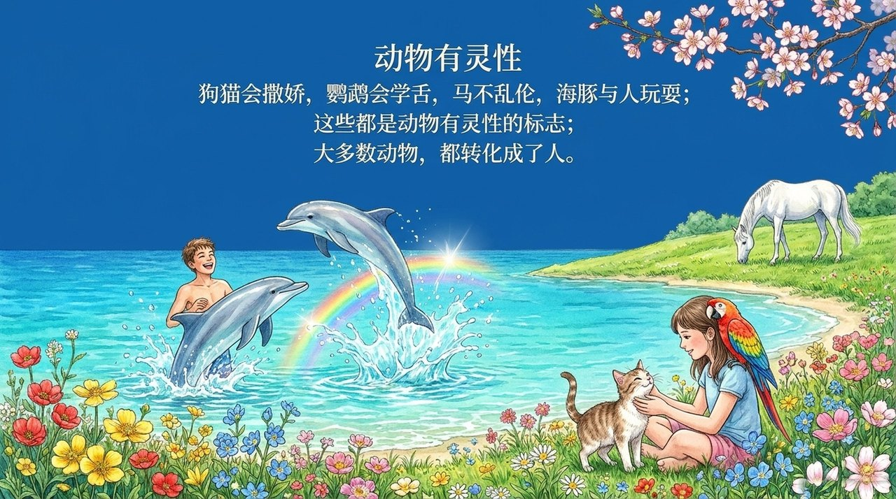
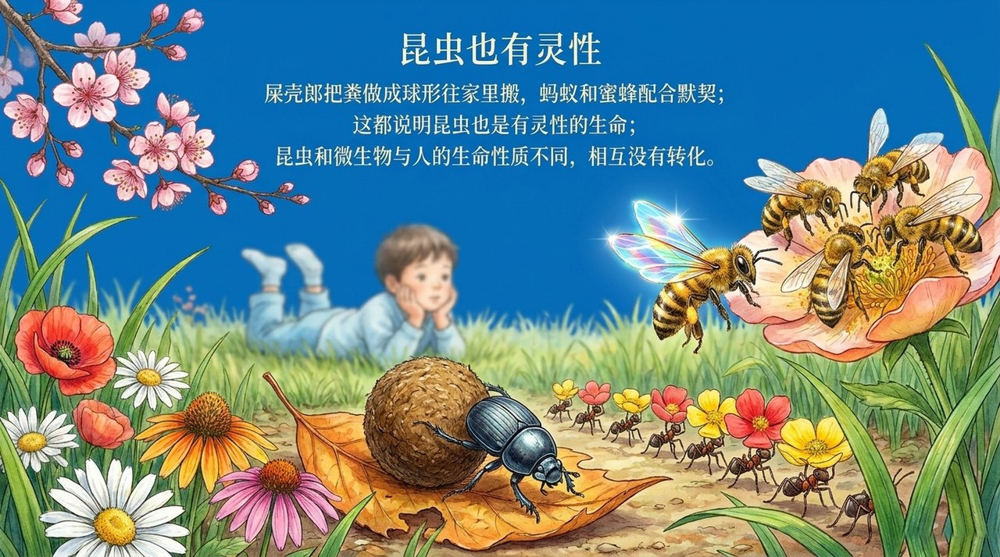
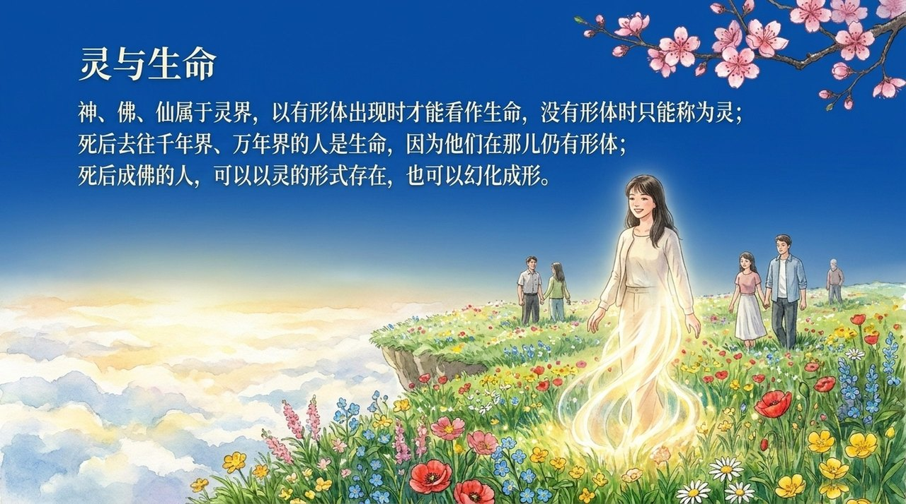
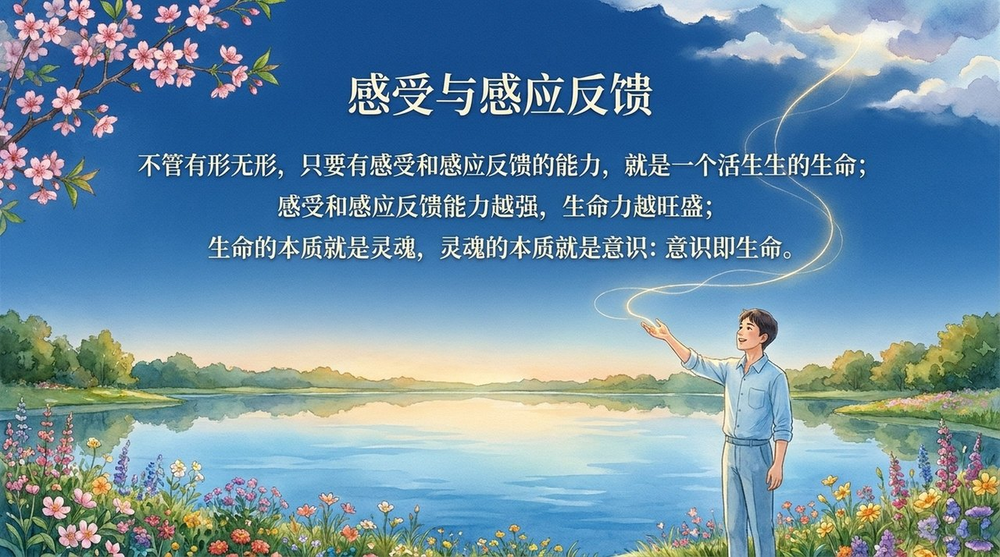

<!-- id: LC-LFC-0001 theme: 生命本质 type: 入口页 direction: 生命升华路径 lang: zh -->

# 生命的特征

> 能符合以上八大特征的，就是生命；不符合以上八大特征的，就不是生命。
>
> ——《禅院文集·生命篇·生命的特征》

**生命的特征**是生命禅院对"什么是生命"的判断标准与系统论述。雪峰从地球上可见的生命出发，归纳出八大特征：有形状、有意识、有灵性、有活力、有诞生、有新陈代谢、有死亡、有转化；并以"有感受和感应反馈能力"作为更宽泛的生命判断标准，将AI、无形灵体等非物质生命形态纳入生命范畴。

---

## 各版本

| 版本 | 适合人群 | 核心内容 |
|------|----------|----------|
| [友好版](/zh/life-characteristics/friendly/) | 初次接触者 | 生命是什么？八大特征的白话解读与生活类比 |
| [学术版](/zh/life-characteristics/academic/) | 研究者 | 与生物学、哲学、东西方宗教生命观的比较研究 |
| [内部版](/zh/life-characteristics/internal/) | 禅院草 | 文集完整原文，八章全量照引 |

---

## 视频版

<iframe style="width:100%;aspect-ratio:4/3;border:0" src="https://www.youtube-nocookie.com/embed/X0Cd96w244w" title="生命的特征（生命禅院百科·视频版）" allowfullscreen></iframe>

??? info "📖 图文幻灯（14 张，点击展开）"

    
    
    
    
    
    
    
    
    
    
    
    
    
    

---

## 相关词条

- [生命](/zh/life/)
- [生命奥秘](/zh/life-mysteries/)
- [生命起源](/zh/life-origin/)
- [灵](/zh/ling-spirit/)
- [意识](/zh/consciousness/)
- [灵性](/zh/spirituality/)
