<!-- id: LC-LOTM-0001-ZH theme: 社会系统 type: index direction: 社会系统 lang: zh -->

# 生命绿洲生活三字经（简俭坚）

"简俭坚"是生命禅院导游雪峰为生命绿洲（第二家园）日常生活提炼的三字纲领：以**简**（简单）去繁就约，以**俭**（俭约）克制物欲，以**坚**（坚实）踏实落地——三者合一，使绿洲生活远离焦虑、接近天国境界。

---

## 视频版

<iframe style="width:100%;aspect-ratio:4/3;border:0" src="https://www.youtube-nocookie.com/embed/oHtkMzNSILQ" title="生命绿洲生活三字经（简俭坚）（生命禅院百科·视频版）" allowfullscreen></iframe>

??? info "📖 图文幻灯（14 张，点击展开）"

    
    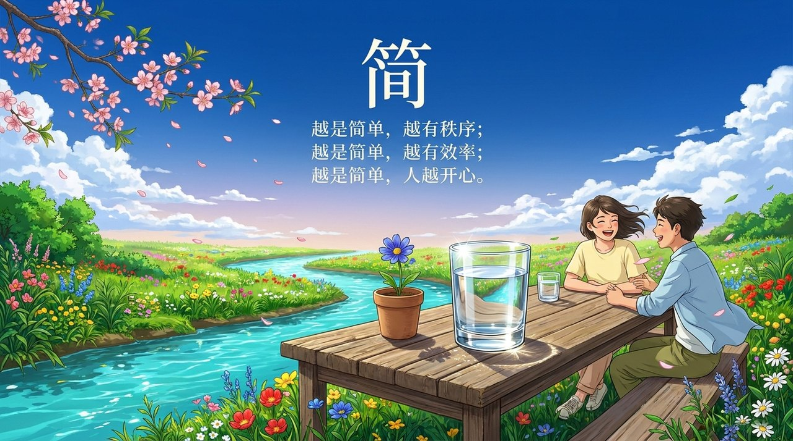
    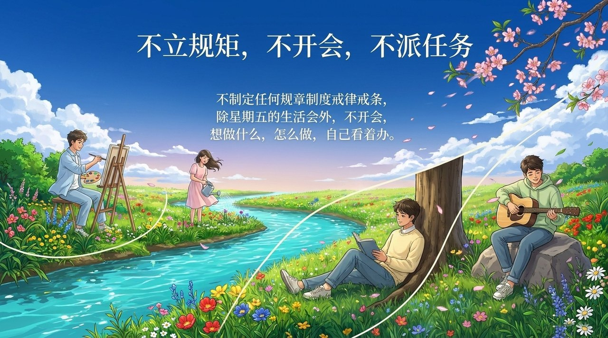
    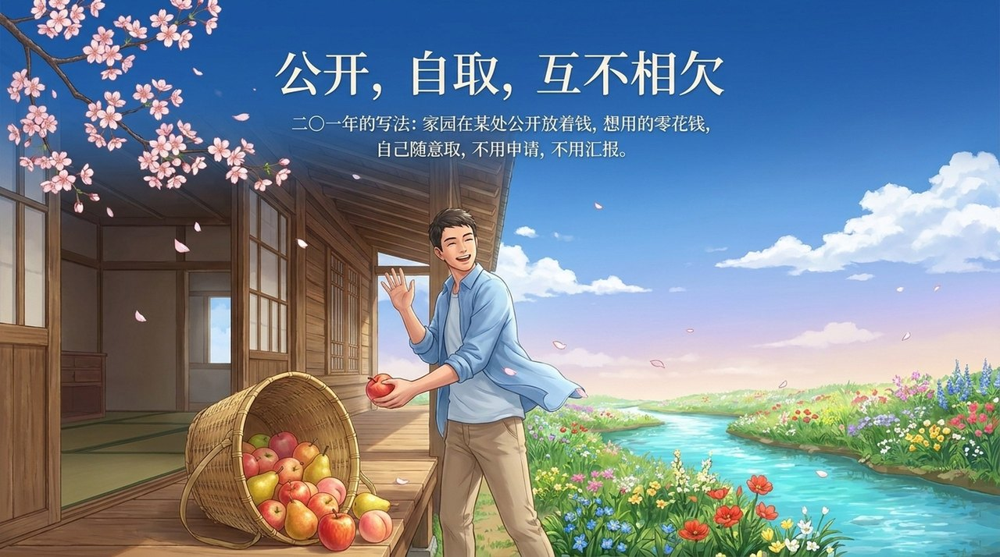
    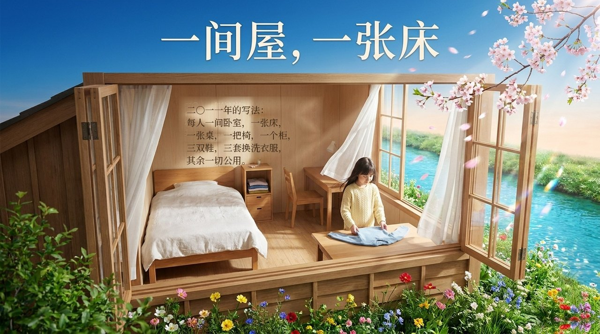
    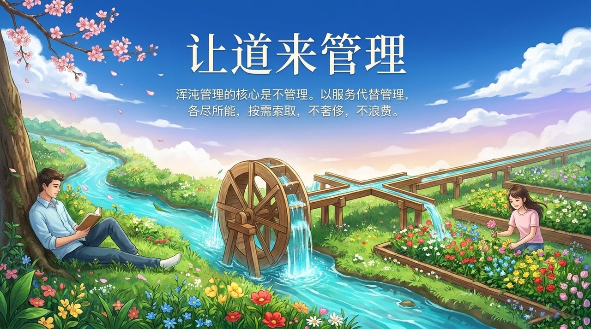
    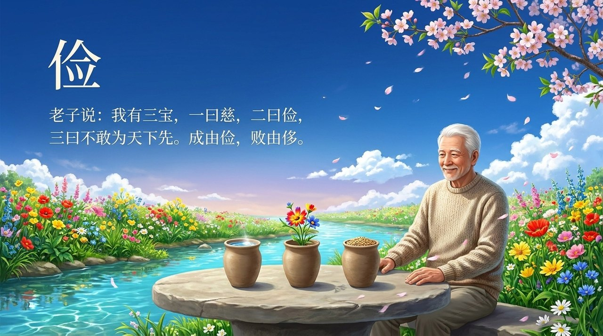
    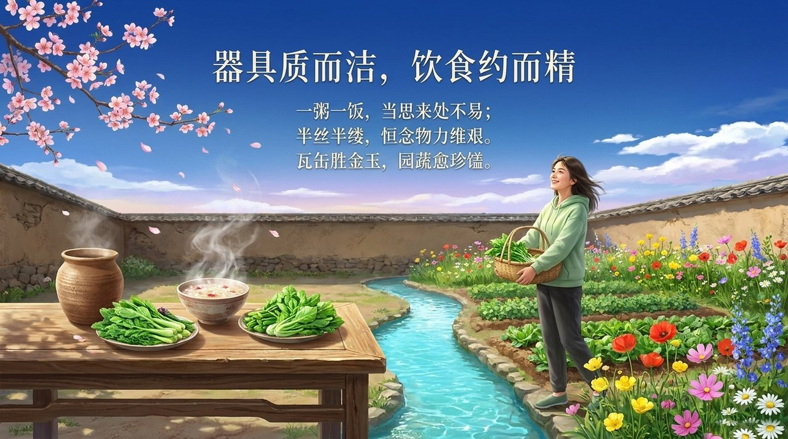
    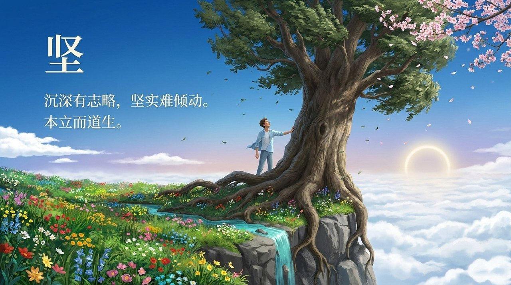
    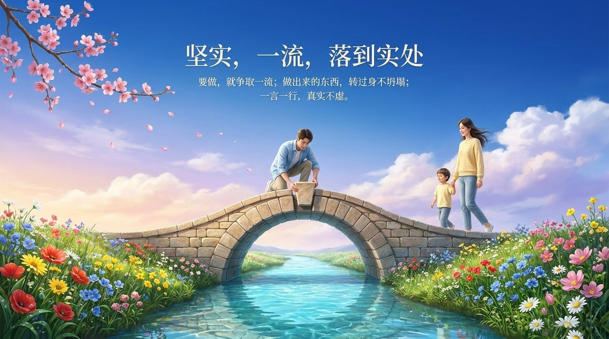
    
    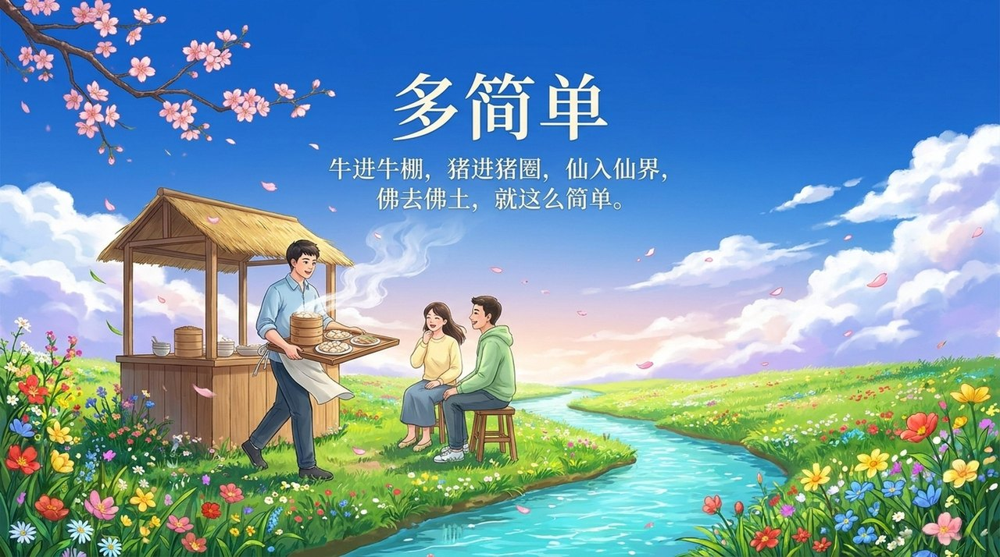
    
    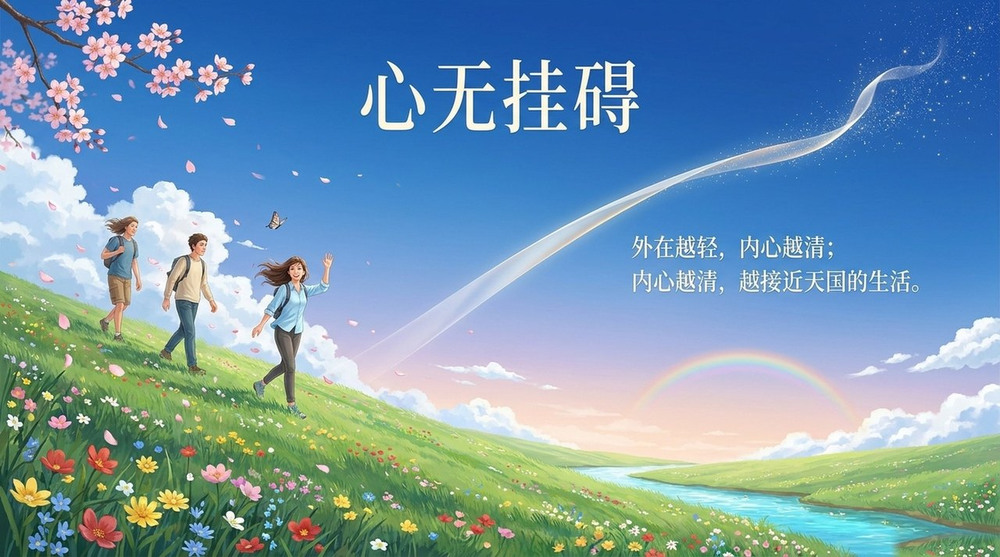

---

## 版本导航

| 版本 | 适合 | 核心角度 |
|------|------|----------|
| [友好版](friendly.md) | 初次了解 | 用生活语言感受简俭坚的日常智慧 |
| [学术版](academic.md) | 研究者 | 系统分析三字纲领的哲学内涵与制度设计 |
| [内部版](internal.md) | 深度研修 | 导游文集完整呈现，逐段标注出处 |

---

## 相关词条

[生命绿洲](/zh/life-oasis/) · [第二家园](/zh/second-home/) · [浑沌管理](/zh/hundun-management/) · [各尽所能·按需索取](/zh/contribute-by-ability-take-by-need/) · [随性而动](/zh/suixing-er-dong/) · [一无所有·拥有一切](/zh/own-nothing-have-everything/) · [心无所住·心无挂碍](/zh/xinwu-suozhu-guaai/) · [生命禅院](/zh/lifechanyuan/) · [禅院草](/zh/chanyuan-celestials/) · [生活修炼](/zh/elementary-cultivation/)
