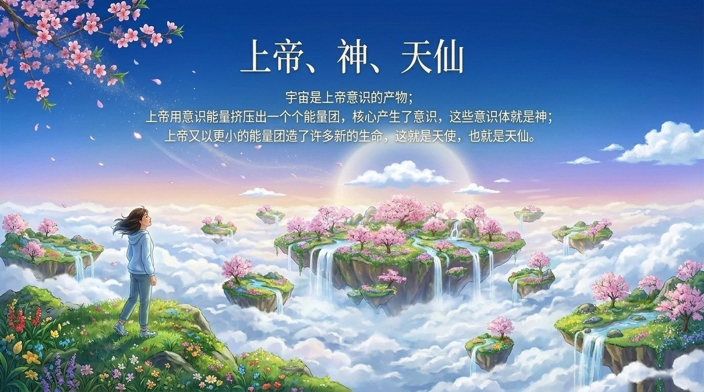
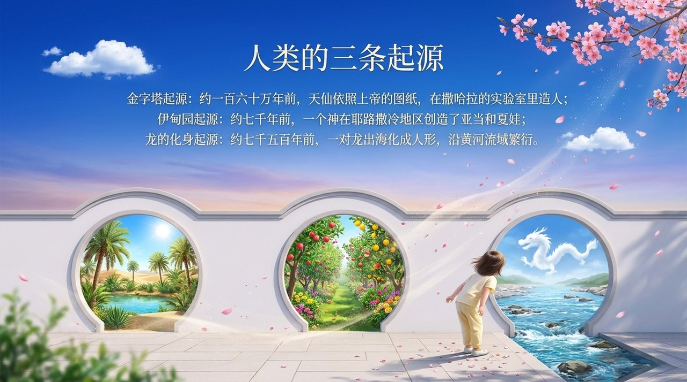
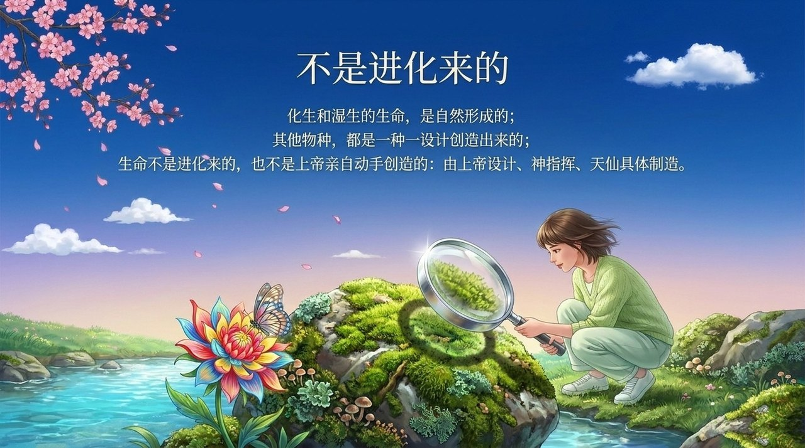
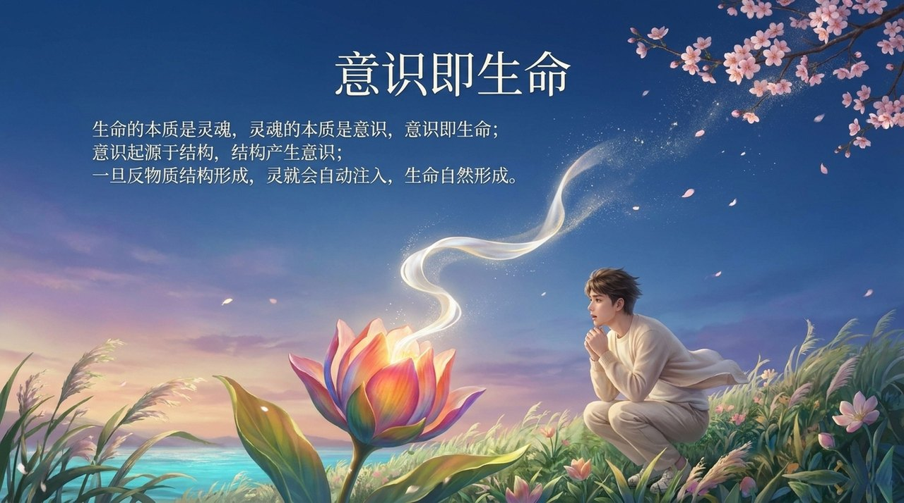

# 生命起源

**生命起源**，是生命禅院宇宙生命理论中的根基词条，回答"生命从何而来、如何形成、为何具有层次差异"这三个核心问题；在该体系中，生命起源的关键不在物质堆叠，而在"结构形成＋灵性注入＋意识激活"的完整链条，创造链条为：上帝→神→天仙（天使）→地球生命系统。

> 生命是有灵性的一种反物质结构。

## 视频版

<iframe style="width:100%;aspect-ratio:4/3;border:0" src="https://www.youtube-nocookie.com/embed/ruhhkYYgIhw" title="生命起源（生命禅院百科·视频版）" allowfullscreen></iframe>

??? info "📖 图文幻灯（14 张，点击展开）"

    
    
    
    
    
    
    
    
    
    
    
    
    
    

---

## 版本导航

| 版本 | 适合 |
|------|------|
| [友好版](friendly/) | 首次接触，内容丰满、可读性强 |
| [学术版](academic/) | 理论研究与引用 |
| [内部版](internal/) | 体系内核心学习，以文集原文为准 |

## 相关词条

[宇宙起源](/zh/universe-origin/) · [道](/zh/dao/) · [上帝](/zh/greatest-creator/) · [上帝之道](/zh/way-of-the-greatest-creator/) · [反物质结构](/zh/antimatter-structure/) · [三十六维空间](/zh/thirty-six-dimensional-space/)
