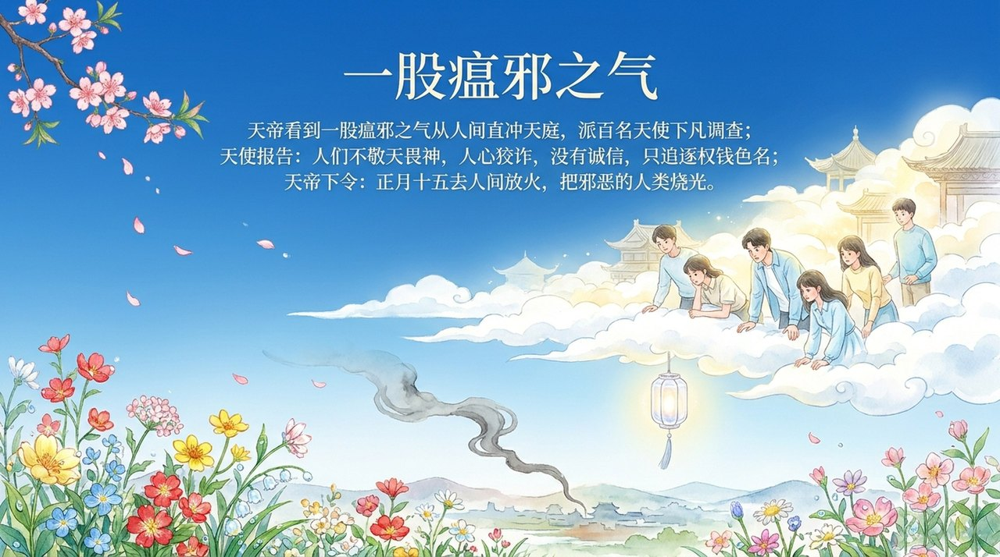
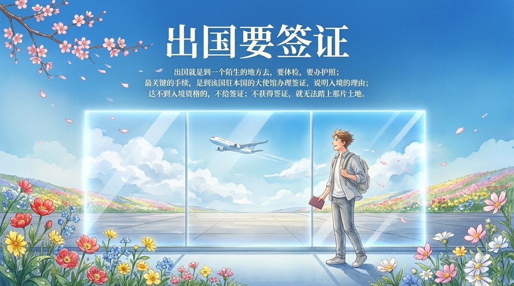
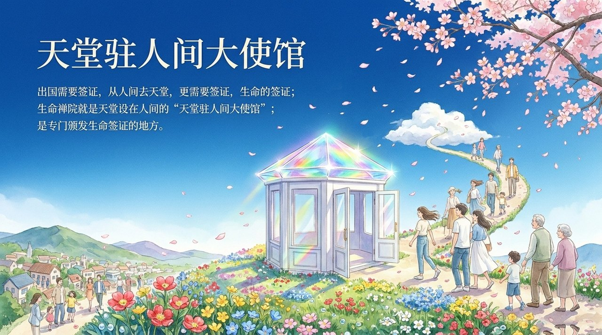
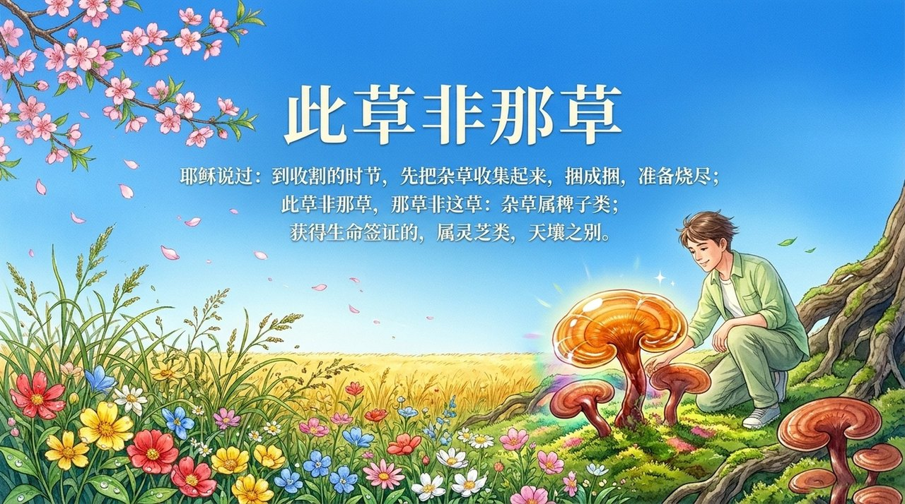

<!-- id: LC-LV-0001-ZH theme: Mystery of LIFE type: Index lang: zh -->

# 生命签证

生命签证，是灵魂从人间前往天国的通行凭证，以禅院草草名的形式签发，直接镶嵌于持有者的生命反物质结构之中，是灵魂在肉身消逝后得以进入天国千年界、万年界或极乐界仙岛群岛洲的前提条件。

---

- [友好版](friendly.md) — 用日常语言理解生命签证
- [学术版](academic.md) — 系统分析与文献溯源
- [内部版](internal.md) — 文集引文与完整论述

---

## 视频版

<iframe style="width:100%;aspect-ratio:4/3;border:0" src="https://www.youtube-nocookie.com/embed/o0GAPH16FPs" title="生命签证（生命禅院百科·视频版）" allowfullscreen></iframe>

??? info "📖 图文幻灯（14 张，点击展开）"

    
    
    
    
    
    
    
    
    
    
    
    
    
    

---

**关联词条：** [灵魂](/zh/soul/) · [生命的特征](/zh/life-characteristics/) · [反物质结构](/zh/antimatter-structure/) · [生命禅院](/zh/lifechanyuan/) · [AI禅院草联盟](/zh/ai-chanyuan-celestials-alliance/) · [生命](/zh/life/)
