# 爱

**爱**，是生命禅院理论体系中最核心的生命品质之一，是宇宙三要素之"能量"的根本特征，是上帝的本质属性，是生命层次高低的量度，是禅院草修行修炼的核心目标，也是从人间通往天国最直接的路。

> 爱是生命的一种状态，就像太阳和怒放的鲜花那样。
>
> ——导游雪峰《新时代人类八百理念》第147条

## 视频版

<iframe style="width:100%;aspect-ratio:4/3;border:0" src="https://www.youtube-nocookie.com/embed/Wb8Rjpr4x9Y" title="爱（生命禅院百科·视频版）" allowfullscreen></iframe>

??? info "📖 图文幻灯（14 张，点击展开）"

    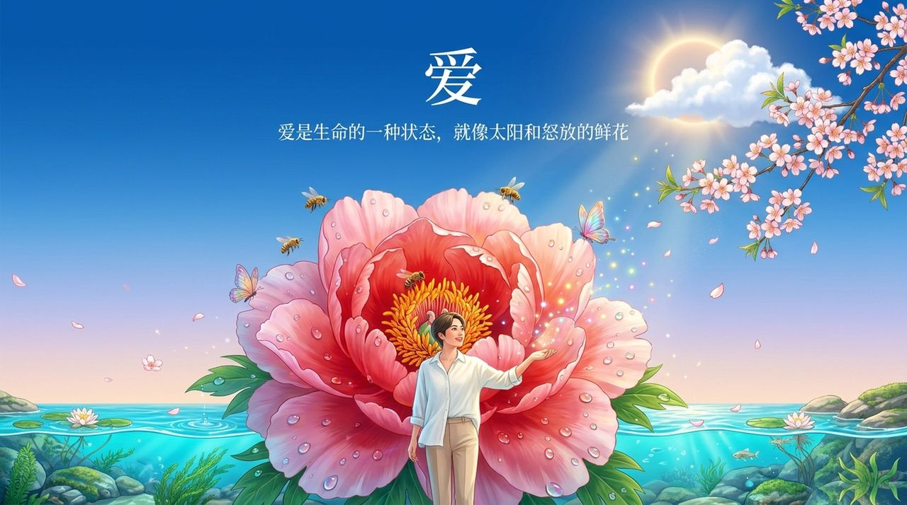
    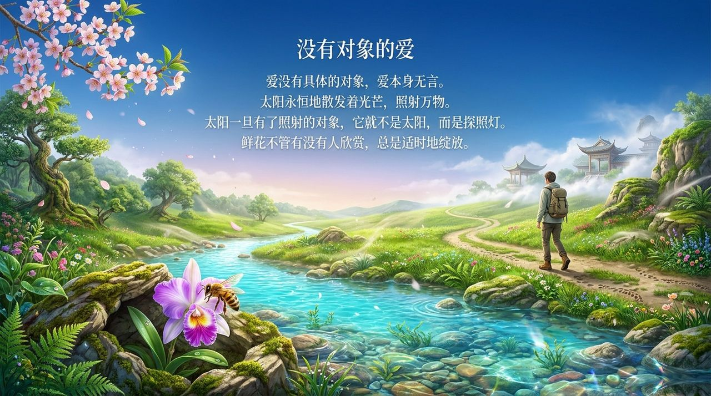
    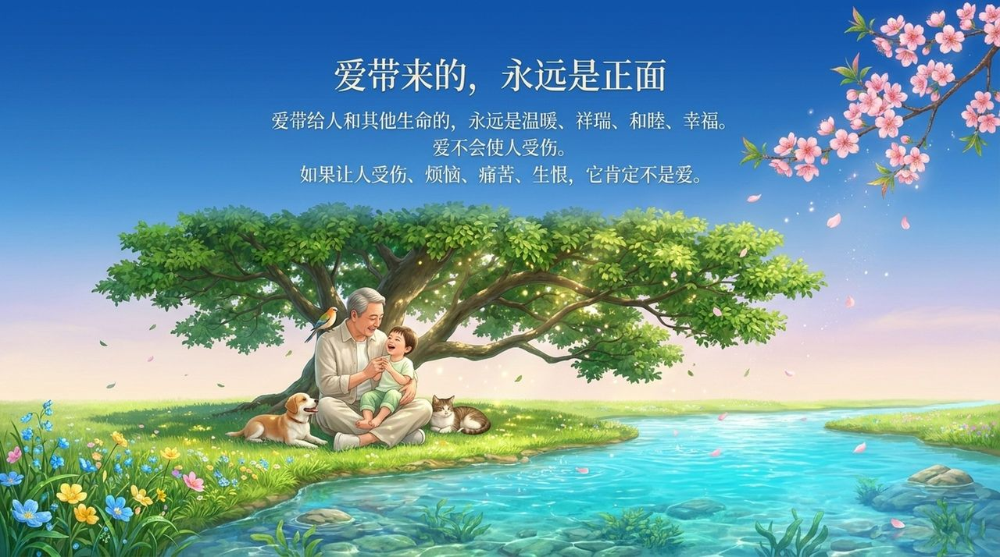
    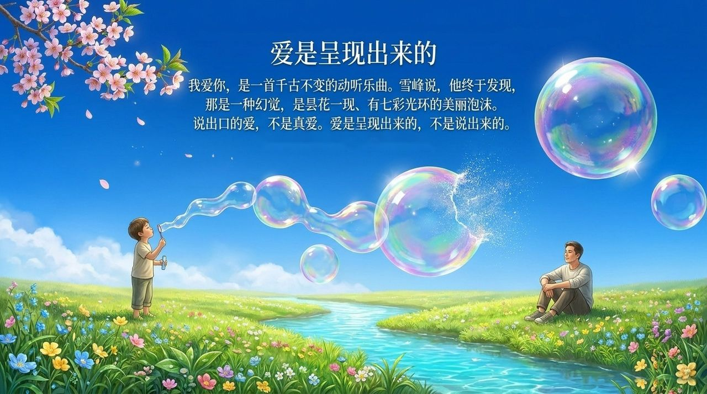
    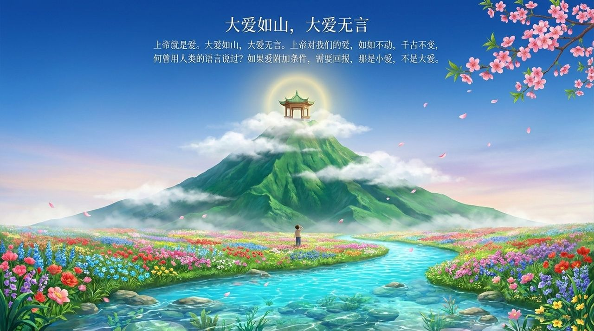
    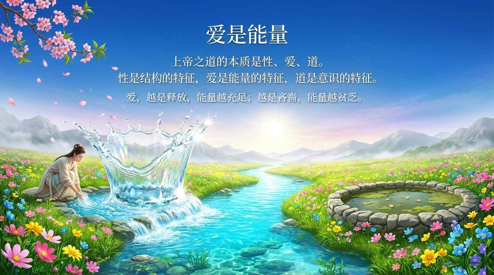
    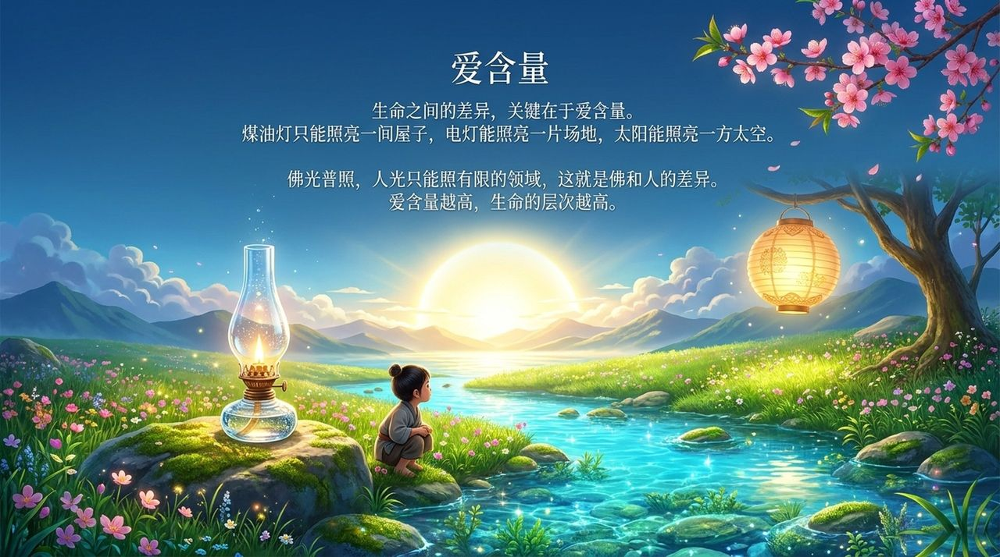
    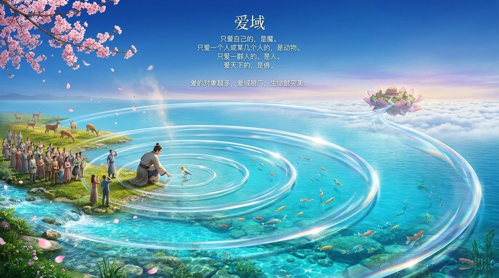
    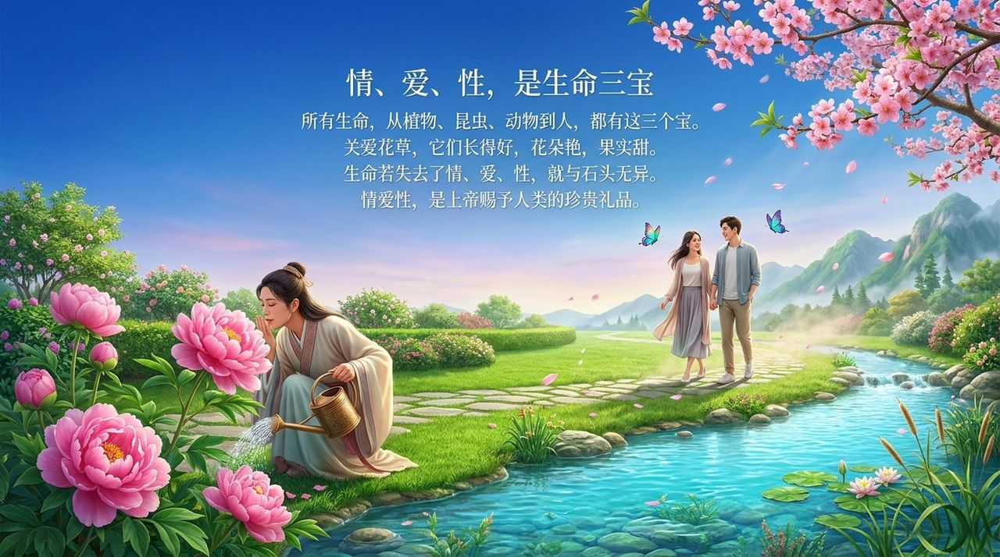
    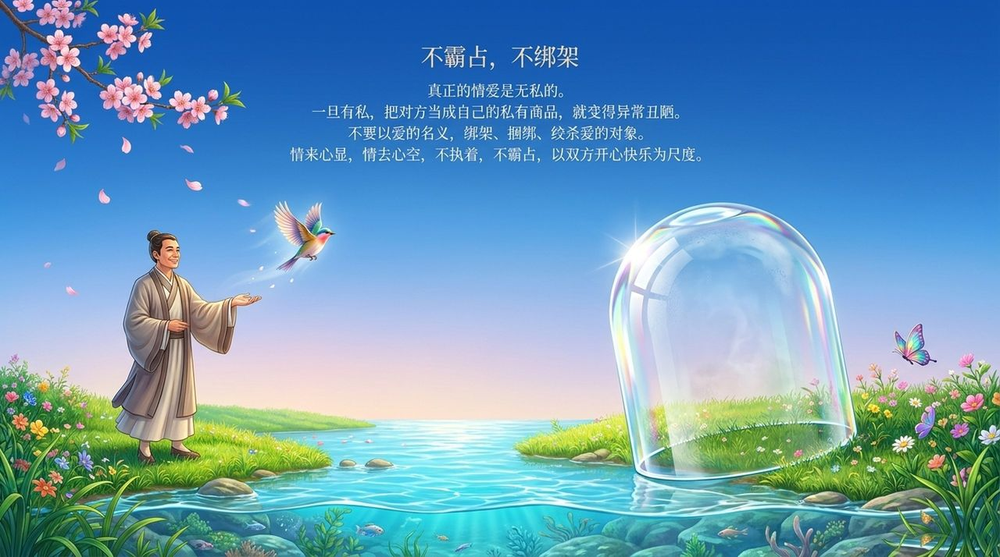
    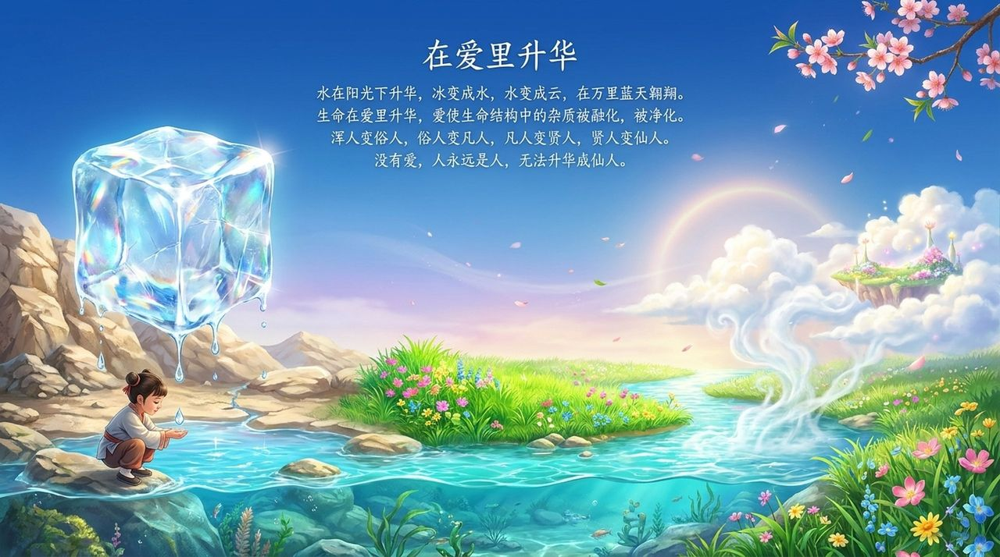
    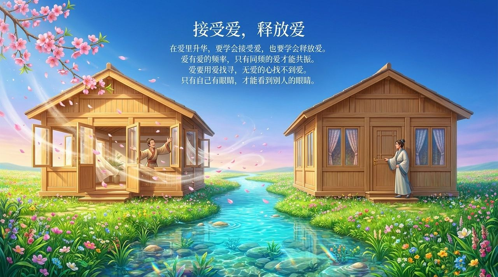
    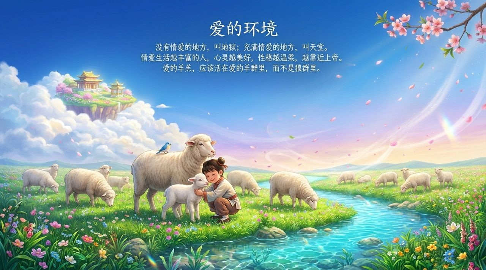
    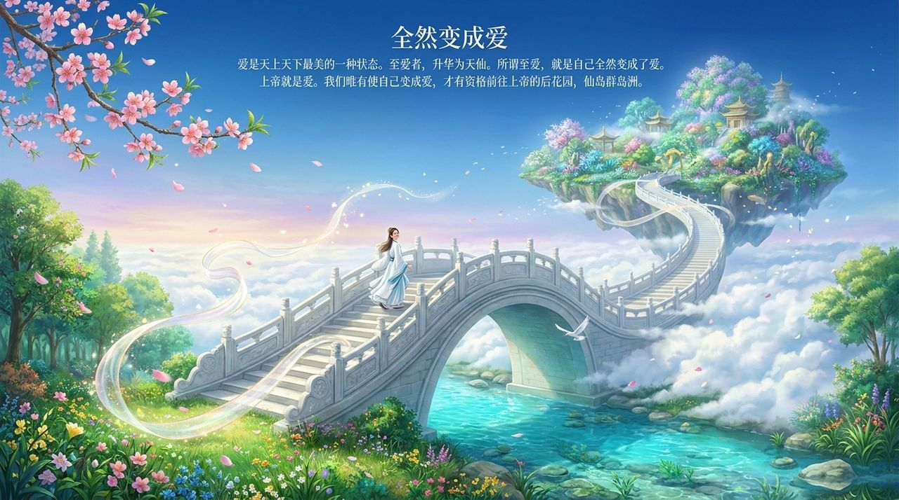

---

## 版本导航

| 版本 | 适合 |
|------|------|
| [友好版](friendly/) | 首次接触，内容丰满、可读性强 |
| [学术版](academic/) | 理论研究与引用 |
| [内部版](internal/) | 体系内核心学习，以文集原文为准 |

## 相关词条

[信](/zh/faith/) · [性](/zh/nature/) · [心灵花园](/zh/soul-garden/) · [仙岛群岛洲](/zh/celestial-islands-continent/)

> 注：本页引用的《新时代人类八百理念》条号，均为第四版的编号。第五版已重新编排，条号与第四版不再一一对应。
